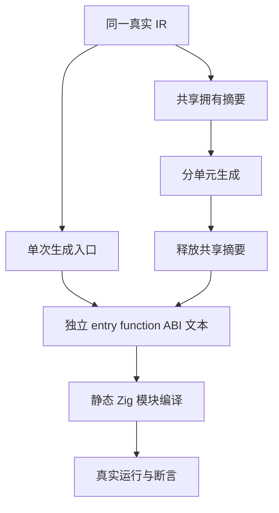

# 共享摘要拆分产物实际执行计划

## Intent：最终目标

采用 IDEA 框架，将函数分析摘要门禁从文本一致性推进到拆分产物的实际编译与运行。验证共享摘要生成的 entry、function、types 文件能够静态连接，执行真实计算，并保留借用嵌套列表的值、身份及输入。

## Data：可用证据

上一部分已有 16 项内部测试通过两模式，证明摘要拥有与生成文本一致性，但未编译运行那些文本。当前 `modules.prepared` 与 `modules.analyzed` 分别提供单次与共享摘要生成入口；Names 将函数文件与统一 ABI 连接。现有 loop-columns 构建展示生成工具、ABI、程序模块和真实 Zig 测试的静态接线。

## Edges：边界与限制

- 仅改测试与构建接线，不修改生产编译器或引入运行库。
- 使用同一真实 IR，分别通过单次与共享摘要生成文件；共享摘要先释放，再保存独立拥有的生成文本。
- 标量夹具包含 1/3/17 层有序加一函数链，输入覆盖零、普通数值与恰好到达 u64 上界；溢出陷阱已有独立进程门禁，不混入本批进程内检查。
- 嵌套列表夹具复用真实非空 Lane 的 Program，检查普通入口返回值、借用身份、后续调用与零分配路径。分配检查同时要求已分配字节为零且没有诱发失败，避免失败后兜底掩盖分配尝试。
- 使用固定当前源码及精确测试覆盖，执行 Debug 与 ReleaseSafe；文本、ABI 和二进制均保留实际身份。
- 源测试定义、配置、生成路线和构建模式分别计数，不把重复运行增算为独立用例。不以本批证明完整前端、所有编译器调用点或性能收益。

## Answer：交付格式与成功标准

新增独立 runtime 目标并接入既有函数分析门禁。标量与嵌套列表的测试按用途分文件；构建静态连接入口、ABI 与有序函数依赖，无动态加载或专用运行层。

两种生成路线与两模式均实际编译执行新增检查，同时回归既有摘要门禁。记录真实命名结果、生成文件、模块依赖与终态；发现已确认实现缺陷才通知指定实现会话。完整部分以英文 Conventional Commit 提交推送。

## 自我批判检查点

生成文本相同可能共享相同错误，实际执行应使用独立数学预期与输入快照。人工 IR 必须保持明确的类型和有序依赖；不能将夹具或模块接线错误直接报告为生产实现缺陷。
