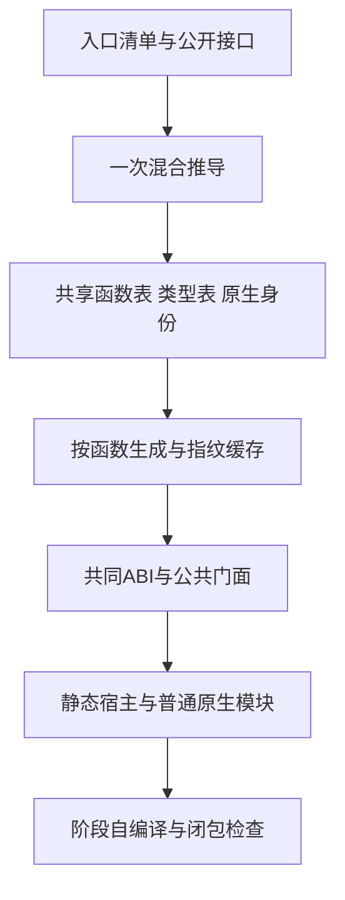
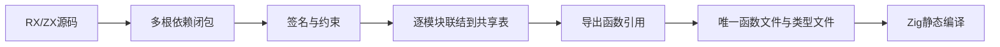
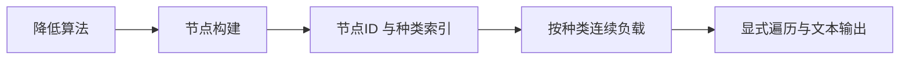

# 剩余架构优化完整执行计划

## Intent：最终目标

初始目标为连续完成架构报告未完成项。2026-10-11 用户明确修正：完成当前验证后停止，剩余自举移交其他会话；若发现有证据支持的其他优化点，允许继续处理。保持统一模块、真实 RX 编排、ZX 原子职责、zero runtime 与 zero copy。

## Data：可用证据

- 第 3 项已由基线实现；第 4 项清单接线本会话已完成，构建通过且 66 个主生成文件不变。
- 混合编译 State 已共享函数和类型表；project 当前仅返回一个入口的前缀视图。
- 统一库生成支持公共模块、函数文件、共同 ABI 与指纹缓存。
- RX 已支持非穷尽 Switch 中提前 Return。报告第 7 项“不能提前返回”错误；布尔验证链可用现有能力平铺。
- genz 手写递归 AST 不能直接平移到 ZX：当前禁止递归类型别名；需改为索引表或实现通用递归类型。不能靠宿主桥包装宣称自举完成。

## Edges：边界与限制

- 不覆盖会话开始时已暂存的其他改动，不自行创建分支或推送。
- 不新增测试用例，不调用浏览器；使用现有回归和真实构建验证。
- 不能将编译成功视为语义、性能或自举完成证据；所有剩余职责按实际实现记录。
- 对 optional 细化、输出借用生命周期、变体缓冲所有权逐项核查，不做未经证明的机械改写。

## Answer：实施顺序与验收

1. 多根推导返回共同函数表及导出；自举采用共同 ABI、按函数生成，复用生成缓存。
2. 核验 value/buffered 语义并消除重复函数体。
3. 将布尔 RX 校验链改为顺序短路，记录 optional continuation facts 的能力边界。
4. 分离种子冷启动和日常 stage0 构建，执行阶段产物及依赖检查。
5. 输出所有权直写与宿主边界收敛。
6. 以真实职责逐步迁移项目编排、genz 和宿主桥，补齐必要通用语言能力；未完成不得宣称自举完成。

## 索引 AST 迁移决策

- Intent：消除 genz 自有状态对递归指针类型的依赖，为真实 RX/ZX 迁移建立可表达的数据模型。
- Data：包外调用者使用输出字符串 API；没有活跃包直接依赖 Builder 或 node 指针模型。Lower 的 helper 拷贝需要共享一个显式 AST 存储。
- Edges：不新增递归类型语言特性；用户要求按性能和内存选择。先保持生成文本逐字节一致，再按同一输入测量；节点按种类保存有效负载，避免宽稀疏列。
- Answer：节点 ID、紧凑索引及按种类负载；Builder/Printer 使用同一存储，后续 ZX 模型及算法直接消费索引。当前 Zig 存储重构本身不算完整自举。
- 工具：已核查 grit apply 的可用语言，当前版本不支持 Zig；批量签名替换采用限定目录的确定性脚本，逐处核对实际解引用。

