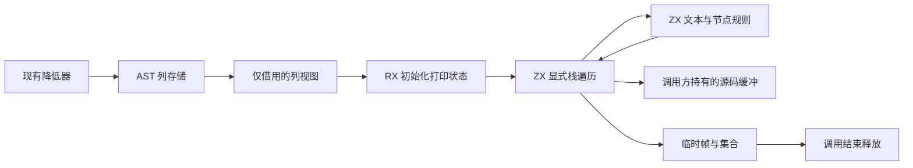

# 剩余架构优化完整执行记录

## Intent：最终目标

按用户第二条请求持续处理报告剩余项目。完整目标与用户原文统一保存在 `docs/user_request.md` 的 S24 补充。

## Data：当前实现与发现

### 多根推导、共享生成及缓存

- project.Options 增加公开模块集合；共享编译完成后从 finished 表取得导出函数引用，保留一份函数表、类型表和原生身份。
- 生成器只收集一次各入口的依赖并集并调用一次 infer；接入统一库后端，生成共同 types.zig、唯一函数文件和公共入口。
- 生成器使用现有 GenerationCache，以工具二进制摘要隔离缓存版本，按函数指纹复用代码。
- 旧宿主导入名通过静态导出别名衔接到共同生成模块，没有新的调用调度或运行库。
- 统一库后端复用一次函数分析结果，公共入口只取共享表中对应函数的视图，避免为每个门面重新分析全部函数。
- 最新冷启动构建 36/36 步骤通过。41 个主入口共用生成模块；1113 个函数文件、1197 个输出文件合计 60,127,419 字节。公共门面仅 275,906 字节。
- zxc Debug 编译由原基线约 31 秒、3 GB MaxRSS 降到约 20 秒、2 GB MaxRSS。总源码字节并未减半：内容寻址长类型名和不同调用变体仍占空间，不沿用报告的线性体积预测。

### 本轮发现的真实问题

- 分离函数生成暴露迭代列缓冲声明先于局部 state_type 声明的问题；将列缓冲声明放到类型收集之后、实际使用之前。
- 共同 ABI 会改变某些类型的内部值表示选择；refinement 的 mark/restore 原来假定输入和值字段始终按值传递。现在按真实函数签名在编译期选择指针或值，局部视图只存活到同步调用结束。
- 门面必须透传已有 executeBuffered 和 buffer_lanes；是否存在由生成器分析结果提供，不能靠文本匹配猜测。

### 函数变体

- 对已有 buffered 能力的 value 变体生成 inline 薄包装，传入全部 null 的缓冲通道。
- null 通道由现有 append/list update 的 enabled 分支走原分配逻辑；不把缓冲参数当作可用存储。
- regular / buffered_pointer 保留各自语义。现有 iterate-buffer、nested-buffer、product-transfer、reverse-ownership 共 252/252 步骤、265/265 用例通过，覆盖缓冲所有权与分配失败。
- 公开入口精简限定于新增的文件生成模式；既有 library API 保留原输出行为，避免改变已有 bundle-cache 约定。该兼容修正后 120/120 步骤、247/247 用例通过。

### RX 短路

- 报告“RX 不能提前返回”不符合当前源码。Case 中 Return 合法，非穷尽 Switch 后允许继续步骤，最终仍检查完整返回路径。
- compiled/validate、compiled/execute、canonical/validation/validate、canonical/body/structure 的 Bool 验证链已平铺，保持失败返回值和顺序。
- optional 的后续路径细化没有全局传递，未机械改写依赖解包的嵌套分支。

### 真实增量测量

- 使用同一正式生成器、同一缓存，把源码复制到临时目录，仅将 naming/check.zx 一个数值常量从 48 改为 49，生产源码不变。
- 初次生成：1155 generated、0 reused；infer 23577 ms、emit 16223 ms、write 64 ms。
- 常量变更：4 generated、1151 reused；infer 22483 ms、emit 12551 ms、write 102 ms。1197 个文件逐字节比较仅 4 个函数文件不同。
- 这证明按函数生成缓存生效，但共同推导与后端分析仍执行；不能把缓存命中率等同于整个增量构建近乎零成本。

### 阶段一致性与索引 AST

- 包含完整 parser/lexer 协议的阶段构建各 11/11 步骤通过。主生成目录 1197 个文件、60,127,419 字节一致；校验目录 193 个文件、5,068,904 字节一致；lexer 233,150 字节及标准 ABI 38,490 字节分别一致。
- 用户要求 AST 迁移路线按性能和内存选择。采用显式共享存储、表达式 ID、按种类连续有效负载，避免最大 union 大小决定每个节点占用。
- 表达式索引替换后，现有 function-analysis-runtime、module-generation、native-value-boundary 共 79/79 步骤、96/96 用例通过。未新增测试。
- `test-function-analysis` 总入口的 summary fixture 仍调用旧的两个参数 analyze，而当前接口为三个参数；该差异在本轮索引改动前已存在。保留其他会话相关文件，改跑独立 runtime 步骤，不把该失败混同为索引回归。
- 继续将嵌套语句块改为同一存储中的范围索引，以消除 Statement 自身的递归类型。表达式索引替换通过不等于整个 AST 或 genz 自举已经完成。

## Edges：仍未完成的范围

- 所有新改动仍在构建与回归阶段，未提交，不宣称本轮已交付。
- 已增加显式 `-Dstage0=<生成器路径>`，parser、lexer、CLI 缓存身份均沿用同一选择；`bootstrap-stage` 以正式模块构建下一阶段生成器。最新阶段构建 11/11 步骤通过，没有 seed parser/lexer 编译步骤。
- 早期 stage2/3 的 1164 个文件、72,148,488 字节完全一致；该证据早于最终门面和 lexer 协议，需要以最终实现重新验证，不能混称最终结果。
- 输出 allocator 生命周期改造仍待实现；旧 seed 源文件尚未删除，完整自举尚未达成。
- genz 与主流程真正迁入 RX/ZX 仍待实现。递归指针 AST、HashMap 状态和所有传递依赖不能靠桥包装完成自举。
- 本会话开始已有的暂存测试与文档不覆盖。

## Answer：验收进度

- 共享生成早期版本的 function-analysis-runtime、library-link、function-effects、type-merge 共 120/120 步骤、247/247 用例通过。最新门面兼容修正后同组 247/247 用例再次通过。
- compiler 包 366/372 用例通过；6 个失败已在独立 HEAD 基线重现，分别为 map/reduce 参数约束及 callback capture，未归因于本次改动。
- 当前尚无全部完成结论，继续记录最终阶段产物、真实单文件增量命中及剩余职责迁移。

## 自我批判

统一生成不是拼接旧产物。必须同时保留统一类型身份、函数调用关系、原生依赖和宿主生命周期。首轮编译失败证明原有分片生成与宿主存在隐含假设，不能仅用生成文件数量下降作为成功证据。

## AST 内存测量与列式接口推进

- Intent：以相同真实自举入口核对指针模型与索引模型，不把结构变化直接当作性能结论。
- Data：两份隔离源码分别在每个 entry/types/function 降低 arena 释放前记录 queryCapacity；两者均生成 41 个公共入口、1 个类型单元、1113 个函数单元。指针模型累计容量 3,134,829,306 字节、单单元最大 75,206,290 字节；索引模型累计容量 3,288,107,432 字节、单单元最大 40,712,282 字节。
- Edges：累计值是各次 arena 容量之和，不是进程峰值 RSS；最大值是单次降低 arena 容量，不能外推为整个编译进程节省。索引模型累计增加约 4.9%，最大单次容量下降约 45.9%。同时运行其他会话构建，不能用墙钟时间作为受控速度比较。
- Answer：先前按种类保存 struct 负载仍不能直接借给 ZX 的列接口。当前进一步将负载字段按列保存，并把 Field、SelectionArm、Declaration 列表改为区间；浮点 AST 保留原始 u64 位模式。此步骤仍属迁移准备，尚未宣称完整生成器自举。后续验证生成字节一致、现有回归与最终列模型内存数据。

## 输出分配区域分析边界

- Intent：消除 analyzer 发布五张结果表时的整表深拷贝，临时 arena 仍按调用释放。
- Data：当前生成函数只有一个 allocator；state_value/conversion 会复用 zx_origin，value_call 的临时借用模式还可能取得栈聚合地址。stores/resolve 存在返回输入字符串的真实路径。
- Edges：仅增加 output allocator 或删除 own 不安全；保留整个临时 arena、在 execute 末尾移动同一份深拷贝，也不满足目标。需要按返回字段路径追踪分配点、输入借用和被调函数来源，确保缓冲扩容/释放使用同一 allocator。
- Answer：该项尚未实现。验收必须覆盖对象壳、列缓冲、嵌套 contracts 与字符串叶子；生命周期不足的输入叶子允许必要复制，持久结果列应从产生时直接分配在输出区域。

## Printer RX/ZX 实施中

- Intent：将 Zig 文本语法、转义与节点遍历迁入 genz 统一模块的 RX/ZX 源码；原生侧只借用列视图和管理分配边界。
- Data：新模块包含完整表达式、语句、声明与成员打印规则。真实生成器已完成其推导与 Zig 生成。第一次模型把字节切片放进工作栈项，现有别名检查会拒绝非 detached 元素读取；已改为标量动作、文本符号与 AST 字节来源索引。文本符号直接返回字节常量，标识符先检查 ASCII，再按首字节筛选 Zig 关键词，避免 UTF-8 原生调用阻断纯度分析。
- Edges：ZX 普通函数保持纯返回；循环回调的上下文显式放进循环状态，不使用词法捕获。帧展开只返回指令集合，不接收输出缓冲。模型源码已通过现有 fmt。该模块尚在完整路径接入验证，不能将“生成成功”写成“完整自举完成”。
- Answer：实测静态摘要中，walk 的输出通道有 4 个追加点、3 个调用点，工作栈有 1 个追加点；quoted 有 6 个追加点，integer 有 1 个追加点与 2 个原地更新点，均无 rejection。render 公开入口已得到来自 input.output 的可复用输出通道。原生适配器通过该元数据选择输出槽，不猜测槽编号；AST 列借用在编译期核对布局、枚举顺序与列数。

## 缓冲槽的分配器归属

- Intent：允许通用 buffered ABI 的某个槽在调用方分配器上扩容，同时其他临时分配继续使用函数 allocator。
- Data：原槽只有 buffer/started，追加与更新固定使用函数 allocator，不能安全把生成 Printer 的输出从临时 arena 中分离。
- Edges：新增可选 allocator 字段，默认仍使用函数 allocator，保持已有调用兼容。槽转发必须连同 allocator 转发；追加、扩容及列表更新统一使用槽的分配器。调用方保有槽的释放责任，不能由临时 arena 释放。
- Answer：先用于 Printer 的 u8 输出通道，继续执行编译、实际源码一致性与既有缓冲回归。该能力不等同于 analyzer 五表结果的完整区域分析，第 9 项仍需按结果路径继续完成。

## 验证收尾与交接边界

- Intent：按用户最新修正，验证当前改动后收尾；剩余自举交给其他会话。只有证据明确的其他优化才继续，不把架构猜测扩成新任务。
- Data：Printer 已在隔离构建中由 RX/ZX 生成，宿主仅提供列视图和独立输出缓冲。小入口 naming 的全部文件与原实现逐字节一致；全量 41 入口生成的 1197 个文件、60,389,690 字节与同一缓冲 ABI 版本的原生 Printer 逐字节一致，无缺失、增加或变化。Zig 关键词集合与当前工具链也已核对一致。
- Edges：正式 `genz/src/render.zig` 仍调用原生 Printer。`printer/render.rx` 和 `printer/host.zig` 尚未接入正式构建；隔离验证覆盖真实自举入口，不代表 Node/Gateway/Wasm 等全部新 Printer 宿主路径已经逐项验证；成功也不等于该功能已经发布。不能将旧缓冲 ABI 的产物与新 ABI 直接比较后，把差异误报为 Printer 回归。
- Answer：保留源码和具体接入状态，给后续自举会话完整交接。列式 AST 的字段及分支臂列表已改为整批预留容量；未引入新的分配器层，也未据未受控耗时宣称整体性能提升。

### 剩余自举的接续位置

1. `packages/genz/src/printer/render.rx` 编排初始化与显式栈遍历，`printer/**/*.zx` 承载打印规则；`printer/host.zig` 是当前过渡适配器。接入点为 `genz/src/render.zig`、`compiler/build/entries.zig` 与 `compiler/build/parser.zig` 的来源根及模块接线。固定 stage0 已支持外部入口清单，无需为了新增入口重写旧二进制。
2. `genz/src/node/{columns,rows,stored,storage,view}.zig` 仍是手写状态/适配层，Lower、项目推导与模块编排也仍待迁移。不得把 Printer 迁移当作整个 genz 或整个编译器自举完成。
3. analyzer 的 symbols、expressions、control、stores、contracts 输出深拷贝仍保留。当前 buffered ABI 的 allocator 字段只解决显式列缓冲的分配归属；它没有完成所有结果路径、借用叶子和对象壳的生命周期分析。
4. 冷启动 seed 仍存在。stage0 日常路径已避免执行 seed 编译步骤，但最终传递依赖闭包与完整 RX/ZX 自编译仍须由后续自举工作验收。

### 自我批判

本次从共享生成扩展到 AST 表示和 Printer，改动范围已明显扩大。索引方案的单单元 arena 峰值改善不能直接代表列式方案或整体进程内存改善；列式存储还可能保留构造切片与归一化列的双份数据。下一会话应先固定输入串行分离 Lower 与 Printer 的分配/耗时，再决定是否让列缓冲使用可回收分配器；不要先增加分配器抽象再寻找收益。当前不再扩展该改造。

## 最终验证

- 正式构建（仓库根）：`zig build -Doptimize=ReleaseSafe -Dstage0=/tmp/zxc-bootstrap-buffer-allocator/bin/zxc-bootstrap -j2 --summary all`，**23/23 步骤通过**。该次日志无 seed 生成器编译步骤；ReleaseSafe 编译耗时不可与历史 Debug 编译耗时直接比较。
- 现有回归命令（`packages/test`）：`zig build test-function-analysis-runtime test-module-generation test-native-value-boundary test-iterate-buffer test-nested-buffer test-product-transfer test-reverse-ownership -j3 --summary all`。结果 **312/312 步骤、361/361 用例通过**，没有新增测试用例。
- Printer 隔离构建成功；同版本的原生 Printer 与 RX/ZX Printer 全量输出 **1197 文件、60,389,690 字节完全一致**。对照使用相同的 buffered allocator ABI，排除了旧版本 ABI 变化的干扰。
- 源码 `zig fmt --check`、本次 diff 空白检查通过；`docs/user_request.md` 中其他会话原话的既有尾随空格保留，没有为了格式检查修改用户原话。
- 先前扩展宿主回归的库发布失败由缺失 solver 路径触发；指定已有 Z3 后，库发布步骤 **51/51 通过**。此前 compiler 包的 6 个失败已在 HEAD 基线复现，不能宣称全仓所有历史测试均通过。
- 完整日志与 Printer 输入清单保存在本目录的本地 `.log` / `.json` 文件中，均由 `.gitignore` 排除，不提交。临时隔离工具为 `/tmp/zxc-printer-diagnostics/zig-out/bin/diagnose`；这些临时路径只是验证证据，不是正式构建依赖。
