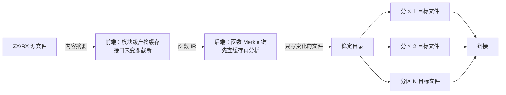

# 增量编译流水线设计

## Intent：最终目标

建立 ZX/RX → IR → Zig → LLVM 目标文件的全链路增量编译，zxc 自举与用户应用都能受益：

- 只改一个函数体时，ZX/RX→Zig 只做与改动成比例的工作，目标为毫秒级。
- Zig→LLVM 只重编受影响的部分，并且可以并行。
- Release 产物保持单编译单元，性能不受影响，也不引入运行库。

用户原话见 [user_request.md](../../user_request.md)（2026-10-11 20:05 之后的三条）。

## Data：现状测量

本机 i9-13900KF，32 线程；仓库根执行 `zig build -Doptimize=debug`：

| 改动          | 总耗时 | 关键路径                                              |
| ------------- | -----: | ----------------------------------------------------- |
| 改 1 个 ZX    |  43 秒 | 生成器运行 21 秒 → zxc 编译 20 秒                     |
| 改编译器 Zig  |  61 秒 | 种子生成器编译 18 秒 → 运行 20 秒 → zxc 编译 21 秒    |
| ZX + `stage0` |  32 秒 | ReleaseFast 生成器 11 秒 → zxc 编译 20 秒             |

- **生成器（ReleaseFast，函数缓存全命中）：** infer 1.3 秒，emit 7.7 秒。emit 的缓存键包含全程序分析结果，所以先跑完整个后端分析才能查缓存。
- **zxc 的 Debug 编译：** 约 13 秒花在 LLVM 代码生成和位码重解析上，源头是 82.6 MB 生成代码（1,489 个函数文件）。
- **单次 Zig 调用：** 固定开销约 1.2 秒。Zig 0.17 的增量编译只支持自带后端，而自带后端在本机 macOS 链接失败（见 [宿主后端构建试验](../完整自举接续/宿主后端构建试验.md)），因此 Zig→LLVM 达不到毫秒级。
- **命名稳定性：** 函数文件名只由源路径决定，改函数体时不变；类型名由内容决定，并集中在一个 `types.zig` 中。

## Edges：边界与约束

- 遵守零运行时：分区之间只是普通静态链接的目标文件。跨区调用由编译期生成的转发函数完成，不加动态调度或解释层。
- Release（`fast`/`safe`/`small`）默认仍为单编译单元，保留跨函数内联。分区只在 Debug 默认开启，也可以显式选择。
- 后端缓存键的重设计与 genz 后端重设计（另一会话）会改到同一处，须在其降级改造落地后一起做，避免两边同时改。
- 不新增测试，不跑全量测试，不触发 CI。

## Answer：分阶段方案

1. **Zig→LLVM 分区（先做，收益最大）**
   - 生成器把函数文件按 `hash(函数名) mod N` 分到 N 个固定分区，每个分区编成一个独立目标文件。
   - 分区内的调用照常通过 `@import` 互相引用。调用其他分区的函数时，导入的是同名桩文件：桩文件只保留函数签名，再用 `bridge.import` 转发到对方导出的 C ABI 符号。参数元组和返回值都按指针传递，错误按错误集中的序号传递。
   - 每个分区只导出被其他分区或外层门面实际引用的函数变体。
   - 原型已验证三点：桩文件只反射签名，不编译函数体；目标文件里同一个函数只有一份实现；返回值和错误都能正确跨单元传递。
2. **稳定输出路径**
   - Zig 的缓存键包含源文件路径。生成器改为写入固定的持久目录，内容不变的文件不重写，Run 步骤只输出一个戳文件。
   - 这样未变的分区直接命中 Zig 缓存。
3. **宿主也变成目标文件**
   - 手写编译器与门面单独编成一个目标文件，最终的可执行文件只剩极小的入口加链接。
   - 这样改动任何一个分区，都不会再触发手写代码重编。
4. **后端函数缓存**
   - 键由函数 IR、类型形状和被调函数的摘要键共同组成，自底向上计算。调用方提出的需求（wanted）单独作为输入并入键。
   - 缓存命中时跳过分析。这一步在 genz 唯一性降级改造完成后和它一起做。
5. **前端模块缓存**
   - 复用 `semantic_cache` 的 `Artifact.Module`：键为源文件摘要加依赖接口摘要。
   - 重新分析后如果接口摘要不变，下游模块保持干净，这就是提前截断。
6. **用户应用**
   - `zxc build` 的 Debug 模式使用同一套分区与缓存。

成功标准：改一个函数体后重建，前三步完成时进入秒级（单个分区编译加一次链接，约 3 秒），第 4–5 步完成后，生成器部分降到毫秒级。产物与单编译单元的生成结果在语义上一致。

## 实施记录：第 1–3 步

仓库根目录执行 `zig build -Doptimize=debug` 时默认使用 64 个分区；`-Dgenerated-partitions=0` 恢复为单编译单元。`compiler` 和 `cli` 包单独构建时默认为 0，所以 `packages/test` 等使用方的行为保持不变。

| 改动后重建  |  总耗时 | 关键路径                                             |
| ----------- | ------: | ---------------------------------------------------- |
| 改 1 个 ZX  |  约 9.2 秒 | 生成器 5.9 秒 → 1 个分区 1–2 秒 → 链接 0.3 秒      |
| 冷构建      | 65–70 秒 | 生成器 12–15 秒 → 分区并行 → 宿主目标文件 14 秒 → 链接 |
| 无改动      | 0.4 秒 | 只有构建配置与缓存检查                               |

改动前，同样改 1 个 ZX 需要 43 秒。

分区数的取舍：32 个分区时，改动后重编单个分区约 3 秒，链接约 2 秒；64 个分区时分别约 1 秒和 3 秒，总计少约 1.5 秒。生成器输出不变时，64 个分区全部重编约 34 秒（32 线程）。

### 实现时发现的约束

- **内联函数不能跨分区转发。** `pub inline fn`（741 个 `callValue` 等）会复制进每个调用方所在的作用域，并按传递关系一并复制，和单编译单元的展开方式一致。
- **分区目标文件必须保留调试信息。** 去掉调试信息的分区链接后，zxc 运行时会在 `ArenaAllocator.loadFirstNode` 读地址 0x20 时崩溃；同样的分区保留调试信息后，产物与单编译单元一致。
- **错误码在每个编译单元内单独编号。** 所以经函数指针跨单元返回的错误（例如 `std.Io` 的 vtable）会错位。宿主目标文件因此在自己的单元内构建分配器、`Io.Threaded`、环境表和预打开目录，可执行文件入口只传入 `std.process.Init.Minimal`。分区之间的错误则按错误集中的序号传递，不受影响。
- **目标文件会传给模块图中的每一次编译。** Zig 编译某个目标文件时，会把它模块图中挂着的全部链接对象都作为输入，于是任何分区一变，宿主目标文件就要重编。因此分区对象不再挂在 `generated` 上，而是挂在单独的 `generated_objects` 模块上，只由最终产物导入。
- **缓存标识要放在入口单元。** `cache_identity` 覆盖全部编译器源码，每次改 ZX 都会变。它改为由可执行文件入口导出 `zxc_cache_identity` 符号，宿主通过 `@extern` 读取，因此宿主目标文件不随之重编。

### 链接

- **改用平台链接器：** Zig 0.17 自带的 Mach-O 链接器处理 64 个分区加宿主目标文件（约 440 MB）需要约 3 秒。在 macOS 上为本机构建时，最终链接改由 `xcrun clang` 驱动 Apple `ld` 完成，同样的输入只需约 0.3 秒；该工具不可用或在其他平台上时，仍用 Zig 链接。
  - 入口单元编成静态库 `zxc_start`，内含 compiler_rt 与 UBSan 运行时（Debug 下 libyaml 的 C 代码要用），对应 Zig 链接可执行文件时自动加入的运行库。
  - 主线程栈大小保持 16 MiB。
  - 根目录构建通过 cli 的命名路径 `zxc` 安装可执行文件。
- **调试信息：**
  - Zig 链接器把宿主目标文件的调试映射项写成了 `N_SO`，应为 `N_OSO`。
  - libyaml 挂在宿主模块上时，Zig 会把它并进宿主目标文件重新生成，这一步丢掉了全部 DWARF。
  
  两者都会让报错堆栈只显示 `???`。现在 libyaml 只由最终产物链接，宿主目标文件保留调试信息，报错堆栈恢复了源码位置。
- **安装时的 RX 测试：** `zig build` 安装时只检查 RX 测试能否编译，不再生成并链接测试二进制（原先每次改动都要再花 3 秒链接）；`zig build test` 不受影响。
- **代码体积：** 每个分区各自实例化 std 泛型与公共辅助代码，分区构建的 `__TEXT` 为 238 MB，单编译单元为 89 MB。

### 验证

- `packages/cli/tests/runtime/cases` 下全部 29 个用例：分区版 zxc 的输出与日志，和单编译单元 Debug zxc 逐字节一致（`store` 用例在两者中都以相同信息失败）。
- 改 1 个 ZX 后重建，只有 `part_24` 中的一个文件和 `.zxc-inputs` 被改写，只重编了 `zxc_partition_24`，宿主目标文件命中缓存。

### 未满足项

- **生成器仍需约 5.9 秒：** infer 0.66 秒，emit 4.8 秒，写出 0.36 秒。
  - Debug 构建的生成器从 ReleaseSafe 改为 ReleaseFast。它的编译时间不变（17 秒对 18 秒），缓存命中时 emit 从 7.1 秒降到 4.8 秒，生成结果逐字节相同。默认的 safe 构建仍使用带检查的生成器。要降到毫秒级，需要完成第 4–5 步。
  - infer 原为 2.93 秒，其中逐模块的 mixed 编译占 2.55 秒。1,500 个模块每个都要处理整张共享类型表（2,850 个类型）：分析前校验一遍（253 毫秒），连同全部名字字符串深拷贝一遍（307 毫秒），链接时再校验一遍。
  - 共享表只来自项目自己分析并链接的模块，生命周期长于每次分析，所以现在 resolved 模式只复制列、借用字符串。扩展已有表（`first` > 0）时，也只在 internal 构建中重新校验。改后 infer 为 1.65 秒，生成结果逐字节不变。
  - RX 流程里的 1,083 个属性表达式也有同样的问题：每个都要校验一次共享表（181 毫秒），再深拷贝一次（327 毫秒），而真正的分析只占约 20 毫秒。表达式选项新增 `borrow_types`，RX 流程编译时打开，结果直接借用共享表的字符串。之后 infer 降到 1.1 秒，生成结果仍逐字节不变。
  - RX 类型推断的不动点循环原先在每轮重建赋值等价类后只合一一对节点，随即从头再来，共重建 604 次，耗时 367 毫秒。现在一轮内合一全部候选对；若某个代表节点的载荷在本轮已经变化，就留到下一轮用新建的等价类处理。改后约 5 毫秒，infer 降到 0.77 秒。生成结果逐字节不变，40 个 RX 测试源与旧版 zxc 的输出和退出码一致（其中 1 个只是两边都因缺少 z3 失败，堆栈格式不同）。
  - 写出原先需要 1.9 秒，其中 1.6 秒花在把 6,199 个文件逐个读回比较上。现在改为在输出目录记录 `.zxc-files` 内容摘要清单，只比较摘要；陈旧文件也按清单删除，不再遍历目录。
  - 函数缓存全部命中时，emit 的 7.2 秒几乎都花在 genz 唯一性分析上（`sample` 显示 `zx.uniqueness.*` 占绝大多数样本）：它对每个函数都先分析，再查缓存。后续处理见下文“genz 唯一性分析与自托管后端”。
- **生成器自身变化会让函数缓存全部失效：** 缓存键包含生成器二进制的摘要，所以改编译器 Zig 代码后，全部函数都要重新生成。不过生成结果不变的文件不会重写，分区对象仍能命中 Zig 缓存。
- **infer 的并行与缓存：** `appendBody` 要求分析时的函数基表就是当前共享表，所以按依赖分层并行分析时，需要把局部函数号重映射后再链接。这样最多能省约 1.1 秒。若要做到模块级缓存，还需要把 `semantic_cache` 的 `Artifact.Module` 接入 RX/ZX 混合路径；目前该缓存只用于纯 ZX 的项目分析。
- **配置阶段：** `cache_identity` 在构建配置阶段读取全部编译器源码来计算摘要，这部分开销仍在。
- **用户应用（第 6 步）：** 测量后暂缓，小应用分区没有收益。用 `packages/cli/examples/quote.zx` 测（Debug 版 zxc）：
  - 改函数体后，`zxc quote.zx --out` 生成 Zig 只需 22 毫秒，ZX→Zig 已经是毫秒级。
  - `zxc build --optimize Debug` 总计 1.6 秒，几乎都是单次 `zig build-exe` 的固定开销；首次冷构建 12.5 秒，主要是标准库与 compiler_rt。
  - 应用规模大到单个 Zig 编译单元超过数秒时，再把分区方案用到 `cli/src/cli/build.zig` 的 `build-obj` 多进程调用上。

## 实施记录：genz 唯一性分析与自托管后端

genz 会话停止后由本会话接手，提交为 `a49a02757`。新的唯一性分析让改 1 个 ZX 后的重建变为 12.5 秒，其中 emit 9 秒。

### 唯一性分析

计时插桩显示，emit 的 8.1 秒在 `Uniqueness.analyze`：外层 3 轮，每轮从最乐观状态重新 settle（约 5,300–6,250 次函数体分析）再做 demand。生成器根模块为 ReleaseSmall 时默认去掉符号，采样前需临时关闭 strip。改动如下，生成结果均逐字节不变：

- `sites.linear` 只取决于函数体和固定的 callee hold/mutate 类型，原先却在每次分析前清空 memo。现在 memo 跨分析保留，并和逐槽 `levels` 一样改为按根槽位偏移索引的稠密表，不再用 `u64` 哈希表。
- `Slots` 预先算好 unwrap 结果和成员类型；每个函数体的表达式行只读取一次，各遍只遍历调用和列表更新。
- slot 布局与 holds/mutates 合成全程序共享的 `Basis`，只建一次。50 个导出入口的 reentry 从 305 毫秒降到 10 毫秒。

结果：analysis 从 8.1 秒降到 0.9 秒；缓存命中时 emit 从约 9 秒降到 1.24 秒。

**顺序依赖：** 把 settle 的 FIFO 工作队列换成“先取最小序号”或“先取最大序号”后，生成结果都会变化（4 个和 13 个文件不同），所以这个不动点并不与求值顺序无关。可能的原因是：递归函数分析时，`arguments` 会改写它自己正在读取的 input summary。目前保持原 FIFO 顺序；要做并行或增量的唯一性分析，得先消除这种顺序依赖。

### 自托管后端

单个分区经 LLVM 编译需约 1.5 秒，几乎全是固定开销；分区数增至 256 时仍需 1 秒，链接还会变慢。x86_64 Debug 下改用 Zig 自带后端（`use_llvm = false`）后，单个分区只需 0.4 秒，全部 64 个分区约 11 秒。约束如下：

- 调用分区的代码必须出自同一后端。LLVM 编译的宿主调用自托管分区时，会在 `ArenaAllocator.alloc` 处因对齐错误崩溃，因为 Zig 自有类型的布局只在同一后端内一致。宿主目标文件因此也改用自托管后端。
- 入口静态库 `zxc_start` 保持 LLVM：它只导出 C 符号，而 Apple `ld` 无法读取自托管后端生成的归档文件。
- Zig 0.17 的 Mach-O 链接器链接自托管目标文件得到的可执行文件，运行时会被内核终止（退出码 137）。因此只有能用平台链接器时，zxc 本体才选用自托管分区，同时传入 `-Wl,-w`，去掉逐个指针报告的未对齐警告（ld 会自动退回非 chained fixups）。
- compiler 包同时提供两套分区对象：`generated_objects`（LLVM）供测试和生成器使用；`generated_objects_self_hosted` 供 zxc 本体使用。Zig 只构建被依赖的步骤，所以没用到的那套不会编译。
- 安装时的 `rx-tests-check` 只做编译检查，现在使用不带分区对象的独立模块，不再等待 LLVM 分区编译。
- 自托管后端生成的帧没有 unwind 信息，报错堆栈在这些帧之后可能不完整。

验证：29 个运行时用例的输出与日志，和 cli 单编译单元 zxc 一致；`packages/cli` 以 64 分区运行 `test-runtime`，30/30 通过。

### 当前测量（改 1 个 ZX 后重建）

| 阶段 | 耗时 |
|---|---|
| zig build 启动与配置 | 约 0.5 秒 |
| 生成器（infer 0.57、emit 1.25、写出 0.15） | 约 2.0 秒 |
| 被改分区（自托管） | 0.45 秒 |
| Apple ld 链接 | 0.28 秒 |
| 合计 | 3.8 秒（原 12.5 秒） |

### infer 与唯一性分析的再拆解

- **infer 0.57 秒：**
  - 可达性与解析 70 毫秒，签名 68 毫秒，逐模块 mixed 编译 406 毫秒。
  - mixed 编译中，ZX 模块分析 249 毫秒、链接进共享表 70 毫秒、RX 模块 53 毫秒。
  - 模块分析里有正比于整张共享表的工作，总量为“模块数 × 类型数”：
    - `nominal_origins.seed` 每个模块都重新校验整张 nominal 表，再深拷贝其中的字符串。可信的共享表现在改为借用，模块分析降到 187 毫秒，infer 降到 0.5 秒，生成结果逐字节不变。
    - `shared_seed.resolve` 的合并预检约 40 毫秒，由 ZX 实现的预检逻辑生成，暂未改动。
- **唯一性分析：** 一次构建共做 6,276 万次 level 计算，分布在 24,268 次函数体分析中，平均每次约 2,600 次，几乎覆盖整个函数体的全部槽位，合计约 0.75 秒。每次重新分析都从头计算整个函数体，而触发重新分析的只是某个 callee output 或自身 input 的变化。要再大幅下降，需要按依赖精确失效：只重算读到已变 summary 的槽位。前提是保持与 FIFO 求值完全相同的结果。

### 唯一性分析的持久化 memo

单次函数体分析只取决于以下状态，是一个纯函数：

- 函数体内容；
- 全程序形状：类型表，各函数的 I/O 类型与 external 标记，以及 basis；
- 自身的 input summary；
- 所调用函数的 output summary；
- 自身的 normalized/renewed 集合。

`uniqueness/memo.zig` 以这些内容的 Blake3 摘要为键，记录三类结果：

- settle 阶段：每次调用按槽位传给被调函数的 level 和 output；
- demand 阶段：需求标记，以及最终的 normalized/renewed 集合与 `grew`；
- final 阶段：flags 与 renewals。

命中时按原顺序回放：对当前状态重做 meet/join，所以 FIFO 工作队列的顺序和最终结果都与重新分析完全相同。单次运行内，第 2、3 轮约 40% 与 99% 的分析可以回放。

- **持久化：** 记录存进生成缓存 storage 的一条固定记录。header 中的生成器摘要保证生成器一变记录即作废；每次只保存本次用到的条目，内容没有变化时不重写。
- **体积：** 记录约 6 MB。最初按 (callee, slot, level) 逐项存储，有 25 MB；同一次调用的槽位总是连续的，所以改为每次调用存一串 level。
- **一致性验证：** 用上次的 memo 增量运行，再对同一份改动后的源码做完全干净的构建，比较两份输出：
  - 只改循环步长（`contains.zx`）：0 处差异；
  - 给 push 之前的列表加别名、破坏线性使用（`finish.zx`，有 2 个文件重新生成）：0 处差异。
- **收益：** 缓存命中时 emit 从 1.1 秒降到 0.55–0.6 秒，改 1 个 ZX 后的重建从 3.8 秒降到 3.0 秒。
- **局限：** 函数编号是键的一部分，增删函数会让其后的函数全部失效；类型表或 basis 一变，所有记录都会失效。

### 达到毫秒级还缺什么

剩余开销都来自“每次全程序重做”和“每次新起进程”，局部优化已经接近上限。还需要完成：

1. **常驻进程。** 生成器以 watch 模式常驻，把解析结果、infer 结果和 genz 分析状态留在内存中，省掉启动和全量重载；Zig 侧用 `zig build --watch -fincremental`。
2. **infer 按模块增量。** 以模块签名为防火墙：改函数体但签名不变时，只重新分析该模块，再增量链接进共享表。
3. **唯一性分析增量。** 先消除顺序依赖，再以函数 summary 为边界：只有被改函数的 input/output summary 变化时，才向调用方或被调方传播。
4. **Zig 侧增量。** 自托管后端加 `-fincremental` 可以做到函数级的原地补丁，配合常驻进程，避免每次重编整个分区并重新链接。

## 实施记录：生成器剩余开销与 Zig 侧上限

### 生成器（缓存命中、改 1 个 ZX）

| 改动 | 之前 | 之后 |
|---|---|---|
| 分区布局：按 32 字节一组比较首尾字节的子串搜索，替代逐字节退化的标准搜索 | 145 ms | 53 ms |
| 唯一性分析：order/sites 等到函数体第一次真正分析时才构建，回放的函数体不再准备 | 202 ms | 134 ms |
| memo 加载：level 与 flags 列表按字节整段读取 | 33 ms | 12 ms |
| 函数指纹：字段按位置、union 按 tag 序号写入，不再哈希字段名和 tag 名 | 72 ms | 37 ms |
| 缓存记录：header 记源码长度，不再对 40 MB 源码逐个算 SHA-256（记录原子替换，只会完整或不存在） | 55 ms | 27 ms |
| 函数缓存查找：指纹与读取都是纯操作，改为全部核心并行，再按序登记 | 约 64 ms | 约 10 ms |

emit 从 430 ms 降到约 245 ms，生成器整体约 0.93 秒（infer 0.52、emit 0.25–0.28、写出 0.08）。每项都验证了生成结果与基线逐字节一致；改 `contains.zx` 后的增量结果与干净构建一致；29 个运行时用例 parity 一致，`test-runtime` 30/30。

生成器依赖模块在 Debug 构建下已经是 ReleaseFast，目标为本机 CPU（SHA-256 走 SHA-NI），新生成的函数本来就多核并行。

### infer 的剩余结构性开销

计数插桩（一次构建）：

- 共享类型表约 2,200 个类型，`appendFrom` 被调用约 4,000 次。每次都把前缀（累计 560 万行）逐行和目标表比较，并初始化等长的映射，而真正新增的类型累计只有 2,642 个。
- `types/find` 是线性查找：每次创建结构类型都从头比较整张表，约 1.5–2 万次调用，累计扫描约 2,500 万行。
- 合计约 150 ms，占 infer 的约 30%。其中约 2/3 的 `appendFrom` 调用与目标表共享前缀内存；其余来自模块分析，它先复制共享表再追加。

要去掉这部分，需要两项改动：

- 给类型表加哈希索引，由 ZX 的 find 消费；
- 可信前缀跳过逐行校验。

这涉及 ZX 合并逻辑与宿主存储之间的契约，尚未实施。另有解析约 30 ms、按路径线性查模块约 15 ms。

### Zig 侧实测上限

- **`zig build --watch`：** 改 1 个文件到二进制更新为 2.56 秒，一次性构建为 2.55–3.07 秒，只省掉启动开销。
- **分区数：** 256 分区时，单分区的缓存检查约 75–130 ms，链接升到 0.6 秒，改文件重建 4.3 秒。64 分区仍是最优。
- **`-fincremental`：** Zig 0.17 在 macOS 上不可用，Mach-O 链接器在加载目标文件或归档时直接 panic（`TODO(MachO2): load object/archive`）。函数级原地补丁目前在本平台不可行。
- **no-op 构建：** 0.67 秒。64 个分区步骤每个都要起一个 zig 进程检查缓存，每个 100–200 ms，并行执行。

结论：用 zig build 驱动时，改 1 个 ZX 后的下限约为 no-op 0.67 秒 + 被改分区 0.45 秒 + 链接 0.3 秒 ≈ 1.4 秒，与生成器无关。要进入毫秒级，必须绕开 zig build 的逐步骤进程模型，并等待 Zig 的 Mach-O 增量链接；或者把编辑循环放进常驻进程，只重编、重链被改的部分。

## 实施记录：SIMD、多核与线性扫描

改 1 个 ZX、生成缓存命中时，生成器从约 0.93 秒降到约 0.47 秒（infer 525→260 ms、emit 276→180 ms、写出 82→27 ms）。每项都验证了以下几点：

- 生成结果与基线逐字节一致；
- 改 `contains.zx` 后的增量结果与干净构建一致；
- 29 个运行时用例 parity 一致；
- `test-runtime` 30/30。

| 改动 | 手段 | 效果 |
|---|---|---|
| 模块解析 | source graph 扫描前，全部 ZX 模块多核预解析，每个结果用独立 arena | infer −60 ms |
| seed 类型查找 | 每次 16 行，对 kind/first/second 三列向量化过滤，命中行才解码深比；结果仍是第一个匹配 | 69→19 ms |
| 扩展表前缀校验 | 与类型规则一致：扩展表只来自本项目分析或表自身，只在 internal 构建逐行校验 | 85→12 ms |
| 模块路径、签名查找 | 原来每次线性扫描全部模块（O(n²)），改为哈希索引 | infer −45 ms |
| 函数表前缀 | 列内存相同即判定前缀相同 | infer −20 ms |
| 唯一性分析 | 函数体身份哈希多核计算；memo 键的 level 分块送入 Blake3（哈希字节不变，已存键仍有效） | 138→80 ms |
| 分区布局 | 引用与 inline 名多核扫描，被调函数解析为序号，需求表改为整数键 | 77→45 ms |
| 写出 | 共用并行工具：导出签名、各分区 root、输出文件内容哈希都按核心并行 | 45→27 ms |
| `zxc_start` | 缓存身份改由 clang 在同一次链接里汇编一个只含该符号的汇编源，入口库不再随每次改动用 LLVM 重编 | 每次新改动 −1 秒 |

说明：

- 生成器本身由 seed（手写 Zig）实现驱动，`generated_parser` 为 false，所以 lookup/preflight 走的是 `seed_lookup.zig` / `seed_preflight.zig`。
- 对应的 ZX 实现（`types/find`、`merging/preflight/prefix`）仍是线性扫描，只影响 zxc 编译用户项目，留待按同样思路处理。

### 端到端现状（新的改动，生成缓存未命中该函数）

| 阶段 | 耗时 |
|---|---|
| 生成器进程 | 0.51–0.59 秒 |
| 被改分区（自托管后端） | 0.45–0.9 秒（与 63 个分区的缓存检查进程并发时变慢） |
| Apple ld 链接 | 0.29–0.34 秒 |
| 64 个分区缓存检查等调度开销 | 约 0.4–0.6 秒 |
| 合计 | 2.0–2.7 秒 |

Zig 侧现在是瓶颈：

- 每个分区编译步骤即使命中缓存，也要起一个 zig 进程检查清单。并发时每个 170–220 ms，合计 3–4 CPU 秒。
- Zig 0.17 的执行器（Maker）只执行内置步骤类型，无法用自定义步骤只编译变化的分区。
- 用 Run 步骤代替需要手工复刻模块参数，过于脆弱。
- watch 模式实测没有改善。

要进入几十毫秒，需要：

- 生成器常驻、按模块增量（预计几十毫秒）；
- Zig 对 Mach-O 的增量链接（`-fincremental`，目前 panic），或在 Linux/ELF 上开发。

## 实施记录：Zig 侧调度、配置缓存与分区体积

改 1 个 ZX 后的端到端重建从约 1.9 秒降到约 1.09 秒；空构建 0.25 秒。

| 改动 | 手段 | 效果 |
|---|---|---|
| 自托管分区 | 64 个编译步骤合成一个 `partition-objects` Run 步骤：按生成器文件清单算每个分区的摘要，与上次记录比较，只对变化的分区并行起 `zig build-obj` | 空构建 0.67→0.25 秒，省掉 64 次缓存检查进程 |
| 缓存身份 | 编译器源码指纹从 configure 阶段移到 `cache-identity` 构建步骤（多核哈希约 2400 个文件，产出 `digest.zig` 与 `cache_identity.s`） | 编辑不再使 Zig 配置缓存失效、重跑全部构建脚本，−0.45 秒 |
| 分区 panic | 分区根改用转发命名空间，把消息交给可执行文件里唯一的 `zxc_partition_panic`，再由宿主的 panic 处理器打印 | 见下 |
| 模板整数插值 | 从 `std.fmt.allocPrint` 改为局部缓冲区上的 `std.fmt.printInt` 再复制 | 生成代码不再引入 C 库绑定 |
| 函数分析 | 唯一性分析与 value/io/process/tasks 分析并行 | emit 207→188 ms |

### 分区体积

Zig 默认的 panic 处理器会把整套栈回溯支持编进每个分区，包括 DWARF、Mach-O 符号加载、线程化 I/O 和信号栈。Debug 版 zxc 的 174 MB 代码里，约 125 MB 是这 66 份重复。改为转发后：

- 单个分区编译：0.3 → 0.1 秒；
- 二进制：265 → 134 MB；
- 链接：0.3 → 0.2 秒。

剩余的 82 MB `__const_zig` 主要是嵌入的 Zig 工具链归档（59 MB），属于产品设计，保留。

`std.Io.Writer.Allocating` 的页大小查询会让 `std.c` 被分析，从而导出弱符号 `_mh_execute_header`。当它独占分区的 `__data_zig` 时，ld-prime 会把它与链接器合成的同名符号判为重复（ld_classic 接受，但链接要 0.4 秒且已弃用）。因此生成代码应避免依赖可增长 writer。

### 实测无效的方向

- 分区数 128/256：每个分区约 2 MB 的重复使二进制变大，链接变慢。32 与 64 持平。
- 缩短生成代码中的 64 位十六进制标识符：编译时间不变。
- 分区改用 ReleaseFast/Small：0.29–0.32 秒，差别可忽略。
- ld 的 `-no_deduplicate`、`-dead_strip`：无改善。
- `zig build --watch`：同样约 1.45 秒（当时），不省时间。

### 现状构成（约 1.09 秒）

| 阶段 | 耗时 |
|---|---|
| 生成器开始前（构建器启动、配置缓存校验、standard-catalog 与 generate-parser 两次串行编译检查） | 约 0.2 秒 |
| 生成器：infer 约 260 ms、emit 约 190 ms、write 25 ms | 约 0.5 秒 |
| 被改分区 | 约 0.14 秒 |
| Apple ld 链接 | 约 0.2 秒 |

infer 的主体是按依赖序逐模块分析 ZX 函数体，并链接进共享的类型表和函数表。

### 实测：按依赖层提前分析不划算

做过一版完整实现（未提交）：

- 链接仍严格按原依赖序进行，保证函数号与类型号不变；
- 依赖已链接的模块按轮次在多核上提前分析；
- 每轮持有一份共享表副本，因为链接会扩容并释放旧缓冲；
- 链接时，新函数排到当前表尾，类型从快照的计数起按结构去重合并；
- preflight 的界限放宽为 `first ≤ 目标表长度`。

结果：生成内容与顺序版逐字节一致，但 infer 从 260 ms 变为 420 ms。原因有两个：

- 依赖图近似一条链：1416 个模块需要 560 轮，344 轮只有 1 个模块；只有第一轮有 152 个可并行。
- 即使是第一轮，32 线程也只有 1.2 倍加速（14 ms 对 16.8 ms），分配与缺页争用抵消了并行。

结论：在这张依赖图上，并行化 infer 没有空间。要继续缩短 infer，只能跳过未变模块的重新分析，也就是常驻进程或持久化按模块的分析结果，使一次编辑只重新分析被改模块及受影响的下游。
