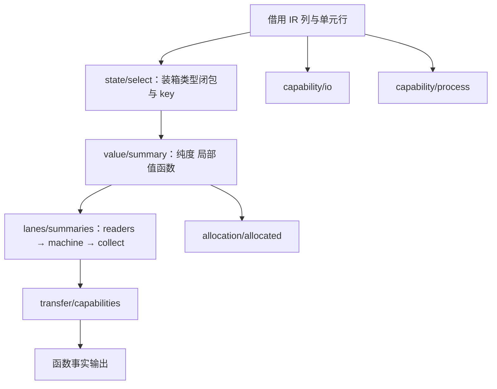

# genz 分析规则迁移

## Intent：最终目标

把 genz 中决定生成策略的自有分析规则迁入 RX/ZX，宿主只借列、构造单元行并复制结果：函数事实（纯度、局部、值函数、状态选择与 key、IO/process 能力、缓冲通道摘要与拒绝码、分配事实、转移能力）、迭代缓冲的版本发现、内联准备。Printer 已由另一会话迁移并在本会话接入正式构建；本块与 Printer 合起来仍不等于 genz 自举完成，Lower、目标节点状态、ABI 与模块输出仍是原生。

## Data：可用证据

- 迁移源码位于 `packages/genz/src/analysis/`，原有 14 个目录、约 9,900 行 ZX/RX：versions 129 文件（宿主已无调用，2026-10-12 删除）、lanes 74 文件、inline 54 文件、types 17 文件，其余为 allocation、calls、capability、consumer、control、ir、state、transfer、value、facts。
- 正式接线：`compiler/build/entries.zig` 新增 `.genz` 所有者的四个入口 `printer`、`function_facts`、`iteration_discover`、`inline_prepare`；`parser.zig` 增加 `genz/` 来源根；`compiler.zig` 增加 `native_genz` 与 `genz_rx_analysis` 两个选项：有生成解析器时 Printer 默认使用 RX/ZX 实现，函数事实与内联准备自 2026-10-12 起同样默认使用 RX/ZX 实现；`genz/build.zig` 的 `generated` 选项门控 Printer，`generated_analysis` 选项在 `function_analysis.zig`、`inline_call/root.zig` 两处门控分析。`iteration_discover` 入口随 versions 一并移除。
- 宿主适配：`function_analysis/{generated,units,abi,summaries}.zig`、`iteration_buffer/generated.zig`、`inline_call/generated.zig`。列借用从 `compiler/src/zx/ir/canonical/borrow.zig` 移到 `packages/core/src/columns.zig`，并补充 `own` 以复制内联重建的单元列。
- Printer 接线验证：固定清单下 1,281 个生成文件与原生 Printer 逐字节一致。
- 原生分析生成器（`-Dnative_genz=true`，固定 50 入口）：1,485 个函数文件、1,536 generated、0 reused；infer 43,046 ms、emit 21,493 ms、write 78 ms。
- 空指针崩溃已定位并修复：`function_analysis/units.zig` 的 `build` 按值接收 `ir.Program`，再把 `&program.symbols`、`&program.expressions`、`&program.stores`、`&program.contracts` 存进入口单元，函数返回后这些指针悬空。生成的 `trace/facts` 第三个循环按值复制入口单元的表达式列，读到 `kinds.ptr == null` 而长度非零。崩溃栈经保留符号的同一二进制符号化，落在 `lanes/summaries` 内联链；寄存器偏移 `+0x200`、`+0x350`、`+0x3b8` 与按字母排序的 Expressions 布局中 `kinds`、`payloads`、`scope_first.len` 对应。修复为 `build` 改收 `*const ir.Program`，三处调用传 `&program`。
- 修复后 RX/ZX 分析生成器不再崩溃，但函数事实阶段在 10 秒内 RSS 升到约 21.7 GB，约 170 秒后被系统以 SIGKILL 结束，未产出文件。原因是 ZX 中沿函数传递的 `machine` 等持久数组：例如 `reach/record.zx` 每次调用都在 `state_columns` 缓冲中先 `appendSlice` 复制整份输入数组再追加，跨单元累积的数组随调用次数平方增长。这正是用户指出的“值复制持久数组”问题，需要在编译器的追加降级上解决，不能靠调参。
- 推导与生成内存（原生分析，`getrusage` 分阶段打点的峰值 RSS；修复前数据为 RSS 采样）：

| 修复进度 | 推导结束 | 生成结束（总峰值） |
| --- | --- | --- |
| 修复前 | 约 19–22 GB，首 5 秒 12.1 GB | 未单独测量 |
| 解析草稿改用真实堆 | 5,614 MB | 17,196 MB |
| 再修 mixed 逐模块草稿 | 3,477 MB | 11,829 MB |
| 再修 Printer 草稿 | 3,477 MB | 5,374 MB |

- 三处内存根因：其一，`frontend/parse.zig` 与 `parse_expression.zig` 把生成解析器的整块草稿 arena 留在结果里，而上层 arena 释放子 arena 时并不回收；现草稿改用 `compact_output.scratch_backing`（真实堆），只把输出深拷贝到结果 arena，指向源码的文本切片原样保留。其二，`mixed/state.zig` 的逐模块 `scratch` 建在推导 arena 上，`reset(.retain_capacity)` 每次都从父 arena 再切一块新缓冲，旧块全部滞留；现由 `infer` 把真实分配器作为 `backing` 传入。其三，生成 Printer 的宿主把草稿 arena 和输出缓冲建在库产物 arena 上；现改用逐函数的节点存储分配器，结束时只复制最终文本。
- 架构整改：`versions/discover.rx` 原来只调用一个 `search` 函数，属于入口包装；现展开为 create、iteration、seed、bind、start、run、finish 七个阶段，`search.zx` 删除并拆成 `start.zx` 与 `finish.zx`。`lanes/summaries` 由单个 ZX 改为 RX 模块 readers、machine、collect。两处已编译并参与生成。
- 主机状态：此前用 lldb 批处理启动生成器后，zig 产物 exec 卡在不可中断内核态约 20 分钟，未重启即自行恢复。
- 三处修复后，原生分析生成器的固定 50 入口产物与修复前逐字节一致（`diff -rq` 0 行）；infer 约 42 秒、emit 约 26 秒。
- 默认开启（2026-10-12）：`compiler.zig` 的 `genz_rx_analysis` 在有生成解析器时默认为真。开启后自举生成 49 入口、1,424 模块、1,277 函数文件，infer 242 ms、emit 1,364 ms，与原生分析同速；生成树与原生分析产物相比只差被删类型带来的 `zx_shape_*` 常量重新编号；新 zxc 对 27 个运行时用例的输出与原生分析基线逐字节一致，此前 1,079 个 .zx 夹具对比也一致。

## Edges：边界与限制

- 生成构建默认走 RX/ZX 函数事实与内联准备；手写原生分析只保留给没有生成解析器的种子构建，并可用 `-Dgenz_rx_analysis=false` 选回，属于过渡桥。种子改由已发布 zxc 生成后才能删除。
- 内存目标按用户要求为 10 GB 以内、编译速度优先；原生路径峰值已降至约 5.4 GB。推导阶段 constraints 约 20 秒 CPU、mixed 约 17 秒，是下一步的速度热点。
- 其他会话暂存的 `packages/test` 函数分析运行时测试把 genz 源码编进没有 `genz_options` 的 `checks` 模块，现有门控会让它编译失败；该测试不属于本任务，未改动。
- 不再用 lldb 调试该二进制；使用崩溃报告加同布局的保留符号二进制定位。

## Answer：阶段图与下一步

1. ~~在编译器的追加降级中消除持久数组复制~~（已完成，RX/ZX 分析可跑完并与原生一致）。
2. ~~对比一致后把 `genz_rx_analysis` 设为默认~~（2026-10-12 完成）；原生分析桥待种子构建不再需要时删除。
3. 推导速度：定位 constraints 与 mixed 两阶段的 CPU 热点；三次解析同一模块（source_graph、signatures、mixed）可考虑共享解析缓存。
4. 继续 Lower 迁移，设计见执行计划。

## 自我批判

分析迁移的编译通过与 Printer 的一致性不能替代三项分析的产物一致。空指针根因是宿主适配层取了按值参数的地址，属于本会话写入的错误，早该在适配层评审时发现。内存问题主要来自 arena 叠 arena：子 arena 的释放与重置在父 arena 上不回收任何内存，这类写法在仓库中仍可能存在，后续新增草稿区必须建在真实堆上。持久数组复制修复后 RX/ZX 分析已能跑完并默认接入；原生实现仍为种子构建保留，genz 的 uniqueness、tasks 以及 Lower、目标节点状态与 ABI 尚未迁移，genz 自举仍未完成。
