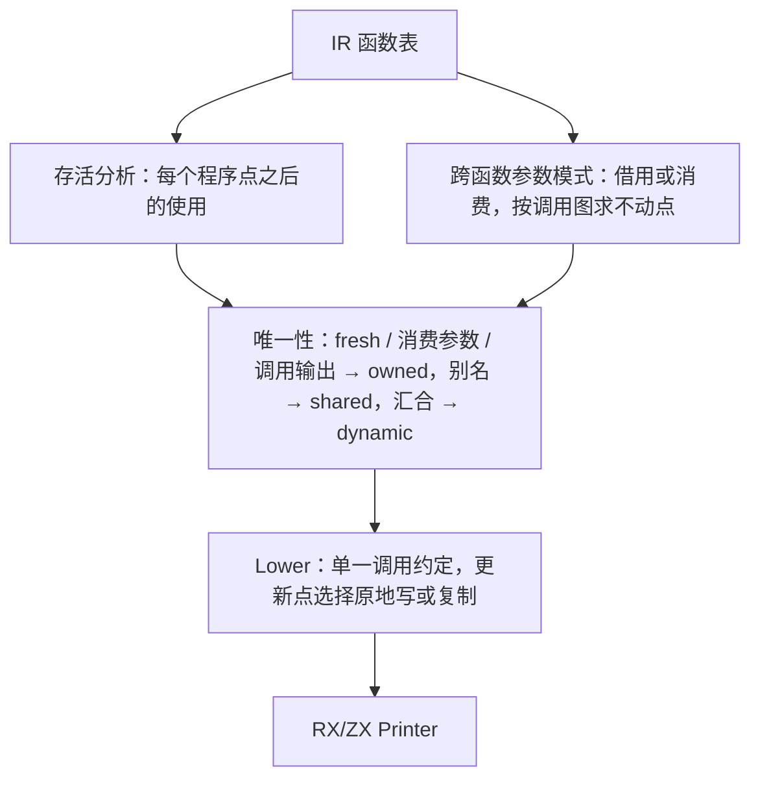

# genz 后端重设计

## Intent：最终目标

按用户要求精简 genz 实现，首要优化编译速度，其次是编译内存，并采用 PL 业界成熟做法：每个 ZX 函数只生成一个 Zig 函数，记录只有一种按值表示，列表原地更新由静态所有权决定。在此基础上删除缓冲通道、迭代缓冲、值调用等叠加机制及其 RX/ZX 分析移植，再把精简后的 Lower 迁入 RX/ZX，满足“src 源码全部由 zxc 的 RX/ZX 实现”的自举目标。

## Data：可用证据

固定 50 入口清单、同一输入，ReleaseFast 生成器，采样为 macOS `sample` 每毫秒一次。

- 体量：1,590 个 RX/ZX 文件共 1.95 MB 源码，生成 82.6 MB Zig，约 42 倍。按函数变体统计：`call` 40.2 MB（1,489 个）、`callBufferedPointer` 19.0 MB（775）、`callBuffered` 17.1 MB（775）、`callValue` 4.2 MB（980）、类型及其他声明约 2.2 MB。两个缓冲变体占 44%。
- 编译成本：生成器整轮约 12 秒，而用生成代码构建生成器需 2–3 分钟（ReleaseSmall 约 2:00，ReleaseFast 约 2:40）。完整构建的瓶颈在 Zig 编译生成代码，主要由函数数量与函数体体量决定。
- 双重表示：同一记录有指针 ABI（`zx_type_*`，嵌套记录与记录列表元素都是 `*const`，每构造一次就 `allocator.create` 一次）和值布局（`value_*`，嵌套内联，外加 `zx_origin` 回指针）两套类型。两者之间的转换逐字段重建，例如 Printer 每次调用子规则都把约 200 列的 `Source` 从值布局拼回指针结构。
- 缓冲通道按作用域重新开始：Printer `walk` 的 `callBuffered` 有 40 多个通道，每列一个；展开帧的内层循环每次启动通道都 `appendSlice` 复制整个栈。采样中 `walk` 一个函数约 3 万个样本，其中 2.2 万落在这一处 `memcpy`，栈越深复制越多，总代价随规模平方增长。
- 没有缓冲时，`push`/`concat` 总是新分配 `len + n` 并复制整份旧列表（`collections.zig`），循环中逐个追加也是平方复杂度。
- 叠加机制的体量：`zx/buffer_call` 2,079 行、`zx/iteration_buffer` 2,021 行、`zx/iteration_value` 905 行、`zx/inline_call` 810 行、`zx/object_reduce` 777 行、`zx/state_value` 567 行、`zx/value_call` 543 行、`zx/append_reduce` 241 行，另有 `genz/src/analysis` 约 9,900 行 ZX/RX 移植（lanes、versions、inline 等），都是在近似“唯一持有的值可原地更新”。
- IR 本身很小：约 37 种表达式和 8 种语句。`Symbol.ownership` 与函数 `output_ownership`（copy/borrowed/owned）已在 IR 中，它们表达语言层的借用规则，不等于原地更新所需的唯一性。
- 宿主桥约 67 个文件、3,052 行，通过编译期反射（`std.meta.Child(@FieldType(...))`、`borrow.pointer`）构造指针 ABI 输入，改表示需要统一替换为按值视图。

## Edges：边界与限制

- 生成代码必须是普通 Zig，零运行时、零成本抽象：不得引入引用计数、运行库或动态调度。所有权位是编译期可知或普通 `bool`，容量信息由分配不变式推出。
- 生成代码使用 arena 分配，不在用户代码中释放；别名共享免费，只有原地写入需要唯一性。追加只写旧长度之后的位置，已共享的前缀切片看不到；`with`、`pop` 之后再 `push` 会覆盖旧元素，必须有唯一性。
- 宿主入口 `execute` 的公开签名不变：输入视为借用，输出交给调用方。
- 不新增测试、不跑全量测试。每阶段用固定清单生成、阶段间产物自洽、受影响专项回归和真实构建耗时验收；表示变化后产物不再与旧版逐字节一致，改用 stage1 与 stage2 生成器产物一致作为自洽证据。
- 另一会话暂存的 `packages/test` 函数分析测试不属本任务，不覆盖。

## Answer：设计与分阶段实施

### 所有权与原地更新

- 每个列表值在程序点上有所有权状态：`owned`（唯一且容量满足不变式，可原地写）、`shared`（可能有别名或来源未知，写前复制）、`dynamic`（循环汇合点两侧不一致，携带一个 `bool`）。
- 容量不变式：生成代码分配列表时容量取 `ceilPow2(max(len, 4))`；`owned` 值的容量由长度推出，不必另存。`pop` 和前缀切片只缩短长度，不变式仍然成立。不是由生成代码分配的值（宿主输入、字面量常量、中段切片）一律视为 `shared`。
- 更新点 `x' = push/concat/with(x, …)`：若 `x` 为 `owned` 且之后不再存活，就原地写入（容量满时按两倍扩容）；否则按不变式分配新缓冲并复制，结果为 `owned`。
- 函数边界采用 Lean 式借用推断：参数路径默认借用，只有函数会原地更新它时才推断为消费。调用方传入消费参数时，若实参为 `owned` 且调用后不再存活就直接移交，否则在调用点复制（`dynamic` 时按位选择）。返回值随输出携带所有权状态，供调用方继续原地更新。
- 记录按值表示，按 Zig 值语义复制；记录内的列表字段被复制后两份都视为 `shared`，由唯一性分析处理，不靠装箱。

### 阶段图

### 实施顺序

1. 原地更新取代缓冲：在现有 `call` 路径实现存活、唯一性和参数模式分析，以及 `push`/`concat`/`with`/`pop` 的原地降级；随后删除 `callBuffered`、`callBufferedPointer`、`callValue` 变体与 `buffer_call`、`iteration_buffer`、`object_reduce/append`、`append_reduce`、`list_update` 缓冲路径及其分析移植。验收：生成体量至少减少约 40%，Printer `walk` 不再出现整栈复制，生成器与 Zig 构建耗时下降。
2. 单一按值记录表示：删除指针 ABI 类型、`zx_origin`、`state_value`、`value_call`、`iteration_value`，宿主桥统一改用按值视图。验收：`types.zig` 只有一套类型，记录构造不再逐个堆分配。
3. 在精简后的设计上把 Lower、目标节点状态和模块输出迁入 RX/ZX，删除不再使用的 `genz/src/analysis` 移植；最后做三阶段自编译与依赖闭包验收。

## 自我批判

前几轮把 RX/ZX 分析当作“迁移完成度”推进，但被迁移的 lanes、versions 本身就是需要删除的叠加机制，持久数组复制问题也正来自同一套缓冲设计。先在旧设计上逐项移植、再修性能，方向有误。本设计尚未实现：上面的体量和耗时只是现状证据，不代表收益已经兑现；唯一性分析的正确性必须靠阶段自洽与专项回归证明，不能用编译通过代替。
