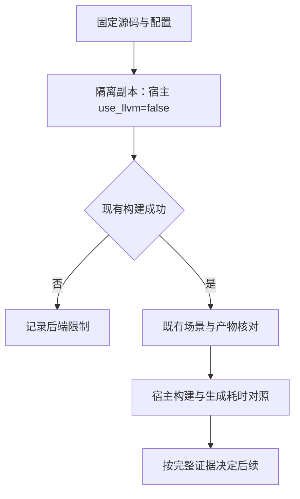
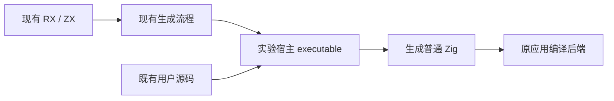

# 宿主后端构建试验

**结论：未采用。三种组合均未产生可运行的完整工具，主工作树默认后端保持不变。**

## Intent：最终目标

核对是否能通过现成 Zig 后端选项降低宿主工具的构建成本，先取得可运行性和行为证据，再决定是否值得继续。不以减少源码迁移或改变用户程序语义换取构建数字。

## Data：可用证据

- 固定工具链 Zig 0.17.0，当前宿主 x86_64 macOS。
- std.Build 的 ExecutableOptions 已提供 use_llvm；它独立于 use_lld，并作用于整个 Compile step。
- 仓库 CLI 尚未设置 use_llvm；现有完整增量构建约 235–237 秒。
- 既有 CLI runtime cases 覆盖集合、可空值、枚举、对象、字符串、控制流与数值类型；verification 既有场景可检查公开编译和求解入口。
- 自带后端的标准库实现路径可能不同，不能仅凭编译成功认定正确或更快。

## Edges：边界与限制

- 只在隔离副本中修改宿主工具的 Compile 选项，不修改主工作树源码或默认构建配置。
- 保持 ReleaseSafe、target 及 compiler_rt 配置；首轮保持链接器，发生链接相关失败后将 LLD 组合作为单独实验记录。不更换 CLI 编译用户应用时采用的后端。
- 固定参考二进制及其源码；复用已有对照副本的共同诊断字符串改动，并记录哈希，不把该改动计入生产源码。
- 不新增测试用例，不运行全量测试，不浏览器确认，不触发 CI。
- 必须同时考察宿主构建、宿主运行时生成速度、真实产物和行为；不能把运行开销转移后只报告编译收益。

## Answer：试验步骤与判断标准

1. 保存源码与构建参数，先核对非 LLVM 模式是否能够完成现有 CLI 构建。
2. 若构建成功，复用既有 runtime 和 verification 场景，检查生成产物与行为一致性；不生成专门迎合新实现的用例。
3. 只有可运行性、正确性和运行成本都可接受，才补齐同源码 LLVM 对照及采用方案。
4. 若不支持或成本不合适，记录实际限制，不修改默认值，也不声称完成构建优化。

## 自我批判

构建工具本身变快，不代表用户应用构建变快。当前只具备做实验的 API 证据，尚无平台支持或性能结论；通过本机样本也不能代替完整平台验收。

## CLI 可运行性结果与范围收缩

完整 CLI 在 85.745 秒后构建失败，macOS 链接器报告 `cannot expand segment __CONST_ZIG in virtual memory`，并提示 self-hosted backend 尚未实现相关内存位置重定位。没有可运行 CLI 产物，不能将该耗时当作成功构建的提速结果。

保留默认链接器与目标配置，不修改 CLI 功能绕过限制。后续仅对已有 lexer 生成工具设置 use_llvm=false；它不嵌入完整工具链，但其生成职责保持完整。先验证该现有工具能否构建与运行，再比较实际 lexer.zig 产物。CLI 临时改动已恢复，主工作树仍无源码改动。

lexer 工具的非 LLVM 编译成功，但运行时 dyld 报告 __CONST_ZIG 段地址顺序错误并终止，整体 7/10 步骤成功，耗时 11.562 秒。因此仍无有效 lexer 产物。错误集中于链接/加载，追加一次独立链接器组合核对：仅在临时 lexer Compile step 设置 use_lld=true，明确记录这是相对首轮的新变量；不手工修改段地址或删除工具功能。

LLD 组合在 10.544 秒后明确失败：`using LLD to link macho files is unsupported`，6/10 步骤成功。该工具链没有在本轮取得可用组合，不继续修改链接布局或功能绕过限制。临时 CLI 与 lexer 构建文件均已恢复；上述失败耗时不作为性能收益。后续改为核对已有调试信息选项，保持 LLVM 和链接器。
