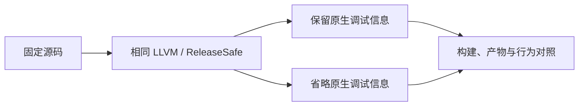
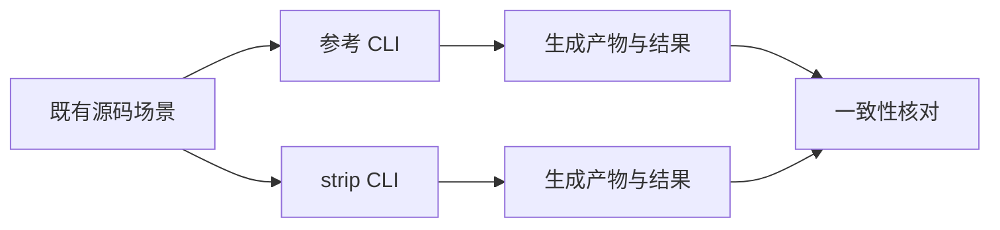

# 宿主调试信息构建对比（未采用）

## Intent：最终目标

使用仓库已有 strip 选项，测量原生宿主调试信息的构建成本。保持 LLVM、链接器、ReleaseSafe 安全检查和用户应用后端，确认调试符号是否是更小且合适的优化边界。

## Data：可用证据

- CLI 已提供 strip 选项，说明明确指出省略手写 zxc 调试信息可降低构建时间与内存；生成模块已单独省略调试信息。
- 修改前优化构建没有为该选项设置默认值；完整 CLI 的单模块重建约 235–237 秒。
- 非 LLVM 后端在当前工具链和 macOS 下未取得可运行组合，相关试验已恢复且单独记录。
- 已有 CLI runtime 与 verification 场景可用于核对生成产物、数值与控制流行为及正常诊断。

## Edges：边界与限制

- 先在隔离副本传入现有 `-Dstrip=true` 测量；达到成本门槛后，只将 CLI 优化模式的默认值改为 true，Debug 默认 false，显式选项仍优先。
- 不降低优化模式的安全检查，不修改生成器、业务规则或应用产物后端。
- 必须明确权衡：省略原生调试信息会失去相应栈回溯源码位置；不能宣称所有调试行为不变。
- 只复用既有场景，不新增测试、不运行全量测试、不触发 CI。

## Answer：步骤与成功标准

1. 恢复所有非 LLVM 临时改动，保存相同源码和配置。
2. 构建 strip 版本并记录耗时、产物大小及构建摘要。
3. 若收益明确，核对既有场景的产物与行为，并补齐同源码默认配置对照。
4. 再判断是否适合仅调整优化模式的默认值，同时保留 Debug 与显式 strip=false 的调试能力。

## 首轮观察

- 保持 LLVM 与 ReleaseSafe，现有 `-Dstrip=true` 完整 CLI 构建通过，耗时 260.673 秒。本地构建缓存为空，复用已有 Zig 全局缓存。
- 复用 CLI build 中列出的 26 个 runtime 场景，两个实际 CLI 均成功生成；对应 Zig 文件逐字节一致。没有新增测试用例。
- 参考 CLI 为 79,317,259 字节，strip CLI 为 78,052,568 字节。26 次生成耗时合计分别为 0.158 / 0.155 秒，样本太短，不能据此声称运行速度提升。
- 同源对照使用同一隔离源码目录、工具链和全局缓存，各自使用独立本地缓存与安装目录；期间不并行运行其他重型构建。

## 同源构建结果与原拟采用范围

| 场景         | 修改前默认配置 | strip 配置 | 观察                   |
| ------------ | -------------: | ---------: | ---------------------- |
| 完整冷构建   |     291.463 秒 | 260.673 秒 | 减少约 10.6%           |
| 单模块变更   |     236.365 秒 | 205.952 秒 | 减少约 12.9%           |
| 原源码热缓存 |       0.355 秒 |   0.386 秒 | 亚秒级，未据此声称改善 |
| 变更后热缓存 |       0.440 秒 |   0.390 秒 | 亚秒级，未据此声称改善 |

冷构建先 strip 后默认；增量先默认后 strip。冷构建输入相同，来自 `68a146c28` 的 packages 加同一条诊断文本末尾两个句点；增量向两配置使用的同一 ZX 文件再追加一个句点。这个改动用于触发真实生成与原生重建，未修改主工作树；测量后已恢复。日志中的最终 CLI 原生编译内存摘要由约 4 GB 降至约 3 GB，仅作粗粒度辅助观察。

原拟采用范围只有 `packages/cli/build.zig` 的现有 strip 默认值：优化模式默认 true，Debug 默认 false，用户显式值覆盖默认。LLVM、链接器、ReleaseSafe 检查和应用生成选项保持原契约。对应 CLI 说明明确写出栈回溯源码位置的代价。

用户随后明确要求先完成自举，性能后续处理。最终验证已停止，尚未提交的 strip 默认值与 CLI 说明已精确撤回，保留其他会话改动。后续不继续本试验，不把中止的验证算作通过。

## 自我批判

同源冷构建与增量测量均显示约 30 秒收益；样本仍是当前机器与工具链上的串行观测，不保证其他平台具有同样比例。即使更快，也只是构建配置优化，不算迁移了任何 RX/ZX 语义或状态；调试能力的权衡必须保留在最终结论中。
