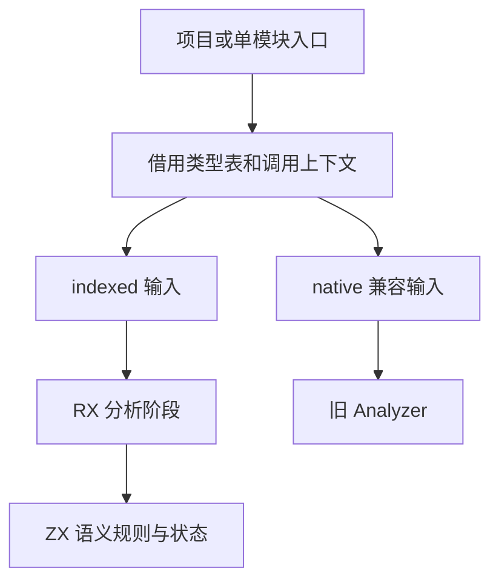
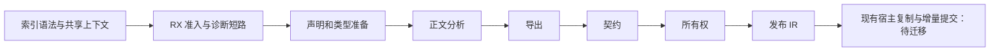
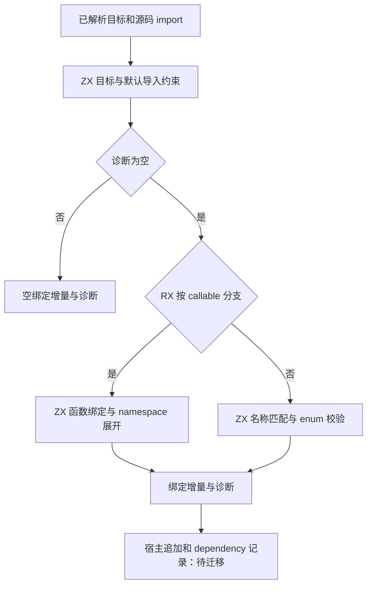
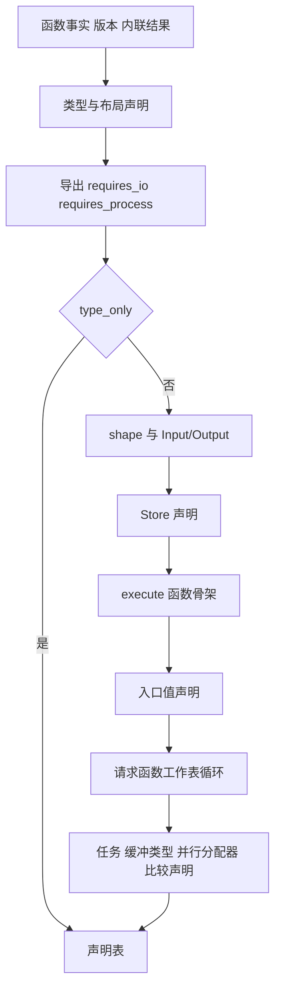

# 完整自举接续执行计划

## Intent：最终目标

完成当前用户指定的七块剩余实现，并以正式传递依赖和真实三阶段自编译共同验收。当前会话目标已建立，完整用户原文保存在 `docs/user_request.md`。

## Data：可用证据

- 接手 HEAD 为 `79cfb5811`；已有大量未提交实现和十个暂存测试、记录文件。
- 已读取“复核编译器生成架构问题”的最终交接：共享生成与缓冲变体已验证；Printer 有同版本 1197 个产物逐字节一致证据，但正式入口未接线。
- 已读取测试会话最近进度：共享摘要专项两模式各 54 次执行通过，尚在提交检查。
- 本机 Zig 为 `0.17.0`。既有 `zxc_zig` 保留分支为 `515828e7b`，不修改。

## Edges：边界与限制

不覆盖已有工作，不提交其他会话暂存文件。不运行全量测试、不新增测试。已有验证均是交接证据，不冒充本轮验证。完整 genz 状态、Lower、Analyzer 与项目编排仍未迁移；Printer 接线不能代表完整自举。
用户后续要求无人值守大步迭代，实际构建耗时为性能取舍的首要指标，构建时间不得退化。每块改变推导或生成结构时，集中核验固定输入的生成/编译成本；不能凭代码减少或理论复杂度宣称提速。保留现有功能与静态编译约束，性能折衷在其内作出。

## Answer：执行顺序与成功标准

1. 冻结接手文件摘要及差异，建立归属；查明构建和真实依赖。
2. Printer 由另一会话负责；用户明确提醒后，本轮新增的五文件接线已逐项撤回并与接手摘要核对一致。本会话转向主分析器及项目流程，不重复实现 Printer。
3. 按清单推进分析器、项目流程、genz 状态与 Lower、其余规则；每块先定义 RX 阶段和 ZX 职责。
4. 闭合产品边界和缓存测量，执行固定输入的完整三阶段验收；平台发行独立保留，只有用户明确要求发布时执行。
5. 完成块仅提交本会话负责且独立可复核的修改，英文规范提交并推送；依赖尚未提交时先保留明确阻碍记录。

### 下一完整职责：项目导入绑定

已解析目标的绑定事务独立于路径解析与 registry 装载。计划迁移 source、compiled、native namespace/type 的目标约束、名称匹配、enum 校验和绑定增量构造；保留逐 import 顺序与现有诊断优先级。只借用当前 import 及目标导出的小视图，不传完整项目状态或 IR，不重复已有 compiled/link/type merge。
宿主暂时追加绑定增量并记录 dependency，仍属过渡状态；此块不能代表项目完整流程自举。source 的纯类型限制不能施加到 compiled 公共类型导出，native 默认导入需要展开带 namespace 的 callable members。外部 registry 和路径规范化另有公共契约，留待单独迁移。

### 下一完整职责：genz Lower

Lower 把 IR 程序降低为列式 Zig AST 行（expressions、statements、declarations、fields、arms），由已迁移的 Printer 渲染。原生 `zx/lower.zig` 是带约 40 个可变字段的总控：声明阶段、函数骨架、表达式分派、语句降低与十余个专项降低（aggregate、collections、iteration、match、transform、capture、list_update、store、tasks、buffer_call、value_call、state_value、iteration_buffer、iteration_value、object_reduce、append_reduce、simd、parallel、comparison）互相回调。迁移前先固定阶段图与原子职责，不允许把总控整体搬进一个 ZX 文件。

- RX 负责上面的声明阶段顺序、`type_only` 短路与结果汇合；每个阶段的输入是借用的 IR 列、分析事实和前一阶段追加后的节点列。
- 函数骨架在 ZX 中是一个内聚算法：参数列表、安全开关、分配器/上下文/io/process 的引用标记与丢弃、pending 事务与 commit；其输入是正文降低的语句行和使用标记，不再通过可变字段回写。
- 表达式降低是按 IR 表达式种类分派的显式栈状态机，和版本解释器同构：帧携带表达式 id、阶段与中间节点 id，缓存、使用标记、序号与捕获边界放在以 ExprId/SymbolId 索引的平坦列中；专项降低作为按种类和事实选择的规则族，各自只读取所需列。
- 输出节点通过列式追加写入 expressions/statements/declarations/fields/arms 五张表，宿主借列交给 Printer；字符串列（标识符、名称）借用 IR 与分析结果，不复制。
- 顺序：先迁移声明阶段与函数骨架并与原生逐字节对比；再迁移表达式与语句降低的基础种类；最后迁移缓冲、值调用、状态值、迭代缓冲等依赖分析事实的专项。每一步都以固定清单的生成文件逐字节一致为验收，不以编译通过代替。

## 自我批判

接手状态复杂，不能以“会话已收尾”推导所有未提交文件归本任务所有。先保存基线，后续只对本轮增量负责。主分析器上下文仍是过渡宿主边界；移除旧 Analyzer 的数据结构依赖不代表结果发布、native 兼容 API 或完整状态模型已完成自举。
