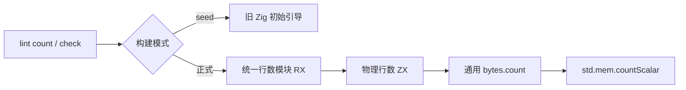
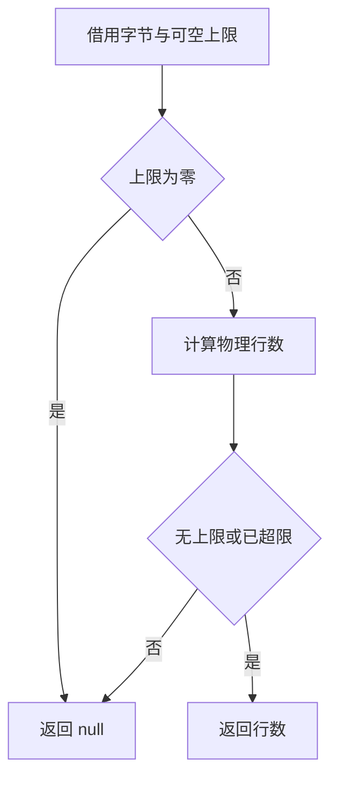

# 物理行数规则迁移

## Intent：最终目标

将 lint 的物理行数计数和限制规则迁入统一 RX/ZX 模块。保留公开 `count`、`check`、默认上限和诊断结构，不改变编译入口：行数限制始终只属于 lint。

## Data：可用证据

- 当前 `packages/lint/src/length.zig` 以 `std.mem.countScalar` 统计 LF，再按最后一个字节决定是否补一行；`maximum=0` 在读取输入前短路。
- naming 已有构建期 seed/generated 选择，可复用其模块注入边界。当前标准库没有 bytes 模块，需要新增普通字节计数契约。
- generated 支持可空标量；输入可用借用的 `u8[]` 与可空上限，输出为可空行数，不需要中间集合。可空比较建立上限约束，再由计数结果的 `u64` 类型确定 payload；仍须实际编译核对。
- 构建文件同时包含其他会话的共享生成工作，独立验证和提交必须使用 HEAD 加本任务增量，不能包含其未提交实现。

## Edges：边界与限制

- 不做 UTF-8 校验；保持任意字节输入、空输入、CRLF、单独 CR、末尾 LF 和等于上限的原有语义。
- 标准库 bytes.count 直接使用通用 Zig 标准库字节计数，保留原有扫描算法；不增加 lint 专用原生桥。
- RX 表达禁用短路、计数调用与结果筛选，ZX 只负责物理行数算法。不得把完整规则藏回宿主。
- seed 保留原实现，只用于初始引导；正式入口必须使用生成模块。零容量分配器不得因迁移扩大。
- 不新增测试、不运行全量测试；复用已有 lint 专项，并核对实际生成代码和构建成本。

## Answer：步骤与成功标准

1. 实现普通 bytes.count 契约与行数模块，保存原公开接口和 seed 边界。
2. 独立接入入口、源码收集、标准能力及 lint 构建依赖；补齐 CLI 缓存身份使用的 lint 依赖参数。
3. 检查实际调用关系、借用输入、标量输出与零分配执行，运行已有专项。
4. 按用户最新要求先完成自举；功能与架构验证通过后提交并更新剩余清单，性能交由后续处理。

## 自我批判

已在隔离副本准备 RX、ZX、通用字节计数和 seed 草案，尚未接入或验证。通用字节扫描符合原生边界，但新增生成模块仍可能增加构建成本；理论上零分配也必须以实际生成接口和既有用例核对，不能用简单源码外观代替证据。
