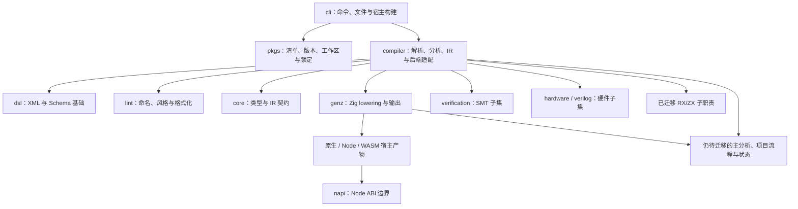
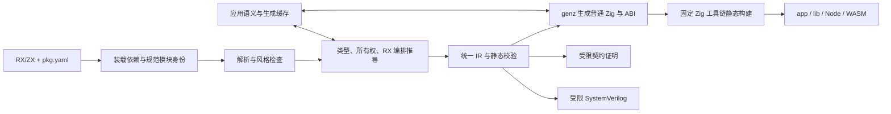
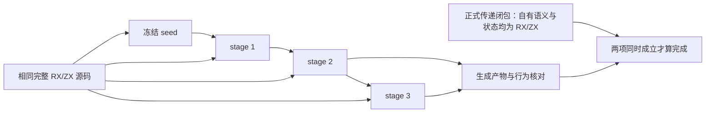

# 旧目标完成度与后续执行清单

## Intent：最终目标

把旧 goal 转换为可直接接力的完成度表和剩余任务，避免重做已实现功能、恢复已取消要求，或把局部自举当作完整自举。

**结论：大部分产品能力已具备实际实现；标准库与多目标后端有明确覆盖边界；完整 RX/ZX 自举仍未完成，而且剩余工作包含主分析器、项目编排、代码生成与状态模型等实质实现，不是仅剩测试。**

本报告日期为 **2026-10-11，Asia/Taipei**。这是源码审计快照，不是当前版本测试通过报告，也不按文件数计算完成百分比。

## Data：可用证据

### 核对基线

| 项目         | 本轮查得状态                                                                | 含义                                                             |
| ------------ | --------------------------------------------------------------------------- | ---------------------------------------------------------------- |
| 主仓库       | `master`，`79cfb58112be734c77f18d3a408d8266396210a7`                        | 本地 HEAD 与只读查询到的远程 master 相同                         |
| Zig 保留分支 | 本地 `zig`、远程 `zig` 均为 `515828e7b3c749edd554f7c301b05ab25c28ebc4`      | 分支创建与推送这项已做，不要重建                                 |
| Zig 原始目录 | `/Users/xiewendao/Documents/MatrixAges/zxc_zig`，绑定 `zig` 的 Git worktree | 目录已存在；本轮只看到未跟踪的 `.DS_Store`，不是完全无未跟踪文件 |
| 主工作区     | 有其他 session 的暂存、未暂存和未跟踪改动                                   | 共享生成、函数变体、构建接线等正在变化，不能当作已提交成果       |
| 本轮验证     | 源码、配置、文档与 Git 只读核对                                             | 没有构建、测试或 UI 验证；没有触发 CI                            |

需求来源是 [用户目标记录](../../user_request.md)，特别是旧 goal 的 S23 引用，以及后续用户修正。验收规则以 [自举完成标准](../../../rules/自举完成标准.md)、[RX 开发约定](../../../rules/RX开发约定.md) 和当前 AGENTS.md 为准。

### 状态口径

- **已实现**：发现生产实现及接入路径；不代表本轮重新测试通过。
- **子集已实现**：支持范围有明确边界，不能扩称整个生态或全部语义已完成。
- **部分完成**：原目标仍有明确缺口，或全范围验收未闭合。
- **未完成**：核心实现或最终验收尚不成立。
- **已取消**：被后续明确决定替代，不进入待实现列表。
- **待验证**：代码或配置存在，但当前交付结论缺少相应证据。

### 产品特性完成度表

下列路径均相对仓库根目录。为方便下一 session 定位，证据优先指向实际源码；公开使用边界另见对应 reference。

| ID  | 旧 goal 特性                                              | 状态                           | 实现证据                                                                                                                                                                | 剩余工作／验收边界                                                                                                                       |
| --- | --------------------------------------------------------- | ------------------------------ | ----------------------------------------------------------------------------------------------------------------------------------------------------------------------- | ---------------------------------------------------------------------------------------------------------------------------------------- |
| F01 | `zig:`、`c:`、`std:`、无前缀 ZX 包                        | **已实现**                     | `packages/compiler/src/zx/modules/specifier/classify.rx`、`check.zx`；`modules/native/`；`packages/cli/src/cli/project/native.zig`                                      | Zig/C 是显式声明、注册和静态链接；保留旧 `lib:` 兼容。不要重写为动态 import                                                              |
| F02 | 参考 Node 特性的 Zig 底层标准库                           | **部分完成**                   | `packages/compiler/standard/modules.json`、`interfaces/`、`src/`                                                                                                        | 已有 14 个模块标识；完整覆盖清单尚需按用户确定范围逐项闭合，不能宣称 Node 全量兼容，见下文                                               |
| F03 | `.so` 插件、懒加载                                        | **已取消**                     | 用户记录 [U0129](../../user_request.md#u0129)：“更严格：取消动态加载，所有模块静态链接”                                                                                 | 静态模块替代此目标；不要再设计 zxc 专用动态加载器。Node 加载 `.node` 是宿主 ABI 边界                                                     |
| F04 | 变量 snake_case、函数 camelCase、类型 PascalCase 编译门禁 | **已实现**                     | `packages/lint/src/naming/check.rx`、`check.zx`、`root.zig`；compiler 接入 lint                                                                                         | 协议字段不强制改名；普通入口函数匿名。行数检查后续已明确只放 lint，不能重新放入编译器                                                    |
| F05 | 形式化证明                                                | **子集已实现**                 | `packages/compiler/src/verification/`；`packages/cli/src/cli/verify.zig`                                                                                                | 实际调用求解器，支持定宽整数、bool、静态对象/元组、分支及受限无环调用。不是整个语言或编译器的正确性证明                                  |
| F06 | 汇编生成、SIMD（旧文写作 SMID）                           | **子集已实现**                 | `packages/genz/src/zx/simd/root.zig`、`transform.zig`；CLI `--asm --cpu --target --optimize`                                                                            | f32/f64 同元素类型的适用 map 可显式向量化，有标量尾部；不承诺任意算法自动最优或固定提速                                                  |
| F07 | WASM                                                      | **支持目标已实现**             | `packages/cli/src/cli/wasm/target.zig`；`packages/genz/src/host/wasm/`                                                                                                  | wasm32-wasi、wasm32-freestanding，JSON／直接标量接口；不等于 WIT、Component Model、wasm64 或所有 OS 能力可用                             |
| F08 | N-API 插件、自动 TS 声明                                  | **核心目标已实现**             | `packages/napi/src/`；`packages/genz/src/host/node/`；`packages/cli/src/cli/node/bindings.zig`                                                                          | 输出 `.node`、`.cjs`、`.d.cts`，同步与异步调用；不等于 napi-rs 所有功能兼容。跨 JS 边界有复制成本                                        |
| F09 | FPGA                                                      | **硬件生成子集已实现**         | `packages/compiler/src/backends/hardware/`、`verilog/`；`packages/cli/src/cli/fpga.zig`                                                                                 | 生成 SystemVerilog、端口清单，可选单级 ready/valid 寄存器；器件映射、布局布线、bitstream、上板指标没有完整交付证据                       |
| F10 | app/lib、统一库被 zxc 与 Zig 消费                         | **已实现**                     | `packages/compiler/src/library/`；`packages/compiler/src/backends/zig/library.zig`；`packages/cli/src/cli/library/`                                                     | `library.zxcir`、共享 ABI、公开 Zig 模块与静态资源。IR 版本绑定；系统 SDK 仍可能是外部依赖，不分裂成 RX 库和 ZX 库                       |
| F11 | `pkg.yaml`、monorepo、共享缓存、内置包管理                | **核心目标已实现**             | `packages/pkgs/src/`；`packages/cli/src/package/workspace.zig`、`manifest/`、`install/`                                                                                 | 工作区放 `pkg.yaml` 的 `workspace.packages`；有锁定、共享缓存、offline/frozen、版本隔离。不是完整 pnpm 命令兼容，不需另造 workspace.yaml |
| F12 | Bun + `@jlarky/gha-ts` 的多平台 Actions                   | **实现已完成，发布待验证**     | `.github/tsflows/build.ts`、`targets.ts`；`.github/workflows/build.generated.yml`；`.github/scripts/package.ts`                                                         | 配置 Linux/macOS/Windows × x64/arm64 六目标；本轮未查六平台最新成功运行和 release。Bun 驱动构建，二进制由 Zig 编译                       |
| F13 | `packages/translib` 的 lib 转换 skill 与程序化 steps      | **已实现**                     | `packages/translib/SKILL.md`；`scripts/translib.ts`、`migration.ts`、`evidence.ts`、`parity.ts`                                                                         | 已有 status/review/build/smoke/parity/check 与证据失效检查；它是迁移流程，不是任意语言自动转译器，也不代表某个具体库已转换               |
| F14 | lint 对齐 GCS，ZX/RX/配置校验与格式化                     | **核心能力已实现，边界待闭合** | `packages/lint/src/`；`packages/cli/src/cli/configuration/check.zig`；[lint 说明](../../../packages/lint/README.md)                                                     | AST 空行、命名、四空格、RX、清单/index/lock 检查已接入；RX 空行尚非构建门禁，锁文件只读；不能宣称覆盖任意配置或与 GCS 模型输出逐字相同   |
| F15 | compiler 分离 genz/dsl/lint，按包职责维护                 | **主要分包已完成**             | `packages/genz/`、`packages/dsl/`、`packages/lint/`、`packages/core/`、`packages/pkgs/`、`packages/napi/`、`packages/cli/`                                              | 包已存在并实际接入；compiler 仍承担后端适配与缓存。跨包状态、构建接线与完整自举继续审计，不能只凭目录存在认定彻底解耦                    |
| F16 | 细粒度增量编译，考虑生成 Zig 缓存                         | **部分完成**                   | `packages/compiler/src/zx/modules/semantic_cache/`；`packages/compiler/src/backends/zig/cache.zig`、`modules.zig`、`batch.zig`；CLI `cache.zig`、`generation_cache.zig` | 应用侧已有语义产物、按函数生成和持久缓存；含编译库的语义缓存仍有边界；自举生成共享正在修改，尚不能认定只重编变动模块已全链成立           |
| F17 | 热重载                                                    | **重编译重启已实现**           | `packages/cli/src/cli/watch.zig`、`watch/`、`watch/process.zig`                                                                                                         | `--watch --run` 成功后重启进程，失败保留旧产物；不是进程内换码，不迁移 Store。不要以旧“热重载”措辞恢复动态加载                           |
| F18 | RX 引号字符串、花括号表达式、Call 目标省略后缀            | **已实现，并已有后续语法修正** | `packages/compiler/src/rx/analysis/attribute.zig`、`attribute_kind.zig`、`labels/Call.zig`、`analysis/call/target.zig`                                                  | 当前 Call 用 `fn/module`，`service` 只用于 Route；Call 无 out/name，非 void 结果按文件名进入 `$ctx`；不能照旧 goal 恢复 Call.service     |

### 整体约束与自举完成度表

| ID  | 目标                                                 | 状态                             | 当前证据                                                                                                                                                        | 下一步验收条件                                                                                                         |
| --- | ---------------------------------------------------- | -------------------------------- | --------------------------------------------------------------------------------------------------------------------------------------------------------------- | ---------------------------------------------------------------------------------------------------------------------- |
| B01 | 无 zxc 专用运行库、解释器、动态调度层                | **核心生成路线成立，需持续审计** | 生成普通 Zig，标准库/显式原生模块静态接入；genz 实现源码可查                                                                                                    | 核对每种产物的传递依赖；Node/WASM 宿主成本单列。不能把规则存在当作所有路径均已证明                                     |
| B02 | 数据 zero copy、零成本抽象                           | **不能宣称全局完成**             | 借用、buffer/transfer、列式状态已有实现；Node 输入输出明确复制；部分 IR/类型物化仍分配复制                                                                      | 逐路径区分必要输出构造、宿主转换和不必要中间复制；优化需保留生命周期、别名、OOM 和错误语义，不用“禁止所有分配”替代设计 |
| B03 | 完成前全面核对功能遗留                               | **部分完成**                     | 本报告为逐项源码盘点；已有目标参考与专项记录                                                                                                                    | 剩余覆盖、当前构建、目标平台和发布证据还未全部闭合；本报告不能代替最终验收                                             |
| B04 | 保留 Zig 目录和本地／远程 zig 分支                   | **已完成保留动作**               | `zxc_zig` worktree 与远程分支均已核实，基线见前表                                                                                                               | 最终还须明确冻结的 seed/toolchain 与可重复引导命令；目录与分支存在不等于 seed 已验收                                   |
| B05 | RX 真实编排、ZX 原子逻辑的自举                       | **部分完成**                     | parser、lexer、命名、类型解析、所有权及多个 IR/模块子规则已有真实 RX/ZX；主分析与 genz 仍是手写 Zig                                                             | 按完整职责和传递依赖验收，不能包一层 RX 调用旧总控，也不能把专用状态桥改名后保留                                       |
| B06 | 用 zxc 完整编译 zxc，stage 1 → 2 → 3                 | **未完成**                       | [现有职责核对](../../2026-10-09/当前自举职责核对.md)；当前 `packages/compiler/src/zx/analysis/analyzer.zig` 与 `packages/genz/src/zx/render.zig` 仍执行核心职责 | 固定完整源码、配置、工具链；同时提交依赖闭包审计和三阶段产物／行为证据；不能共同回调旧 Zig 核心后宣布自举              |
| B07 | 每大 feature 提交、push；优先修复其他 session 的反馈 | **持续执行约定**                 | 已有大量英文提交；本轮开始 HEAD 已在远端，工作区另有并发改动                                                                                                    | 下一执行 session 只提交自己负责且验收过的变更；历史授权不扩展成本轮审计的自动提交或消息发送                            |

现有自举路线可继续使用 [整体设计](../../2026-10-09/整体自举方案/设计方案.md) 和 [大块执行计划](../../2026-10-09/整体自举方案/执行计划.md)，但各块状态需要按最新源码更新。

### 关键覆盖边界

1. **标准库。** 当前 14 个标识为 `encoding`、`crypto`、`path`、`path/posix`、`path/win32`、`querystring`、`zlib`、`os`、`url`、`url/search_params`、`fs`、`child_process`、`process`、`http`。用户后续 [U0111](../../user_request.md#u0111) 要求“纯计算标准库 + 受控 I/O，覆盖清单逐项确认”。应整理选定 API 的状态、错误行为与资源边界；没有依据把全部 Node 模块自动加回待办。流式压缩等限制不是整库不存在。
2. **形式化与 FPGA。** [契约证据](../../2026-10-03/契约验证实现与证据.md) 覆盖受限语义，不证明编译器自身。FPGA 的硬件生成边界与板级交付不同；没有器件/板卡验收证据时保留待确认范围，不凭空指定硬件平台。
3. **SIMD/WASM/N-API。** 参考 [SIMD](../../2026-10-05/SIMD参考.md)、[WASM](../../2026-10-05/WASM参考.md)、[N-API](../../2026-10-05/NAPI参考.md)。现有子集可复用，不因不支持所有外部生态能力就重写。历史执行证据必须注明对应版本；本轮未重跑。
4. **zero runtime 与 zero copy。** 前者约束专用执行层，不能推导没有分配、I/O 或宿主 ABI 转换。N-API 文档明确输入复制和 JS 自有输出，WASM JSON 边界有编解码成本；这是绝对 zero copy 宣称的反证。不要静默放宽用户目标，也不要为消灭必要输出分配破坏功能；将未满足的边界单列。
5. **GCS 与 translib 外部参考。** 本轮可读取 [GCS 仓库](https://github.com/MatrixAges/gpu-code-spacer)，其工具为模型式空行调整；本地 lint 采用规则和 AST，不做逐字等价声明。旧 [X 链接](https://x.com/TiagerBao/status/2102358687432183976) 本轮未能读取，不能声称已核对该帖全部要求；translib 状态依据本地实际工作流和脚本。

## Edges：边界与限制

### 正在进行的工作，不要重复抢改

本轮查见 [剩余架构优化执行记录](../剩余架构优化完整执行/执行记录.md) 与实际 dirty 文件相符；以下仍属于其他 session 的进行中内容：

| 进行中范围                               | 主要位置                                                                               | 本轮判断                                                                       |
| ---------------------------------------- | -------------------------------------------------------------------------------------- | ------------------------------------------------------------------------------ |
| 多入口共同推导、统一 ABI、按函数共享生成 | `packages/compiler/build/`；`src/rx/analysis/project/`；`src/backends/zig/library.zig` | 有代码改动和首轮产物记录，尚无最终构建/性能验收，不标完成                      |
| value/buffered 变体共享、迭代缓冲修正    | `packages/genz/src/zx/`                                                                | 改动尚未提交；所有权、可空通道与 OOM 语义仍需负责人验证                        |
| 构建入口清单与宿主接线收敛               | `build.zig`、`packages/cli/build/`、`packages/compiler/build/entries.zig` 等           | 先取得最新成果状态再接续，不能基于旧快照覆盖                                   |
| RX 验证链短路平铺                        | `zx/modules/compiled/*.rx`、`zx/ir/canonical/`                                         | 当前 RX 已支持分支 Return；旧报告“RX 不能提前返回”已被纠正，不能再当新语言缺口 |
| 已暂存专项测试与历史文档                 | `packages/test/`、`docs/`                                                              | 不是本报告的变更，不代替测试 session 提交                                      |

提交 `79cfb5811` 已把不被正式程序链接的检查入口调整为仅测试时生成。不能再把“所有旧入口仍无条件生成”当作已核实问题。共享生成的速度收益还需实际测量，旧估算不列为本轮成果。

### 明确不做的错误接力

- 不重建 `zig` 分支、不覆盖 `zxc_zig`。
- 不恢复动态插件/懒加载、不实现进程内动态换码。
- 不创建独立 RX 库或 ZX 库，不把统一库缩成某种源码入口包装。
- 不把 ZX 行数门禁放进编译器；不为压行数删除语义空行或制造微型转发文件。
- 不执行全量测试；由负责测试的 session 提供对应 revision 的结果，并优先处理其有效失败反馈。
- 不将“所有配置格式化”解释为任意配置语言，也不向生成应用插入风格检查运行库。
- 不沿用过期综述中的未完成列表：例如旧 compiler README 的某些 Store/Parallel/Gateway 描述、功能索引的 Parser 描述，与后续源码不一致。最终文档收口时应修正，不以它们否定已接入能力。

## Answer：交付格式与成功标准

### 当前架构图

图中的箭头表示职责调用或依赖方向，不表示全部包已完成自举。`translib` 是开发时迁移流程，不进入应用运行依赖。

### 编译数据流与最终自举验收图

### 下一 session 的执行顺序

| 顺序 | 工作块                           | 具体交付                                                                                       | 完成判据                                                                                 |
| ---- | -------------------------------- | ---------------------------------------------------------------------------------------------- | ---------------------------------------------------------------------------------------- |
| P0   | 接收最新状态与测试反馈           | 核对新 HEAD、dirty 文件和当前负责人；更新本表，先处理已有失败                                  | 不覆盖并发修改，不重复实现已交付工作；失败反馈绑定源码 revision                          |
| P1   | 收口进行中的构建架构优化         | 共同推导/ABI/函数生成、入口清单、变体复用及缓存接线                                            | 集成构建及相关既有专项由责任方给出证据；测量冷/热/单模块变更构建，不能只看代码体积       |
| P2   | 明确统一模型与完整 Analyzer 职责 | 接续整体自举 A/B：普通 ZX 状态、符号/作用域、表达式与语句、调用/集合/Task/Store/契约到 IR 发布 | 正式入口走 RX 编排，传递闭包不回调旧 Analyzer，不保留编译器专用 Writer 承载状态          |
| P3   | 项目、RX 推导、链接与缓存自举    | 接续 C：模块顺序、包边界、绑定映射、Store 注册、RX 降低、缓存失效与恢复                        | 缓存命中/未命中同一规则，ZX/RX 正式路径闭合，完整 IR 门禁一致                            |
| P4   | genz 完整职责自举                | 接续 D：分析事实、buffer/transfer、内联、lowering、目标节点、printer、ABI 与分模块输出         | 生成与 fingerprint 使用同源规则，正式后端不回调手写 genz；没有动态调度或多余复制         |
| P5   | 产品规则与覆盖收口               | 接续 E：lint/pkgs/CLI 的自有规则迁移；标准库覆盖表、目标平台边界、公开文档、CI 证据            | 自有状态/规则均有 RX/ZX 所有者；平台原生白名单逐项解释；F02/F12/F14/F16/B02 有明确结论   |
| P6   | 冻结 seed 并三阶段自编译         | 接续 F：固定源码/配置/工具链，seed → stage1 → stage2 → stage3                                  | 闭包检查与阶段一致同时通过；记录真实命令、摘要及来源，不复用旧核心伪造闭环               |
| P7   | 最终功能与发布交付               | 汇入测试 session 的 revision 对应结果，确认六平台发行和最终参考文档                            | 本表所有约定范围都有完成/明确边界及证据；每个大块英文规范提交并 push，最终工作区归属清楚 |

### 可复制给执行 session 的任务正文

> 继续完成 zxc 的原始目标，先读取本清单、docs/user_request.md、AGENTS.md、rules/自举完成标准.md，以及 docs/2026-10-09/整体自举方案/ 中的大块计划。按最新源码重核状态，不以此快照覆盖其他 session 的未提交改动。
>
> 不重做 F01/F04/F10/F11/F13/F18 已实现机制；F05–F09 在明确支持子集内复用现有实现，不擅自扩大成整个外部生态兼容。动态插件/懒加载已取消，zig 分支与 zxc_zig 已存在。Call 使用 fn/module，service 仅用于 Route。
>
> 先接收并优先修复现有测试反馈，收口进行中的共享生成与构建优化；随后按完整职责推进 Analyzer、项目/RX/链接、genz、lint/pkgs/CLI 规则与状态的 RX/ZX 自举。RX 必须表达真实阶段编排，ZX 承担内聚逻辑；不得以包装旧 Zig、专用运行库、解释器、动态加载或用例硬编码替代实现。保持统一模块边界、静态编译、必要的借用与缓冲复用，明确 Node/WASM 等宿主边界的实际成本。
>
> 完成前对照覆盖表收口遗留，固定 seed、源码与工具链，完成 stage 1 → 2 → 3，并同时证明正式传递闭包不依赖手写 Zig 的编译器语义。采用大块实施；不运行全量测试、不新增未经要求的测试，将全量验证留给负责测试的 session。每个大 feature 收口后使用英文规范 commit 并 push，只提交本 session 所负责的改动。无人值守时依据现有证据作最小且合理的设计决策；不能证明完成的项保留明确状态，不能把计划当成果。

这段正文供用户在目标 session 发出，不代表本轮已启动 goal、向其他聊天发送消息或执行代码迁移。

### 本轮执行记录与自我批判

- 已核对目标中的后续修正、现有包和关键生产入口；一个只读子 agent 复核产品特性，主 agent 核对自举、缓存、RX 与 Git 状态。
- 已查实际远端 `master`/`zig` 分支值；未触发构建、测试、发布或 Git 写操作。
- 本报告的“已实现”是实现存在性判断。没有逐项执行全部错误路径，也没有审计所有目标上的安全、性能和 ABI 行为；不能将其当作 release 认证。
- 当前工作区可被其他 session 持续修改，因此交接必须重查 HEAD 和 dirty 文件。进行中优化以负责人最终提交和验证结果为准。
- 子集支持不是失败，但也不自动等于宽泛旧目标全部完成。未明确要求的 Component Model、全 Node 兼容、板卡工具链等不能自行变成强制任务；应先使用已保存的目标边界。
- 零成本约束和完整自举最容易被阶段性成果掩盖。本轮因此单列反证与未迁主链，而没有用文件数量、成功用例数或提交数计算百分比。
