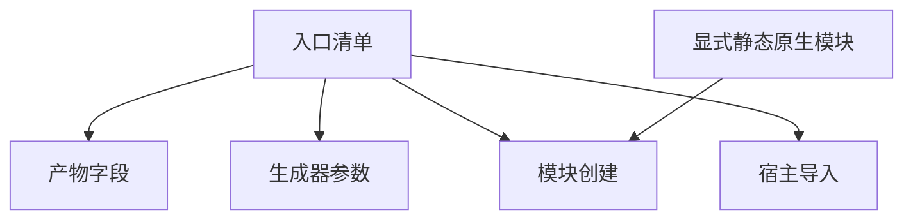
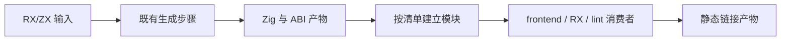

# 构建入口清单收敛执行计划

## Intent：最终目标

继续架构报告未完成优化，本轮完成第 4 项：入口信息集中声明，消除产物字段、模块创建和宿主导入的重复接线。

## Data：可用证据

- 基线提交 `79cfb5811` 已将 14 个检查入口拆到测试专用生成步骤。
- `entries.zig` 已驱动输出参数，但 `parser.zig` 仍手写 Sources 和模块创建，`compiler.zig` 重复维护 ParserModules 和宿主导入。
- 现有 `checks` 函数已经采用清单循环建立模块，是本轮结构参考。
- 工作区已有暂存的测试与记录改动，本轮不覆盖、不提交它们。

## Edges：边界与限制

- 保持每个入口的导入名称、原生依赖、ABI 模块身份和生成顺序；尤其复用 standard 的 resolution ABI。
- 只修改构建层，不修改 RX/ZX 语义，不增加运行库，不新增测试用例，不调用浏览器。
- 不将本轮接线收敛描述为第 1 项统一生成完成，也不承诺编译性能提升。
- 不创建分支，不自动提交或推送。

## Answer：步骤与成功标准

1. 清单补充消费者及真实原生依赖；编译期派生产物字段和宿主模块字段。
2. 用清单循环替换模块创建与导入，保留宿主专用模块的显式接线。
3. 执行构建及现有相关回归，核查生成输出与原生依赖不变。
4. 记录实际结果、局限与自我批判。

### 架构图

### 数据流图

