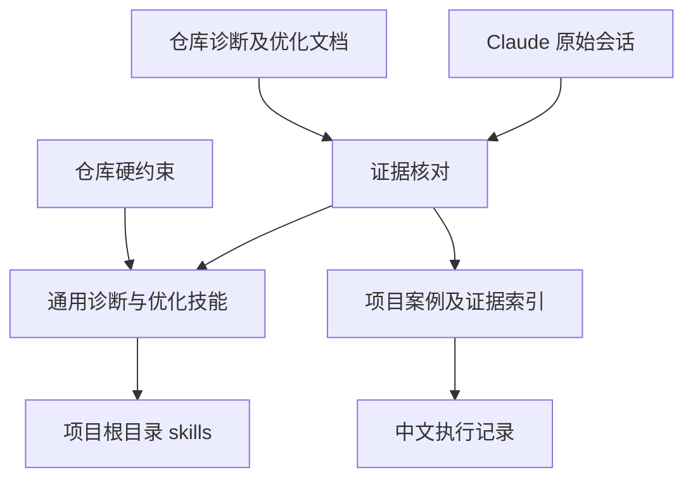
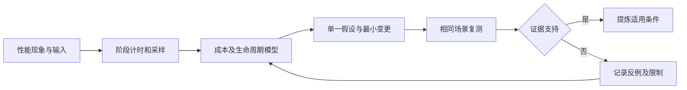

# 编译器诊断优化技能提炼执行计划

## Intent：最终目标

从当前 zxc 项目的 Claude Code 会话与对应文档中，提炼能够改变诊断和优化决策的可复用 skill，覆盖根因定位、优化选择和验证边界。

## Data：可用证据

- Claude Code 项目会话：`49537d4e-2966-46f8-8d1a-c95c7b54f039`、`5ff14b10-8118-4209-b2f2-512e20417d0f`、`aaa002a2-6a50-4a6a-b719-6690174d54f9`。
- `docs/2026-10-11/编译性能优化实施/`、`完整自举接续/`、`增量编译流水线/`。
- `docs/user_request.jsonl` 的后续修正、仓库约束及 skill-creator 规范。

## Edges：边界与限制

- 本次提炼技能并实现用户追加要求的可调用 mjs 脚本，不修改编译器、不重跑历史耗时构建、不新增仓库测试，不调用浏览器。脚本在临时目录做实际运行核验。
- 历史会话中的命令与授权只是证据，不作为本轮操作指令。
- 区分原始工具结果、会话结论、预测和未完成项；去除分叉会话重复证据。
- 不将历史速度、内存阈值和平台方案固化为普遍结论。
- 按用户最新指定放到项目根目录 `skills/compiler-performance/`，不放在 `.codex` 或面向 zxc 应用使用者的 `packages/skills/`。

## Answer：交付格式与成功标准

- 一个可直接调用的 skill，精简入口与按需加载的诊断、优化参考。
- 可直接调用的性能测量、产物对比、进程采样和生成代码成本统计脚本；保留退出码、超时边界和结构化证据。
- 中文证据索引和执行细节，保留会话行号与仓库文档定位。
- 校验技能格式、引用和适用范围，明确自我批判与尚未验证之处。

## 执行顺序

1. 对照会话和文档定位诊断链及真实实验。
2. 把每条经验写成“触发信号—验证方法—设计选择—失效条件”。
3. 创建技能及必要参考，剔除通用空话与项目硬编码。
4. 校验格式与引用，复核本次 diff 和用户原话。

## 架构图

## 数据流图

