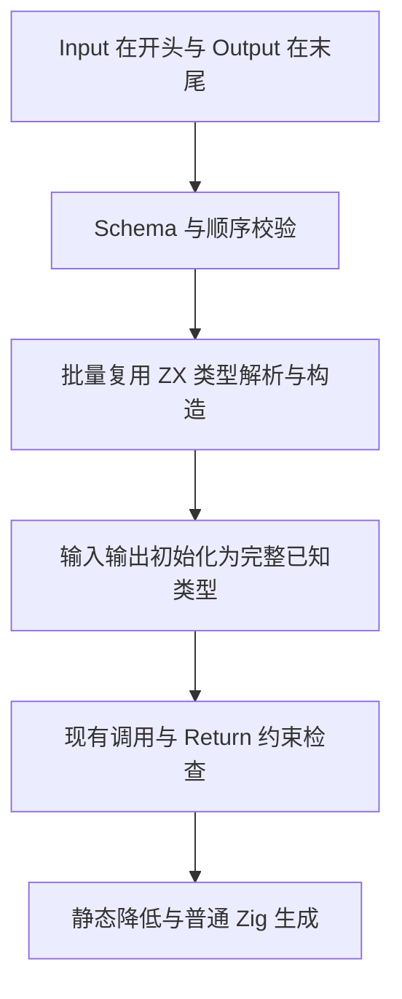
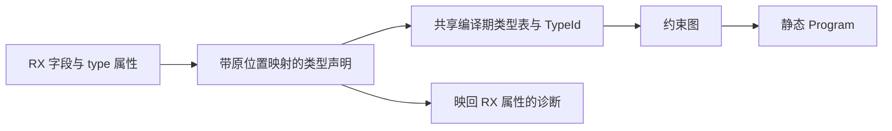

# RX 显式输入输出契约

## Intent：最终目标

按用户最新要求，`Input` 放在 `Module` 开头，`Output` 放在末尾，明确字段与类型并减少端口的隐式推导。声明仅影响编译期类型契约，不新增运行库。

## Data：可用证据

现有 Module 的 `in/out` 属性只接受名字，真正端口来自调用和 Return 的约束推导。现有类型图已经支持完整已知类型、字段缺失及调用和返回检查；ZX 类型解析和解析后的类型表可以直接复用。

## Edges：边界与限制

- 对象字段写成 `<Input><Field name="value" type="u64" /></Input>`；Output 同理，放在所有执行步骤之后。
- 整值类型写成 `<Input type="u64[]" />`、`<Output type="bool" />`；无输入或输出显式使用 `type="void"`。无字段且无 type 的声明表示空对象 `{}`，与 void 不同。
- 每种声明最多一次，Input 必须第一个子元素、Output 必须最后一个；type 属性与 Field 子元素互斥。Field 不携带 Store 初值。
- 为保持现有自举源码兼容，缺少声明时沿用旧推导。显式 Input 未使用时仍保留其类型；声明不是可执行 Step。
- 类型使用普通 ZX 语法；不根据已有表中的名字猜测外部 ZX 类型。RX 当前没有 ZX 类型导入语法，本阶段不扩展导入协议。
- 契约类型批量解析，一次复用共享类型构造状态，避免逐字段复制类型表。增量继续使用现有 RX 摘要失效边界。
- 不新增测试用例；用真实自举模块接入声明，运行既有相关回归与同输入性能核对。

## Answer：交付格式与成功标准

实现 Schema、顺序约束、批量类型解析及约束图接入，在 YAML 字段间模块中实际使用声明。已知类型校验调用和返回值，并保持缺省推导兼容。记录构建、行为、性能及剩余边界后独立英文提交并推送。

## 实现与证据

- `labels/{Input,Output,Field}.zig` 与共享 Schema 负责字段形式、静态属性、字段名、重复字段和 type/Field 互斥。Module 校验 Input 首位、Output 末位及唯一性。
- 执行步骤保持原模型；准备阶段过滤声明，因此末尾 Output 不会被误判为 Return 后的不可达执行。
- `analysis/project/contracts/source.zig` 批量组装普通 ZX 类型声明并保留属性位置映射，防止字段内容越出单一类型表达式。内部别名按规范化模块路径及端口稳定命名，不按当前模块排列编号确定名义身份。
- `contracts.zig` 一次解析、一次使用已有类型构造器初始化，直接扩展现有共享类型表。临时声明名称环境和诊断 reporter 在作用域结束时恢复，名称缓存先释放，再销毁解析 arena，避免借用键逃逸。
- 约束图以完整 known 类型初始化显式端口；显式但未使用的 Input 不再降为 void。调用、Return、返回路径及最终 IR 编译继续使用原有检查。
- YAML 字段间规则已经使用首部 Input 和尾部 Output。其真实源码通过 `check-rx --entry`、`fmt --check`、`lint`，并由正式生成编译器实际编译为 Zig；ReleaseSafe 完整构建成功。

没有添加新的编译器专用原生接口或运行库。现有解析入口接受完整 ZX 模块，因此这里有一次类型文本组装及 parser 自有源码副本，而非逐字段复制完整类型表；这是明确的编译期适配成本，不是应用输入数组或运行时数据复制。Schema 和端口装配接入既有手写 RX 宿主分析层，这部分仍属于完整自举的待迁移闭包，不能宣称已经全部 RX/ZX 化。

### 验证范围

- `packages/compiler` 的 `zig build test-rx -Doptimize=ReleaseSafe --summary all`：39/39 通过；最终源代码再用固定生成器执行同一检查。
- 既有 `contract_test.zig`：8/8 通过；`test-rx-text` 各组成功。验证时临时把既有构建步骤入口选为已有契约文件，结束后已原样恢复 `packages/test/build.zig`，没有新增测试用例。
- 既有 RX 格式化 52 项、导入排序 22 项、manifest 格式化 126 项，各连续三轮全部通过。
- RX 执行表达式编辑后，增量与干净生成 1,425/1,425 文件一致；恢复后的增量与干净生成、恢复后与原始输出也分别全部一致。日志显示编辑仅分析 2 个模块，复用 1,454 个模块。
- 没有声明的相同源码，由旧、新同模式 seed 生成器生成：1,424 个文件字节一致，唯一变化为 `.zxc-inputs` 的生成器身份摘要。
- 给同一接口加入声明后，1,387 个文件字节一致，36 个公开包装文件仅局部 `zx_shape` 编号改名，另外变化为输入摘要与文件摘要清单。逐个形状按自身内容和子形状内容递归计算摘要，归一化后这 36 个文件也一致；没有简单抹掉所有编号来掩盖接线变化。1,311 个函数文件及类型 ABI 保持一致。

### 性能核对

使用 compiler-performance 脚本，所有最终性能轮次与构建、测试隔离。新旧生成器均为 small 根模块、safe 宿主模块的 seed 路径，常驻服务关闭，共用已预热的函数文件缓存；每轮使用新输出目录，确保不是输入摘要命中后跳过分析。三组各 7 轮，输入、驱动和工具均记录内容摘要。

| 场景             | 墙钟中位数 | CPU 中位数 | 推导 / 生成 / 写出中位数 |
| ---------------- | ---------- | ---------- | ------------------------ |
| 修改前，无声明   | 478.65ms   | 2.34s      | 70 / 332 / 27ms          |
| 修改后，无声明   | 483.21ms   | 2.33s      | 69 / 330 / 26ms          |
| 修改后，显式声明 | 478.05ms   | 2.34s      | 69 / 336 / 25ms          |

RSS 中位数分别为 212,385,792、212,467,712、212,860,928 B，通常采样范围重叠；无声明新路径有一轮峰值为 251,691,008 B，不能用中位数隐去这次波动，也不能据此承诺峰值上限。没有逐字段分析或复制共享类型表，无声明路径不构造声明文本或解析 AST，也没有应用端运行时新增分配。最终的推导与 CPU 成本保持在相同范围；无声明整轮墙钟增加约 0.95%，显式声明整轮基本持平，不能把这种进程启动与 IO 波动推算为普遍提速或确定退化。

一次原地替换测量副本后的启动失败未混入统计；最终改用新路径的最终构建副本，并重新完成全部性能轮次。最终报告位于本目录被忽略的 `contracts-verified2-{implicit-before,implicit-after,explicit-after}.json`。产物对比为 `contracts-{legacy-output,dogfood,edited,restored,roundtrip}-diff.json`；各构建、回归和限时记录均以 `contracts-` 为前缀。

### 未通过的完整回归与自我批判

完整 `test-rx-inference` 的 ReleaseSafe 运行达到 240 秒上限，被限时工具结束。采样显示主线程等待 `genz` 唯一性分析线程，该线程在 `FailingAllocator` 的 Mach-O 栈回溯中 panic 后递归等待回溯锁。Debug 重试也在同一栈回溯子系统等待，已主动结束。采样保存在 `contracts-test-wait/` 与 `contracts-test-wait-debug/`，不能把这两个完整套件记为通过，也没有禁用分配失败检查来制造通过。

后续阶段定位到通用分配器被隐含跨线程共享，修正资源契约后，完整 138 项 ReleaseSafe RX 推导回归已通过。见 [分析并发与验证阻塞](分析并发与验证阻塞.md)，此处保留本阶段当时的真实失败记录。

当前证据支持新语法、真实模块接入、旧契约兼容与生成成本；不等于全部异常组合或完整自举已经验收。未新增专门测试，复杂命名类型导入、其余旧 RX 模块的声明迁移，以及完整阶段自编译仍需继续。端口源码装配与 Schema 仍在宿主层，后续需要按完整职责迁移，而不是仅依靠入口标签数量判断完成率。
