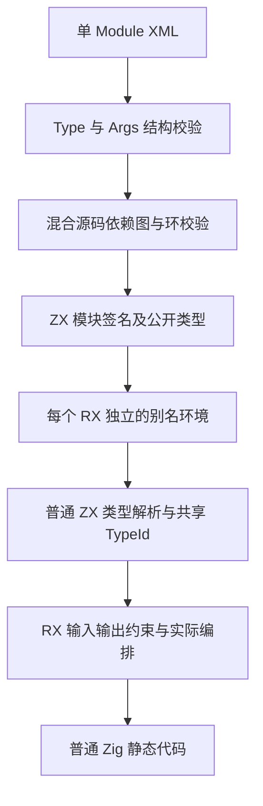
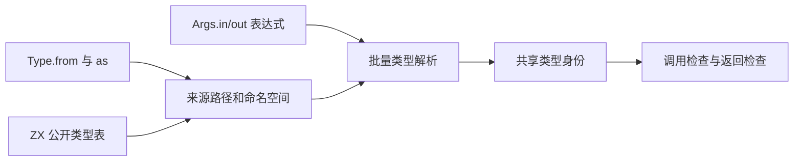

# RX 类型引用与 Args 实施

## Intent：最终目标

用 Type 声明明确的类型来源，用 Args 声明模块输入输出。复杂对象复用 ZX 的公开类型，减少重复定义和隐式推导；保持 RX 编排可读、单 Module 根、普通 Zig 静态生成与零专用运行库。

用户已明确授权实现，最终修正以本文为准：类型引用标签为 Type，as 必填，from 默认不写 .zx；不采用前置 Import、多根文件、Import 包裹 Type、独立 Input/Output 或 Module.input/output。

```xml
<Module>
    <Type from="calculate_total" as="Total" />

    <Args in={Total.Input} out={Total.Output} />

    <Call fn="./calculate_total" in={$in} />

    <Return value={$ctx.calculate_total} />
</Module>
```

## Data：可用证据

基线为 fb369ccd。该基线的 Module 使用 Input/Output 字符串或内联 Field 契约，contracts/source.zig 将全部声明批量拼接为一次 ZX 类型解析。签名阶段已经拥有每个 ZX 模块的公开类型表和共享 TypeId；Type 应引用这些结果，不重复解析或重建类型。

只读分析已确认：当前普通 ZX 类型解析不支持 Alias.Type；原生及生成解析器需要同步补齐。现有 Import 专用于 RX 模块依赖，不应承接本次类型引用职责。多个 RX 可各自使用相同别名，类型绑定环境必须按模块隔离。

## Edges：边界与限制

- Module 内 Type 可以多个，置于 Args 前；Args 唯一，其 in/out 为类型表达式。标量可直接使用 ZX 内建类型，导入类型必须通过别名限定；无输入或输出使用 void。
- Type.from 使用与 Call.fn 一致的 ZX 路径规范，不按文件是否存在猜测源码种类；as 是非空有效标识符，当前作用域不得重名。
- 用户随后要求单函数转发模块支持 `<Module fn="./calculate_total" />`，直接复用目标函数接口，fn 与子节点互斥。其他新增需求及逐项验收统一记录于新增语言需求实施清单.md。
- 本阶段实现用户要求的 ZX 源文件公开类型引用；不扩展新的编译库类型加载协议。既有 Import 的 RX 模块语义保持独立。
- 缺失来源、未导出或非类型名称、未知别名、冲突及依赖环必须在编译期给出定位；未使用的 Type 声明也需要解析依赖并检查环。
- 类型表达式复用普通 ZX 类型语法，支持复杂对象及既有组合能力；不将类型属性当字符串，也不引入 RX 专用类型语言。其他消费类型的 RX 场景须盘点并复用相同能力，不把本次 Args 做成无法扩展的特殊分支。
- 不新增用例、不创建分支；迁移现有仓库源码和相关已有断言、文档及生成源头，不仅修改生成产物。超过五文件的模式迁移先检查 grit，当前环境无 grit 时使用有明确范围和幂等检查的临时迁移程序。
- 性能按先实现、再优化推进，发现退化保留功能并定位。语法变更的前后输入差异必须明确；未修改语法的同输入场景独立比较，不把不同输入测量当严格同输入证据。

## Answer：交付格式与成功标准

1. 接入 Type/Args Schema、属性分类、顺序与别名校验，移除被替代的 Input/Output 契约和 Module 名称标注。
2. 普通 ZX 支持限定类型名；RX 通过已分析签名为每个模块建立类型别名环境，批量解析 Args 并接入既有约束求解。
3. Type 引用进入源码收集、混合依赖图、缓存失效和真实文本入口，格式化保留类型表达式写法与语义空行。
4. 迁移自举源码和既有相关检查，构建真实生成器与 CLI；核对实际产物、类型身份、正确性及缓存编辑/恢复。
5. 比较正式路径耗时、CPU、RSS 和生成形态，记录未验证项及自我批判，英文规范提交并推送。





## 过程记录

以下保留实施中的证据与失败边界；本子阶段最终状态见文末“阶段 12A 验收”。

已保存基线工具及四个源根快照至 /tmp/zxc-type-args。已接入 Type/Args Schema、属性角色、每模块别名、ZX 限定类型名、源码图/CLI 装载和 Module.fn 内部展开，并迁移原有四处 Input/Output 契约。

从正式分析的实际类型表、公开类型和依赖图取得全部 161 个自有 RX 的接口事实；45 个纯转发文件（含已有运行夹具）对齐为 Module.fn，另 131 个编排模块补齐 Type/Args。新增类型边在迁移程序中以完整依赖关系检查，避免匹配到下游类型而制造环。当前四个源根的普通 RX 均有显式 Args 或单函数简写。临时事实提取程序只在 /tmp 中复制构建脚本读取真实分析，不加入生产入口或测试用例。

初始与源码对齐后的 bootstrap 构建均 34/34 成功，初始 CLI 46/46 成功，既有 RX Schema/依赖检查 39/39 通过，实际 57 入口生成成功。Args 类型属性已与值表达式分开，避免把数组/可选类型交给值解析器。仅调整已有用例与生成源，RX 属性用例数量仍为 parsing 70、schema 78。

源码对齐涉及四处已有声明的源包类型，新增 Type 对已声明源包的解析与 CLI 类型源收集，不支持新的编译库类型加载协议。直接解析 Args 类型值后的 bootstrap 34/34、CLI 46/46 构建成功；既有文本、推导和属性检查 99/99 步、408/408 测试通过。消除早期名称/遍历帧复制后，重跑相关文本及推导检查，51/51 步、260/260 测试通过。本阶段尚未完成最终性能门禁和提交。

### 其他消费类型的剩余范围

用户原始要求也包括其他 RX 类型属性，当前 Store.Field.type 仍为旧字符串，Store 定义尚不接受 Type。该部分没有完成，不能用 Module 接通代替全部类型消费范围。进一步实施必须让普通模块的 Store.from、Store 定义及其 Type 来源进入同一文件依赖图；不能只在类型解析器中加 aliases 而漏掉循环和失效。

已确认 ZX 签名阶段使用 header、类型声明和 has_store，不绑定 Store 运行期对象，因此可以在 registry 前分析签名，再用其共享类型表与每 Store 的别名解析定义。registry 追加的类型后缀必须保留，不能被 prepare.loadSignatures 覆盖。Store 元节点需要进入额外 roots，混合编译跳过元节点并正确记录缓存边界，不制造假的运行期 Source.Loaded。

另外，Type 引入的枚举目前不能在 RX 值表达式中用 Model.Enum.Member 访问；RX inference、表达式 Options/initial aliases 及普通 ZX 的 enum-owner 识别需要共同接入限定名称。该缺口同样保留在第一项后续子阶段，不能通过运行期命名空间对象替代。

### 性能优化中的证据

同输入 623 模块初测未观察到稳定耗时回退，但热缓存 RSS 中位数高于旧工具。实际生成的 name.zx 在内建类型/cache/alias 短路前有两次 allocator.create，分别复制名称和遍历帧。已改为直接使用规范化文本查询，普通路径复用原帧；仅进入本地声明且文本变化时构造新名称，保留限定名及注释处理。新的构建正在验证，旧测量不作为优化后结果。

第一次优化后，两种执行顺序合计的同输入热缓存中位数为 270.860→270.868 ms、CPU 1.210→1.210 s、峰值 RSS 185.625→185.656 MiB，原有热内存增加消失。完整项目则仍有 674.580→692.923 ms、355.297→365.070 MiB 的热缓存成本，不能通过门禁；纯 ZX CLI 同输入也有额外 CPU 成本。这轮 type-args-optimized-*.json 保留为中间证据，不作为阶段交付结果。

进一步修改将内建、缓存与导入名的原文查询放在规范化之前；只有查询未命中时才处理名称中的空白/注释，文本变化后重新走同一解析规则。正常限定名也直接命中已有别名，不为所有类型名扫描字节。Args 批量解析同时改用已有索引语法，类型解析直接借用节点与边，不再将生成解析器结果还原为原生 AST，再转换回生成类型解析器的另一套结构；seed 保留原生视图。临时合成的声明名称仅用于边界校验，不暴露为其他 Args 可以引用的本地类型。

上述索引变体的正式测量仍有完整项目和 CLI 额外成本，没有作为门禁通过。当前继续将本地声明查询也放在规范化之前，全部普通名字命中时完全跳过新增 normalizer。另移除临时声明名称中已无身份用途的路径 SHA256，使用当前批次唯一的模块编号；名称仅用于检查合成声明边界，类型与公开产物不依赖它。生成 lexer 的字节 reduce 每字符调用 tick，tick 与合法标识符继续分支存在状态装箱，长合成名确实增加这条调用/分配路径；没有把整轮 RSS 或耗时变化全部归因于它。

静态核对也排除了无条件逐声明整表复制的猜测：publish 使用前沿 reserve 并只写新元素，程序声明循环直接更新值状态。类型解析的每端口独立 arena 和同模块 aliases 快照仍有重复准备，后续如有成本证据再收束，不在当前无证据扩大抽象。

### 缓存及真实产物

索引变体相对前一工具的全部 1452 文件核对，只改变 name.zx 对应生成函数以及 .zxc-files/.zxc-inputs；其他实际生成文件相同。磁盘缓存下，对 Shape 别名重命名、切换到已公开且等价的 Walk.Output、恢复原文，暖/冷及原始/恢复四组 1452 文件均逐字节相同。

同一常驻 PID 进一步完成上述三种编辑、将实际 Shape.Plan.numbers 从 u32[] 改为不兼容 bool、再恢复。四组暖/冷和两组恢复比较均为 1452 文件逐字节相同；不兼容类型在常驻与冷进程中给出同一位置、代码和正文的诊断，没有复用旧接口。报告为 type-args-resident-interface-edit.json。临时驱动修正了名称遮蔽、socket 诊断写入服务日志及分区参数不一致的问题；这些失败没有作为编译器行为失败或性能样本。

短名称/慢路径规范化变体也已完成独立磁盘和常驻编辑/恢复核对，结果仍为全部 1452 文件相同；见 type-args-compact-cache-edit.json 与 type-args-compact-resident-interface-edit.json。相对索引变体，全部生成文件仍仅有 name.zx 对应函数及两项元数据变化。

### 现有应用与库检查

短名称变体的既有文本/推导检查为 260/260 测试通过。与之同跑的库入口 5 个用例最初因环境缺少默认 z3 返回 FileNotFound，未记为功能回归或通过。随后从 [Z3 官方发布](https://github.com/Z3Prover/z3/releases/tag/z3-5.3.3) 取得 arm64 工具，核对发布的 SHA256，解压至 /tmp/zxc-type-args/tools，并通过 ZXC_TEST_SOLVER 指定真实求解器；重跑 test-library-entry 为 41/41 步、5/5 用例通过，覆盖新 Module.fn 的发布、重定位、源码消费及原生 Zig 兼容。没有用固定 unsat 输出代替求解器。

顺序运行、Task、值策略和并行运行的合并命令未完成：并行 results_test 的分配失败检查停住。对实际 PID 71163 的三秒采样显示，主线程等待 join，一个工作线程在 FailingAllocator 捕获堆栈时进入 StackIterator.next 的 corruptSwitch panic，另一个线程等待共享分配器锁。已终止确认停住的测试及其构建；保留 type-args-runtime-wait-profile 和无效的检查报告，不把其他已执行步骤合并宣称全套通过。触发堆栈捕获 panic 的根因以及旧工具是否同样触发，尚未隔离。

### 最新性能门禁：仍未通过

短名称变体使用同一工具链、实际优化模式及两种执行顺序，关闭 resident；每组热缓存 14 次、冷生成 10 次，CLI 每样本连续 200 次独立进程、合计各 14 样本。623 模块同输入场景采用两工具都支持的历史 RX 接口与同一 ZX 源码快照；完整项目比较的是实际旧源码与新标准对齐后的源码，包含新增类型规范化功能，不能当作严格同输入。CLI ZX 使用同一实际文件，RX 使用新旧语法的等价模块。

| 场景           | 墙钟 ms：前→后    | CPU s：前→后 | 峰值 RSS MiB 中位数：前→后 |
| -------------- | ----------------- | ------------ | -------------------------- |
| 同输入热缓存   | 266.892→265.162   | 1.205→1.200  | 185.453→184.398            |
| 同输入冷生成   | 634.530→631.309   | 3.800→3.805  | 190.242→189.680            |
| 完整项目热缓存 | 675.129→690.708   | 3.360→3.420  | 356.148→356.047            |
| 完整项目冷生成 | 1407.849→1423.904 | 9.010→9.130  | 361.992→353.109            |
| CLI ZX ×200    | 1054.161→1067.921 | 1.110→1.140  | 55.734→55.750              |
| CLI RX ×200    | 1206.859→1247.038 | 1.475→1.500  | 55.773→55.727              |

原始报告前缀为 type-args-compact-，汇总为 type-args-compact-performance-summary.json。内存成本已经收敛，但完整项目与 CLI 额外耗时仍需定位，不能宣称无性能退化或提交完成阶段。完整项目阶段日志的一组样本为 infer 232→235 ms、emit 347→366 ms、write 37→36 ms，下一步重点转向实际生成路径，不继续凭猜测只改 Args 解析。

两组前后短采样捕获到实际工作，但工具在采样后看到目标已结束为 defunct，因此身份检查返回非通过；记录于 type-args-emit-profiles.json。正式工具被裁剪，主栈仅能定位 main+offset，不能将这些样本解释成具体函数比例。当前使用临时显式保留 root/generated 调试信息的构建采样；脚本 finally 恢复唯一的 strip 设置，不将该变体时间用于正式前后比较。

带符号构建 34/34 成功，临时构建设置已恢复。两轮采样均定位到 function_analysis.remaining 下的 calls/expressions.zx 扫描；它只读取 kinds、payloads、call_functions，却把完整 Expressions 记录保存在每轮循环状态中，生成代码内联了整张表的列描述符。当前最小改动仅使该状态借用这三列，公开 Input/Output、任务拒绝、调用边界和允许值比较保持。此假设尚待无探针构建、产物和性能复测，不能把采样窗口次数解释成整轮收益。

### 三列扫描变体验证中

无探针 bootstrap 34/34、CLI 46/46 构建成功。完整 1452 产物比较仅改变目标扫描函数、types.zig 与两项元数据；types.zig 的 4554 项声明中，只有两项内部循环状态类型被两项新状态类型替换，其他声明正文相同。独立磁盘及同一常驻 PID 的别名、类型来源、不兼容类型和恢复校验全部保持通过。既有 Task/值策略检查为 76/76 步、78/78 Zig 测试通过，三个 Node 分组为 3、37、32 项全部通过。

原并行 OOM 问题已用 fb369ccd 的 baseline-cli 复现：从该提交复制 service、left、right 三份原有 RX，复用原有 map_values/double_values ZX 和完全相同的 results_test，旧工具生成的两个工作线程和左右模块包装仍在，未裁剪 ReleaseSafe 下前 5 项通过，第 6 项同样在捕获失败堆栈时 panic `switch on corrupt value` 并由 20 秒受控执行终止。报告 type-args-parallel-baseline-oom-check-2.json。CLI 此路径将 ABI 内联进 program.zig，并非原夹具工具的两文件 bundle，因此没有宣称原始源码字节相同；最初假定存在独立 ABI 文件的驱动已修正。

对本次实际卡住的同一生成程序，仅改变 Zig 的诊断信息裁剪配置（ReleaseSafe -fstrip），现有 6 项检查含完整分配失败枚举全部通过；报告 type-args-parallel-oom-stripped-check.json。测试源码与 OOM 断言未改动。由此保留原始未裁剪并行检查为已确认旧工具也触发的诊断路径缺口，尚未宣布根因已修复或整个并行套件通过。

旧工具生成的同一工作流在 -fstrip 下也为 6/6 通过，补齐旧/新工具的两组诊断配置对照。临时重放复用同一现有测试文件，没有新增断言或跳过 OOM。

### 三列状态的正式测量与后续

两种顺序合并的同输入热缓存为 268.767→259.432 ms、CPU 1.205→1.150 s；冷生成为 638.902→629.992 ms、CPU 3.820→3.770 s。完整项目热缓存墙钟 676.226→676.307 ms、CPU 3.370→3.340 s，原有生成阶段额外成本已经收敛；冷生成 1406.115→1412.283 ms、CPU 8.985→9.035 s。对应峰值 RSS 中位数为同输入热 186.656→185.367 MiB、冷 189.672→189.914 MiB，完整项目热 357.188→361.180 MiB、冷 371.125→367.438 MiB；完整项目热 RSS 两种顺序的变化方向不同，不能判定稳定内存回退。

CLI ZX ×200 仍为 1043.817→1063.727 ms、CPU 1.105→1.120 s；RX 为 1197.825→1220.475 ms、CPU 1.470→1.440 s。没有据其他场景改善而忽略这项额外成本。以字节完全相同的 baseline-cli 副本再做同文件、同输出目录、两个执行顺序各 3 样本的 A/A 对照，耗时与 CPU 基本相同（各轮约 1012–1014 ms、CPU 1.070 s），不支持将 A/B 的全部差额简单归为可执行文件复制或路径噪声。

当前再将限定名称续接从 primary 普通类型路径独立到 name_part 原子状态处理。primary 恢复原有主路径；新状态保留原先的 identifier 与深度检查、诊断及名称跨度。第一次构建暴露新文件导入顺序不符合内建格式规则；格式化命令的参数顺序纠正后已检查实际文件，再重建。尚无这一变体的性能结论，阶段继续保持未完成。

续接分离后的 bootstrap 34/34、CLI 46/46 构建成功。小样本同文件 CLI 仍有额外成本，因此没有将这一假设视为已解决。随后对明确的、启动时暂停的自有 CLI PID 先附加原生 sample，再恢复运行，捕获到了实际编译调用。0.1 ms 采样间隔不受平台支持的尝试已保留，改为原生支持的 1 ms；只用它定位调用链，不把短窗口采样计数当作稳定时间比例。

调用链显示 project 返回 IR 后、verified_compile.checkProgram 以及后续渲染包装均会进入完整校验。逐调用核对 verified_compile 后确认：私有 render 的两个调用点分别来自 analyze 完成 checkProgram 后的 compile，以及显式 checkProgram 成功后的 emit；这之间没有 IR 变换。原 render 对有契约的程序本就直接调用 genz，而无契约时再经过公共 compiler.zig.emit 重新校验一次。当前统一由该私有已检查路径调用 genz；checkProgram 的完整 IR、依赖收集和 SMT 检查，以及公共 compiler.zig.emit 对外部输入的校验均保留。该复用不增加跳过校验的公开参数或入口。

无探针构建再次为 bootstrap 34/34、CLI 46/46 成功。真实 Z3 的既有验证与非法 IR/OOM 检查正在运行，正式性能和产物复测尚待结束。

## 阶段 12A 验收

本子阶段完成 Module 的 Type/Args 与单函数简写。全部 161 个自有普通 RX 使用 Args 或 Module.fn，相关既有纯转发夹具、属性生成源和使用指导同步对齐。Type/Args 复用已分析 ZX 导出及共享类型身份，限定名称续接由独立原子状态处理；类型规范化使用已有 lexer，RX 表达准备、短路、扫描与汇总。公共函数生成仍为普通静态 Zig。

最终无探针工具为 /tmp/zxc-type-args/checked-render-bootstrap、checked-render-cli；基线为 fb369ccd 的工具及 Git 源码快照。实际优化配置前后相同：bootstrap 根模块 ReleaseSmall、相关依赖 ReleaseSafe，CLI ReleaseSafe；带符号工具只用于定位，未用于表中计时。合并两种执行顺序后：

| 场景                   | 墙钟 ms：前→后    | CPU s：前→后 | 峰值 RSS MiB 中位数：前→后 |
| ---------------------- | ----------------- | ------------ | -------------------------- |
| 同输入热缓存           | 271.591→258.765   | 1.210→1.155  | 187.234→186.984            |
| 同输入冷生成           | 634.609→625.745   | 3.800→3.765  | 191.258→189.562            |
| 完整项目热缓存         | 672.132→667.490   | 3.360→3.280  | 362.836→363.219            |
| 完整项目冷生成         | 1409.742→1395.759 | 9.010→8.915  | 359.125→360.445            |
| 同文件 CLI ZX ×200     | 1045.909→928.582  | 1.105→0.995  | 55.750→55.742              |
| 同物理目录 CLI RX ×200 | 1156.157→1159.898 | 1.440→1.380  | 55.789→55.711              |

热缓存每变体 14 样本、冷生成 10 样本、CLI 各 14 样本。RX 最后一项在同一临时目录、同一输出位置运行，只切换真实新旧接口文本；第一顺序新版本快约 3 ms，反序慢约 11 ms，合并差异约 0.32%，方向随执行顺序改变且样本范围重叠，未观察到稳定墙钟退化。之前跨 /tmp 与仓库目录的 RX 数据继续保留，不能作为严格同输入比较。完整项目源码包含新增功能及对齐，亦不是严格同输入；623 模块与同文件 ZX 场景提供独立的同输入证据。峰值 RSS 的小幅变化不解释为累计分配或内存泄漏。

产物与缓存：

- 同输入前后 566 文件仅 .zxc-inputs 工具身份不同；其余所有字节相同。
- 同输入暖/冷 566 文件、完整项目暖/冷 1453 文件均逐字节相同。
- 同一 CLI ZX 的 1 文件、新旧等价 RX 的 2 文件也分别逐字节相同。
- 真实别名、类型来源修改、类型不兼容与恢复的磁盘及常驻校验通过；成功产物每次 1453 文件与冷结果一致，失败时诊断一致。

最终检查包括真实 Z3 的 test-verification 与资源/非法 IR 检查：75/75 步、3/3 Zig 测试通过，最后一组 Node 验证为 74/74。此前本实现路径的文本/推导为 260/260，Task/值策略为 78/78 Zig 与三个 Node 分组 3、37、32 全部通过，库入口 5/5 通过。新/旧工具的同一现有并行用例在裁剪诊断信息时均 6/6（含 OOM）通过；未裁剪 ReleaseSafe 的堆栈捕获 panic 已确认旧工具也触发，保留为独立缺口，没有声称完整并行套件通过。

原始报告见 type-args-checked-render-_.json、type-args-neutral-rx-_.json；最终产物证据为 type-args-checked-render-generated-output.json、type-args-final-cli-output.json。原始数据和日志按仓库规则本地忽略，不提交。

### 自我复核与剩余范围

该阶段的性能结论仅覆盖上述实际输入、机器及模式，不能外推为所有项目、平台或 OOM 行为都相同。缩小循环状态与复用私有已检查结果减少了准备、复制及重复校验；外部 IR 入口的完整验证保留，少分配也意味着 OOM 触发位置可以变化，不能拿旧固定分配次数当语义要求。

第一项需求尚有后续子阶段：Store.Field.type 的表达式及 Store.Type 作用域、限定枚举值表达式仍未接通；编译库类型来源协议也未扩展。本次不将它们报告为完成。const.zx 导出常量及裸值清理、结构格式化/120 列、barrel/index、If、pipeline 均按新增语言需求实施清单继续；自举传递闭包与阶段自编译仍是最终目标，不能用该阶段构建或产物一致代替。

完整项目基线最初取自中途的源根快照，其中混入新 normalizer，预热失败后立即停止；没有将其当作有效基准。已从 fb369ccd 的 Git 内容重建独立基线，后续整项目测量必须使用该权威快照。

限定名的空白/注释规范化使用既有 lexer，RX 编排准备、短路、扫描与汇总，ZX 实现原子处理；seed 保留对应规范化。已修复初始构建暴露的局部命名、union 类型推断、来源未公开类型及回调捕获问题。当前构建记录 type-args-bootstrap-build-6.json，待核对终态。前一阶段性能及正确性记录见公开形状图规划自举.md，不替代本阶段验收。
