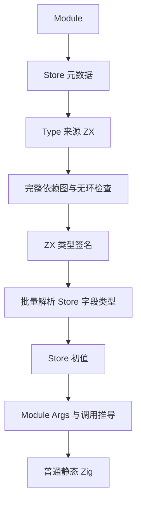
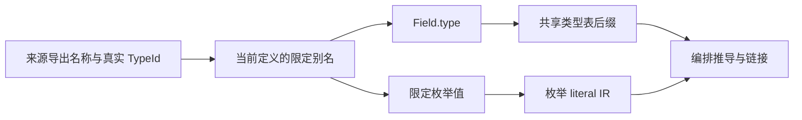

# Store 类型表达式与限定枚举实施

## Intent：最终目标

让 Store 与 Module 复用同一种 Type 来源声明，Field.type 使用花括号内的类型表达式，直接保留 ZX 导出的类型身份。RX 值和 Store 初值支持来源明确的限定枚举成员。完成后继续共享常量、格式化、barrel、If、pipeline，再继续自举。

## Data：可用证据

基线提交为 07196ea4。Module Type/Args 已实现，Store.Field.type 仍为静态字符串；Store registry 在 ZX signatures 之前运行，混合依赖图仅注册 RX/ZX。字段逐个执行完整模块分析，会重复复制共享类型表。

上一轮仅核对 max_u32 使用约定，没有修改实现，不计为功能推进。本轮先修复类型来源与初始化顺序的结构性缺口。

## Edges：边界与限制

- Type.as 必填、当前定义内唯一，Type 放在 Object 前；Field.type 只消费类型表达式，不执行值表达式。
- Store 定义作为依赖图元数据节点，Module → Store → Type 来源都参与无环检查，包括未使用来源与已注册 Store。
- 先分析 ZX 签名，再解析 Store 类型和初值；后续 Module 不能覆盖 Store 添加的类型表后缀。
- Store 元数据不生成函数、转发层或运行期命名空间，不改变共享内存生命周期。
- 源码包按所属文件解析；沿用当前 Type 只支持源码类型来源的边界，不伪造编译库支持。
- 不新增测试用例、不创建分支；运行现有相关检查和临时真实输入对照。实现保留，发现性能问题继续优化。

## Answer：交付格式与成功标准

依次接通 Schema、混合依赖图、签名与 Store 类型作用域、枚举值作用域、CLI 装载及活动源码。以类型身份、循环诊断、缓存编辑恢复、现有 Store 行为检查和同输入性能对照验收；完成独立阶段后英文提交并推送。

## 执行状态

阶段 12B1 与 12B2 已完成，实现、基线失败核对及性能验收见下文；修改前二进制分别保存在 /tmp/zxc-store-types 与 /tmp/zxc-enum-values。

## 阶段 12B1：Store 类型消费

实现 Schema 的 Type/Object 联合子元素与 Field.type 表达式角色；Type.as 唯一且在 Object 前。混合图加入真实 Store 元数据节点与 Module→Store、Store→Type 来源边，所有注册 Store 都作为根校验。元节点不产生函数，ahead 不调度元节点；history 比较定义 AST 与来源依赖，并保留元节点无 IR 行的事实。

初始化顺序调整为依赖图→ZX 签名→Store registry→RX 契约。registry 复用 Module 已有的 type_imports，prepare 保留 Store 扩展后的类型表，不覆盖后缀。Field 类型按整份 Store 一次解析并一次建立类型工作表，解析时隐藏合成声明；检查声明数量、名称及来源边界。保留共享类型、native 与 nominal 输入校验。

CLI collection 先完成物理路径与 Schema 检查，再装载类型来源并校验 Store 初值；源码包 Type 同时收集 Store 作用域。仅用作 Type 来源的文件分析签名，真正被 Call.fn 调用时分析函数体与授权。

已尝试 grit，环境无该工具；使用 /tmp/zxc-store-types 中的通用迁移脚本对齐活动 Field 声明，没有按示例路径硬编码。现有 schema 的字符串/表达式预期对应翻转，仍为 78 项，没有增加用例。Store Schema 的 children 现在区分 Type/Object，已有检查按真实数据结构更新。

第一次回归暴露旧检查访问 Object children 的结构变化、临时给共享 fixture 增加 Type 后部分调用方未注册来源，以及缺失/重复 Store 诊断优先级变化。已恢复共享 fixture 的最小输入，保留原缺失定义 capability 诊断和重复定义路径，修复检查访问结构。第二轮现有文本/推导/物理路径检查 91/91 步、260/260 Zig 检查及 16/16 Node 检查通过；syntax 单独 39/39 通过。

只读复核确认签名前缀、追加类型和 nominal/native 身份未重编号，并发现低层 Store API 的 nominal 校验不能省略，已补回。此处仍是编译器现有原生宿主适配层的接线改动，不能据此宣称 Store 分析职责已完整自举。

限定枚举值的两条接线已定位：RX 推导与实际表达式编译必须共享 aliases，Parallel Task 也要继承；原生与生成表达式分析要在递归分析 owner 之前识别完整限定名，并同步类型提示。留在阶段 12B2，当前未实现，也未把它算作本阶段交付。

## 阶段 12B1 验收

最终构建：bootstrap-build-final 16/16，cli-build-matched 28/28。现有运行、请求 IO、值约束与属性检查 store-runtime-checks 为 123/123 步、229/229 Zig 检查通过；属性执行另有 55 项与 6 项拒绝用例，全部通过。文本、推导和物理路径检查为 260/260 Zig 及 16/16 Node；独立 RX Schema 为 39/39。日志均位于 /tmp/zxc-store-types，不新增仓库测试用例。

真实文件对照包含：Store 引用仅导出类型的文件、引用声明 setter 的 ZX 公开复杂对象类型、别名改名、来源类型变为 bool 后初值不兼容、重复别名、错误调用 type-only 文件，以及恢复源码。每一状态的缓存与 --no-cache 结果相同；恢复后的生成文件与原始文件完全一致。另已确认未使用 Type 来源中的真实自环由编译和 check-rx 拒绝。显式 ZX→RX 文件导入仍受现有禁止规则约束，不把该拒绝当作混合循环执行能力的证明。报告为 store-types-physical-validation.json。

性能采用阶段 12A 同模式二进制为 before，当前 bootstrap/CLI 为 after；固定 Zig 0.17、ReleaseSafe 依赖、bootstrap 根 small、关闭 resident generator。所有构建和行为检查结束后，独立执行正反两种顺序。项目使用相同 manifest 和实际源码，热各 14 次、冷各 10 次；ZX CLI 各 14 次，每次 200 个独立进程。Store 编译各 14 次，每次 40 个进程，使用同一物理目录，仅在测量外将旧字符串类型与新类型表达式互换；因此 Store 对照是语义等价输入，不能称逐字同输入。

| 场景          | 耗时 before→after    | CPU 秒 before→after | 峰值 RSS 中位 MiB before→after |
| ------------- | -------------------- | ------------------- | ------------------------------ |
| 项目热生成    | 665.848→666.192 ms   | 3.275→3.280         | 359.484→363.508                |
| 项目冷生成    | 1411.388→1396.471 ms | 9.030→8.965         | 361.781→359.781                |
| ZX CLI ×200   | 930.669→917.117 ms   | 0.995→0.990         | 55.742→55.758                  |
| Store CLI ×40 | 98.479→98.272 ms     | 0.090→0.090         | 54.500→54.500                  |

热生成耗时差异为 +0.052%，各轮范围重叠。首轮热 RSS 中位增加约 4 MiB，存在 406 MiB 单轮峰值，不能忽略：两种顺序的第一组 after 中位低于 before，第二组较高。为此另做 14 对交错热测，耗时 672.664→672.397 ms、CPU 3.285→3.280 秒，RSS 中位 361.750→364.125 MiB；两侧范围分别 348.031–378.625、348.984–378.516 MiB。配对 RSS 差均值 +1.925 MiB，按 14 对样本计算的 95% t 区间约 -6.034 至 +9.885 MiB。当前未观察到稳定耗时、CPU 或 RSS 回退；不把 RSS 噪声宣称为节省，也不承诺未覆盖负载的上界。

完整产物比较：相同 after 工具热/冷生成的 1453 文件全部一致；before/after 的 1453 文件中仅 .zxc-inputs 的工具身份摘要不同，明确排除该单文件后其余 1452 文件全部一致。ZX 与语义等价 Store 的 CLI 生成文件分别逐字一致。报告为 store-types-output-_.json，耗时/CPU/RSS 原始报告为 store-types-project-_、store-types-cli-* 与 store-types-warm-interleaved-*；汇总为 store-types-performance-summary.json 和 store-types-warm-interleaved-summary.json，均按规则忽略，不提交。

## 自我复核与下一步

本阶段解决类型来源作用域、声明消费与初始化先后，不以文件扩展名或通过数量冒充完整自举。批量类型解析仍通过现有原生宿主驱动通用解析与类型能力，仍有待后续 RX/ZX 迁移；Store 的运行期共享内存、请求归属和授权保持既有行为。Stage 12B2 继续限定枚举值，然后实现真正的 export const 与 max_u32 直接导入使用，之后按清单逐项推进。

## 阶段 12B2：限定枚举实施

基线为 b14f3065，二进制保存至 /tmp/zxc-enum-values。将已有 type_imports 沿 RX 推导、顺序/并行编译及 Store 初值传递为独立 aliases，不加入运行期环境或捕获。原生与生成分析共用各自的 enum owner 查询；Type.as 与导出名均为单标识符，限定 owner 恰好为 Alias.Enum，更深普通对象链立即跳过。查询遵守 local/injected 值优先，成员检查和 literal IR 复用既有逻辑，hint 同步使用同一查询。公共表达式 API 的 alias TypeId 在分析前校验，包括 Expression 与 Program 模式。

初始实施遵循既有 IDEA 目标与边界；先实现再测量，出现回退信号时保留能力并优化。最终验收记录如下。

### 12B2 接线与边界

RX 推导、mixed/备用 lower、module_compile、Flow、Parallel Task 与 Store 初值已接通 aliases。类型上下文保留完整导出；值上下文只保留枚举及其类型别名，避免每个值属性重复初始化无关类型。整个查询复用原 TypeId，生成 EnumValue；类型来源没有加入环境 tuple 或 task captures。

原生与生成 enum owner 查询均先处理值遮蔽。只读复核发现 callback 的 scope_floor 会隐藏外层活动值；查询已改为检查全部仍 active 的同名 root，再交回普通值解析处理真实捕获。原生同时补齐 root injected binding 检查，避免 root/owner 两种注入形状产生分歧。通常对象的复杂 owner 在调用查询前短路；不会对整条深层属性链扫描 aliases。

公共表达式入口校验 alias TypeId 范围，覆盖 Program、Linking 和 Expression。types/check 的调用阶段显式携带 check_bindings，保留原 Expression 模式在 binding 建立之后检查 expected 的顺序，没有因新增 aliases 校验跳过原检查。初步构建发现两个调用点需同步新增参数，以及 loop 状态 ID 要以现有 Search.id 的 u32 类型初始化，均已修正。

### 12B2 正确性与基线失败核对

bootstrap 最终构建 16/16、CLI 28/28。现有组合检查覆盖 RX 推导、独立表达式 binding/runtime、nominal origins、Task 输出和 RX 属性，结果为 395/397 项通过；两项失败为空/非 nominal 后缀零分配。compiler 的 seed 构建与 frontend 检查为 307/313 项通过；六项失败涉及旧 map 参数、reduce initial 与 callback capture 期望。不能将这两组写成全套通过。

已从 b14f3065 用 git archive 提取 compiler/core/genz/lint/dsl 到 /tmp/zxc-enum-values/packages，保持原 frontend 检查不变，并只在临时 build 添加既有 suffix_resources_test 的独立运行入口。基线实际运行同样为 310/318 项通过、完全相同的八项失败。没有修改当前检查或断言：当前集合其余检查通过，新增能力没有产生新的失败。

前六项与成熟集合实现的 map(item,index,source)、省略 reduce initial、显式捕获外层值支持相冲突；仍需独立对齐旧期望。两项零分配问题的旧与新 producing/append 生成函数逐字相同，循环前无条件 renew 四列，导致空后缀也分配。列为旧问题继续处理，不把它们算作本阶段成功或缩减最终自举范围。证据日志为 baseline-existing-checks、seed-frontend-checks、semantic-checks。

公共表达式真实使用驱动位于 /tmp/zxc-enum-values/api-driver，12/12 构建步骤成功，验证限定字面量、注释/空白、owner/root 两种 injected 对象优先级、回调捕获与非法 alias TypeId；驱动调用公开解析与分析 API，没有添加仓库测试。原生 seed 与生成路径对同一限定枚举输入的六个源码文件逐字一致，唯一差异是 .zxc-inputs 的工具身份。原生生成器不装载 Store 定义，因此没有用它宣称原生 Store 项目入口已支持。

真实 Module/Store 输入已验证 Type 别名改名、$ 前缀合法别名、注释空白、未知成员精确位置、Store 别名不泄漏、不同来源的同名枚举拒绝混用、成员重排及恢复。每一状态缓存/--no-cache 产物与诊断一致，恢复后等于原始产物。实际应用执行覆盖 Call 参数、顺序 Task、Parallel Task、Store 枚举/枚举数组/嵌套对象初值；另执行枚举 Switch/Case 应用，均得到预期结果。报告为 enum-physical-validation.json、enum-application-runtime.json、enum-switch-runtime.json。

### 12B2 性能与产物

先完成实现，初轮三次热测 656.006→675.209 ms，约 +2.9%，作为回退信号保留功能继续优化。按实际值语义过滤枚举 aliases，并在调用 owner 查询前对普通深层对象短路后，初步三次热测为 666.527→670.708 ms，CPU 两侧均 3.320 秒；最终采用正反两种顺序重新测量，未使用初轮作为验收数字。

基线 b14f3065 与最终工具同优化模式、同工具链、同实际源码和 manifest；关闭 resident generator。所有构建与其他检查结束后独立测量，项目热各 14 次、冷各 10 次；ZX/RX CLI 各 14 次，每次 200 进程；Store CLI 各 14 次，每次 40 进程，Store 两侧均使用当前花括号类型语法，是相同输入。

| 场景          | 耗时 before→after    | CPU 秒 before→after | RSS 中位 MiB before→after |
| ------------- | -------------------- | ------------------- | ------------------------- |
| 项目热生成    | 669.723→673.313 ms   | 3.320→3.330         | 362.211→364.109           |
| 项目冷生成    | 1411.108→1411.481 ms | 9.045→9.080         | 358.617→365.734           |
| ZX CLI ×200   | 913.220→906.464 ms   | 0.990→0.990         | 55.734→55.750             |
| RX CLI ×200   | 1213.681→1216.155 ms | 1.440→1.440         | 55.734→55.719             |
| Store CLI ×40 | 95.933→95.698 ms     | 0.090→0.090         | 54.492→54.477             |

热生成 +0.54% 的两种顺序分别为 +5.56 ms 与 -1.59 ms，不能解释为稳定退化。冷生成整体耗时差 +0.026%；首序 RSS 中位差约 +10 MiB、反序差约 +0.13 MiB，且两侧单轮范围重叠、最大值约 409 MiB。为排除顺序影响，再做 12 对冷生成交错测量：耗时 1413.104→1413.507 ms，CPU 9.090→9.060 秒，RSS 中位 360.625→363.094 MiB；范围分别 351.312–374.812、351.609–384.641 MiB。
交错 RSS 配对差均值 +1.639 MiB，12 对样本的 95% t 区间约 -7.198 至 +10.476 MiB。实测没有稳定耗时、CPU 或 RSS 回退信号；保留 RSS 正向中位差和波动数据，不将其报告成节省。

项目完整产物：最终工具冷/热 1454 文件全同；before/after 仅 .zxc-inputs 的工具身份摘要不同，明确排除后 1453 源码文件全同。ZX CLI 一文件、RX CLI 两文件、Store CLI 一文件前后全部一致。原始报告 enum-final-* 及 enum-native-generated-output* 按规则忽略，源码和本记录提交。

### 后续工作

第一项 Type/Args、Module.fn、Store 类型消费与限定枚举值完成。继续真正的 export const、const.zx 中的 max_u32 直接导入使用，再按清单实现格式化、barrel、If、pipeline，最后继续自举闭包迁移。八项基线旧失败和通用 Store 生成入口边界继续保留在最终目标内；本阶段没有把它们隐藏或据此宣称自举完成。
