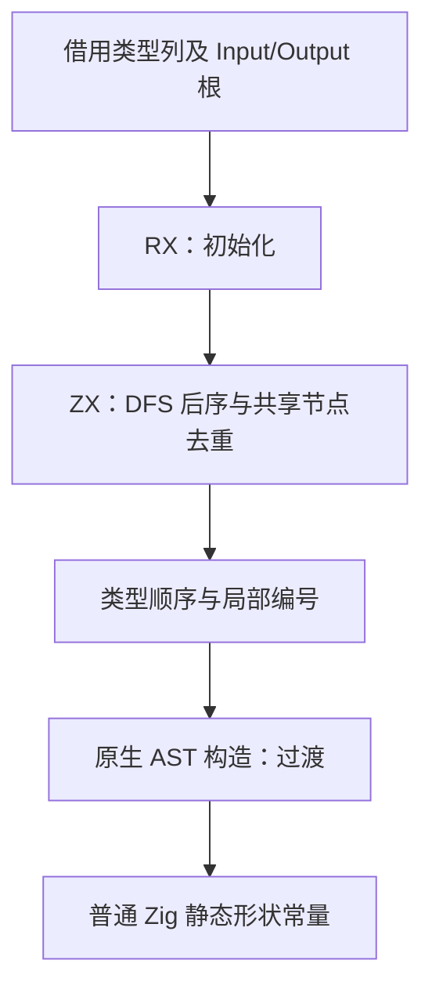
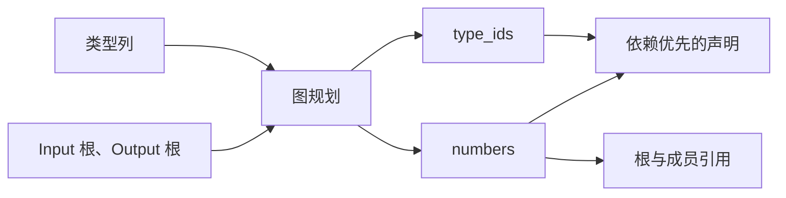

# 公开形状图规划自举

## Intent：最终目标

将公开形状元数据的可达图遍历、去重和编号状态迁入 RX/ZX，使私有名称由公开接口图决定，消除无关全局 TypeId 变化造成的冷热产物编号漂移。

## Data：可用证据

基线 `199b037d`。第九阶段已复现同一原生工具旧缓存与冷生成之间 41 个 public 文件仅 zx_shape 编号不同。shape.zig 用全局 TypeId 命名，fingerprint 按稳定类型名与布局 key 哈希，缓存复用边界和文本命名依据不一致。

公开契约是 input_shape/output_shape 的结构，zx_shape 常量为私有实现。完整 IR 保证子类型 ID 小于 owner，Task 不允许出现在公开根或容器中。

## Edges：边界与限制

- 以 Input、Output 固定根顺序和既有成员顺序做 DFS 后序，复用共享节点，编号独立于无关类型插入和全局排序。
- 仅 list/optional/object/tuple 有子类型边；enum、error_set、native_reference 为叶，保留 string 与其他 scalar 的区别。
- 正式路径执行 RX/ZX 规划，seed 保留匹配算法。输入列借用；AST 字段构造及种类到 Zig AST 的映射仍为明确过渡职责，不宣称整个 shape 后端完成自举。
- 不新增测试、不创建分支。使用既有生成、原生接口、库缓存及资源检查，真实输入差分和元数据结构对照，不仅比较成功退出。
- 提升输入指纹版本隔离旧持久化文本；另做合法源码编辑与恢复的增量/冷生成对照。
- 保留实现，根据性能证据继续优化，门禁达标后英文提交并推送。

## Answer：交付格式与成功标准

RX 连接初始化与图规划，ZX 实现内聚图算法；返回有序 TypeId 和局部序号映射。私有编号变化通过所有公开 input_shape/output_shape 的编译期结构对照，计算函数和 ABI 保持。核对同输入性能、缓存稳定性及剩余边界，按 IDEA 记录结果。

