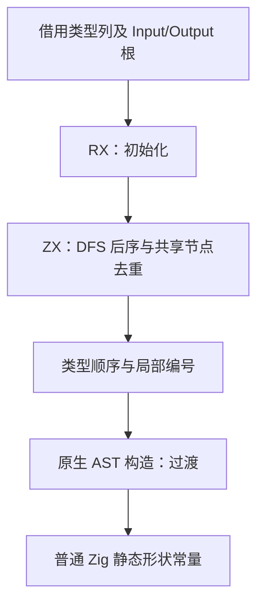
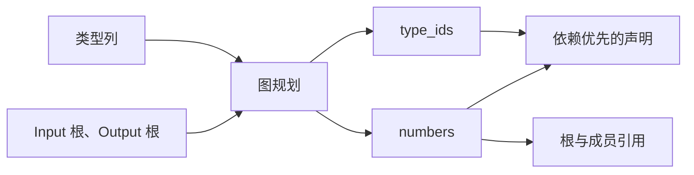

# 公开形状图规划自举

## Intent：最终目标

将公开形状元数据的可达图遍历、去重和编号状态迁入 RX/ZX，使私有名称由公开接口图决定，消除无关全局 TypeId 变化造成的冷热产物编号漂移。

## Data：可用证据

基线 `199b037d`。第九阶段已复现同一原生工具旧缓存与冷生成之间 41 个 public 文件仅 zx_shape 编号不同。shape.zig 用全局 TypeId 命名，fingerprint 按稳定类型名与布局 key 哈希，缓存复用边界和文本命名依据不一致。

公开契约是 input_shape/output_shape 的结构，zx_shape 常量为私有实现。完整 IR 保证子类型 ID 小于 owner，Task 不允许出现在公开根或容器中。

## Edges：边界与限制

- 以 Input、Output 固定根顺序和既有成员顺序做 DFS 后序，复用共享节点，编号独立于无关类型插入和全局排序。
- 仅 list/optional/object/tuple 有子类型边；enum、error_set、native_reference 为叶，保留 string 与其他 scalar 的区别。
- 正式路径执行 RX/ZX 规划，seed 保留匹配算法。输入列借用；AST 字段构造及种类到 Zig AST 的映射仍为明确过渡职责，不宣称整个 shape 后端完成自举。
- 不新增测试、不创建分支。使用既有生成、原生接口、库缓存及资源检查，真实输入差分和元数据结构对照，不仅比较成功退出。
- 提升输入指纹版本隔离旧持久化文本；另做合法源码编辑与恢复的增量/冷生成对照。
- 保留实现，根据性能证据继续优化，门禁达标后英文提交并推送。

## Answer：交付格式与成功标准

RX 连接初始化与图规划，ZX 实现内聚图算法；返回有序 TypeId 和局部序号映射。私有编号变化通过所有公开 input_shape/output_shape 的编译期结构对照，计算函数和 ABI 保持。核对同输入性能、缓存稳定性及剩余边界，按 IDEA 记录结果。

## 实施与实际验证

实现已由提交 `24f1f61b` 保存；以下证据在该提交之后补齐，不把先前提交视为已经完成性能验收。

- `plan.rx` 显式连接状态初始化与图遍历；`initial.zx` 建立局部编号表，`walk.zx` 实现有界 DFS。输入五个类型列直接借用，不重新编码类型表。
- 正式 `generated_analysis` 路径调用生成的 shape_plan；seed 保留相同顺序的原生规划。移除临时差分探针前，真实 57 个公开入口的访问顺序与编号表均与 seed 相同。
- 无探针的 bootstrap 与 CLI 均以 -Doptimize=ReleaseSafe 构建成功；bootstrap 可执行根模块实际配置为 ReleaseSmall，相关依赖为 ReleaseSafe，CLI 为 ReleaseSafe。新增 RX/ZX 文件的既有 lint 通过，四个修改的 Zig 文件通过 fmt 检查。
- 同一 57 入口、1,478 模块输入生成 1,448 个文件。57 个 public 文件仅私有形状声明及其引用变化；计算代码与 ABI 一致。额外差异是工具/输入身份与产物摘要文件 `.zxc-inputs`、`.zxc-files`。
- 对全部 114 个 input_shape/output_shape 执行编译期递归比较，核对 kind、子节点、字段名、字段顺序及字段形状；无探针工具和最终实测产物均通过。真实 gap 模块的两项形状也通过同样对照，计算代码及独立 ABI 文件保持一致。
- 最终热缓存与冷生成的 1,448 个文件全部逐字节相同，无排除项。

产物证据：`shape-plan-semantic-final.json`、`shape-plan-semantic-measured.json`、`shape-plan-cli-semantic.json`、`shape-plan-warm-cold-final.json`。临时探针和比较程序保存在 `/tmp/zxc-shape-plan/`，未加入生产源码或测试目录。

## 缓存与既有行为检查

在临时复制的真实 genz 源码上，将 sum 的循环游标改成嵌套对象，保持运算与公开接口不变，实际改变生成函数和 ABI 内部类型；编辑后增量/冷生成、恢复后增量/冷生成，以及原始/恢复产物均为 1,448 文件完全相同。该编辑在旧工具上也通过，不能将其报告为独立复现旧编号缺陷。

另将真实 string.join 原生声明的错误契约从 OutOfMemory 扩展为 OutOfMemory、Overflow，再恢复；三组全量对照也均完全相同。证据分别为 `shape-plan-cache-edit.json`、`shape-plan-cache-edit-impact.json` 和 `shape-plan-cache-dependency.json`。

既有 test-native-generation 通过，覆盖原生对象 ABI、空/非空列表、可选枚举、错误返回、生成复用及枚举/对象声明重排。test-generation-runtime 最初为 2/3：损坏缓存已正确恢复且执行正常，但最后的格式断言仍要求 v1；改动前工具独立执行也在相同断言失败，而缓存存储实现早已使用 v2。仅更新已有断言为 v2 后，无探针正式 CLI 的三项原有检查全部通过，没有新增用例。

其他既有门禁如实保留：

- Debug test-module-generation 为 20/23，仍是此前记录的三项 buffer eligibility 失败。
- ReleaseSafe test-library-link 为 45/46，缺失公开表的拒绝检查失败。该路径因 ReleaseSafe 关闭完整内部 IR 校验而未拒绝空 exports；空导出不会建立形状生成任务，与本阶段规划无调用关系。未用旧工具独立执行同一套库检查，不声称全库回归通过。相关所有权泄漏报告来自 expectError 收到成功 Bundle 后没有释放，仍需单独修复公开 API 校验边界。

## 同输入性能

改动前工具来自 `199b037d`，改动后为移除探针的 `24f1f61b` 工具，前后实际优化配置相同：bootstrap 根模块 ReleaseSmall、相关依赖 ReleaseSafe，CLI ReleaseSafe。正式生成器使用相同 57 入口 manifest，关闭 resident generator；先确认构建和行为检查结束，再按前→后、后→前两种顺序运行。热缓存使用独立固定缓存，冷生成每轮使用新的缓存；CLI 每轮独立进程连续编译真实 gap 模块 200 次。表中为两种顺序合并后的中位数，CPU 为 user + system，RSS 为每轮峰值 RSS 的中位数。

| 场景       | 每个版本轮数 |        墙钟：前→后 |    CPU：前→后 |        RSS：前→后 |
| ---------- | -----------: | -----------------: | ------------: | ----------------: |
| 热缓存生成 |           14 |   683.95→679.19 ms | 3.365→3.370 s | 350.00→349.25 MiB |
| 冷生成     |           10 | 1419.95→1408.74 ms | 9.030→8.975 s | 349.67→349.91 MiB |
| CLI 200 次 |           14 | 1246.08→1253.79 ms | 1.540→1.550 s |   55.75→55.73 MiB |

CLI 墙钟约 +0.62%，但两种顺序分别为 1237.19→1255.16 ms、1279.77→1250.64 ms，方向反转；CPU 差异为 0.01 s。热缓存及冷生成未发现稳定退化，不能据这些样本宣称所有规模均无回归或存在确定提速。

峰值 RSS 存在较大轮间波动：热缓存样本最大值 373.48→381.81 MiB，冷生成 365.22→391.62 MiB；中位数稳定，未观察到一致内存增长。以上是进程采样峰值，不是累计分配量，也不是全部子进程同时内存。原始报告为 `shape-plan-formal-{1,2}-{warm,cold}-{before,after}.json`、`shape-plan-cli-{1,2}-{before,after}.json`，均 valid、输入未变且全部成功。没有用工具自身构建耗时冒充运行性能。

## 自我批判与剩余边界

局部编号解决了本阶段命名依据与缓存依据不一致的问题，但先前 41 个文件漂移的复现来自第九阶段；本阶段另做的游标编辑不复现旧缺陷，证据范围不得混写。语义比较实际检查公开形状，而不是将私有编号文本变化简单忽略后宣称全部产物相同。

正式图算法和遍历状态已迁移，AST 字段构造、种类映射、类型状态适配器及其他生成器职责仍有手写 Zig。seed→stage1→stage2→stage3 和正式入口传递依赖闭包尚未完成；本阶段不等于完整自举完成。当前新增 RX 仍使用已实现的 Input/Output 契约，用户随后明确的 Type + Args 方案属于下一阶段，不能提前宣称已经支持。
