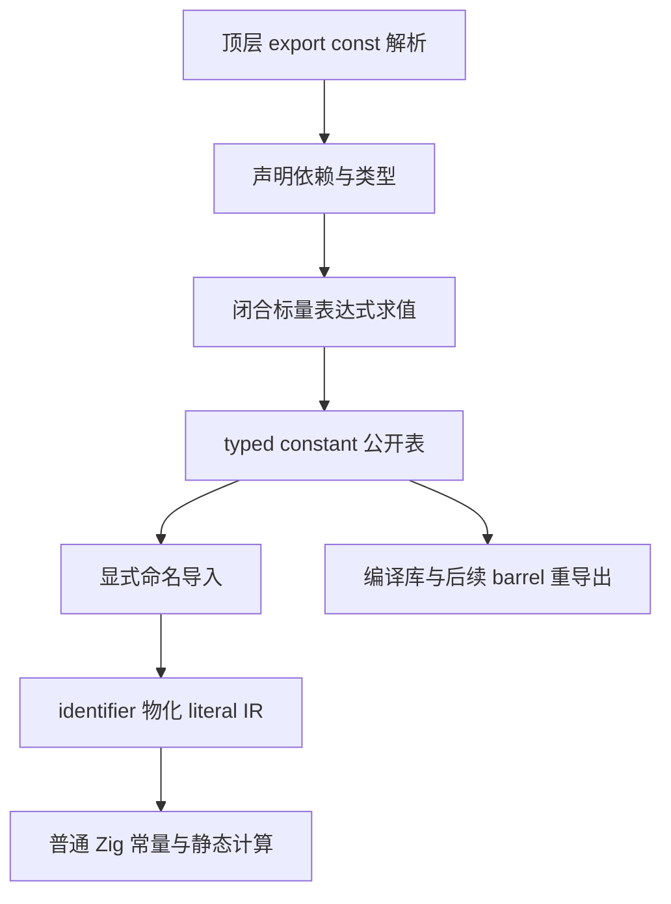
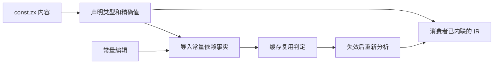
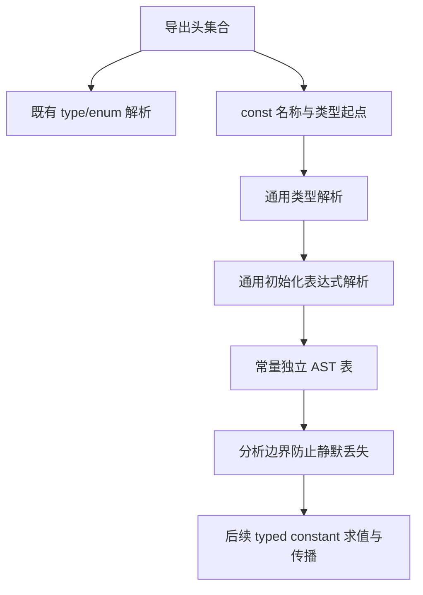

# 共享常量与裸值清理实施

## Intent：最终目标

支持真正的 ZX 导出常量，在共享 const.zx 定义 max_u32 等技术常量，业务逻辑显式导入并直接使用。清理有语义的裸值，保持声明类型、普通静态 Zig、零运行期全局状态与零额外数据复制。

用户最新修正：不增加 unvisited_index = max_u32 这样的同值导出别名，不在使用处重新声明局部常量。数学边界仅定义一次，直接引用 max_u32。

## Data：可用证据

目前 4294967295 出现在形状规划、调用图遍历和多处 u32 容量校验。前两者使用 u32 最大值代表未访问；其他位置是表示范围约束。不能只改一个示例，也不能把数据上限、状态和任意字面量全部机械当成同一业务概念。

当前 ZX 顶层 ast.Declaration 只表示类型，Program 没有常量声明表；命名值导入仅有枚举通道。现有 ir.Export 只有名称与 TypeId，无法保存常量值。expression_program/evaluate.rx 是语义分析，不是可以直接调用的通用求值器。

只读分析已定位原生/生成顶层解析、signature_project、ModuleRecord、binding、analyzer、artifact、compiled.Export 和 semantic_cache.restore。命名 lint 当前将命名导入当 PascalCase 类型名；回调 identifier 当前会构造运行期捕获；依赖复用目前没有比较导入常量值。上述位置必须一起接通。

## Edges：边界与限制

- const.zx 无须默认函数。常量声明与类型声明分开，保留名称、声明类型、初始化表达式和源码位置；已求值导出保存名称、类型及值，不使用来源模块的 ExprId。
- 初始表达范围为闭合的标量常量表达式及既有枚举值。复用现有字面量、范围及运算类型规则；调用、Store、任务和运行期输入不属于编译期常量。
- 整数溢出、除零、截断除法/余数、f32 舍入及短路均与普通 ZX 行为一致，不按宿主宽整数或 f64 随意计算。
- max_u32:u32 始终保留 u32 类型；遇到 u64 长度等消费场景按语言规则显式 widen。常量引用不能退回裸数字的上下文推导。
- 业务 identifier 直接物化已有 literal IR，不创建全局变量、函数包装、SymbolId 或回调捕获。局部遮蔽、重名和非法递归仍按统一名字规则处理。
- 所有自有业务逻辑中的技术上限、哨兵、阈值、位掩码、协议标记都按语义整理为具名定义。结构性索引起点 0 和步进 1 正常保留；代表类型/状态编号的 0/1 使用常量或枚举。
- 不机械替换测试数据、上游原文和外部序列化契约；生成 ZX 从生成源头调整。常量不能只按行号命名或逐处包装相同数字。
- 不新增测试，不新建分支。使用现有检查及真实常量编辑/恢复对照；保留功能解决性能问题，验收后英文提交并推送。

## Answer：交付格式与成功标准

1. 原生及生成解析器、AST、native/indexed 视图和格式化识别 export const；命名 lint 区分值与类型。
2. 用职责独立的 RX 编排与 ZX 原子逻辑完成声明依赖、类型检查、闭合求值和错误定位；不借专用运行库执行。
3. 签名、导入、hint/knownType、identifier、共享类型链接及编译库都携带 typed constant；回调引用保持零捕获。
4. 常量值或类型变化使消费者缓存失效，更新持久化版本；显式重导出保留值和类型，导入不等于自动公开。
5. 建立共享 const.zx，按语义批量清理生产裸值并接入 lint；使用处直接引用导入名。
6. 核对真实产物、错误、库传播、缓存编辑/恢复、耗时、CPU、RSS 及剩余边界，提交推送后继续下一项需求。

## 当前进度

Type/Args 已由 279037b6 收口。阶段 13A 已实现常量语法与独立 AST 表并完成下述验收；typed constant 求值、导入传播与生产裸值清理尚未完成。使用处直接引用导入名的修正已纳入本阶段和后续验收。

## 阶段 13A：声明表示与解析基础

以 279037b6 为基线，二进制保存至 /tmp/zxc-export-const。常量与类型分别建表，常量保存名称、明确的类型注解、初始化表达式及跨度。export const 的类型注解必须显式写出，减少公共接口隐式推导；普通局部 const 不受影响。生成解析沿用通用类型与表达式解析，不为示例数字特判。

本子阶段先保留完整语法，不宣称常量已经可消费。在求值与导出传播接通前，分析入口明确拒绝常量声明，防止静默丢弃；Args/Field.type 的单类型表达式入口也必须拒绝夹带常量。生产裸值暂不迁移，后续阶段完成真正 typed constant 后再清理。

### 已落实的边界

原生顶层与生成顶层均支持 type/enum/const 交错，或仅导出常量的文件。生成常量模块以 RX 显式连接声明头、类型、初始化表达式、类型顺序与发布；ZX 保留对应的原子算法。每个常量独立保存类型、表达式与块表，转换与保留 indexed 输出都覆盖这些数据，不复用来源模块的节点编号。

类型名与常量值名分别接受 PascalCase、snake_case 检查。格式化按源码位置合并两张声明表，避免把常量夹在类型之间的源码当空白覆盖。现阶段 initializer 内部命名/style 尚未遍历，留在完整常量语义阶段补齐；不将声明名检查当作完整 lint 支持。

自我审查发现，外部 reviewed signature 的两个 Zig 分支和正式生成 RX 入口原本只排除默认函数与导入，会忽略新增常量；均已补齐常量拒绝。Args/Store 类型表达式入口也拒绝夹带常量。普通分析、完整项目装载与项目签名明确给出 unsupported，不在未实现求值时默默忽略声明。低层 native→indexed 转换仍只供已检查的入口使用，后续接通常量时必须同步替换该临时边界。

### 当前验证证据

原生 seed 构建为 34/34，使用新生成器继续构建 bootstrap 为 16/16。当前前端为 307/313，失败的六项与 279037b6 既有 callback/map/reduce 期望完全相同，未产生新失败；不将这组写作全套通过。原始日志位于 /tmp/zxc-export-const。

临时通用 AST 查看器读取同一物理源码，对原生 Parser 与生成 parse 输出做 JSON 逐字段比较；共享边界文件与混合默认函数文件完全一致。常量覆盖整数、负数、布尔运算、f32、模板插值与对象。格式化前后 AST（排除位置）相同，二次格式化相同，CRLF 保留；缺失类型、缺失初始化表达式、分号、无效模板插值均在相同 code/span 拒绝。缺失冒号的文字仍沿用两条解析器既有风格（原生“:”，生成“expected :”），未声称诊断文字完全相同。仓库未添加测试用例。

### 端到端核对纠正静态审查遗漏

最初只检查单模块 analyzeInputIn 和项目 signature，漏掉了普通 project.finishInput 直接调用 input.analyze 的正式通道。真实 CLI `lint --semantic` 因此接受带常量的源码，证明静态审查结论不完整。已将检查放到 Project.loadInput 的 header 取得之后，在 source cache.get/restore 之前执行；随后重新构建与验证，旧中间版本的性能采样停止并废弃。

重新核对所有 input.analyze 调用点，单模块入口与 Project 两处均已覆盖。mixed 的全部 ZX 签名、body/ahead 与历史复用也分别核对：签名复用要求 ZX 全文不变，Frame 复用仅容许函数 body 内变化，新增顶层声明无法绕过。已验证 IR/library 不携带源码 AST，不能事后证明旧中间工具曾丢弃的声明；本阶段不将旧产物来源审计误称为常量支持。

### 最终验收与性能

修正后 bootstrap 为 16/16、CLI 为 28/28。读取现有 style/format 与 import groups/comments/resources 四个原始检查文件的临时构建入口为 19/19 步、14/14 检查通过，包含 5,040 排列、132 有序分类对、注释和失败分配清理；没有新增或改写检查断言。与此前 OOM 排查一致，此组临时 root 使用 strip，不能替代原未裁剪并行 OOM 问题的修复。最终 CLI 验证独立常量文件、混合默认函数、只有常量的 bounds 文件及依赖文件含常量的项目，syntax lint/fmt 通过，semantic/普通重复编译均明确拒绝，错误指向正确源码。临时验证文件位于 /tmp/zxc-export-const，原样保存用户期望的直接使用名称。

最终性能只使用修正后的工具；全部构建和行为检查完成后，固定同一 manifest/当前源码、Zig 0.17、ReleaseSafe 依赖与 small bootstrap 根，关闭 resident generator，正反顺序各一轮。项目热各 14 次、冷各 10 次；ZX/RX CLI 各 14 次、每次 200 个进程；Store 各 14 次、每次 40 个进程。以下为中位数，RSS 为进程峰值而非累计分配。

| 场景       | wall ms，前→后      | CPU s，前→后  | RSS MiB，前→后    |
| ---------- | ------------------- | ------------- | ----------------- |
| 项目热缓存 | 667.085 → 661.503   | 3.280 → 3.235 | 364.109 → 363.852 |
| 项目冷生成 | 1426.708 → 1416.928 | 9.205 → 9.120 | 369.953 → 363.234 |
| ZX CLI     | 921.084 → 918.852   | 0.995 → 0.995 | 55.742 → 55.703   |
| RX CLI     | 1235.732 → 1208.756 | 1.465 → 1.440 | 55.742 → 55.711   |
| Store CLI  | 97.737 → 97.225     | 0.090 → 0.090 | 54.484 → 54.469   |

本组未见 wall/CPU/RSS 退化，不将小幅波动泛化为稳定提速。相同 manifest 生成的热/冷 1,459 个文件全部相同；前后仅 .zxc-inputs 的工具身份变化，其余 1,458 个代码文件完全相同。ZX/RX/Store CLI 的 1/2/1 个产物也逐字相同。真正 export const 输入在旧工具不可解析，因此性能对照只说明共同支持的当前自举与 CLI 场景，没有虚构旧版本的常量吞吐基线。

在计时之外修改 constants/annotation.zx 的合法诊断字符串，再恢复原文；两次热生成均等于各自独立冷生成，恢复后也等于初始 1,459 文件。该证据验证解析基础的现有缓存传播，不替代 13B 必须完成的“导入常量值变化使旧 literal 失效”验收。原始报告为 docs/2026-10-31/const-parser-verified-_.json、const-parser-cache-_.json，依规则忽略不提交；汇总为 /tmp/zxc-export-const/performance-summary.log。

阶段 13A 完成，但完整常量功能尚未交付。下一步移除临时 unsupported 边界，接通闭合求值、声明类型、直接导入、IR/库与依赖值比较，再建立共享 const.zx 并清理裸值；消费处直接使用 max_u32，不再声明同值别名。自举总目标保持未完成。
