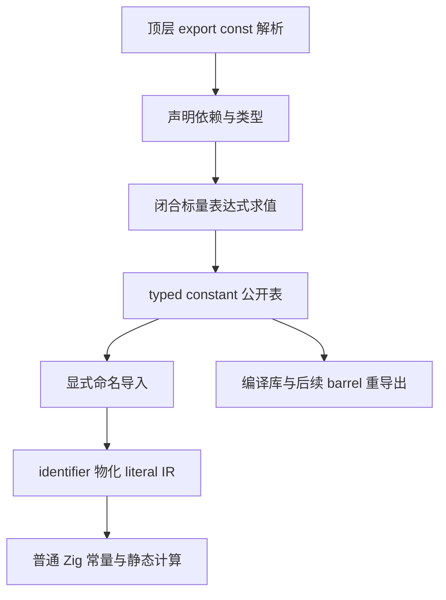
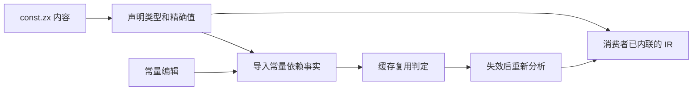

# 共享常量与裸值清理实施

## Intent：最终目标

支持真正的 ZX 导出常量，在共享 const.zx 定义 max_u32 等技术常量，业务逻辑显式导入并直接使用。清理有语义的裸值，保持声明类型、普通静态 Zig、零运行期全局状态与零额外数据复制。

用户最新修正：不增加 unvisited_index = max_u32 这样的同值导出别名，不在使用处重新声明局部常量。数学边界仅定义一次，直接引用 max_u32。

## Data：可用证据

目前 4294967295 出现在形状规划、调用图遍历和多处 u32 容量校验。前两者使用 u32 最大值代表未访问；其他位置是表示范围约束。不能只改一个示例，也不能把数据上限、状态和任意字面量全部机械当成同一业务概念。

当前 ZX 顶层 ast.Declaration 只表示类型，Program 没有常量声明表；命名值导入仅有枚举通道。现有 ir.Export 只有名称与 TypeId，无法保存常量值。expression_program/evaluate.rx 是语义分析，不是可以直接调用的通用求值器。

只读分析已定位原生/生成顶层解析、signature_project、ModuleRecord、binding、analyzer、artifact、compiled.Export 和 semantic_cache.restore。命名 lint 当前将命名导入当 PascalCase 类型名；回调 identifier 当前会构造运行期捕获；依赖复用目前没有比较导入常量值。上述位置必须一起接通。

## Edges：边界与限制

- const.zx 无须默认函数。常量声明与类型声明分开，保留名称、声明类型、初始化表达式和源码位置；已求值导出保存名称、类型及值，不使用来源模块的 ExprId。
- 初始表达范围为闭合的标量常量表达式及既有枚举值。复用现有字面量、范围及运算类型规则；调用、Store、任务和运行期输入不属于编译期常量。
- 整数溢出、除零、截断除法/余数、f32 舍入及短路均与普通 ZX 行为一致，不按宿主宽整数或 f64 随意计算。
- max_u32:u32 始终保留 u32 类型；遇到 u64 长度等消费场景按语言规则显式 widen。常量引用不能退回裸数字的上下文推导。
- 业务 identifier 直接物化已有 literal IR，不创建全局变量、函数包装、SymbolId 或回调捕获。局部遮蔽、重名和非法递归仍按统一名字规则处理。
- 所有自有业务逻辑中的技术上限、哨兵、阈值、位掩码、协议标记都按语义整理为具名定义。结构性索引起点 0 和步进 1 正常保留；代表类型/状态编号的 0/1 使用常量或枚举。
- 不机械替换测试数据、上游原文和外部序列化契约；生成 ZX 从生成源头调整。常量不能只按行号命名或逐处包装相同数字。
- 不新增测试，不新建分支。使用现有检查及真实常量编辑/恢复对照；保留功能解决性能问题，验收后英文提交并推送。

## Answer：交付格式与成功标准

1. 原生及生成解析器、AST、native/indexed 视图和格式化识别 export const；命名 lint 区分值与类型。
2. 用职责独立的 RX 编排与 ZX 原子逻辑完成声明依赖、类型检查、闭合求值和错误定位；不借专用运行库执行。
3. 签名、导入、hint/knownType、identifier、共享类型链接及编译库都携带 typed constant；回调引用保持零捕获。
4. 常量值或类型变化使消费者缓存失效，更新持久化版本；显式重导出保留值和类型，导入不等于自动公开。
5. 建立共享 const.zx，按语义批量清理生产裸值并接入 lint；使用处直接引用导入名。
6. 核对真实产物、错误、库传播、缓存编辑/恢复、耗时、CPU、RSS 及剩余边界，提交推送后继续下一项需求。

## 当前进度

已完成使用点与实现通道的只读分析，尚未修改常量语法或清理生产裸值。当前先收口 Type/Args 模块接口阶段的性能与缓存证据；不得把当前仍存在的裸值报告为已经清理。
