# 共享常量与裸值清理实施

## Intent：最终目标

支持真正的 ZX 导出常量，在共享 const.zx 定义 max_u32 等技术常量，业务逻辑显式导入并直接使用。清理有语义的裸值，保持声明类型、普通静态 Zig、零运行期全局状态与零额外数据复制。

用户最新修正：不增加 unvisited_index = max_u32 这样的同值导出别名，不在使用处重新声明局部常量。数学边界仅定义一次，直接引用 max_u32。

## Data：可用证据

目前 4294967295 出现在形状规划、调用图遍历和多处 u32 容量校验。前两者使用 u32 最大值代表未访问；其他位置是表示范围约束。不能只改一个示例，也不能把数据上限、状态和任意字面量全部机械当成同一业务概念。

当前 ZX 顶层 ast.Declaration 只表示类型，Program 没有常量声明表；命名值导入仅有枚举通道。现有 ir.Export 只有名称与 TypeId，无法保存常量值。expression_program/evaluate.rx 是语义分析，不是可以直接调用的通用求值器。

只读分析已定位原生/生成顶层解析、signature_project、ModuleRecord、binding、analyzer、artifact、compiled.Export 和 semantic_cache.restore。命名 lint 当前将命名导入当 PascalCase 类型名；回调 identifier 当前会构造运行期捕获；依赖复用目前没有比较导入常量值。上述位置必须一起接通。

## Edges：边界与限制

- const.zx 无须默认函数。常量声明与类型声明分开，保留名称、声明类型、初始化表达式和源码位置；已求值导出保存名称、类型及值，不使用来源模块的 ExprId。
- 初始表达范围为闭合的标量常量表达式及既有枚举值。复用现有字面量、范围及运算类型规则；调用、Store、任务和运行期输入不属于编译期常量。
- 整数溢出、除零、截断除法/余数、f32 舍入及短路均与普通 ZX 行为一致，不按宿主宽整数或 f64 随意计算。
- max_u32:u32 始终保留 u32 类型；遇到 u64 长度等消费场景按语言规则显式 widen。常量引用不能退回裸数字的上下文推导。
- 业务 identifier 直接物化已有 literal IR，不创建全局变量、函数包装、SymbolId 或回调捕获。局部遮蔽、重名和非法递归仍按统一名字规则处理。
- 所有自有业务逻辑中的技术上限、哨兵、阈值、位掩码、协议标记都按语义整理为具名定义。结构性索引起点 0 和步进 1 正常保留；代表类型/状态编号的 0/1 使用常量或枚举。
- 不机械替换测试数据、上游原文和外部序列化契约；生成 ZX 从生成源头调整。常量不能只按行号命名或逐处包装相同数字。
- 不新增测试，不新建分支。使用现有检查及真实常量编辑/恢复对照；保留功能解决性能问题，验收后英文提交并推送。

## Answer：交付格式与成功标准

1. 原生及生成解析器、AST、native/indexed 视图和格式化识别 export const；命名 lint 区分值与类型。
2. 用职责独立的 RX 编排与 ZX 原子逻辑完成声明依赖、类型检查、闭合求值和错误定位；不借专用运行库执行。
3. 签名、导入、hint/knownType、identifier、共享类型链接及编译库都携带 typed constant；回调引用保持零捕获。
4. 常量值或类型变化使消费者缓存失效，更新持久化版本；显式重导出保留值和类型，导入不等于自动公开。
5. 建立共享 const.zx，按语义批量清理生产裸值并接入 lint；使用处直接引用导入名。
6. 核对真实产物、错误、库传播、缓存编辑/恢复、耗时、CPU、RSS 及剩余边界，提交推送后继续下一项需求。

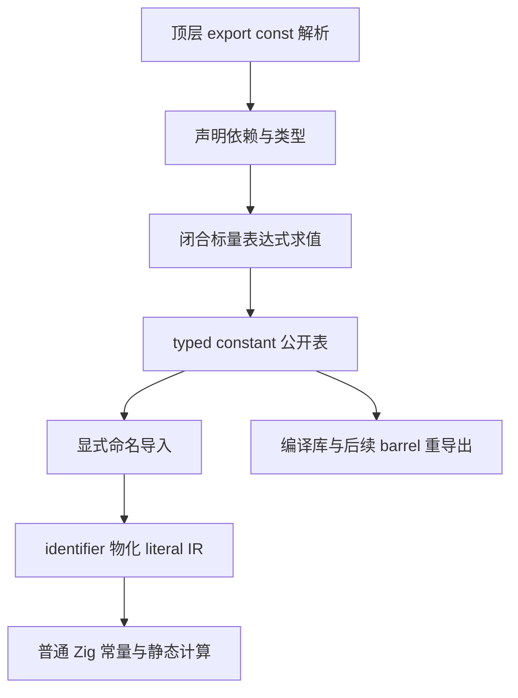

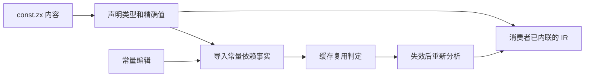

## 当前进度

Type/Args 已由 279037b6 收口。阶段 13A 已实现常量语法与独立 AST 表并完成下述验收；typed constant 求值、导入传播与生产裸值清理尚未完成。使用处直接引用导入名的修正已纳入本阶段和后续验收。

## 阶段 13A：声明表示与解析基础

以 279037b6 为基线，二进制保存至 /tmp/zxc-export-const。常量与类型分别建表，常量保存名称、明确的类型注解、初始化表达式及跨度。export const 的类型注解必须显式写出，减少公共接口隐式推导；普通局部 const 不受影响。生成解析沿用通用类型与表达式解析，不为示例数字特判。

本子阶段先保留完整语法，不宣称常量已经可消费。在求值与导出传播接通前，分析入口明确拒绝常量声明，防止静默丢弃；Args/Field.type 的单类型表达式入口也必须拒绝夹带常量。生产裸值暂不迁移，后续阶段完成真正 typed constant 后再清理。

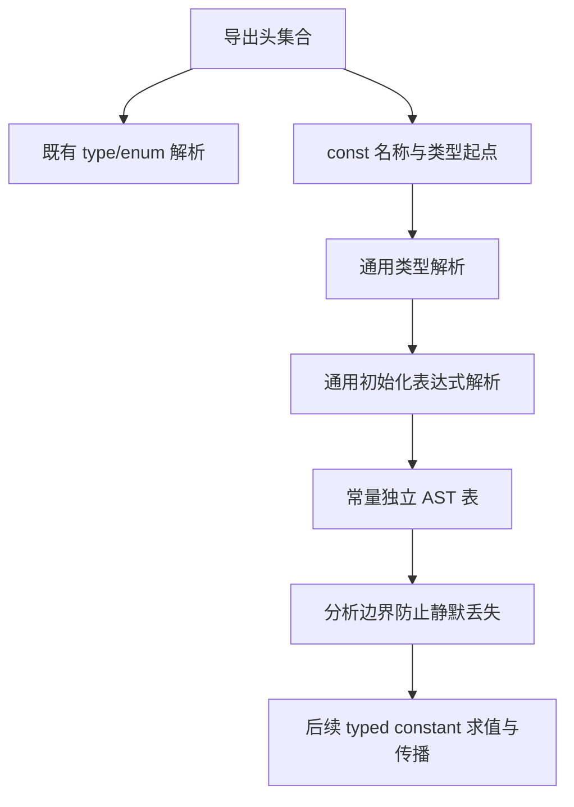

### 已落实的边界

原生顶层与生成顶层均支持 type/enum/const 交错，或仅导出常量的文件。生成常量模块以 RX 显式连接声明头、类型、初始化表达式、类型顺序与发布；ZX 保留对应的原子算法。每个常量独立保存类型、表达式与块表，转换与保留 indexed 输出都覆盖这些数据，不复用来源模块的节点编号。

类型名与常量值名分别接受 PascalCase、snake_case 检查。格式化按源码位置合并两张声明表，避免把常量夹在类型之间的源码当空白覆盖。现阶段 initializer 内部命名/style 尚未遍历，留在完整常量语义阶段补齐；不将声明名检查当作完整 lint 支持。

自我审查发现，外部 reviewed signature 的两个 Zig 分支和正式生成 RX 入口原本只排除默认函数与导入，会忽略新增常量；均已补齐常量拒绝。Args/Store 类型表达式入口也拒绝夹带常量。普通分析、完整项目装载与项目签名明确给出 unsupported，不在未实现求值时默默忽略声明。低层 native→indexed 转换仍只供已检查的入口使用，后续接通常量时必须同步替换该临时边界。

### 当前验证证据

原生 seed 构建为 34/34，使用新生成器继续构建 bootstrap 为 16/16。当前前端为 307/313，失败的六项与 279037b6 既有 callback/map/reduce 期望完全相同，未产生新失败；不将这组写作全套通过。原始日志位于 /tmp/zxc-export-const。

临时通用 AST 查看器读取同一物理源码，对原生 Parser 与生成 parse 输出做 JSON 逐字段比较；共享边界文件与混合默认函数文件完全一致。常量覆盖整数、负数、布尔运算、f32、模板插值与对象。格式化前后 AST（排除位置）相同，二次格式化相同，CRLF 保留；缺失类型、缺失初始化表达式、分号、无效模板插值均在相同 code/span 拒绝。缺失冒号的文字仍沿用两条解析器既有风格（原生“:”，生成“expected :”），未声称诊断文字完全相同。仓库未添加测试用例。

### 端到端核对纠正静态审查遗漏

最初只检查单模块 analyzeInputIn 和项目 signature，漏掉了普通 project.finishInput 直接调用 input.analyze 的正式通道。真实 CLI `lint --semantic` 因此接受带常量的源码，证明静态审查结论不完整。已将检查放到 Project.loadInput 的 header 取得之后，在 source cache.get/restore 之前执行；随后重新构建与验证，旧中间版本的性能采样停止并废弃。

重新核对所有 input.analyze 调用点，单模块入口与 Project 两处均已覆盖。mixed 的全部 ZX 签名、body/ahead 与历史复用也分别核对：签名复用要求 ZX 全文不变，Frame 复用仅容许函数 body 内变化，新增顶层声明无法绕过。已验证 IR/library 不携带源码 AST，不能事后证明旧中间工具曾丢弃的声明；本阶段不将旧产物来源审计误称为常量支持。

### 最终验收与性能

修正后 bootstrap 为 16/16、CLI 为 28/28。读取现有 style/format 与 import groups/comments/resources 四个原始检查文件的临时构建入口为 19/19 步、14/14 检查通过，包含 5,040 排列、132 有序分类对、注释和失败分配清理；没有新增或改写检查断言。与此前 OOM 排查一致，此组临时 root 使用 strip，不能替代原未裁剪并行 OOM 问题的修复。最终 CLI 验证独立常量文件、混合默认函数、只有常量的 bounds 文件及依赖文件含常量的项目，syntax lint/fmt 通过，semantic/普通重复编译均明确拒绝，错误指向正确源码。临时验证文件位于 /tmp/zxc-export-const，原样保存用户期望的直接使用名称。

最终性能只使用修正后的工具；全部构建和行为检查完成后，固定同一 manifest/当前源码、Zig 0.17、ReleaseSafe 依赖与 small bootstrap 根，关闭 resident generator，正反顺序各一轮。项目热各 14 次、冷各 10 次；ZX/RX CLI 各 14 次、每次 200 个进程；Store 各 14 次、每次 40 个进程。以下为中位数，RSS 为进程峰值而非累计分配。

| 场景       | wall ms，前→后      | CPU s，前→后  | RSS MiB，前→后    |
| ---------- | ------------------- | ------------- | ----------------- |
| 项目热缓存 | 667.085 → 661.503   | 3.280 → 3.235 | 364.109 → 363.852 |
| 项目冷生成 | 1426.708 → 1416.928 | 9.205 → 9.120 | 369.953 → 363.234 |
| ZX CLI     | 921.084 → 918.852   | 0.995 → 0.995 | 55.742 → 55.703   |
| RX CLI     | 1235.732 → 1208.756 | 1.465 → 1.440 | 55.742 → 55.711   |
| Store CLI  | 97.737 → 97.225     | 0.090 → 0.090 | 54.484 → 54.469   |

本组未见 wall/CPU/RSS 退化，不将小幅波动泛化为稳定提速。相同 manifest 生成的热/冷 1,459 个文件全部相同；前后仅 .zxc-inputs 的工具身份变化，其余 1,458 个代码文件完全相同。ZX/RX/Store CLI 的 1/2/1 个产物也逐字相同。真正 export const 输入在旧工具不可解析，因此性能对照只说明共同支持的当前自举与 CLI 场景，没有虚构旧版本的常量吞吐基线。

在计时之外修改 constants/annotation.zx 的合法诊断字符串，再恢复原文；两次热生成均等于各自独立冷生成，恢复后也等于初始 1,459 文件。该证据验证解析基础的现有缓存传播，不替代 13B 必须完成的“导入常量值变化使旧 literal 失效”验收。原始报告为 docs/2026-10-31/const-parser-verified-_.json、const-parser-cache-_.json，依规则忽略不提交；汇总为 /tmp/zxc-export-const/performance-summary.log。

阶段 13A 完成，但完整常量功能尚未交付。下一步移除临时 unsupported 边界，接通闭合求值、声明类型、直接导入、IR/库与依赖值比较，再建立共享 const.zx 并清理裸值；消费处直接使用 max_u32，不再声明同值别名。自举总目标保持未完成。

## 阶段 13B1：闭合标量求值算法

### Intent：最终目标

先完成可复用的 typed IR 标量求值，再接到声明、导入、编译库与缓存。保留声明类型，不按使用处重新推导；ir.Constant 与类型 Export 分离，只有名称、TypeId 与标量值，不持有来源 ExprId/SymbolId。

### Data：可用证据

现有 numbers/decode 已处理字面量类型、范围、浮点解析和整数转 float 精确性；复用普通 initializer 分析，求值只读取 typed IR。SMT verification 的符号项与安全条件不等于数值求值器。有符号除法采用向零截断；genz 已将 minInt % -1 升宽运算得到 0。std:float 提供 narrow/widen/isFinite，可在每次 f32 运算前后保持真实单精度。

### Edges：边界与限制

求值前先验证 IR，闭合检查扫描所有可达分支，拒绝 Call、Store、Reference、聚合及 optional 等当前非标量节点；计算时使用 memo 与显式帧，只计算选中路径。整数使用符号与 u64 幅值，预检溢出/除零，不引入有符号转换桥。浮点中间值遵循 IEEE；当前 IR literal 仅允许 finite，因此非有限最终值明确报告 unsupported，而不是生成非法 Zig 或隐式改值。未来若扩大该范围，须同步物化、IR 与缓存表示。

RX 连接闭合检查、游标初始化、求值与结果发布；遍历、分支选择和算术是 ZX 的内聚算法。Zig 只保留既有 IR 验证入口、借用表与 owned 结果适配，不增加专用运行库。无常量的正式源码路径不调用求值器。现阶段 native seed 尚未消费该生成求值入口，声明仍保留 13A unsupported；不能据独立求值模块宣称直接导入已完成。

### Answer：交付格式与成功标准

完成求值模块、独立常量值模型与生成接口，使用现有运算夹具真实源码的 typed IR 做临时求值/实际 Zig 执行对照，覆盖短路、整数边界、f32 舍入、枚举及错误。新增夹具和断言不写入仓库；验收缓存、生成输出和共同场景性能后提交推送，再接通常量声明与导入传播。

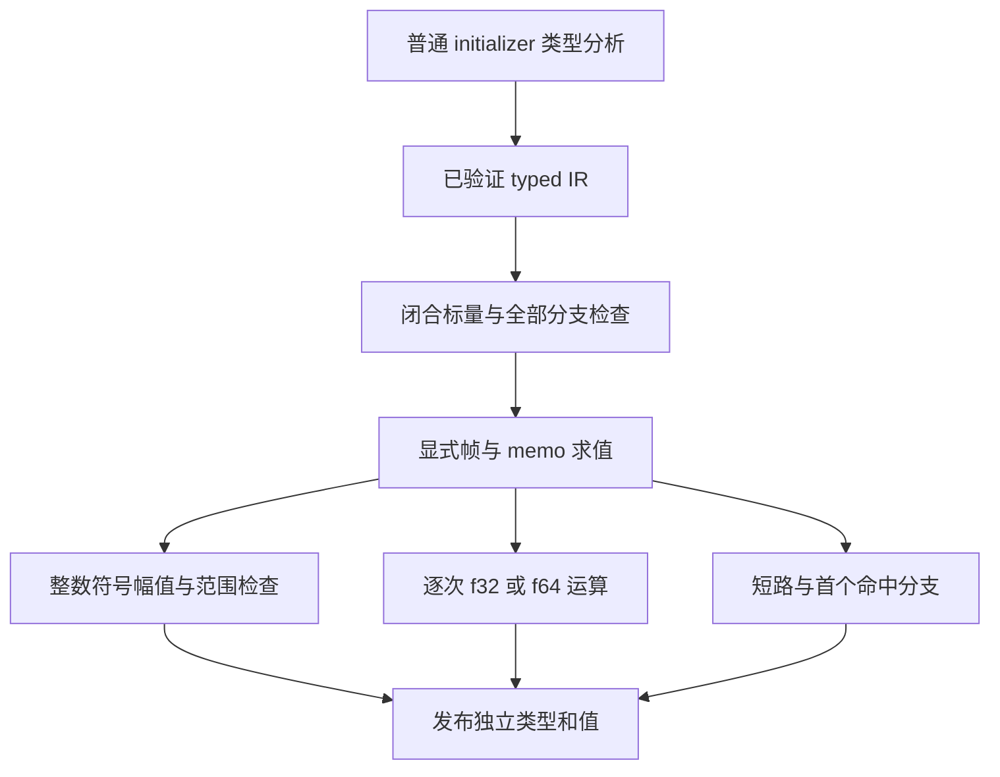

### 13B1 验证与自我核对

临时通用 IR 查看器读取仓库原有源码与 JSONL，将输入参数物化为保留原 TypeId 的 literal，再调用完整 IR 校验与生产求值 API。未新增仓库测试或改动夹具断言。覆盖 44 份原始源码、19,887 行输入：26,138 个标量结果与原 expected 一致（对象输出按各个标量字段分别求值，不宣称支持对象常量）；62 项整数 UB 在编译期给出相应溢出/除零诊断；736 项非有限最终值明确 unsupported；3,220 行含非有限 literal 输入，因既有 IR 边界跳过并单列。浮点结果逐位比较，包含负零、次正规数和 f32 逐步舍入；整数覆盖六种整数类型、signed 最小值、截断除法与余数符号。raw 为 /tmp/zxc-constant-fold/corpus-validation.json。

最初临时输入适配错误地将 canonical 类型字段顺序当作夹具 arguments 顺序，IR 门禁正确拒绝越界 u8。适配现改为原始 AST 声明字段名对齐输入位置，未放宽生产 IR 校验。两个带局部对象绑定的 unary field 夹具不在当前闭合标量范围，未混入通过数。静态审查与实际数据各自覆盖不同问题，不把一方替代另一方。

从既有 conditional/number、match/nested 和 logical_and/basic 源码复制后作合法临时编辑，保留原夹具输入与选中输出：conditional 四项、逻辑短路四项和首个命中匹配两项跳过未选中的 1/0；另一次 false && runtime-index 仍被闭合检查拒绝。原文件未改动。限定 enum API 的普通 literal、trivia、运行期同名值、capture、alias bounds 既有探针继续通过，并核对 folded enum 的原 TypeId 与成员下标。

生成 walk 的 memo 更新为 @constCast 后单元素写入；帧 push 使用可复用 zxReserve，pop 使用 zxRetract/切片；闭合标记也是原地写入，没有逐节点 renew/dupe 整表。检查的是本阶段实际生成代码，不据源码形态猜测零复制；仍需共同场景 wall/CPU/RSS 实测。生成源码当前位于临时 inspect 缓存的 constant_fold 公开入口及其传递函数，后续缓存路径会随输入变化，不当稳定文件名引用。

此前闭合标记的 map 捕获 root 虽可由正式生成路径分析，初始 native seed 的 callback 能力仍不宜依赖。现改为 false 标记数组和显式 root 状态，在首次逆序访问识别根；没有放宽 callback 规则。原生 seed 实际完成 34/34 构建；独立 pinned bootstrap 为 16/16，CLI 为 28/28。前端原有 307/313 及相同六项旧失败保持，未把它写成全套通过。native seed 仍只负责生成求值算法，尚未接通常量声明的求值调用。

13B2 将在既有模块边界内接声明分析、直接 identifier 与命名导入、IR/库/缓存值传播，并为初始 native seed 使用同源 RX/ZX 的生成求值快照。快照只用于最初引导，正式 generated 入口继续来自本阶段源码；不得将快照或专用 Zig 语义当作最终自举闭包。

### 13B1 性能与产物验收

固定 e7f972d8 工具为基线，使用同一当前 manifest/源码，清单增加 constant_fold 入口，共 58 个生成入口；Native seed 与 pinned 构建均实际完成。计时在构建与行为核对结束后独立运行，ReleaseSafe 依赖、small bootstrap 根、Zig 0.17、resident generator 关闭。项目热各 14 次、冷各 10 次；CLI 各 14 次（ZX/RX 每次 200 进程、Store 每次 40 进程）。

| 场景       | wall ms，前→后      | CPU s，前→后  | RSS MiB，前→后    |
| ---------- | ------------------- | ------------- | ----------------- |
| 项目热缓存 | 665.810 → 667.380   | 3.230 → 3.270 | 368.117 → 373.484 |
| 项目冷生成 | 1400.110 → 1402.648 | 8.995 → 8.970 | 372.852 → 372.766 |
| ZX CLI     | 907.394 → 905.690   | 0.985 → 0.980 | 55.742 → 55.750   |
| RX CLI     | 1194.401 → 1203.685 | 1.420 → 1.430 | 55.688 → 55.734   |
| Store CLI  | 95.568 → 95.592     | 0.090 → 0.090 | 54.484 → 54.492   |

初轮不能直接称通过。额外交错 16 对热生成，RSS 差的 95% 区间含 0，但 CPU 平均 +0.051s、区间 [0.021,0.082]；20 对 RX CLI 的 wall/CPU/RSS 差区间分别为 [-2.870,4.987]ms、[-0.0072,0.0082]s、[-0.082,0.024]MiB，未见稳定 RX 退化。随后核对引导方式，再作 pinned 的 16 对热采样，wall 出现正差。

最终核对实际二进制，基线、native seed 构建和 pinned 构建的 bootstrap 用 cmp 全部相同，SHA-256 均为 dafa693881ae9ab4fde96fc084e6ef6f614fd7e888483178f7f11c69e8c4088e。new evaluator 尚未被 bootstrap 主流程调用，未使用路径被静态消除；因此这些运行差异不能归因于本次 bootstrap 代码退化，也不能拿它们宣称优化收益。短窗口采样的 UUID 同样相同，main/deduplicated 栈无法解释完整流程，未将样本占比当整轮成本。应在首次性能比较前先检查工具摘要，避免对同一个程序做过早的代码归因；此项作为本次自我核对纠正保留。

测量 pinned 工具时，覆盖了已有 resident 进程映射的同名可执行文件，一次预热被 macOS SIGKILL；改用全新文件名 after-bootstrap-pinned 后正常。该失败发生在正式采样前，未混入有效样本；可观察事实是同名文件仍被 resident 映射，新路径下相同字节可正常执行，未据此断定内核的具体原因。后续使用独立工具快照路径。

相同输入的全部 1,476 个生成文件前后完全相同，热/冷也全部相同；ZX/RX/Store CLI 的 1/2/1 产物逐字相同。在计时之外对 publish.zx 的合法诊断字符串编辑并恢复，编辑热/冷、恢复热/冷、恢复与初始均为 1,476 文件完全一致。新 API 没有旧版本吞吐基线，本轮共同路径结论不替代 13B2 接通后对常量项目与值失效的实际测量。

原始资料为 /tmp/zxc-constant-fold，docs/2026-10-31/const-fold-*.json 等报告依规则忽略不提交。现阶段没有可确认的共同路径性能退化；保留全部求值实现，不用撤回功能处理性能。13B1 完成后继续 13B2，完整 export const、直接导入与裸值清理仍未完成。

## 阶段 13B2：声明、直接引用与跨模块传播

### Intent：最终目标

撤除 13A 的临时拒绝前，完整接通原生及生成声明分析、typed identifier、签名/命名导入、Program 与模块记录、artifact、编译库和缓存。使用者直接导入 max_u32；不重声明同值别名，不将值放入类型 Export。

### Data：可用证据

当前 25104fe5 已提供相同语义的 RX/ZX scalar evaluator 与 ir.Constant 值模型。新增只读通道审计确认，semantic_cache.restore 的旧依赖比较没有值；mixed/history 的 float 列使用 ==，必须保留 +0/-0 的位差异。compiled.Result.module() 和 artifact 的 native/generated roots/plan 两条路径也是独立的可能丢值入口。旧 guard 仍保留，当前不可能把未接通的声明静默编译成功。

### Edges：边界与限制

初始化 native seed 使用从同源 RX/ZX 生成的冻结求值快照；正式 parser.generated 继续接当前生成模块，不将快照变为正式编译器的语义依赖。通过独立 bootstrap-constant-seed 构建步骤再生成，常规构建不自动改写快照。native AST→indexed 适配保留常量 annotation/reference 和 expression root；借用统一表达式、块表及 native text，使引用索引一致，不通过字符串重建类型。

常量先按源码声明顺序求值，复用此前常量与显式导入；不赋予全局普通变量或隐式运行期初始化语义。签名收集只保留完整 typed value，不持有来源 ExprId。无常量快速路径在构造求值状态之前返回。类型与值变化、负零、nominal enum 来源以及字符串生命周期分别核对，不用编译成功代替值失效证明。

### Answer：交付格式与成功标准

1. 准备 seed 同源快照与 native syntax 适配，核对 Native/generated 一致。
2. 接 initializer 类型分析与闭合求值，identifier/hints 直接保留已声明的 TypeId，回调不捕获常量；按普通局部遮蔽规则处理。
3. source signature、binding、Program、module record 与 source linking 均分开携带 constant imports/exports。
4. artifact roots/extraction/remap、库公开导出/装载/取模块/codec 与外部边界完整校验 typed values。
5. 提高 IR/cache/library envelope 版本，比较 remap 后类型与精确值，证明值编辑、负零和恢复在普通缓存、mixed history 与编译库的消费者均失效。
6. 去除临时拒绝，建立共享 const.zx 并按语义替换生产裸值，通过已有行为与性能门禁后提交推送。

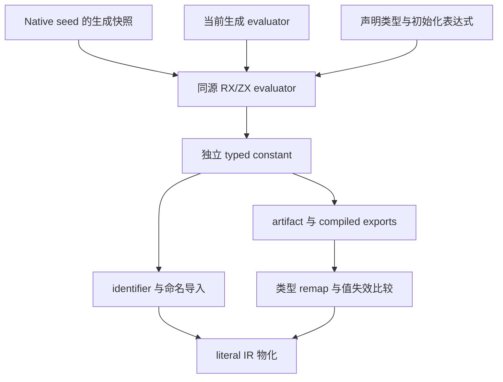

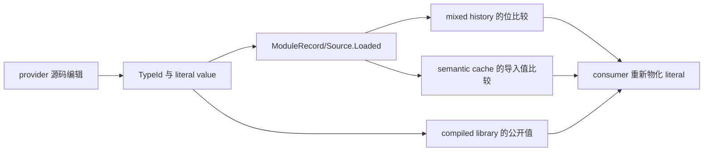

## 阶段 13B2a：直接 typed identifier 与 seed 基础

### Intent：最终目标

先完成常量消费端的独立阶段：表达式 API 接收已有声明类型和值，直接按导入名物化字面量。该阶段不建立同值别名、不创建全局 Symbol，也不把暂未接通的源码导入宣称可用。

### Data：可用证据

13B1 的 Value 与新的 core/constant/model.Literal 复用同一模型；原生表达式分析与 RX/ZX 表达式分析共用已有类型表和字面量范围规则。原生 seed 的生成求值快照由 bootstrap-constant-seed 再生成，26 个 Zig 文件的函数内容来自当前 RX/ZX；不会在正常构建时改写源码目录。native AST 适配保留每项 annotation 与 initializer 的真实索引，借用统一表达式、块和 native text 表，未改写为类型字符串。

### Edges：边界与限制

本次只闭合 expression.Options.constants 到 typed literal 的消费职责。源码声明分析、跨模块 signature/import、Program/artifact/compiled library 和缓存值失效仍待 13B2 后续阶段；13A 的 unsupported guard 保持，生产裸值尚未迁移。没有创建专用运行库，快照仅作为初始 seed 的过渡输入，正式生成入口使用当前 RX/ZX。

空常量表在 marshal 和 lookup 中直接返回，避免额外表分配。局部、injected 以及外层不可捕获局部沿原作用域规则优先；常量不捕获。静态函数、native namespace、枚举 namespace 和 error namespace 都必须让位于同名普通值。

### Answer：交付格式与成功标准

消费 API 必须保持原 TypeId，u32 常量面对 u64 上下文继续要求显式转换。非法范围、符号、f32 精度、非有限值、tag/type 不匹配、枚举成员越界、缺失类型、空名与重复名在输入边界报 contract。字符串在结果 arena 中拥有独立存储，不能持有调用方释放或修改后的缓冲。

临时通用 API 查看器在原生和生成表达式分析两条路径均通过：六类标量 literal（含 i64 最小值、u32 最大值、f32 负零及 nominal enum）逐值/逐位比对；回调 IR 中直接出现 u32 literal、没有同名 Symbol；局部遮蔽、常量遮蔽枚举/error/builtin namespace、声明类型与 expected 不符均符合原语义。覆盖上述非法输入和 caller 字符串修改后的独立所有权。未新增仓库测试。日志为 /tmp/zxc-constant-propagation/binding-api-final.log 与 binding-api-native-final.log。

生成 bootstrap 16/16、初始 native seed 34/34 步通过；CLI 既有回归最终汇总 57/57 步、34/34 测试通过。前端既有检查 307/313，通过数与基线相同，六项旧失败仍为 map/reduce arity 与 callback scope 旧期望，不将它们描述为本次已修复。对应日志均在 /tmp/zxc-constant-propagation。

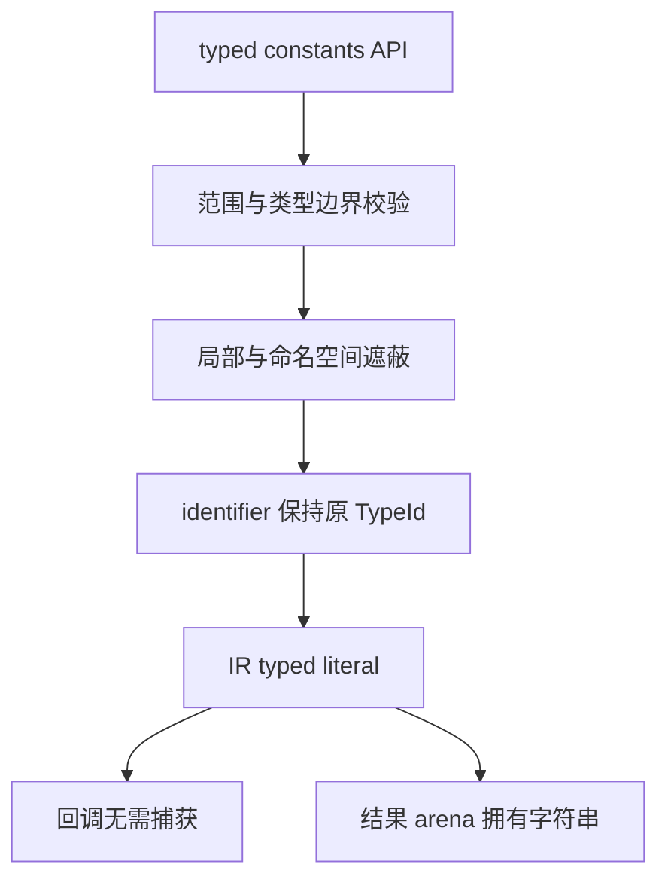

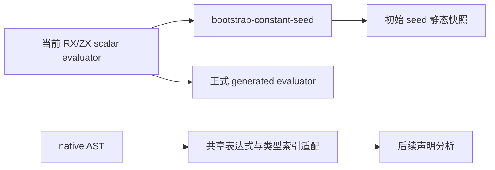

### 自我复核

最初临时探针假定 generated map 保留 transform 节点。实际输出已将集合操作展开为 iteration/scope，因而该探针假设错误；改为核对真实 IR 的返回元素类型、typed literal 以及没有同名 Symbol，不放宽生产门禁。只读审查发现 error namespace 与静态调用路径遗漏同名值遮蔽，现已同步修复两条分析路径。不能仅据直接 identifier 通过推断整个 export const 或缓存传播完成。

### 性能诊断与优化过程

固定同一新 manifest 与源码，基线为 25104fe5 的 bootstrap/CLI，先完成热 14、冷 10 和 ZX/RX/Store 各 14 轮。首轮热 wall 671.23→680.11 ms、CPU 3.245→3.295 s；另做 16 组逐次交错，wall 平均差 2.52 ms 的区间跨零，但 CPU 平均差 +0.03875 s，95% 区间 [0.01244, 0.06506] s，不能直接当作无退化通过。

sampling 对应同一组实际二进制，但优化构建大多折叠成 main+offset，且进程在窗口内退出；没有足够符号将小幅差异可靠归因于某个 helper，未用该采样宣称热点百分比。生成代码能独立确认：null 常量仍组装借用参数并调用 lookup/valid。将 null 检查提前到调用处，避免常量缺席时进入相关 helper；保留非空表的类型、范围、遮蔽及所有权校验。该优化的效果必须由后续复测决定，不能仅凭源码推断。

首轮同输入前后 1,478 个代码文件完全一致，单独 .zxc-inputs 因工具摘要不同而变化；同工具热/冷共 1,479 文件完全一致。ZX/RX/Store 的 1/2/1 生成文件全部一致。后续还需在优化工具上复测和编辑/恢复对照。

空表调用前置后，热 CPU 中位数回到 3.25→3.25 s，但两轮冷生成的平均 RSS 仍分别增加 11.33 与 10.31 MiB，未直接通过性能门禁。进一步核对生成状态模型：不可变的常量表指针被放入频繁更新的 Local；即使是 null，也扩大每个局部状态记录。现将表放到不随求值更新的表达式 Source 上下文，类型校验从 CompileInput 单独接收表；identifier/call 只借用该指针。Local 恢复原形状，不复制常量表，不缩减任何校验，后续源模块接入时也应通过只读上下文传递。

### 13B2a 最终验收

最终实现将不可变常量表放在表达式 Source，恢复 Local 的原有字段布局。嵌套 map 的常量读取直接生成原 u32 literal，且没有同名 Symbol；有外层同名局部时，开启/关闭全局常量表的结果保持相同。当前生成分析与 native 分析加冻结求值快照两条临时 API 查看器均通过，日志为 context-api-nested.log 与 context-api-native-nested.log。实际初始 seed 34/34、pinned bootstrap 16/16、CLI 27/27 构建步通过，CLI 34/34 测试通过，前端最终仍为 307/313，六项旧失败不变。生成快照再次从当前源码再生，26 文件除仓库格式化空白外完全一致。

计时固定同一最终源码、58-entry manifest、工具链、优化模式与缓存边界；所有构建完成后单独测量。除热 14、冷 10、CLI 各 14 轮外，再把前后工具复制到同一目录、等长文件名，排除启动路径层级差异，逐次反转顺序执行热 16 对、冷及 ZX/RX/Store 各 12 对。复制后的二进制内容与各自构建产物相同；进程运行期间未覆盖工具文件。

| 受控配对场景 | wall 中位数，ms，前→后 | CPU 中位数，s，前→后 | RSS 中位数，MiB，前→后 |
| ------------ | ---------------------- | -------------------- | ---------------------- |
| warm         | 679.10→677.06          | 3.275→3.275          | 368.35→368.47          |
| cold         | 1432.66→1438.52        | 9.155→9.185          | 370.51→367.03          |
| cli-rx       | 1227.10→1223.90        | 1.450→1.455          | 55.75→55.74            |
| cli-zx       | 915.64→914.76          | 1.000→1.000          | 55.80→55.77            |
| cli-store    | 99.87→99.50            | 0.095→0.100          | 54.50→54.52            |

热 wall/CPU/RSS 配对差值的 95% 区间分别为 [-12.63, 3.19] ms、[-0.0224, 0.0174] s、[-6.43, 8.62] MiB；冷为 [-12.29, 16.77] ms、[-0.0664, 0.0781] s、[-12.77, 6.68] MiB。ZX/RX/Store 的 CPU、RSS 差值区间均跨零；wall 也跨零，只有 RX 略快，区间 [-5.22, -0.54] ms。共同路径未观察到稳定退化，不将统计上未检出差异等同于数学上的完全零开销，也不宣称整体提速。工具自身构建耗时未做成对吞吐基准，新绑定 API 也没有旧能力基线。

相同最终源码前后 1,478 个生成代码文件完全一致；只有 .zxc-inputs 因工具摘要不同变化。同一工具热/冷全部 1,479 文件一致。受控 ZX/RX/Store 的 1/2/1 文件也全部一致。计时之外合法修改 types/check.zx 的常量校验诊断，再恢复原字节；编辑热/冷、恢复热/冷、恢复与初始均为 1,479 文件完全一致。此处验证源码依赖缓存，不替代后续尚未接通的“提供者常量值改变使消费者失效”验收。

原始报告为 docs/2026-10-31/const-binding-*.json，依规则忽略不提交；脚本、日志、实际工具与临时查看器位于 /tmp/zxc-constant-propagation。最终 code 根因是消除缺席常量时的无用调用，并将只读环境移出频繁更新的局部状态；不同优化轮次的源码布局也有变化，因此不把跨轮次 RSS 相减宣称为精确的单项节省。结论依据最后一次同输入的前后对照。

13B2a 消费职责已完成，继续声明、签名、直接命名导入、IR/artifact、编译库与缓存精确值传播。完整 export const 与生产裸值清理仍未完成；不解除现有拒绝 guard，不创建临时同值别名替代用户要求。

## 阶段 13B2b：声明求值与签名中的 typed exports

### Intent：最终目标

将真实常量 AST 接入签名分析，在独立值通道中保存声明类型和值；初始化表达式复用原有表达式分析和闭合标量求值。下一步模块导入、IR、artifact、编译库和缓存继续消费此值通道，使用处直接引用名称。

### Data：可用证据

当前 ec4403ef 已提供两套表达式分析的 typed constant bindings，以及同源 RX/ZX 标量求值和初始 seed 快照。原生 AST 适配已保存 annotation、initializer 与 native text 索引；生成常量 AST 每项持有自己的类型、表达式和块表。类型声明在 declarations 阶段已全部解析并缓存。

### Edges：边界与限制

正式声明分析通过 RX 显式连接类型解析、初始化表达式分析、闭合求值和结果发布。ZX 只做有序集合遍历、输入准备、名称检查和结果组装。不可变常量表保持在 Source，不重建到 Local。声明按源码顺序，显式导入和此前声明可见；不隐式接受前向引用或运行期初始化。已有 types/cache 继续复用，切换到某项常量的类型树后恢复模块的类型来源上下文。

初始 native seed 仅连接既有类型/表达式分析与同源冻结求值器，不复制标量计算规则。该 seed 编排为过渡实现，不是正式自举依赖闭包。源码常量的总 guard 在跨模块、库和缓存未完整接通前继续保留，避免签名导出值后在下游被静默丢弃。

### Answer：交付格式与成功标准

每项 RX 阶段在真实 AST/native text 上工作，签名持有独立 constant_exports；TypeId 保留，名称与字符串结果有明确所有权。核对类型别名、nominal enum、此前常量及导入常量引用、溢出/除零/短路、重名/前向引用、f32 和负零；空声明与空导入在准备求值状态前返回。用当前源码入口、现有检查和临时内部 API 查看器验证，不新增仓库测试。相同最终输入、配置和工具链验证全产物、编辑/恢复、耗时/CPU/RSS，再英文提交并推送。

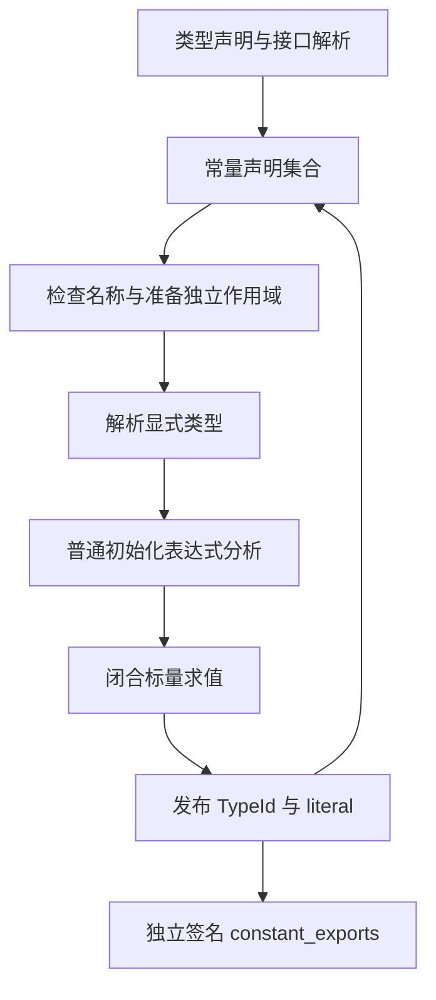

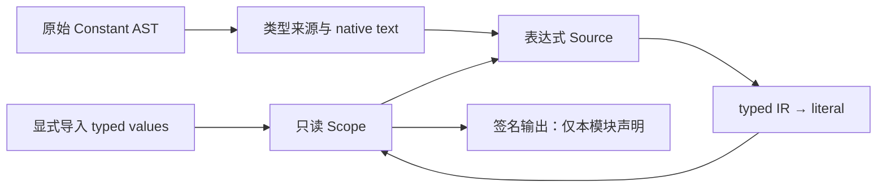

### 13B2b 验收与自我复核

正式签名 RX 已依次调用声明集合、接口、类型导出和常量集合。集合中的每项通过普通 source package 调用 item/analyze.rx；该 RX 连接名称/作用域准备、现有 annotation 解析、原有表达式遍历、闭合标量求值及结果发布。未把跨职责流程藏进 ZX。类型解析继续借用已有 cache，切换类型树后所有失败和成功路径均恢复模块 context；delta/cache 更新保留。

声明返回的 scope 包含 imports+本地声明，但签名 host 只发布 constant_first 之后的项；空声明不隐式重导出导入值。常量使用独立 constant_exports，类型 exports 不存值。Native seed 连接既有 Analyzer.expression 与同源冻结 evaluator，不复制整数/浮点规则。生成与原生发布都将名字、字符串深拷贝到 Types allocator，值的生命周期与语法 scratch 分离。

只读审查发现原生 AST 名称不能只按 span 切源码：手工 AST 可以提供权威 name.text 与零 span。现沿现有 NativeText 模式增加 constant_names，与 constants 同索引；prepare 返回 Name 供发布复用，避免重复 UTF-8 解码。临时内部查看器复制真实 Zig 源树作为检查入口，不新增生产公开 API，也未新增仓库测试。indexed AST、生成分析读取 native AST、初始 seed 三条路径均通过；日志为 /tmp/zxc-constant-declarations/inspect-more.log 与 inspect-native.log。核对了混合类型/常量声明、每项独立类型树、u32 声明类型、类型别名、nominal enum、字符串解析 arena 结束后的值、负零、导入与此前常量、短路及拒绝路径；native/indexed 错误 code/span 一致。text/span 不一致的原生 AST 也使用 text 导出。

实际 native bootstrap 34/34、pinned bootstrap 16/16、CLI 构建 27/27 步通过；CLI 34/34 测试通过。前端为 307/313，与基线相同的六项旧失败仍在，未宣称修复。

所有构建结束后，用相同最终源码、58-entry manifest、工具链、优化模式和缓存边界，前后工具放同一目录等长名字，热 16 对、冷及 ZX/RX/Store 各 12 对逐次交错测量。每份报告均验证工具与声明输入未变。

| 场景      | wall 中位数，ms，前→后 | CPU 中位数，s，前→后 | RSS 中位数，MiB，前→后 |
| --------- | ---------------------- | -------------------- | ---------------------- |
| warm      | 671.60→666.97          | 3.300→3.300          | 368.65→370.85          |
| cold      | 1442.07→1437.53        | 9.205→9.230          | 372.55→371.73          |
| cli-rx    | 1225.79→1225.88        | 1.450→1.450          | 55.80→55.76            |
| cli-zx    | 908.69→910.46          | 0.990→0.990          | 55.77→55.78            |
| cli-store | 98.32→98.66            | 0.090→0.090          | 54.51→54.49            |

全部场景的 wall、CPU、RSS 配对差值 95% 区间均跨零，未观察到稳定退化；冷 CPU 均值 +0.0325 s、区间 [-0.0093, 0.0743] s，仍明确保留该不确定性，不宣称严格零开销或整体加速。新声明能力没有旧功能吞吐基线，工具自身构建耗时未作成对基准。

相同最终输入前后 1,482 个生成代码文件完全一致，仅 .zxc-inputs 因工具摘要变化；同工具热/冷 1,483 文件全一致。ZX/RX/Store 的 1/2/1 文件也全一致。计时之外修改 declarations/analyze.zx 的合法诊断消息并恢复原字节，编辑热/冷、恢复热/冷、恢复与初始各 1,483 文件一致。这是源码缓存传播验证，仍不能替代下一阶段提供者常量值编辑使消费者 literal 失效的验证。

原始报告 docs/2026-10-31/const-declaration-*.json 依规则忽略不提交；工具、临时查看器、脚本和日志位于 /tmp/zxc-constant-declarations。13B2b 的声明与签名职责已完成，源码项目 guard 仍保留：project 暂以空常量导入调用签名，不能把此阶段当作用户的跨文件导入已经可用。

### 下一步接入位置

1. project.LoadFrame 增 constant_imports、Imported 增 constant_exports；签名保存 Unit.signature_constant_imports 并传入 signature_project.Module。替换 input.signature(&types, &.{}) 的明确占位。
2. binding 的 native/generated 分支分开处理常量命名导入，允许 provider 同时有默认函数；import type 不能由值满足。
3. resolved/bindings 与 generated analyzer/admission/resolved 都要验证常量。后者当前仍要求每个命名值是 enum alias；普通 project 跳过此门禁，不能用 project 通过证明 mixed 接线。
4. analyzer Context 接导入，prepare 后、body 前求本地声明，scope 作为模块阶段只读元数据传给 body 和 contracts 的 Source。Local/Prepared 不增加常量表字段。
5. Program、module_record、link/source.Loaded 保留本地 constant_exports 与 constant_imports，链接时 remap TypeId 并拥有名字/字符串。
6. mixed 的 Prepared、exports、reuse 同步值；后续独立完成 artifact、compiled library、codec、缓存版本及浮点位比较，最后再解除 guards。

## 阶段 13B2c：命名值绑定与项目签名传播

### Intent：最终目标

把提供者 constant_exports 通过普通命名导入传给消费者签名，使同一项目中的后续常量声明直接使用 max_u32 等原名。类型导入、默认函数导入、类型/枚举接口的原约束继续独立，不能借类型导出表传值。

### Data：可用证据

当前 a8395bf3 已完成真实声明 AST 的类型分析、求值与独立签名导出。binding 尚无值表；project.LoadFrame 和 signature_project.Module 未保存常量导入，调用签名仍传空数组。IR/模块 body、库与缓存尚无完整值通道。

### Edges：边界与限制

命名值按 const 优先、枚举其次；import type 不能由 const 满足。常量提供者可同时有默认函数，类型与枚举仍遵守现有 source pure-type 约束。签名的命名依赖继续使用原有 DFS 并拒绝环；完整可调用/RX 依赖图仍由统一模块图门禁覆盖，签名结果不代表完整项目已可运行。只在签名通道自身完整时移除该通道的拒绝；body、compiled、cache 等未完整前继续明确拒绝，不能静默丢值。

### Answer：交付格式与成功标准

复用统一 Literal/Values，提供公共表查找和原生值复制边界；native/generated binding 结果匹配。项目签名同时保存 type、function、constant imports，按当前类型空间传入声明分析，消费者只发布自身声明。名称和字符串独立拥有；错误位置、无环规则和无常量快速路径保留。核对真实项目输入、已有检查、完整生成产物和缓存编辑/恢复，并测同输入 wall/CPU/RSS 后英文提交推送。完整源码功能、IR/库/缓存值传播及裸值清理仍是后续必做项。

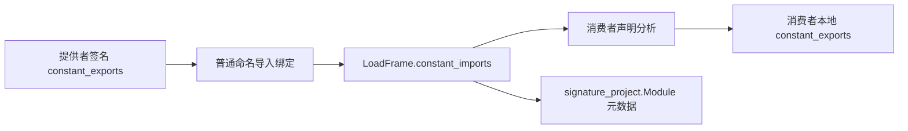

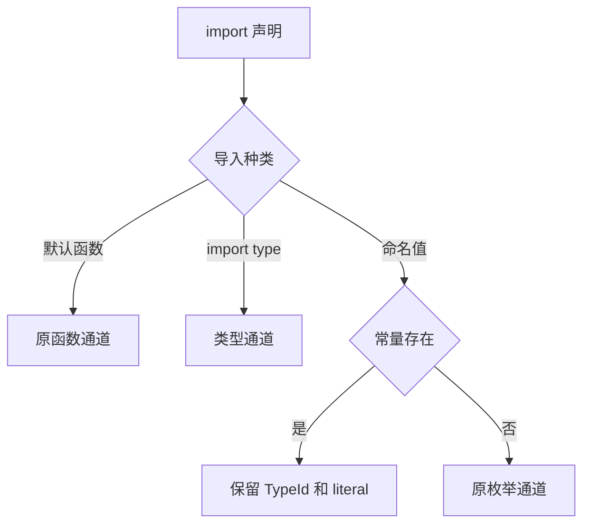

### 13B2c 验收与自我复核

命名导入通过 constants.zx 选择 typed values，剩余名称交原有 aliases 路径；default function 与 import type 继续各走原通道。core/constant/lookup 复用于普通表达式和导入选择，原生 copy 边界只复制名字和字符串 payload，其他值按值保留。没有同值别名、Function 包装或运行时全局变量。

项目 LoadFrame、Imported、Unit.signature_constant_imports 和 signature_project.Module.constant_imports 已接通。签名调用传当前常量输入，消费者本地声明使用原 TypeId 求值，导入本身不成为公开导出。仅移除签名通道的常量拒绝，body guard 仍在缓存/导入处理之前；Program、IR/库及语义缓存值传播仍待后续阶段。

真实双文件项目在 native 与 generated 两条路径通过：同一命名导入混合 u32/string 常量和枚举，消费者声明直接计算 max_u32，常量提供者带默认函数也可导入。共享 ParseCache 下合法修改提供者值再恢复，消费者结果均跟随变化并等于各自冷分析。该证据只覆盖签名与解析缓存，不替代将来的 body semantic cache。查看器和日志位于 /tmp/zxc-constant-binding/inspect、project-cache.log、project-native-cache.log；未新增仓库测试。

Native bootstrap 34/34、pinned bootstrap 16/16、CLI 构建 27/27 步通过，CLI 34/34 测试通过；前端 307/313，与基线相同六项旧失败。只读审查确认 TypeOnly 不消费值、默认函数提供者规则及字符串持久所有权；签名阶段原有默认函数边跳过逻辑未改，完整调用/RX 图仍依赖统一 SourceGraph，未将签名检查冒称完整图验收。

初版误把 native literal 校验接到 generated binding host，令正式路径实例化 seed IR 的 store 检查并出现未注册生成模块错误。现按职责边界修正：binding 消费已验证提供者的值，声明输入继续验证 typed values，不新增回调旧语义的原生桥。IR、compiled/cache 的外部值边界必须在后续阶段独立验证；不能在最终开放时遗漏。

完成全部构建后，固定最终源码、工具链、优化模式、58-entry manifest 和缓存边界，工具以同目录等长文件名执行热 16 对、冷及 ZX/RX/Store 各 12 对交错测量。

| 场景      | wall 中位数，ms，前→后 | CPU 中位数，s，前→后 | RSS 中位数，MiB，前→后 |
| --------- | ---------------------- | -------------------- | ---------------------- |
| warm      | 693.73→691.96          | 3.410→3.405          | 375.11→368.87          |
| cold      | 1480.85→1486.64        | 9.535→9.565          | 377.28→376.52          |
| cli-rx    | 1228.33→1226.96        | 1.450→1.450          | 55.71→55.74            |
| cli-zx    | 916.13→914.14          | 1.000→1.000          | 55.76→55.73            |
| cli-store | 99.17→99.13            | 0.090→0.090          | 54.50→54.48            |

各场景 wall/CPU/RSS 配对差值 95% 区间均跨零，未观察到稳定退化；冷 CPU 区间 [-0.0100, 0.0783] s、RSS [-5.22, 14.18] MiB，明确保留测量的不确定性，不宣称严格零开销。新命名值能力没有旧版等价吞吐基线，工具自身构建耗时未作成对测量。

同一最终输入前后 1,484 个生成代码文件完全一致，仅 .zxc-inputs 因工具摘要变化；同工具热/冷 1,485 文件全一致。ZX/RX/Store 的 1/2/1 文件全一致。计时之外合法编辑 aliases.zx 的诊断消息再恢复，编辑热/冷、恢复热/冷、恢复与初始各 1,485 文件一致。原始 const-import-*.json 报告依规则忽略不提交，脚本/日志/工具在 /tmp/zxc-constant-binding。

13B2c 签名命名值通道完成。下一阶段仍按前文最小链接 analyzer 的只读 scope、Program、module_record/link、mixed 与 resolved admission，再完整补 IR/artifact/compiled/cache 校验、版本和值变化失效；完成这些才解除编译入口 guard 并清理业务裸值。

## 阶段 13B2d：模块执行、契约与 IR 公开值

### Intent：最终目标

让导入及本地常量进入模块 body/contract 的只读 Source，初始化表达式的临时符号不进入最终 Program；Program 独立保存本地 constant_exports。随后将该元数据连到 module_record、link/mixed，并完整补齐 artifact、compiled 和缓存。

### Data：可用证据

当前 93f78e6e 已接通签名命名值；模块 body 和 contracts 仍给 Source.constant_values:null。Program、IR 校验和 generated resolved admission 尚无常量输入。此前测量证明不可将常量指针放回频繁更新的 Local。

### Edges：边界与限制

RX 在 prepare 后、body 前调用声明分析；scope/公开起点仅作为模块阶段元数据，Local/Prepared 保持原形状。native seed 复用已有声明集合与生成求值器，契约子分析器继承同一只读常量表。IR 公开元数据不加入 Function、Symbol 或 runtime body；constants-only 模块仍 type_only。所有转储/复制边界未完成前，编译入口 guard 继续保留，不以私有入口验证通过宣称完整功能开放。

### Answer：交付格式与成功标准

native/generated 模块分析和契约都直接产生原 TypeId 的 literal；IR 两套校验检查导出名称、类型和值，拒绝越界与无效 payload。resolved imports 必须在 native/generated 门禁中精确对应声明，import type 不可由值满足。输出名字/字符串拥有独立生命周期，链接 remap 类型时不借用将重置的 scratch。以真实源码、已有检查、完整产物/编辑恢复和同输入性能对照验收后提交推送。

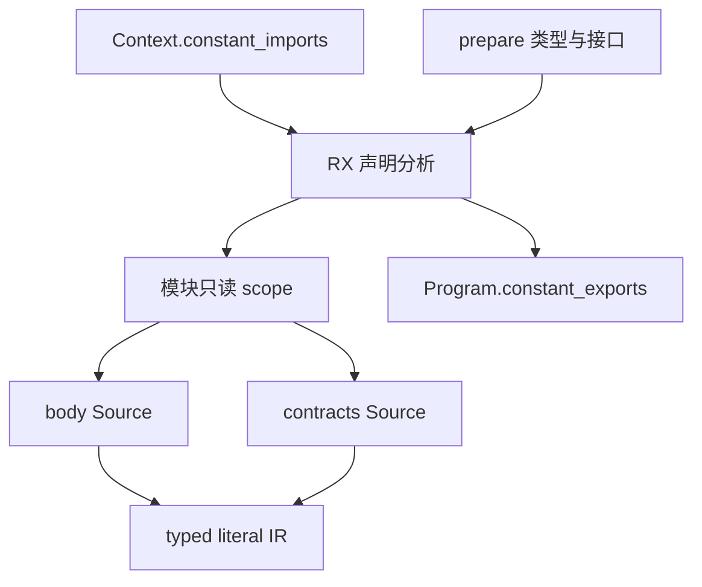

### 13B2d 实施与行为复核

原生声明集合现在同时返回完整 scope 与本地 exports；生成分析在 prepare 后、body 前通过 module/constants.rx 显式接入同一声明阶段。scope 只进入模块阶段 Analysis 与不可变 Source，没有放回高频 Local/Prepared。body 与 contracts 消费同一 scope，既有词法绑定仍优先；初始化时的表达式与符号不会泄漏到模块运行体。

Program 增加 constant_exports，IR 版本从 36 升到 37。native/generated IR 校验都检查名称唯一性、类型与 literal payload。resolved admission 只允许命名值导入匹配常量，import type 仍不可消费值，同名 alias/constant 输入不允许混入。Project、ModuleRecord、Source.Loaded、mixed Prepared 与公开库 Export 补齐元数据；Source 链接按目标类型表 remap，并在目标 allocator 深拷贝名字和字符串。history 的浮点比较改为位比较，避免将 +0 与 -0 视为相同依赖。

artifact 两个提取入口、compiled 校验/加载与 semantic restore 仍保留明确门禁：当前不支持的常量元数据必须拒绝或缓存未命中，不能静默丢失。源码 provider 的 body guard 尚未移除；签名分析与显式 supplied values 的 resolved 消费不等于完整源项目、库与缓存已开放。

临时真实源码查看器位于 /tmp/zxc-constant-module/inspect，分别执行 indexed generated、native AST 适配生成分析及 native seed 分析，并在解析 arena 释放之后检查输出。直接导入 max_u32、原 u32 类型、禁止隐式扩大为 u64、局部同名绑定、本地常量导出、两种契约、仅常量模块不产生 runtime Symbol/Expression 均通过。IR 拒绝越界值、错配类型、非法 TypeId、空名与重名；Source 链接确认名字/字符串独立持有且 scratch 释放后有效。这些是临时 API/源码核对，未新增仓库测试。

初始 seed bootstrap 34/34 步、pinned bootstrap 16/16 步、CLI install 28/28 步成功，CLI 既有回归 34/34 测试通过。前端 307/313，与 13B2c 基线相同六项 map/reduce 参数及 callback capture 旧失败，不报告全绿。新 bootstrap 的构建仅证明阶段可用，不代表完成最终自举的传递依赖审计与 stage 1/2/3 闭包。

自我复核：跨 frontend/compiler 的文件归属是 Zig 模块边界，尝试直接共享 frontend 内部 copy.zig 会造成重复归属；现保留库边界原有的短字段复制，不为这三项赋值扩张公共 API。只读复核未发现新的悬垂引用或 direct import 需要重声明的问题；同时指出无常量模块仍经过新增 RX 阶段，应以同输入性能实测判断其公共路径成本，不能以内部函数早退代替证据。

首轮同输入热生成 16 对交错测量发现公共路径退化：CPU 配对平均增加 0.04625 s，95% 区间 [0.03655, 0.05595] s；wall 平均增加 8.10 ms，区间 [2.84, 13.37] ms。该版本不通过性能验收。冷生成 12 对 wall 平均增加 9.17 ms，区间 [0.63, 17.71] ms。功能保留，优化方向是无本地声明且无导入时直接返回原 Analysis，跳过声明分析与新 Analysis 构造；不得删去常量语义以恢复基线。

现已在 module/constants 的 RX 早退中加入“syntax.constants 为空且 Context.constant_imports 为 null”，让既有模块直接返回原 Analysis；声明、导入值与诊断路径保持原逻辑。优化后生成分析的真实源码/IR/链接查看器再次通过。8 对交错热生成探测 CPU 平均差值降至 0.010 s，95% 区间 [-0.0061, 0.0261] s；此小样本仅用于决定继续全场景测量，不作为最终无退化结论。

### 下一阶段的收口边界

13B2d 仅完成模块消费与 IR 元数据，不解除 provider 的源码 body guard。13B2e 先让 artifact.Module 同时记录本地 constant_exports 和实际 constant_imports；roots/type planner 纳入其 TypeId，native/prepared 提取、link Artifact→Program、semantic restore 的 Program 重建均不得遗漏。缓存复用必须比较 remap 后的名称、原 TypeId 与实际 literal，浮点以位比较，含合法编辑与恢复后的冷/热对照。

随后补 compiled.Export 的生成输入、ZX validation/loading、native seed loading、host publish 与 codec，公开类型与常量按同一模块 Export 组织；聚合库 Program 保持不携带其他模块常量。完成旧数据版本拒绝和完整复制/校验后，再移除当前 artifact/compiled/cache guard 及 provider 的源码 body guard，最后以 const.zx 的单次定义和消费者直接 import 清理裸值。每一门禁的移除都要以对应链路已有实现与实际验证为前提。

### 13B2d 最终性能与产物证据

在全部构建结束、源码固定后，使用同一 58-entry manifest、Zig 0.17.0、优化模式与缓存边界，以同目录等长文件名交错执行热 16 对，冷及 CLI 各 12 对。先完成性能测量，再在计时之外编辑并恢复源码，未将构建并发计入结果。

| 场景      | wall 中位数，ms，前→后 | CPU 中位数，s，前→后 | RSS 中位数，MiB，前→后 |
| --------- | ---------------------- | -------------------- | ---------------------- |
| warm      | 694.92→691.50          | 3.395→3.410          | 363.91→369.64          |
| cold      | 1471.67→1471.93        | 9.420→9.445          | 367.70→374.30          |
| cli-rx    | 1225.60→1224.76        | 1.450→1.450          | 55.72→55.70            |
| cli-zx    | 909.59→909.89          | 0.990→0.990          | 55.75→55.73            |
| cli-store | 99.09→98.86            | 0.090→0.090          | 54.49→54.48            |

五个场景 wall/CPU/RSS 配对差值的 95% 区间均跨零，未观察到稳定退化。热 CPU 区间 [-0.00362, 0.02362] s；热 RSS [-5.24, 13.75] MiB，冷 RSS [-2.79, 11.15] MiB。RSS 中位数仍有约 6 MiB 上浮且区间较宽，明确保留这项不确定性，不将“未检测到稳定退化”说成数学上的严格零成本。新常量语义没有旧版等价功能吞吐基线，编译工具自身的构建成本未做成对计时。

同一最终输入前后 1,486 个代码文件完全一致，仅 .zxc-inputs 的工具摘要不同；同工具热/冷 1,487 文件全一致。CLI ZX/RX/Store 的 1/2/1 文件全一致。计时之外合法编辑 binding/aliases 的诊断文本再恢复，编辑热/冷、恢复热/冷、恢复/初始各 1,487 文件均一致。未修改专用用例、未新增仓库测试。原始报告是依规则忽略的 const-module-final-paired-_.json、const-module-output-_.json、const-module-cache-*.json；脚本、原始首轮/探测报告及构建日志位于 /tmp/zxc-constant-module。

空路径优化后的当前源码重新执行 seed bootstrap 34/34 步成功，最终 CLI 回归 57/57 步、34/34 测试通过。13B2d 模块消费与 IR 元数据阶段完成，完整常量总项仍未完成；后续收口按上文 artifact/compiled/cache 边界推进。

## 阶段 13B2e：artifact 与语义缓存常量传播

### Intent：最终目标

让模块 artifact 同时持有本地导出值与实际导入值；恢复消费者缓存前比较真实导入值及映射后的声明类型。直接命名导入不要求重复声明，不把常量变成运行时 Symbol。

### Data：可用证据

9e47eb70 已补 Program、模块消费与 Source 链接。当前 artifact.Module 尚无两组常量；两个提取入口暂拒，restore 遇常量即 miss。entries 的键只检查消费者自身源摘要及 context，提供者只改值不会由该键自动失效。native 接口共用同一缓存 codec，但其语义没有公开常量。

### Edges：边界与限制

根类型收集与既有规划必须包含常量类型；名字/字符串在目标 allocator 持有，所有新 TypeId 通过已有 mapping。比较逻辑与有效性规则由普通 ZX 原子逻辑表达，RX 连接验证与结果；seed 可保留等价初始实现。新增通用浮点位表示能力若必要，放普通标准库，不能新建编译器专用 native 语义桥。compiled 和源码 provider guard 尚不在本阶段解除。旧缓存 schema 明确失效，native interface 恢复不能静默吞掉常量。

### Answer：交付格式与成功标准

native/generated 两种提取和缓存恢复均保留精确值、原声明类型、所有权及 nominal remap；当前导入值变化时 miss，恢复后结果与冷分析一致，包括 +0/-0。公开 artifact link 不遗漏入口常量。执行既有回归、真实源码/缓存 API 检查与同输入性能/全产物对照；每阶段英文规范提交并推送。

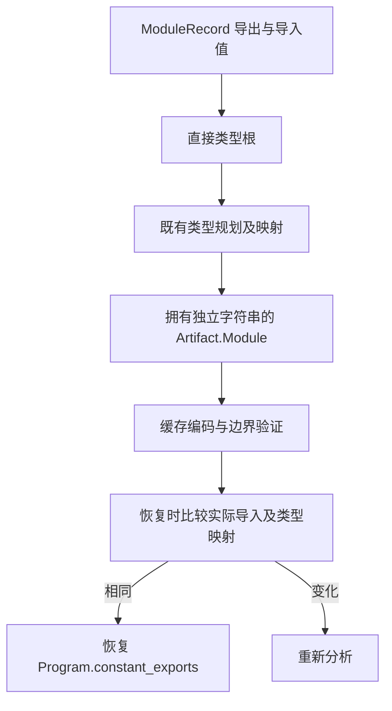

### 13B2e 实施与初步验收

Module 增加 constant_exports 与 constant_imports；根投影改名为 declaration_types，把类型导出与两组值的 TypeId 交给原有 list-root/closure，不新增游标阶段或专用类型规划。native seed roots 同样显式标记两组值。两个提取器和公开 artifact link 通过 Nodes.constants 持有名字/字符串并使用原类型映射。link 对每个命名值先使用同一常量规则比较，缺少同名常量才回到既有 enum/type 检查；常量提供者可有默认函数，其他接口限制保持。

统一规则位于 analysis/constants/bindings.rx：RX 按是否指定名字选择 named 或整表匹配，ZX 负责名称查找、类型映射与 active literal 比较。value_equal 复用字段类型，float.bits 是普通静态标准库接口，返回 f64 的 u64 位表示；正式比较语义来自 ZX，标准库函数不承载编译器规则。Zig 层负责一次封装与生命周期，初始 seed 保留等价规则；这些现有状态/封装适配器仍属于最终自举待迁移内容，不以新增 ZX 文件宣称最终闭包完成。

恢复时比较缓存和当前导入值，结果含名称、声明 TypeId 映射及精确 payload；未命中走原回滚。cached Module 的类型表先由 types.append 验证，再检查常量，避免内存 put 绕过磁盘解码时用坏类型列进入 literal 检查。codec schema 从 module.v3 改为 module.v4，decode 在类型表验证后检查两组值。旧协议两项已有夹具同步升级，防止旧 marker 让 payload 拒绝检查变成空通过；未新增仓库测试。native interface 恢复显式拒绝常量，避免未投影字段被静默丢弃。

只读复核还发现逐个导入名称封装整张常量表会造成平方级临时物化；现按依赖 prepare 一次，逐名共享封装后的表。算法查找仍按既有线性扫描，未引入额外索引、全项目摘要或常驻缓存；不把静态推断当作实测收益。无常量时校验和整表比较直接返回，链接不创建 Prepared。

临时查看器 /tmp/zxc-constant-artifact/inspect 从真实源码分析结果构造对应模块记录，释放原解析及分析 arena 后检查提取产物。native/generated 均通过导出/导入值与字符串所有权、enum 类型根、负零 codec、相同值命中、合法改值及 +0/-0 变化未命中、恢复重新命中、坏 payload/类型列拒绝与回滚、artifact 链接和带默认函数的常量提供者。过期导入值的链接返回 ConflictingInterface。此证据针对 artifact/cache API；源码 provider guard 与 compiled guard 仍在，未冒称完整项目入口已开放。

初始 seed bootstrap 34/34 步、最终 pinned bootstrap 16/16 步、CLI install 28/28 步成功。现有缓存 codec 回归 39/39 测试通过；其他模块、语义缓存与链接检查以及同输入性能仍待收口。性能共同输入保留上一阶段可消费的 58 个入口；新增的两个常量规则入口随本阶段正常完整构建验证，未把新增功能数量差异计成同输入性能变化。

## 共享常量完整入口收口

### Intent：最终目标

把常量从声明、解析、分析、IR、源模块、编译库到缓存恢复接通，交付可直接消费的功能；不再把内部接线拆成新交付。用户进一步明确：范围不限整数，具有含义的字符串、浮点值、阈值和标记也应在对应 const.zx 定义后直接导入。

### Data：可用证据

artifact 与缓存原有收口检查已完成：缓存 codec 39/39，模块 artifact、semantic cache 与 link boundaries 130/130；两类源码查看器均通过常量所有权、类型映射、负零、改值失效、坏缓存拒绝及回滚。旧输入 58 入口的前一轮完整产物对照验证了 std:float.bits 的精确 ABI 增量；其余 1484 文件逐字相同，热/冷全 1487 文件相同。此轮证据覆盖此前实现，后续 compiled 与共享源码变更另补相应验证，不重复整批检查。

当前 compiled.Exports 增加常量列，公开库的每个导出分别保留常量，而聚合 Program 不携带模块级常量；验证、装载、类型 remap、owned 输出、codec 及源项目导入全部接通。源码 provider 与 compiled 临时拒绝门禁已解除。公开 API 查看器已通过 source→semantic-cache 改值/恢复，以及 library.link→codec→加载→命名导入→Zig 生成，并在释放原分析、库与编码字节后消费解码结果。相关日志：/tmp/zxc-constant-artifact/public-check.log，13/13 构建步骤成功。

core/const.zx 统一声明整数边界、内建类型编号/名称和 ASCII 命名范围；消费者直接导入。numbers/target 删除旧同值局部别名。常量分析域的诊断代码与文案进入 analysis/constants/const.zx，避免只处理整数。生产 RX/ZX 的 4294967295 仅保留定义；u32→u64 保留显式拓宽，新通用 integer.widenShort 用普通 Zig 转换 u16。命名规则允许 snake_case 常量命名导入，同时保留 PascalCase 枚举/类型约束。

### Edges：边界与限制

常量当前仍限闭合标量表达式，复合对象/集合常量尚不支持；不能把本次交付说成任意类型常量均完成。其他职责的历史裸值仍需按语义整理，不能用本次几个域的替换宣称全仓库清理完成。结构性的空集合、循环起点/步长不机械抽取。现存 Zig 状态及适配桥仍属于最终自举迁移范围。正式性能对照必须使用两工具均可消费的同一冻结源码，不把新增常量声明造成的输入差异算成性能退化或收益。

### Answer：交付格式与成功标准

源码与编译库真实入口可用；保留命名、声明类型、精确标量值和独立所有权；更新使用指导与仓库规则。功能收口后集中运行对应回归与同输入性能，记录剩余需求，再以英文规范提交并推送。本节按 IDEA 记录；下图给出完整架构和数据流。

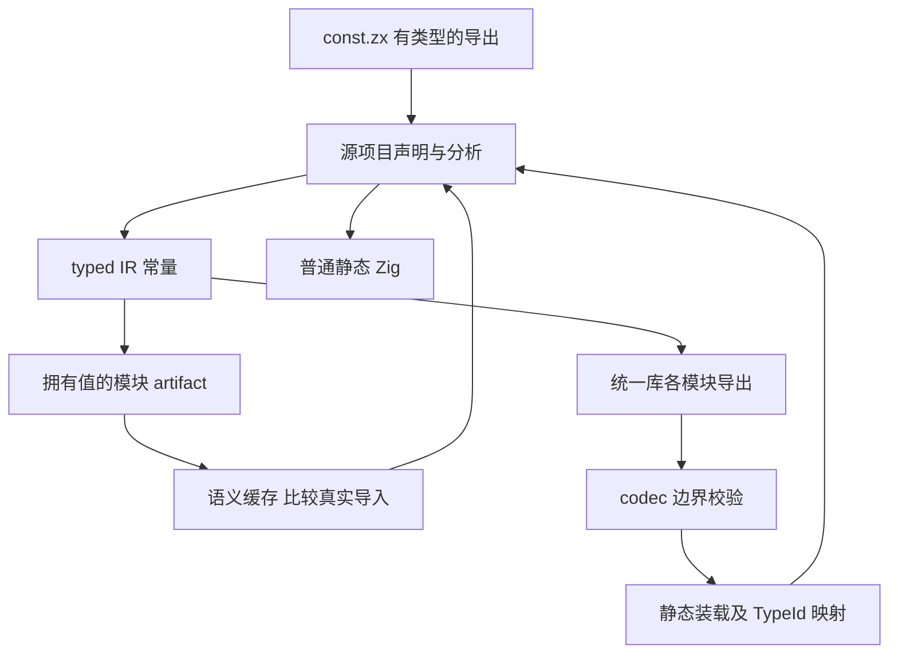

最终共享源码版本的 pinned bootstrap 16/16 步与 CLI 28/28 步成功；编译库 codec 回归 42/42，通过源库字节格式、类型列与拒绝路径。临时 CLI 真实程序同时导入 u32、string、f64、bool，生成的普通 Zig 执行结果为 4294967295，日志 /tmp/zxc-constant-artifact/runtime-check.log。此前 artifact/cache API 检查 130/130 与缓存 codec 39/39 对应未改动的链路，不重复运行。当前完整要求仍包含其他职责裸值清理与 lint、复合常量能力边界以及后续语言需求。

性能复用冻结的旧版本 58 个入口，前后工具使用同一 manifest 与源码、相同路径长度、相同 Zig 工具链。生成器热场景 16 对、冷场景 12 对已完成。CLI 目录副本不满足入口项目身份边界，预热即失败而没有测量样本；改为两工具共同编译原工作区中未改动的相同 RX/ZX 案例，复用既有 Store 案例，不重跑已完成的 warm/cold。完整统计及产物比较在下方追加最终结果。

### 最终同输入性能与产物

基线工具来自 9e47eb70，最终工具来自本次完整改动。热/冷使用同一冻结旧源码 58 入口；CLI 使用两工具共同消费且未改动的 RX/ZX/Store 源码。warm/cold 分别为 16/12 对，CLI 每场景 12 对，交替前后顺序；CPU 为 user+system，RSS 为进程峰值 MiB。CLI RX/ZX 每个样本各编译 200 次，Store 每样本编译 40 次。

| 场景      | wall ms 前→后（中位数） | CPU s 前→后 | RSS MiB 前→后 | wall 差值 95% 区间 ms |
| --------- | ----------------------- | ----------- | ------------- | --------------------- |
| warm      | 702.653→694.535         | 3.390→3.380 | 358.62→364.01 | [-12.520, 0.293]      |
| cold      | 1490.817→1480.645       | 9.505→9.505 | 369.43→368.03 | [-16.256, 9.563]      |
| cli-rx    | 1195.562→1192.036       | 1.420→1.410 | 55.76→55.74   | [-8.518, 1.546]       |
| cli-zx    | 900.141→896.260         | 0.980→0.970 | 55.80→55.74   | [-9.364, 1.027]       |
| cli-store | 97.854→97.692           | 0.090→0.090 | 54.54→54.47   | [-1.987, 6.213]       |

所有场景 wall 与 RSS 的配对差值 95% 区间含 0；CPU 在 CLI RX/ZX 小幅下降，其余含 0。本轮未检出稳定性能退化，不将有限样本说成任何输入下绝不退化。完整数据保留在忽略的 docs/2026-10-31/const-complete-paired-summary.json，日志为 /tmp/zxc-constant-artifact/performance-complete.log 与 performance-cli-complete.log。

全输出比对：前后 1487 文件中的 types.zig 仅增加 float.bits 与 integer.widenShort 的精确六行接口块；.zxc-files 仅相应 types.zig 摘要变化，.zxc-inputs 为工具身份变化。临时比较脚本先断言移除两个精确块后 types.zig 逐字相同，再核对其余 1484 文件全部一致；未按未知差异盲目排除文件。最终工具热/冷全部 1487 文件相同；CLI ZX/RX/Store 各 1/2/1 文件全部相同。报告为 const-complete-verified-output-*.json（忽略文件），日志 /tmp/zxc-constant-artifact/outputs-complete.log。

自我复核：本次交付证明共享标量常量的正常源码、编译库与缓存入口可用，且关键边界、类型编号、名称、字符范围和本职责诊断文案已直接引用 const.zx。它不能证明全仓库所有职责的历史裸值已清完，也不能代替复合常量或最终自举闭包；全局裸值 lint、对象结构格式化、barrel/index、If、pipeline 及新增对象复用操作继续保留在需求清单。
