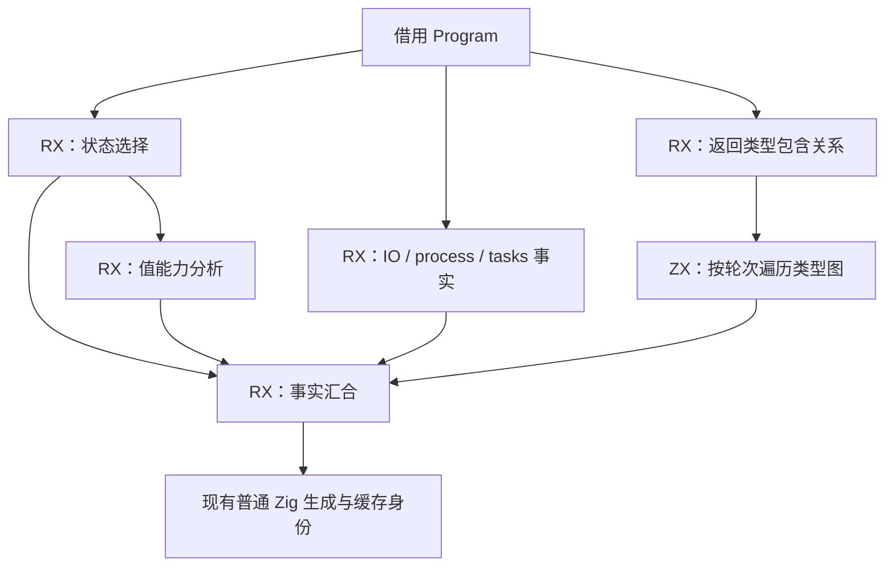

# 函数返回类型包含关系自举

## Intent：最终目标

将函数返回类型的输入包含关系分析迁入现有 RX/ZX 函数事实模块，正式生成路径不再执行对应手写 Zig 算法，保持缓存身份、普通 Zig 产物与性能。

## Data：可用证据

基线为 `1f58e74f`。`genz/zx/function_analysis.zig` 的 `freshOutputs` 对每个函数遍历输出类型的后代，判断其中是否存在输入类型；结果进入生成缓存指纹。现有 `analysis/facts/analyze.rx` 已编排值能力、共享状态及副作用事实，`function_analysis/generated.zig` 已借用相同 Program 的类型列与函数列，不需要新适配协议。

算法从输出类型的子类型开始，不检查输出本身；只沿 optional/list/object/tuple 遍历，不进入 task/error/native。现有通用 `types/children.zx` 的 deep 选项还遍历 task，因此不能直接替换。

## Edges：边界与限制

- RX 显式连接本项整表事实与其他事实；图遍历和必要循环在一个内聚 ZX 算法中。
- 类型列与函数列借用，保留单个轮次标记数组及跨函数复用的待处理缓冲区，不逐函数清整张类型表，不逐节点构造子类型数组。
- 旧实现仅留在 seed 分支；不新增编译器专用原生桥、运行库或动态调度。
- 不新增测试用例，使用现有生成输入和检查；临时差分探针只核对旧新结果，最终测量前移除。
- seed 生成器不执行正式 RX/ZX 事实，不能用 seed 的毫秒数替代正式路径性能；需要构建 `bootstrap-stage` 工具核对实际路径。

## Answer：交付格式与成功标准

实现 ZX 包含关系算法并接入现有 RX 事实阶段；通过已有回归与实际输入差分，确认缓存相关布尔事实逐项相同。对正式 bootstrap 工具和 CLI 固定输入进行产物与性能对照，记录实际范围、自我批判和剩余闭包，再独立英文提交并推送。

## 实现与过程证据

`facts/analyze.rx` 增加显式返回类型事实阶段，并在返回处汇合 `fresh_outputs`。`types/fresh_outputs.zx` 按函数轮次遍历类型图，同职责目录中的 `children.zx` 将一个节点的直接子类型追加到待处理缓冲区。缓冲区保留物理长度，以单独的逻辑 count 弹出和复位，旧槽位直接复用；仅达到历史容量上界时才追加，不通过切片或新列表清空缓冲区。

既有适配器继续借用 Program 列并把布尔结果复制进调用方 allocator，没有新协议或原生语义接口。`remaining` 的正式 generated 分支直接取生成事实；手写算法只由非 generated 分支使用，保留给 seed 和显式选择的旧后端。

临时差分探针在正式 generated 分支对每次调用执行旧算法并逐项比较布尔数组。带探针的正式 bootstrap 工具对相同 55 入口、1,458 模块输入生成成功，前后 1,426 个文件逐字节一致，唯一变化为 `.zxc-inputs`。同一探针下，完整 RX 推导 138/138 通过，测试执行 704ms。探针随后移除；这些含探针的数据只用于正确性，不能作为最终性能成绩。

对应报告为本目录被忽略的 `fresh-probe-{bootstrap-build,generator,rx-inference}.json`、`fresh-probe-output-raw.json` 及日志。新 ZX 两个文件的既有格式化和 lint 检查通过，修改的 RX 格式检查通过。没有新增测试用例。

## 最终验证与性能

移除探针后，`bootstrap-stage` 和根目录 ReleaseSafe CLI 均构建成功。最终完整 `test-rx-inference` 138/138 通过，执行 595ms；既有模块生成 cache/gates/resources 的 Debug 检查 9/9 通过，覆盖缓存复用、替换、分配失败、释放与内部校验。临时构建选择已原样恢复。报告为 `fresh-final-{bootstrap-build,cli-build,rx-inference,generation-debug}.json` 及日志，构建有并行负载，不据其耗时比较性能。

性能基线与最终工具均为相同 ReleaseSafe 宿主、small 根模块的正式 `bootstrap-stage` 工具，正式 RX/ZX 函数事实启用。固定 55 入口 manifest 和相同修改后源码；基线工具仍以旧算法计算事实，但能够编译同一份新增 ZX 源码，因此比较不混入不同输入。各轮常驻服务关闭，输出目录新建；热生成逐版本预热相同函数缓存，冷生成逐轮新建缓存。计时与构建、回归隔离，工具、驱动及显式输入摘要均稳定。

| 场景                                     | 轮次 | 墙钟中位数：基线 → 最终 | CPU 中位数：基线 → 最终 | 进程峰值 RSS 的中位数：基线 → 最终 |
| ---------------------------------------- | ---- | ----------------------- | ----------------------- | ---------------------------------- |
| 正式 bootstrap 热函数缓存生成            | 各 7 | 678.15 → 665.10ms       | 3.35 → 3.29s            | 356,909,056 → 353,042,432 B        |
| 正式 bootstrap 冷生成                    | 各 5 | 1,392.88 → 1,388.93ms   | 8.88 → 8.85s            | 367,869,952 → 360,333,312 B        |
| CLI 同一真实 RX 编译 50 次，先最终后基线 | 各 7 | 323.10 → 322.60ms       | 0.40 → 0.40s            | 57,180,160 → 57,163,776 B          |
| CLI 同一真实 RX 编译 50 次，先基线后最终 | 各 7 | 322.26 → 324.53ms       | 0.39 → 0.39s            | 57,196,544 → 57,212,928 B          |

正式热生成的 infer / emit / write 中位数为 238 / 349 / 35ms → 233 / 345 / 34ms；每轮复用全部 1,403 个生成单元，仍执行前端与分析。热生成 RSS 各轮最大值 367,673,344 → 357,613,568 B，冷生成 375,029,760 → 361,414,656 B。普通 CLI 两种先后顺序中墙钟分别约 -0.15% 与 +0.70%，CPU 持平，未见稳定退化；不把小幅波动或某轮首次装载成本视为算法收益。RSS 是被测进程峰值，不是整台机器或常驻服务的累计内存。

前后完整产物 1,427 项中，1,426 项逐字节一致，仅 `.zxc-inputs` 的工具 frame 身份变化；先保存原始差异，再只排除这个精确文件复核。最终冷生成与热生成全部 1,427 项一致，不作任何排除。CLI 源码及 ABI 两项也逐字节一致。报告为 `fresh-formal-{warm,cold}-{before,after}.json`、`fresh-cli-{1,2}-{before,after}.json`、`fresh-final-output*.json`、`fresh-final-cold-warm-output.json` 和 `fresh-final-cli-output.json`。

## 边界与自我批判

复用现成 `children(deep=true)` 会误把 task 纳入遍历；机械使用每节点返回子类型列表也会增加分配。这两种看似直接的替换都不满足原始语义和性能边界，因此这里保留明确的节点类别与复用缓冲区。

本项是一个完整的优化事实算法迁移，不是整个函数分析器自举完成。Program 的宿主列式适配、唯一性分析、错误传播和聚合身份观察仍有待迁移内容。生成结果一致与阶段编译仍不能代替整个编译器的传递依赖审计。
