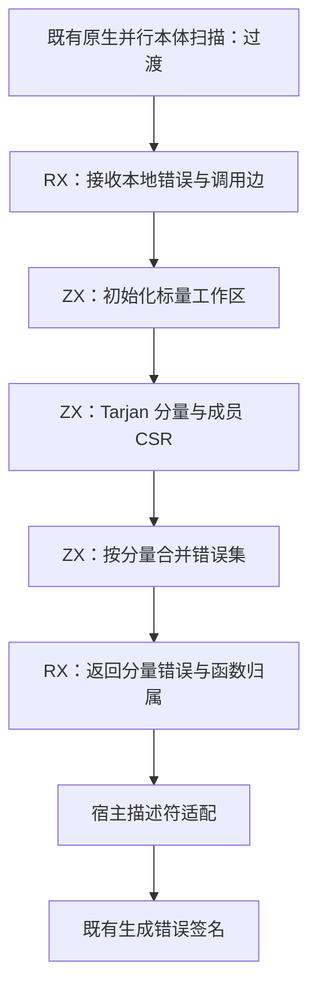
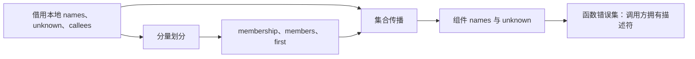

# 函数错误集传播自举

## Intent：最终目标

把正式生成器使用的函数调用图强连通分量划分、分量内错误集合并及被调方错误传播迁入 RX/ZX，保持精确错误集、unknown 传播、普通 Zig 产物与编译性能。

## Data：可用证据

基线为 `87d40605`。`core/error_effects/functions.zig` 先并行扫描各函数本体得到本地错误及 source callee，再用显式栈 Tarjan 按被调方优先顺序计算分量，合并、去重并排序错误名称。`genz/function_analysis.analyzeFrom` 仍直接调用整个原生算法；现有 `core/error_effects/analyze.rx` 没有替代这条整表传播路径。

现有工作区已有标量列表的按值状态与原地索引更新，能够表达预分配的 order、low、活动栈和 DFS 栈。使用并行标量数组及逻辑长度，避免为每次 DFS 步骤创建记录或在空栈上反复申请容量。

## Edges：边界与限制

- 本阶段完整迁移图传播职责；本体错误规则扫描及其原生状态仍是过渡依赖，不能宣称全部错误效应或整个编译器完成自举。
- 不注册新的专用 Zig 语言接口。既有本体扫描只暴露已有结果供宿主适配，名称与调用边借用；RX 输入只增加必要的事实，不扩大各纯度热循环的 Program 描述符。
- RX 明确连接初始化、分量计算和集合传播；ZX 保留内聚图算法与集合算法，不把整条业务流程藏进一个入口包装函数。
- 分量内 source 递归、前向调用、native unknown、Store unknown、字符串按内容去重及确定性排序均保持。旧实现只供 seed 和临时差分。
- 不新增测试、不新建分支。使用既有行为、错误传播及资源检查；完整同输入产物、冷热正式生成与 CLI 性能作为门禁。

## Answer：交付格式与成功标准

正式 generated 分支使用 RX/ZX 图传播，图的自有状态由 ZX 建立；适配层只借用本地扫描结果并转换返回描述符。比较全部函数的错误集、null 与名称内容顺序，移除临时探针后核对实际产物和性能。记录未迁移边界、自我批判及证据，英文提交并推送。

## 实现与正确性核对

新增 `core/error_effects/functions` 统一模块，Input 显式声明 names、unknown、callees 三列，Output 位于 Module 末尾。RX 连接工作区初始化、Tarjan 分量和集合传播。ZX 用独立标量数组保存活动栈、DFS 节点/子边位置/入栈位置，使用逻辑长度复用空间；组件用 membership、members、first 表示，不在每个 DFS 步骤创建记录。

入栈时保存的 starts 在对应 DFS frame 退出前始终有效：该节点不能被后代 SCC 弹出。因此分量完成时的 starts 等于旧 lastIndexOfScalar 的位置，成员次序及组件完成次序不变。跨组件边指向更早完成组件，跳过同组件等价于旧 join 跳过活动栈中的目标。unknown 早退只省略最终不可见的名称合并；有限错误集按内容边收集边去重，再排序。

原生本体扫描拆出持有 worker arenas 的 collect 结果。宿主借用本地名称与调用边，仅建立行描述符；调用 ID 的 u32 表示经静态检查后借用，不复制调用边。组件名称切片复制到调用方 allocator，函数共享对应组件的切片；字符串正文继续借用 IR 或静态错误名。worker arenas 在 generated execute 与返回复制完成后才释放。

## 自举加载器缺口

初次构建报 Referenced module file is not registered。manifest 已有包声明，但 generate_parser 在预校验 RX 前未把它传入 TextSource，构造 ModuleSource 时也丢失 packages。修复两处传递，并给 resident.modules 的解析复用条件增加包声明摘要；按长度编码 specifier 与 entry，一次计算，避免对每个源文件重复散列整个包表。完整 manifest 仍参与原有分析 frame/shape 身份。保留原有模块图与完整源码依赖图校验。

由于旧工具不具备这项已存在语言能力的加载器修复，不能拿它对同一新输入的共同失败计算性能差异。用于图算法比较的原生基线保留相同加载器修复及本体扫描所有权整理，只把三个 GenZ 集成文件暂时恢复至提交前内容构建；finally 恢复并逐字节核对源码。该工具仍使用原生 SCC，未调用新图模块。

## 临时差分与当前证据

在 generated 适配器临时调用旧 perFunction，逐函数比较 null 状态、名称数量和每项内容顺序。第一版及边收集边去重版均通过真实 55 入口输入；后一版分析 1,469 模块、生成 1,323 个函数文件、1,413 个生成单元。报告为 `error-graph-probe-{bootstrap-build,generator}.json`、`error-graph-probe-{build,generator}-2.json`。

原生图工具与探针工具处理完全相同的新源码与 manifest，完整目录 1,437 项中 1,436 项逐字节一致，唯一差异为工具身份 `.zxc-inputs`，没有文件增删。原始差异报告 `error-graph-probe-output-raw.json` 保留该项，尚不能据探针版本计时声称性能达标。

尝试既有 test-function-analysis 时，它的构建入口引用 `function_analysis/lanes.zig` 与 `buffer_call/analysis/flow.zig`；两文件在基线 HEAD 中也不存在，导致 FileNotFound。未重建退役路径或改变断言，不能把该目标写为通过。既有测试中未找到直接的 SCC 自环/互递归断言；阶段证据还需要上述逐项差分和算法不变量，不能只引用普通 typed-try 通过。

## 最终产物与既有检查

删除差分探针后重新构建 bootstrap-stage 与 CLI，均成功。`rg expected_errors` 确认未保留探针；正式 generated 路径不再执行原生 Tarjan，原生 `perFunction` 只用于 seed 分支。

- `error-graph-final-bootstrap-build.json`、`error-graph-final-cli-build.json`：最终工具构建成功。
- `error-graph-final-typed-try.json`：107/107 构建步骤、247/247 检查通过，包含 typed-try 与 RX inference。
- `error-graph-rx-syntax.json`：31/31 步骤、39/39 检查通过。
- `error-graph-generation-debug.json`：20/23 检查通过，失败仍是前阶段已登记的三项 buffer_eligibility 断言；未改断言或重建缺失的测试源码。
- 新增 RX/ZX 的格式检查与 lint 全部通过，修改的 Zig 格式检查和 `git diff --check` 通过；未新增测试用例。

正式计时使用最终无探针工具。原生基线与最终工具的完整目录 1,437 项中 1,436 项一致，无文件增删；唯一差异仍是 `.zxc-inputs`。该文件由 manifest、源码摘要、原生接口及生成器二进制摘要共同计算，本次输入完全相同而二进制不同，差异符合工具身份设计。报告 `error-graph-output-final-raw.json` 未排除该文件。最终工具热缓存与冷生成 1,437/1,437 项一致，见 `error-graph-output-warm-cold.json`；CLI 两项产物也完全一致，见 `error-graph-long-cli-output.json`。

## 修改与恢复的缓存验证

在临时副本中将真实 string 原生接口的 join 错误集从 OutOfMemory 扩大为 OutOfMemory、Overflow，不修改仓库源码。同一函数缓存执行原输入、接口修改、恢复，再分别与对应输入的全新缓存比较：修改后与冷生成、恢复后与冷生成、原输入与恢复后三组均为 1,437/1,437 项一致。修改确实改变公开接口及其依赖生成单元；原生图基线处理修改后输入同样只在 `.zxc-inputs` 上不同。证据为 `error-graph-cache-*.json`、`error-graph-cache-output-*.json`，脚本 `/tmp/zxc-error-sets/check_cache.py`。

为直接验证 RX 包命名空间的常驻解析缓存，独立启动最终工具服务，通过现有 socket 协议顺序发送同一真实 manifest、删除所需包声明的副本、原 manifest；状态依次为 done、failed、done，第二次明确诊断 Referenced module file is not registered。直接读取服务状态，避免 CLI 失败回退冷生成掩盖缓存错误。原始与恢复产物、恢复与独立冷生成均为 1,494/1,494 项一致（该场景固定 partitions=1），见 `error-graph-namespace-resident.json`、`error-graph-namespace-output-{restored,cold}.json`。服务仅用于本轮检查，已通过 stale 身份请求正常结束。脚本 `/tmp/zxc-error-sets/check_resident.py`，原始日志 `/tmp/zxc-error-sets/namespace-server.log`。

## 正式性能门禁

采用相同 55 入口 canonical manifest、源码、工具链、ReleaseSafe 工具与独立输出目录。正式工具运行时设置 `ZXC_RESIDENT_GENERATOR=0`；热场景复用已预热的磁盘函数缓存，冷场景每轮使用全新缓存。所有构建及行为检查结束后隔离测量，分别按 before→after、after→before 执行；每个顺序热生成 7 轮、冷生成 5 轮。报告中的显式输入与工具文件前后摘要均不变。这里的“热”不代表常驻进程。

| 场景（合并两顺序中位数） |    原生图基线 |      RX/ZX 图 |   变化 |
| ------------------------ | ------------: | ------------: | -----: |
| 热生成墙钟，14 轮        |    683.736 ms |    678.327 ms | -0.79% |
| 热生成 CPU               |       3.425 s |       3.410 s | -0.44% |
| 热生成峰值 RSS 中位数    | 368,566,272 B | 369,098,752 B | +0.14% |
| 冷生成墙钟，10 轮        |  1,427.716 ms |  1,427.401 ms | -0.02% |
| 冷生成 CPU               |       9.200 s |       9.175 s | -0.27% |
| 冷生成峰值 RSS 中位数    | 370,696,192 B | 367,247,360 B | -0.93% |

两执行顺序的热墙钟分别为 682.954→677.686 ms、684.433→679.402 ms；冷墙钟分别为 1,421.882→1,420.864 ms、1,436.794→1,428.885 ms。未检测到稳定墙钟或 CPU 退化；冷生成基本持平，不能称为加速。RSS 分布有重叠，热场景中位数 +0.14% 也不能隐去；冷场景单轮最大值为 401,129,472→409,763,840 B，未证明最坏内存降低。

小型 gap RX 的无缓存 CLI 编译先做每批 50 次测量，墙钟 +0.18% 且顺序方向翻转；CPU 只有 0.01 s 分辨率，不能据此判断退化。随后改为每批 200 次、两顺序各 7 批：墙钟 1,171.178→1,169.056 ms（-0.18%），CPU 1.430→1.435 s，峰值 RSS 中位数 58,400,768→58,441,728 B（+0.07%）。两个顺序的 CPU 中位数前后分别同为 1.44 s、1.43 s；合并后 +0.005 s 来自离散样本中位数，低于计时分辨率。两顺序墙钟分别下降约 0.9%、上升约 0.7%，本轮没有稳定变化证据，不声称 CLI 提速。

测量报告为 `error-graph-formal-{1,2}-{warm,cold}-{before,after}.json`、`error-graph-cli-{1,2}-{before,after}.json`、`error-graph-long-cli-{1,2}-{before,after}.json`，各自 `.json.logs/` 保存逐轮日志。驱动为 `/tmp/zxc-error-sets/{measure.py,measure_cli.py,compile_many.mjs}`；基线构建脚本为 `/tmp/zxc-error-sets/build_baseline.py`。CLI 小输入不能替代正式生成器数据；这些数字也不代表 Zig 后端完整重建耗时。

## 自我批判与后续边界

本阶段交付的是正式路径中的函数错误图传播及其工作区状态，RX 有初始化、分量划分、集合传播三个真实阶段。工作区标量数组预分配、索引原地更新；生成代码检查未发现算法循环内的记录逐步装箱。名称按内容去重，输入名称正文与调用边借用，没有引入专用运行库。

本体错误规则、IR 模型、并行 worker、加载器与解析缓存仍由原生 Zig 执行；本阶段拆出所有权并修复包元数据传递，没有完成这些职责的迁移。直接的自环与互递归专项既有检查缺失，有限真实输入差分与不变量审查也不是一般规模的机器证明。既有三项布局断言及退役测试入口继续存在。性能结论限于所记录输入、环境和场景，不承诺任意规模图的资源上界优于原生实现。完整自举的传递依赖审计及 stage 1→2→3 验收尚未完成。
