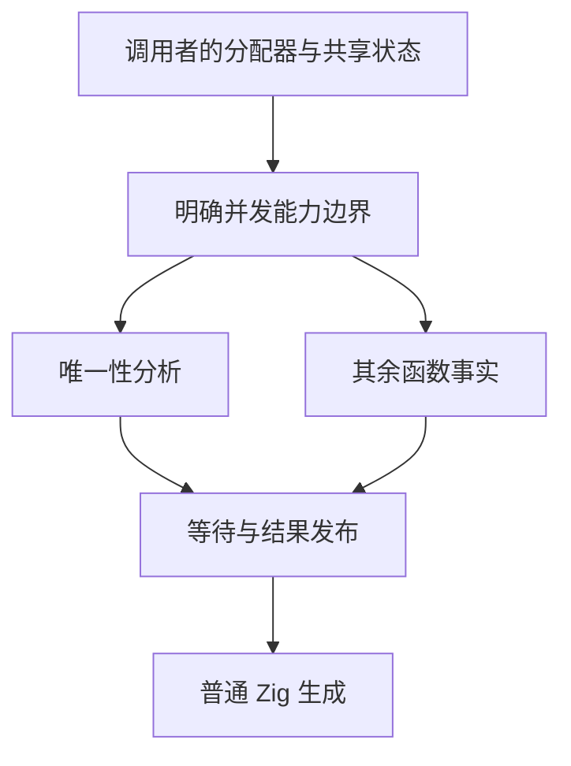
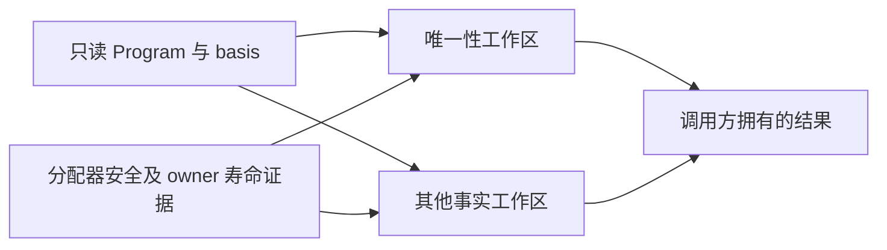

# 分析并发与验证阻塞

## Intent：最终目标

恢复完整自举回归的可验证性，消除函数分析对通用分配器的隐含线程安全要求，并保留正式生成器的并行性能。

## Data：可用证据

前一阶段完整 RX 推导回归未通过：主线程等待唯一性分析工作线程，采样在 Mach-O 回溯 panic 及回溯锁中等待。`function_analysis.analyzeFrom` 无条件创建线程；公开入口接收普通 `std.mem.Allocator`，而工作线程和主线程的分配可以回到同一 backing allocator。标准 `FailingAllocator` 的计数和失败标志是普通可变字段，并非并发接口。

版本核对：本机 Zig 0.17 的 ArenaAllocator 在 child allocator 线程安全时也线程安全，不能笼统认定 arena 不安全；普通 FBA 与 FailingAllocator 没有此保证。`std.process.Init.gpa` 明确承诺线程安全，因此正式生成器可以显式选择并行分析，而普通库 API 不应隐含该要求。

## Edges：边界与限制

- 分别验证分配器并发风险和生成模块回溯信息，不把采样症状当作唯一根因。
- 不按测试名称、环境或源码路径关闭规则，不绕过分配失败检查，不用全局 page allocator 替代调用方 allocator。
- 只有调用者能证明分配器和共享状态安全时才允许并行；普通公共调用应满足其现有分配器契约。
- 不新增测试用例，使用既有完整回归和生成器输入，所有执行设明确上限。
- 对正式生成路径做相同输入的产物、墙钟、CPU 与 RSS 核对。此阶段是自举验证与资源边界收口，不能代替剩余算法迁移。

## Answer：交付格式与成功标准

先隔离回溯配置，再修正实际并发所有权边界；完整回归需报告真实结果。最小生产修改验证后独立英文提交并推送。

## 实现与验证

### 根因与最小修正

保留生成模块调试信息的隔离运行仍在同一工作线程的失败回溯路径卡住，不能靠切换调试符号解除问题。随后仅修正分配器并发边界，原有生命周期文件 6 项检查（含分配失败枚举）通过，执行耗时 649ms；这组结果支持并发分配器契约是实际阻塞链上的必要修复。

`Analysis.analyze/create/createExported/createRemembered` 继续接受普通 allocator，并使用已有的顺序路径。新增显式 `createRememberedConcurrent`，要求 backing、memo 及其共享父分配器线程安全，且分析期间独占 memo。内部并发选择为 comptime 参数，普通路径不会保留线程创建分支。

正式生成器通过 `emitLibraryFilesCachedConcurrent` 选择并发；`resident.gpa` 来自标准 `Init.gpa`，memo 同样使用该 gpa，并在一次分析期间独占。没有根据缓存存在与否、分配器名称、测试名称或数据规模猜测线程安全，也没有加入锁、运行库或替代调用方 allocator。唯一性算法内部已有独立 smp-backed 工作区的并行保持原样。

### 既有检查

- 最终 `test-rx-inference -Doptimize=ReleaseSafe`：138/138 通过，测试执行 766ms。此前同一完整入口达到 240 秒上限，不能用失败基线计算提速倍数。
- 既有模块生成 cache/gates/resources 三个文件在 Debug 下共 9/9 通过，覆盖填充、复用、替换、所有权、分配失败和内部 IR 门禁。仅临时选择这些既有文件，`packages/test/build.zig` 已原样恢复，未新增测试用例。
- 首次将上述门禁检查按 ReleaseSafe 执行时，8/9 通过；失败的是故意篡改内部 IR 版本后要求 Debug 内部校验拒绝的检查。按其内部校验条件改用 Debug 后 9/9 通过，未改变生产门禁或删去检查。失败日志仍保留。

报告为本目录被忽略的 `analysis-{symbols-isolation,sequential-lifetime,full-rx-inference,final-rx-inference,module-generation-core,final-generation-core-debug}.json` 及对应日志。符号隔离采样时父构建结束，采样脚本明确记录身份校验异常；原始栈仅用于定位，不作为有效性能计时。所有已识别的卡住测试进程均已清理。

最终完整推导复核报告为 `analysis-optin-rx-inference.json`；最终 cache/gates/resources 的 Debug 复核再次 9/9 通过，报告为 `analysis-optin-generation-debug.json`，临时构建选择已原样恢复。最终 CLI 的既有 `rx/cli/check_test.ts` 11 个场景通过，报告为 `analysis-optin-cli-check.json`。本次未新增测试用例。全仓格式检查还列出任务范围外的既有格式差异，仅本次修改源码的定向格式检查通过；没有批量改写无关文件。

### 边界与自我批判

最初将现象概括为工具链回溯问题不够充分；普通 allocator 的并发资格本应先由调用关系核对。此次改动解决该实际调用链，没有修改标准库、跳过失败注入或声称修复了 Zig 所有回溯问题。

公开的普通分配器入口改用已有顺序路径，因此还需对实际小入口和正式大生成任务做成本对照。此处修正的是过渡宿主的资源契约，唯一性算法和其余手写状态仍需继续迁入 RX/ZX。

### 性能门禁中发现的额外成本

第一版顺序实现仍把唯一性结果写入专用短期 arena，再复制到调用方工作区；这原本用于隔离两个并发阶段。普通入口顺序执行后，这次复制已无生命周期必要。同一 YAML gap 入口每批编译 50 次、每版 7 轮的首次测量为 308.20ms → 317.69ms，交换先后顺序复测仍偏慢，不能把它视为无退化。

因此顺序路径直接将唯一性结果写入调用方结果 allocator，去掉专用 arena 的结果分配及一次 `copyPlans`。并行路径继续独立持有结果，join 后再复制，保持原线程边界。`Owned` 入口最后从临时事实复制到长期 arena 的必要转移仍保留。这是基于执行方式的生命周期简化，不按输入规模或具体用例分支。

去掉复制后，交替复测仍为 307.97ms → 316.32ms、313.40ms → 316.18ms，没有足够证据认为小入口墙钟问题消失。因此不能把普通分配器入口的安全顺序默认值直接当作 CLI 的最终执行策略。

CLI 普通源码生成新增显式能力传递：`main` 以标准 `Init.arena` 的线程安全保证设置 `Context.concurrent_analysis`，传至 `CompileOptions`，选择 `emitConcurrent` / `bundleConcurrent`。普通公开调用仍默认 false；这不是用户 CLI 开关，也不按分配器身份自动检测。原生模块生成与其他未显式声明的调用保留安全默认值，不能把此选项理解为整个编译器所有阶段的并发总开关。

### 最终路径的性能与产物

基线为 `4c3c8cd4` 对应的 CLI / seed 生成器，最终工具从同模式 ReleaseSafe 构建复制至新的独立路径。固定 Zig 0.17、相同真实源码、相同 manifest（55 个入口、1,456 个模块），所有计时轮次与构建及测试隔离。生成器常驻服务关闭，每轮输出到新目录；冷生成使用每轮新的函数缓存，热生成先单独预热对应版本后计时，每轮明确复用 1,401 个生成单元。

| 实际路径                                     | 轮次 | 墙钟中位数：基线 → 最终 | CPU 中位数：基线 → 最终 | 峰值 RSS 的中位数：基线 → 最终 |
| -------------------------------------------- | ---- | ----------------------- | ----------------------- | ------------------------------ |
| 正式 seed 冷生成                             | 各 5 | 1,211.18 → 1,200.88ms   | 7.83 → 7.85s            | 251,445,248 → 251,363,328 B    |
| 正式 seed 热函数缓存生成                     | 各 7 | 494.58 → 497.24ms       | 2.36 → 2.38s            | 212,926,464 → 212,582,400 B    |
| CLI 同一 RX 源码连续编译 50 次，先最终后基线 | 各 7 | 308.38 → 307.98ms       | 0.38 → 0.38s            | 57,180,160 → 57,163,776 B      |
| CLI 同一 RX 源码连续编译 50 次，先基线后最终 | 各 7 | 314.21 → 309.33ms       | 0.38 → 0.38s            | 57,196,544 → 57,180,160 B      |

热生成墙钟约 +0.54%，冷生成约 -0.85%，CPU 小幅波动且采样范围重叠，没有稳定退化证据；不据此声称普遍提速，也不能保证所有机器或所有公开库调用都更快。冷生成各轮 RSS 最大值为 251,723,776 → 251,691,008 B，热生成为 213,417,984 → 213,237,760 B。CLI 的首轮包括可执行文件首次装载，全部样本保留，未只挑选最快结果。

最终前后生成文件集合 1,425 项中，1,424 项逐字节一致；唯一变化是 `.zxc-inputs`，内容为生成 frame 与源码的指纹，frame 随生成器实现变化。先保留未排除的原始报告，再仅排除这个精确路径复核。全部函数文件、类型 ABI、公开模块、文件摘要清单均一致。CLI 生成的源码及 ABI 两个文件也逐字节一致。没有应用代码形态变化或新增运行时成本。

报告为 `analysis-optin-generator-{cold,warm}-{before,after}.json`、`analysis-optin-compile-{1,2}-{before,after}.json` 和 `analysis-optin-{generator,compile}-output*.json`。较早混合首轮未命中缓存的报告也保留，但不作为此表的纯热缓存数据。最终 CLI 构建成功，116.66s；构建缓存状态不同，不与之前轮次计算性能收益。
