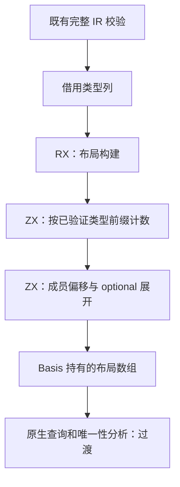
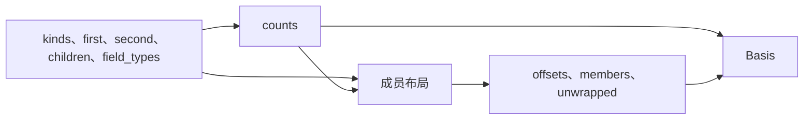

# 唯一性列表槽布局自举

## Intent：最终目标

将唯一性分析 Basis 使用的列表槽计数、成员偏移和 optional 展开表构建迁入 RX/ZX，保持原有成员次序、列表边界、普通 Zig 产物及性能。

## Data：可用证据

基线 `db4b9685` 的 `uniqueness/slots.zig` 用递归 memo 计算每个类型含有的列表位置，再构造成员偏移、成员类型及 optional 展开表。正式路径为 function_analysis → Uniqueness.Basis.create → Slots.init → Flow/Summaries/Sites。

完整类型校验的 `semantic/types/validation/row.zx` 与 `children.zx` 明确要求容器子类型 ID 小于 owner；seed_type_rules 采用相同规则。正式 emit/emitBundle 在进入分析前执行 validateIr。计数可以读取已经完成的类型前缀，无需递归 memo、known 表和每个类型重复 optional 链遍历。假设是消除这些工作后，普通生成代码能保持或降低布局构建成本；必须通过实际输入差分与无探针性能验证。

`packages/genz/README.md` 明确要求所有 zx 入口的调用方先完成结构、类型、所有权与契约校验；genz 不替代该校验。低层 Analysis/create 和 initializePrepared 不自行调用 validateIr，因此依赖已有调用契约，不能说每个调用都动态校验。Slots.init 在仓库内仅由 Basis.create 调用；reentry/analyze 复用原 basis 及其 types/functions。

## Edges：边界与限制

- 新算法沿用正式分析接收已验证 IR 的边界；裸 TypeStorage 的 append 只写列，不单独保证拓扑次序，不声称任意未经校验的类型表合法。
- list 只占一槽，不深入其元素类型；optional 透明；object/tuple 按成员顺序累计；其余类型占零槽。保留 u32 溢出检查，不截断或饱和。
- 本阶段迁移布局构建及返回状态，member/listType/path 的查询遍历仍属原生过渡职责；不宣称唯一性分析整体自举。
- 输入列借用，结果由 Basis 的 allocator 持有，不返回已释放临时 arena 的引用。无专用运行库、无动态调度。
- 不新增测试、不创建分支。现有 function-analysis 入口缺少退役源码的共同失败继续登记，不为迁移重建旧路径。
- 遵循本阶段用户更新的目标：先实现，再根据证据优化；若测得退化，继续定位并优化实现，达到门禁后提交，不用撤回功能代替性能处理。

## Answer：交付格式与成功标准

RX 明确连接槽计数与成员布局阶段；ZX 分别承担顺序集合算法。正式 generated_analysis 路径接入新模块，seed 保留原生实现。临时逐列差分后删除探针，运行现有相关检查、完整产物比较、同输入冷热生成与 CLI 性能门禁。按本 IDEA 框架记录证据、自我批判和未迁移边界，阶段完成后英文提交并推送。

## 实施与阶段证据

新增统一模块 `analysis/uniqueness/slots/build.rx`，Input 声明五个实际需要的类型列，Output 位于末尾。RX 将 counts 与 layout 两个阶段连接；计数与成员遍历保留为内聚 ZX 集合算法。新增编译入口 uniqueness_slots，正式 generated_analysis 分支选择生成实现，原生递归仅供 seed。

宿主适配器直接借用五列，使用 executeValue 将结果数组交给调用方 allocator，省去输出记录装箱。TypeId 的 u32 backing 经静态检查后只读转换切片，不复制元素或嵌套切片描述符；原 types 生命周期与旧 Slots 相同。生成代码检查未见计数或成员循环逐步创建状态记录。

临时在每次 generated Slots.init 后执行原生 seed，逐项比较 counts、unwrapped 及每个类型的 offsets、members；真实 56 入口、1,473 模块、1,326 函数文件输入通过，见 `slots-probe-bootstrap-build.json`、`slots-probe-generator.json`。随后删除 expected_slots 探针并重新构建首版无探针 bootstrap-stage 与 CLI，见 `slots-final-{bootstrap,cli}-build.json`。

首版无探针工具处理同一输入，完整目录 1,442 项中 1,441 项逐字节相同，唯一差异为包含生成器二进制身份的 `.zxc-inputs`，无文件增删；原始未排除报告 `slots-final-output-raw.json`。这证明既有生成形态保持，不代表全部回归已通过或完整自举完成。性能必须使用后续隔离测量，不能采用本轮与其他构建并行时的耗时。

## 既有检查与失败基线

`slots-existing-checks.json` 的组合命令运行 field-facts、function-updates、aggregate-loop、modular-loop、type-validation、type-merge，达到 900 秒时限，不能记为完成或通过。实际已执行的多组字段所有权、零轮零 arena、固定分配峰值、分配失败清理、函数更新求值/错误顺序检查通过；完整日志同时记录 70 项具名失败：类型校验允许项 18、类型前缀比较 18、前缀资源错误 2、重复列表返回身份 30、混合更新分配上界 2。

为确定本阶段归属，临时只将 Slots.init 恢复至 `db4b9685` 的原生算法，并将既有 function-updates 的模式枚举筛选为 duplicate、mixed，保留全部用例、输入和断言；复跑完整 type-validation、type-merge、modular-loop 及该函数更新子集。`slots-native-checks.json` 完成并失败，345/416 项通过、71 项失败。上述 70 项全部在原生算法中同名复现，没有本轮观察到的新独有具名失败；原生还暴露一项 inlined module cache lifecycle 分配失败清理问题，修改后对应项未完成独立确认，不能称为修复。`slots-failure-comparison.json` 保留集合对照；模式筛选只用于基线实验，最终源码与构建枚举均逐字节恢复，脚本 `/tmp/zxc-slots/check_baseline.py`，日志 `/tmp/zxc-slots/check-baseline.log`。

modular 的 MissingFrameValueBuffer 生成门禁也在该原生对照中复现。另行完成 `slots-aggregate-checks.json`：55/86 步骤成功，24/24 个实际测试通过，但六个生成步骤仍报 InvalidValueBufferCount，与此前已登记的布局缺口同类，不能写作整个 aggregate-loop 套件通过。本阶段未改测试断言、未新增测试用例，也没有借回退算法绕过这些问题；这些边界仍需后续独立修复。

## 首轮性能与继续优化

无探针工具在全部构建结束后交错测量两种顺序。热生成墙钟中位数 685.543→690.215 ms，CPU 3.410→3.425 s；冷生成墙钟 1,444.924→1,440.573 ms，CPU 均为 9.210 s。冷生成峰值 RSS 中位数 368,926,720→405,725,184 B（约 +10%），两执行顺序的修改后中位数都约 406 MB，属于需要处理的稳定退化。报告 `slots-formal-{1,2}-{warm,cold}-{before,after}.json`。

本阶段因此尚未完成。按用户更新后的要求保留 RX/ZX 实现，继续定位和优化。当前生成布局的成员及外层行数组使用 zxReserve，最小增长容量为 8，旧实现按已知长度精确分配；这提供了检查分配放大的入口，还不能只凭静态容量推算整轮 RSS。将用真实输入上的临时计数器比较直接申请次数、累计申请字节与旧算法，删除探针后再复测；不把累计申请量等同于峰值 RSS。

临时使用默认不诱发失败的标准 FailingAllocator 包装两种实现，真实输入逐列差分仍通过。2,593 类型的 generated 实现申请 7,350 次、累计 41,473,120 B，native 为 4,607 次、177,881 B；原始记录 `/tmp/zxc-slots/allocation-probe.stderr.log`，构建报告 `slots-allocation-probe-build.json`。这远超过小列表增长头的成本，不能将问题归结为最小容量。

追踪 counts 的生成代码发现三处分支索引写入均先 `zxReserve(..., len, false)` 整列复制。嵌套求和 loop 返回的状态包含对 counts 的借用，导致后续写入被保守判为共享。只立即投影 `.total` 未消除复制（`scalar-projection-output`）。将“成员槽计数求和”收口为只返回 u32 的 ZX 原子函数 sum，避免把带数组借用的状态带回调用方；`scalar-sum-output` 中 counts 仅剩初始化 map 的一次增长调用点，不再有三处整列复制。该职责拆分不新增原生桥或动态层，仍需分配计数与最终无探针计时验收。

优化后再次使用真实输入对照：2,594 类型，generated 4,858 次申请、571,616 B，native 4,609 次、177,946 B，四组结果逐项一致；记录 `/tmp/zxc-slots/scalar-sum-probe.stderr.log`、`slots-scalar-sum-probe-build.json`。新增 sum 源文件使实际编译输入增加一个模块，所以不将两次不同源码输入的耗时相减；两次各自的 native 对照及消失的三处复制调用点才是根因证据。剩余增长头、容量与描述符成本仍存在，是否影响整轮性能以最终复测为准。

优化后的首轮无探针复测已不再出现稳定约 10% RSS 放大，但原生基线沿用先前源码版本的磁盘函数缓存，41 个 public 文件仍保留旧的 zx_shape 全局类型编号，连同 `.zxc-files` 和工具身份共有 43 项内容不同。未忽略这些差异。独立全新缓存的原生工具与优化工具相比，1,443 项仅 `.zxc-inputs` 不同；同一个原生工具的旧暖缓存与新冷缓存恰好是 41 个 public 文件及 `.zxc-files` 不同。计算函数文件和共享 ABI 均一致。报告为 `slots-optimized-output-{raw,clean-native,native-warm-clean,warm-cold}.json`。

`shape.zig` 当前用全局 TypeId 命名 private zx_shape 常量，跨源码编辑复用语义相同的包装文件时，局部编号可与冷生成不同。这是原生基线同样存在的输出稳定性缺口，不宣称已在本阶段修复。为了使正式性能与产物门禁具有相同缓存前提，改用两个全新固定缓存分别预热，重新测量，保留前一轮原始报告而不覆盖。

## 最终验收

删除全部计数与差分探针后，优化版 bootstrap-stage、CLI 构建成功，见 `slots-optimized-{bootstrap,cli}-build.json`。新增五个 RX/ZX 文件格式检查及 lint、修改 Zig 的格式检查、`git diff --check` 全部通过。只读复核确认 sum 是成员槽求和算法，借用只在调用期间存活，没有把数组状态带回调用方。

固定更新后的 56 入口输入（1,474 模块、1,327 函数文件），双方各用全新磁盘函数缓存预热；`ZXC_RESIDENT_GENERATOR=0`，每次独立输出目录，ReleaseSafe 工具、同一工具链，构建与其他检查均已结束。先 before→after，再 after→before，每个顺序热生成 7 轮、冷生成 5 轮；CLI 每批 200 次无缓存 gap RX 编译，每顺序各 7 批。显式输入和工具前后摘要均未变化。

| 场景（合并两顺序中位数） |  原生布局基线 | 最终 RX/ZX 布局 |     变化 |
| ------------------------ | ------------: | --------------: | -------: |
| 热生成墙钟，14 轮        |    683.575 ms |      683.962 ms |   +0.06% |
| 热生成 CPU               |       3.420 s |         3.425 s | +0.005 s |
| 热生成峰值 RSS 中位数    | 371,089,408 B |   374,054,912 B |   +0.80% |
| 冷生成墙钟，10 轮        |  1,421.333 ms |    1,421.211 ms |   -0.01% |
| 冷生成 CPU               |       9.130 s |         9.135 s | +0.005 s |
| 冷生成峰值 RSS 中位数    | 370,638,848 B |   371,826,688 B |   +0.32% |
| CLI 200 次墙钟，14 批    |  1,210.418 ms |    1,206.082 ms |   -0.36% |
| CLI 200 次 CPU           |       1.475 s |         1.470 s | -0.005 s |

热生成两执行顺序墙钟为 682.406→677.584 ms、684.184→687.153 ms；冷生成为 1,425.119→1,430.241 ms、1,417.462→1,416.593 ms，方向不一致，不声称加速。CPU 的 0.005 s 合并中位数差低于原始 0.01 s 分辨率。RSS 中位数的小幅正差照实保留：热基线两顺序本身相差约 12.6 MB、冷基线约 6.6 MB，样本区间重叠；热场景单轮最大 RSS 为 395,821,056→396,034,048 B（+0.05%），冷场景为 383,041,536→382,500,864 B（-0.14%）。未再现首版稳定约 10% 的内存退化，当前未检测到可稳定归因的端到端退化，也不能据此声称任意输入或最坏内存都有改善。

新缓存的完整目录对照 1,443 项中 1,442 项一致，唯一差异为工具身份 `.zxc-inputs`，无文件增删；最终工具热缓存与冷生成 1,443/1,443 项一致，CLI 两项产物一致。报告为 `slots-fresh-output-{raw,warm-cold}.json`、`slots-fresh-cli-output.json`。性能报告为 `slots-fresh-formal-{1,2}-{warm,cold}-{before,after}.json`、`slots-fresh-cli-{1,2}-{before,after}.json`，各自 `.json.logs/` 保存逐轮输出。驱动 `/tmp/zxc-slots/measure_fresh.py`，汇总 `/tmp/zxc-slots/summarize_fresh.py`；工具快照为同目录 baseline/optimized bootstrap 与 CLI。CLI 的 RSS 还包含驱动进程影响，不能解读成单次编译器内存上界；这些耗时也不代表 Zig 后端完整重建。

## 自我批判与剩余边界

本阶段采用“实现后定位、优化”的处理，保留新功能并消除三处整列复制，没有以撤回迁移代替优化。最初把增长容量视为入口是合理线索，但真实计数表明主要成本是借用状态引发的复制；未将静态推测或累计申请字节冒充 RSS。剩余成本来自派生结果列表的普通增长头与容量策略，累计申请仍高于原生精确分配；输入借用、标量调用及状态原地写入没有解释层、动态调度或额外输入正文复制。后续可继续优化结果容量，不能把本阶段写成累计分配已经等于原生。

布局构建及状态已进入 RX/ZX，RX 有计数→布局两个真实阶段，ZX sum 只承担集合求和。输入类型列借用，输出原地构造并直接归 Basis allocator 持有，适配器不复制列表正文。成员查询、二分定位、路径遍历、Flow 与其他唯一性规则及其状态仍为原生过渡职责。已验证类型前缀是明确契约，不是对任意裸表的保证。

组合回归超时、70 项已观察共同断言失败、额外原生分配清理问题、布局生成门禁和旧缓存形状编号问题均未掩盖。当前证据足以验收本阶段布局迁移及记录场景的性能门禁，不代表这些既有缺口已经修复，更不代表完整自举；最终传递依赖闭包及 stage 1→2→3 仍待完成。
