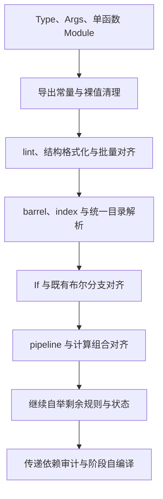

# 新增语言需求实施清单

## Intent：最终目标

按用户最新要求逐项实现类型引用与接口声明、共享导出常量、格式化规则、聚合导出、If 与管道表达式；全部完成后继续原有自举目标。每个阶段保留正确性和性能证据，英文规范提交并推送，不因发现性能退化而撤回功能。

## Data：可用证据

用户原话统一追加到 docs/user_request.jsonl，本文件只收口当前决策与执行顺序。前一阶段公开形状规划验证已由 fb369ccd 提交并推送；Type + Args 的 Module 子阶段 12A 已验收，Store 类型消费子阶段 12B1 已实现并验收，限定枚举值子阶段 12B2 已实现并验收，其他新增功能尚未交付。

仓库当前支持单 Module XML、普通 RX/ZX 混合依赖图、ZX 类型与函数签名、静态 Zig 生成及现有格式化/缓存检查。当前 formatter 主要处理导入顺序、语义空行和缩进，尚无结构换行；已有 120 限制指文件行数，不能误当列宽。

## Edges：边界与限制

- 最新要求优先于讨论中的旧建议：使用 Type，不是 Import；as 必填；from 默认省略 .zx；接口声明在 Args，不使用 Input/Output 或 Module.input/output。
- 非空对象表达式、对象类型以及 RX 属性中的对象始终垂直多行，不以 120 列为触发条件。其他结构以默认 120 列规划换行；不能通过改写字符串、模板文本、注释内容来强行满足列宽。
- 有语义的裸值统一在 const.zx 声明并显式导入，使用处直接引用 max_u32 等名称，不再定义 unvisited_index = max_u32 这样的同值别名或局部转声明。常量是编译期值，不是运行期共享状态。
- 统一模块边界、无环依赖、真实 RX 编排、ZX 原子逻辑、普通 Zig 静态链接及零专用运行库约束继续有效。
- 不新增测试用例，不进行浏览器 UI 确认。使用已有检查及真实输入的临时差分、运行和幂等性验证；不为用户示例添加针对性硬编码。
- 对齐当前源码、生成源头、有效示例及指导；保留历史调查记录所描述的当时事实，不改写归档证据来假装旧实现已经符合新标准。
- 保留独立阶段边界，不在尚未验证时宣称交付；原有自举最终完成标准仍包含传递依赖审计及 seed→stage1→stage2→stage3。

## Answer：交付格式与成功标准

### 第一项：Type、Args 与单函数简写

- [x] Module 内可以声明多个 Type，from 使用 ZX 路径规则，as 必填且唯一。
- [x] Args 使用 in/out 类型表达式，导入类型必须通过命名空间引用；复用 ZX 公开类型身份，不重建枚举或原生引用。
- [x] Args、其他消费类型的 RX 属性与值表达式明确区分，使用普通 ZX 类型能力，不另建字符串类型语言。
- [x] Store 内 Type 来源作用域及 Field.type 类型表达式，批量解析并保留导出类型身份。
- [x] RX 值与 Store 初值接通限定枚举成员，推导和编译共享类型 aliases。
- [x] 只转发整个输入并返回结果的模块使用 Module.fn；fn 与子节点互斥，继承目标函数 Input/Output，支持 void 边界。
- [x] 普通编排保持显式 Type/Args 与真实数据流，对齐旧源码、生成模板、相关现有检查及指导。
- [x] 接通 Schema、装载、混合依赖图、类型解析、缓存失效、格式化和错误定位；正确性及性能验收后提交推送。

具体实施见 RX类型引用与Args实施.md。

12A 已对齐四个自举源根的全部 161 个普通 RX，并验证真实生成、错误、磁盘/常驻缓存和性能；保留已确认旧工具也触发的未裁剪并行 OOM 堆栈捕获问题。第一项已经按 12A、12B1 与 12B2 分阶段实现并验收：12B1 已接通 Store.Field.type 表达式及 Store 内 Type 作用域，运行和缓存检查见 Store类型表达式与限定枚举实施.md；12B2 已补齐限定枚举值，接下来实现共享常量。

### 第二项：导出常量与裸值清理

- [x] 13A：原生/生成解析保留独立常量 AST、显式类型和初始化表达式；格式化安全合并声明顺序，语义尚未接通时明确拒绝，避免静默忽略。
- [x] 13B1：独立 typed IR 闭合标量求值，保留整数范围、f32 逐步舍入、短路和匹配；常量值模型独立于类型 Export。声明、导入与缓存值传播仍待 13B2。
- [x] 13B2a：表达式 API 消费 typed constants，直接 identifier 保留原类型、零 Symbol/捕获及完整值遮蔽；原生 seed 接同源生成求值快照。源码导入和缓存值通道仍待后续阶段。
- [ ] 实现真正的 export const，常量文件无须默认函数；const.zx 集中保存共享定义，使用处直接按名显式导入。
- [ ] 哨兵、类型上限、阈值、掩码和协议标记等使用有意义的名称；结构性的索引起点 0、步进 1 保留，代表状态/类型编号的 0/1 使用常量或枚举。
- [ ] 常量保存声明类型及编译期值，不塞进只有名称/类型的旧类型导出表，不包装成函数、运行期 Symbol 或闭包捕获。
- [ ] 闭合标量表达式复用现有字面量和运算类型规则，明确范围、溢出、除零、浮点精度及短路；调用、Store、任务和运行期输入不能冒充编译期常量。
- [ ] 引用 max_u32:u32 始终得到 u32；u64 消费场景按既有规则显式 widen，不能把导入常量重新按裸数字推导。
- [ ] 原生/生成解析器、命名 lint、签名、导入、回调、IR、编译库和持久化缓存均携带类型和值；依赖常量值变化时必须使消费者旧 literal 失效。
- [ ] 扫描并按语义清理生产逻辑的类似裸值，建立 lint 约束；不把同一个裸值逐处改成无意义的局部 const，也不机械改写测试数据或协议契约。
- [ ] 验证真实使用、常量编辑/恢复和编译库传播及性能后提交推送。

只读分析已确认当前没有可直接复用的通用常量求值器；expression_program/evaluate.rx 承担语义分析而非求值，不能据其名称宣称已经支持常量折叠。现有命名值导入仅支持枚举，必须补齐独立值通道。semantic_cache.restore 的依赖比较也必须增加常量类型/值，不能只比较导入路径及名字。

具体通道、类型与生命周期边界见共享常量与裸值清理实施.md。13A 只完成解析基础，不能将导入 max_u32、编译期求值、缓存值传播或裸值清理标为完成。

### 第三项：lint、fmt 与既有代码对齐

- [ ] 独立的默认列宽 120，不改变 ZX 文件行数 lint 的含义。
- [ ] 非空对象一律按字段垂直显示；短对象也不保持单行。
- [ ] RX 长标签按属性换行，表达式对象递归结构换行；ZX 长调用、数组等在合法边界换行。
- [ ] 结构布局先于依赖跨行状态的语义空行规划，保证一次格式化到位及二次幂等。
- [ ] 注释归属、字面量、模板、XML 实体/CDATA、语义空行及 CRLF 行为保持。
- [ ] 库层检查与 CLI lint/fmt 共用规则；不为格式化装载项目语义或源码依赖，不新增 lint→frontend 依赖环。
- [ ] 从正式 formatter 批量对齐既有源码，验证 token/语义保持、幂等性、已有格式化/运行检查及性能，再提交推送。

### 第四项：barrel export 与目录入口

- [ ] index.zx 能集中重导出类型与函数，支持显式别名，同名冲突必须诊断。
- [ ] 同时承接第二项的常量重导出，维持原类型和值；导入本身不意味着自动公开。
- [ ] index.zx 代表所在目录，目录引用与显式 index 引用归一到同一模块身份。
- [ ] 与 Node.js 一致处理文件/目录解析顺序；在真实输入集合及物理装载处使用同一规则。
- [ ] 所有重导出形成依赖边，包含未消费导出；直接、间接及经目录别名形成的循环都拒绝。
- [ ] 复用解析、签名和编译缓存，不因聚合层重复分析整个依赖闭包；零运行时转发层。
- [ ] 对齐适合的有效目录消费方式，验证导出身份、缓存编辑/恢复与性能后提交推送。

### 第五项：If 与 Else

- [ ] If.on 是布尔表达式；Else 可选、最多一个且位于分支末尾，不增加 Then 标签。
- [ ] 复用现有静态分支机制，覆盖嵌套、短路、返回完整性、作用域、所有权及依赖扫描。
- [ ] 将语义等价的布尔 Switch/Case 按新标准对齐，保留多值匹配的 Switch。
- [ ] 更新 lint/fmt、指导及相关已有检查，验证语义与性能后提交推送。

### 第六项：pipeline

- [ ] ZX 支持 x -> double(_) -> add(3, _) 形式；_ 表示当前阶段输入，可出现在调用参数位置。
- [ ] 初始值及每个阶段按顺序只求值一次；占位符作用域明确，不能复制副作用或违反所有权。
- [ ] 结果类型为最后一步返回类型；普通导入、调用、错误传播和副作用规则保持。
- [ ] 编译为普通静态调用，不引入运行时管道对象、动态调度或隐式数据复制。
- [ ] 词法、原生/生成解析器、类型分析、生成、缓存和 formatter 一致支持；管道按阶段换行，ZX 无分号规范保持。
- [ ] 对齐适合的原有原子计算组合，验证求值顺序、实际输出及性能后提交推送。

### 最后：继续自举

上述需求完成后，按自举执行计划继续迁移剩余自有规则与状态。现有过渡适配器、库公开 API 校验缺口、聚合缓冲及最终依赖闭包问题仍需处理，不因新增语法工作完成而将原目标标记完成。

