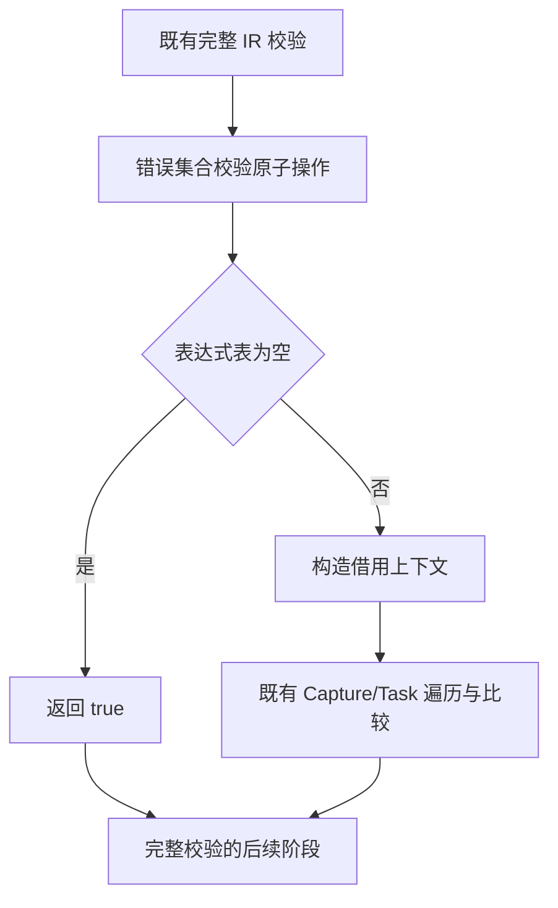
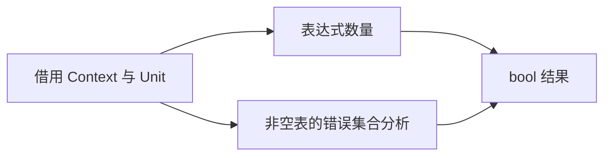

# 空表达式错误校验零分配修复

## Intent：最终目标

恢复完整 IR 校验对空表达式表的零分配行为，不跳过其他校验阶段，保留 Capture/Task 的错误集合检查及编译性能。

## Data：可用证据

基线 `a409d101`。上一阶段在原生槽布局和 RX/ZX 槽布局中都复现 type-validation 允许项 18 项 OutOfMemory。现有 fixture 使用 fail_index=0 的 allocator，要求完整校验不申请内存。

`validation/effects/body.zx` 的唯一职责是遍历 Capture/Task 表达式并核对错误集合；空集合返回 true。当前代码在零次循环前仍构造两层 Context，生成代码出现两次 allocator.create。根因是无条件准备上下文，非类型表规则或槽布局本身。

## Edges：边界与限制

- 在原子集合校验内部按空集合恒真规则短路；不绕过整个 validateIr，不改输入、断言或失败注入方式。
- 非空表沿既有逻辑校验，不改变错误顺序、类型前缀或 native/Store 规则。
- 不新增测试、不新建分支。先用既有 type-validation、typed-try-analysis 核对，再用实际自举输入对照完整产物及冷热性能。
- 保留实现，根据测量优化到门禁达标后提交。其他已登记失败与旧缓存形状编号问题不在本阶段宣称修复。

## Answer：交付格式与成功标准

空表达式表在构造上下文前返回 true；允许项的零分配检查通过，Capture/Task 既有分析检查保持。移除临时探针后的正式工具使用双方各自全新缓存及同一输入验收，按 IDEA 记录证据、自我批判，英文提交并推送。

## 实施与行为核对

仅在 effects/body 的上下文构造之前增加表达式数为零的恒真返回，不改变非空路径或完整校验编排。`empty-effects-existing-checks.json` 执行既有 test-type-validation 与 test-typed-try-analysis：46/46 构建步骤、149/149 项检查通过。此前允许项 18 项 OutOfMemory 已消失，原有失败注入和零分配断言保持不变。

bootstrap-stage 与 CLI 构建成功，见 `empty-effects-{bootstrap,cli}-build.json`；该 ZX 文件格式检查和 lint 通过。未新增测试、未使用临时生产探针，未改其他已登记失败。

## 产物与性能门禁

实际 56 入口自举输入、工具链和 ReleaseSafe 模式相同，双方从各自全新磁盘函数缓存预热；测量时禁用 resident，各轮独立输出目录，其他构建与检查均已结束。before→after、after→before 两种顺序，每顺序各 7 轮热生成、5 轮冷生成；CLI 每批 200 次无缓存 gap RX 编译，每顺序各 7 批。报告的显式输入与工具前后摘要均未变化。

| 场景（合并中位数）    |        修复前 |        修复后 |     变化 |
| --------------------- | ------------: | ------------: | -------: |
| 热生成墙钟，14 轮     |    681.695 ms |    682.905 ms |   +0.18% |
| 热生成 CPU            |       3.430 s |       3.425 s | -0.005 s |
| 热生成峰值 RSS 中位数 | 377,724,928 B | 371,081,216 B |   -1.76% |
| 冷生成墙钟，10 轮     |  1,428.494 ms |  1,418.953 ms |   -0.67% |
| 冷生成 CPU            |       9.170 s |       9.135 s |   -0.38% |
| 冷生成峰值 RSS 中位数 | 373,252,096 B | 371,982,336 B |   -0.34% |
| CLI 200 次墙钟，14 批 |  1,215.470 ms |  1,215.852 ms |   +0.03% |
| CLI 200 次 CPU        |       1.490 s |       1.480 s | -0.010 s |

热生成两顺序为 678.978→681.107 ms、682.755→685.425 ms，正差很小且 CPU 没有同向增加；CLI 两顺序方向相反。冷生成两顺序均下降（1,424.233→1,416.115 ms、1,441.252→1,419.005 ms）。当前未检测到可稳定归因的端到端退化，不把微小墙钟差或 0.01 s CPU 分辨率内的差异称作稳定收益，也不据此承诺任意输入的最坏资源上界改善。

完整目录 1,443 项中 1,442 项逐字节一致，唯一差异为生成器身份 `.zxc-inputs`，无文件增删；修复后热缓存与冷生成 1,443/1,443 项一致，CLI 两项产物一致。报告为 `empty-effects-output-{raw,warm-cold}.json`、`empty-effects-cli-output.json`。性能报告为 `empty-effects-formal-{1,2}-{warm,cold}-{before,after}.json`、`empty-effects-cli-{1,2}-{before,after}.json`，各自 `.json.logs/` 保留逐轮原始输出；驱动与工具快照在 `/tmp/zxc-effects-empty/`。CLI 峰值 RSS 还受 Node 驱动影响，未把它当作单次编译器内存上界；完整工具重建时间未作前后性能比较。

## 自我批判与剩余边界

短路依据是空集合遍历的恒真结果，不是 type_only、测试名称或特定文件路径。未跳过完整 IR 校验，非空逻辑原样保留。现有检查证明本次覆盖范围内的零分配和 typed-try 分析行为，不等于所有 Task/Capture 组合的穷尽证明。

本阶段仅处理空表；非空且无 Capture/Task 的表仍会准备上下文，是后续可探索的成本。类型前缀合并、重复别名身份、混合更新分配上界、值缓冲生成门禁和旧缓存形状编号问题仍按第九阶段记录保留，不能以 149 项通过宣称全部编译器回归或完整自举完成。
