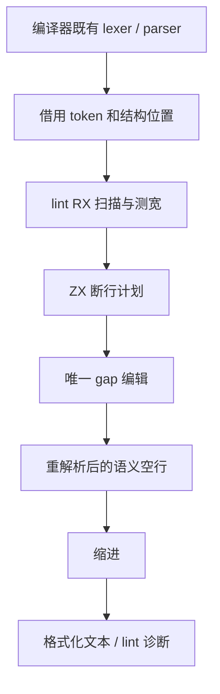
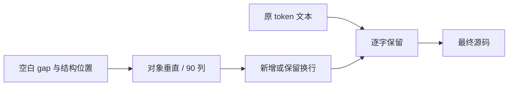

# 结构格式化与列宽实施

## Intent：最终目标

非空对象表达式、对象类型和 RX 属性对象始终垂直；其他可换行结构默认 90 列。lint/fmt 共用规则，批量对齐正式源码和生成源头，之后继续其余语言需求及自举。

## Data：可用证据

64e0d52f 已交付共享标量常量。现有 lint/source 只规划导入及语义空行，frontend/module_result 再重解析并缩进；RX 仅格式化外层节点。现有借用 AST 支持 native/indexed，但类型没有完整括号 span；词法 token 保留字符串和模板整体范围。只读分析确认必须覆盖纯类型、export const、contracts，并避免把 Args 的类型语法当值表达式。

## Edges：边界与限制

- 结构规则属于 lint，通过 RX 连接扫描、测宽和断行阶段，ZX 实现集合算法；宿主只提供 token/AST 位置及应用编辑，不新增 lint→frontend 依赖。
- 每个空白 gap 只归属一次编辑，布局同时确定换行与缩进，最后规划语义空行；重解析限于阶段边界，不按每个对象重复解析。
- 注释原文、归属，字符串与模板原文、XML 文本/实体/CDATA、CRLF 保留。不可拆分的长字面量不强行切割。
- 90 列和默认 120 文件行数是独立规则。对象强制垂直与宽度无关。
- 只使用已有检查和临时真实输入验证，不新增仓库测试；性能验证集中在功能收口。

## Answer：交付格式与成功标准

ZX/RX 真实 CLI 一次格式化到位、二次幂等；lint 给出同样结果。有效源码 token/行为保持，批量修改从正式 formatter 产生；构建、既有格式化检查、实际运行与同输入性能验收后英文规范提交并推送。未完成时保留完整范围，不把局部接线列为需求交付。

用户在比较 88/100/120 后明确选择 90 列，后续实现与验收以 90 为默认值；文件行数 lint 仍为 120。开发中的 120 列原型不作为最终配置验证证据。

## 实施记录（2026-11-01）

layout/layout.rx 真实编排 scan→suffixes→measure→breaks，ZX 分别负责分组扫描、尾部宽度、宽度测算和唯一 gap 布局决策。lint 只依赖已有 core/DSL；frontend 提供借用的 token、注释、语法块和匹配结构位置，未加项目装载或语义推导。纯类型与常量通过词法结构覆盖；import/enum 与代码块从对象强制垂直规则排除。模板 token 作为整体保护。

初始引导的 bootstrap/layout.zig 从相同 layout.rx 源码通过当前已交付工具生成；规则本身未另写一份 Zig 语义。生成命令为 zxc packages/lint/src/layout/layout.rx --no-cache --out <snapshot>，将生成结果保存到 bootstrap/layout.zig；后续修改始终从 RX/ZX 源头重生成。

ZX format 先结构布局，变化后重解析再按新结构规划语义空行，布局包含缩进。RX 属性先通过 ZX 保守宽度预检，再按需复用通用 lexer（同时适用类型和值）和同一布局算法，外层标签也进入同一分组宽度算法；最终 XML 语义空行基于结构变化后的节点。CLI RX lint 改走与 fmt 相同的 compiler.format。编译入口保持既有源代码语义检查，不把列宽加入语言语法或类型约束；列宽属于 lint/format。

开发原型通过真实 compiled/empty.zx 的嵌套对象垂直布局及连续两次相同；yaml/gap/resolve.rx 的属性对象与标签同时展开、两次相同。header.zx 暴露无括号长逻辑链未处理，已补运算符优先级和单段测宽，避免把可整体阅读的比较过早拆开。测宽同时包含行前缀、目标缩进与真实 token 间空格，而非把每个标点额外当一个空格。闭合括号不再执行反向的无符号宽度减法。最终结构已经通过真实源码与既有检查，原型观察只用于说明缺口来源。

自举边界：本阶段新增的 frontend 语法位置投影、宿主数组封装和编辑应用仍为手写 Zig 适配器；其最终迁移计入原有自举职责闭包，不能因为布局算法已经是 RX/ZX 就宣称整个格式化模块或编译器完全自举。

## 最终布局与源码核对

最终结构为 scan→suffixes→measure→breaks；indent-only 直接 scan→breaks。breaks 的续行与括号帧同时决定实际缩进和宽度，不再用括号深度猜测目标列数。原 indentation/zx.zig 的手写状态机已删除，保留借用 token 的适配入口；结构布局后只需在位置变化时重解析一次以规划语义空行，不再重复执行另一套缩进状态机。元数据投影、封装与编辑应用仍是过渡 Zig 适配器，最终自举闭包继续保留它们。

实际四个源码根共 1570 个 RX/ZX 文件，正式 formatter 按 90 列与非空对象垂直规则对齐，全部解析成功、二次幂等。普通代码行超过 90 的数量为 0；24 条受保护的长字面量逐条核对为 23 条诊断文案和 1 条 SMT-LIB 查询模板。后者在 verification/query/statement.zx，拼接 Z3 所需查询，未生成 Zig；24 条中没有 Zig 代码模板。禁止模板生成 Zig 的约束已补入 AGENTS，诊断裸值迁入 const.zx 仍属于共享常量清理的未完成范围，不以排版例外冒称完成。

响应用户关于实际 RX 可读性的修正，已在 genz/analysis/facts/analyze.rx、modules/native/analyze.rx、native/parse.rx 和 native/prepare.rx 使用已有结果展开，只覆盖变化字段；逐项核对输入输出字段集合，没有引入 pick/omit 普通方法调用。另有 native/interface.rx 的 signatures/functions 调用只需五列输入中的三列，需要后续静态 pick/omit，不能直接展开整个输入。

临时查看器使用实际 lexer/XML parser 对齐前后源码：1556 个未做语义简化的既有文件，其 token、字符串/模板字节、注释及附着位置、XML 字段和非空文本保持；4 个明确的展开简化另行核对类型及生成结果。此前 1560 文件原型核对同样通过，最终报告为 /tmp/zxc-layout/token-verification-final.log。其他布局规则源码属于新增实现，不作为格式化前后等价源文件。全部输出共同 60 个入口生成了 1499 文件，1493 文件字节相同；四个有意简化的模块与对应清单/输入摘要变化，逐项查看了生成差异，不将预期变化一概排除。

已有 RX CLI 格式化 52/52、ZX CLI 导入/格式化 22/22、库导入顺序/资源检查 10/10 与 RX 分配失败/生命周期 2/2 通过；RX、ZX 格式化前后实际运行各 1/1 通过。真实 RX 对象以 CRLF 运行后没有混入 LF。完成了 61 入口 pinned bootstrap 的 16/16 构建，最终 CLI 和同输入性能收口继续执行；不重跑已经得到且未受后续改动影响的检查。

## 性能收口与范围复核

短 RX 的额外成本来自不需要换行的属性仍进入 lexer、元数据投影与完整布局。attribute_required.zx 先以字节宽度的保守上界和对象/换行标志判断：只有能证明无需布局时才跳过；带对象、已有换行和可能超宽的表达式仍走正式算法，90 列规则未撤回。该判断和默认宽度都在 ZX，宿主不另写一份列宽常量。尝试过的描述符 ABI 借用与整体布局捷径未证明收益，已撤回并移除对应微文件。

最终布局算法在新增模板资源之前后保持一致；1575 个真实 RX/ZX 文件最终复核无修改、解析失败与非幂等，之后新增的资源关键字常量文件单独检查通过，总数 1576。此前 token/XML 保真证据覆盖未做语义修改的既有文件，四个展开简化与后续模板静态引用分别按对应语义证明，不混作纯空白变化。

当前最终同输入七场景报告为 docs/2026-11-01/template-layout-paired-summary.json。RX fmt 的 CPU 中位数 0.22s→0.22s，配对 CPU 差值区间 [-0.0091, 0.0124]s，已消除开发版本中检出的稳定退化。ZX CLI 的小幅墙钟差异进一步定位为模板资源装载器对无引用模块仍执行路径归一化，已加空引用直接返回，针对受影响 CLI 场景补充对照；其余已取得且不受该修改影响的证据保留复用。

自检：格式化代码体量大来自全仓已授权对齐，功能实现与纯空白变化分开核对；普通代码列宽与不可拆字面量分开统计。静态 pick/omit、其余长对象复用、裸值全面清理和完整自举均未在本阶段冒称完成。

无模板引用直接返回后，受影响的 RX、ZX 与 Store CLI 三场景各 16 对最终补测，墙钟、CPU、RSS 的配对差值区间均覆盖 0；详细报告为 docs/2026-11-01/template-layout-final-summary.json。模板真实引用另有独立场景，属于下一阶段资源能力的优化范围，不混入本阶段既有代码格式化验收。
