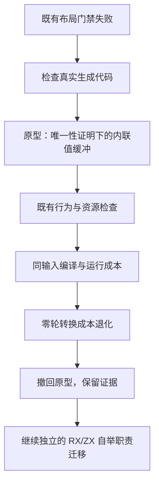
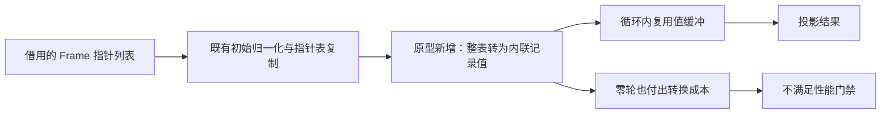

# 聚合循环值缓冲性能调查

## Intent：最终目标

核对上一阶段发现的既有布局门禁失败，验证以值缓冲消除循环内记录 boxing 的方案能否满足不退化要求。性能或适用边界不足时撤回尝试，不能为了通过门禁扩大自举过渡实现。

## Data：可用证据

基线为 `a2706901`。正式路径的 `iteration_value.inline_lists` 未启用，深布局谓词拒绝 product 列表操作。实际 stack 产物的 while 内仍有 `allocator.create(Frame)`，指针列表容量复用不等于消除记录分配。

旧形态检查还把 execute 包装入口当作实际函数体，并依赖特定 ArrayList 字符串。分析时使用真实 executeIn 的 AST 区分所有者、循环体和原生消费者位置，未以 zxReserve 字符串替代资源证据。

## Edges：边界与限制

- 不新增测试，保留既有旧值、借用输入、固定峰值、错误及分配失败检查。
- 不新增运行库、解释器或动态分派；原型只生成普通 Zig、静态局部类型及标准库 ArrayList。
- 值布局需要纯度、身份观察、唯一性和结果不逃逸证明。初始借用列表的转换成本必须计入，不能只观察循环体。
- 本阶段最终仅交付调查记录；生产代码、测试及安装的工具均恢复至基线。Input/Output 标签及此前自举提交保留。

## Answer：交付格式与成功标准

交付失败基线、原型结果、完整性能数字、撤回理由和恢复证明。不把原型测试通过称为合入，不把本次调查称为生成器或整个编译器完成自举。

## 原型及正确性检查

原型以 `owner: *ArrayList(InlineElement)` 与不可变 items 切片保存局部列表视图，初始转换一次，更新与 push/pop 复用所有者，保留长度快照与按值记录快照。已拥有的值缓冲不再经过普通指针列表的 normalize/renew。push 增补唯一性标志，持久化 memo 版本随之递增；这些改动现均已撤回。

第一次完整循环检查为 199 项实际执行测试通过，仍有 3 个生成步骤失败。双列表的重复 renew 修复后为 213 项通过、1 个消费者形态步骤失败；括号识别修复后为 153/153 构建步骤、222/222 测试通过。报告为 `layout-buffer-loop-checks-{4,5,6}.json`，失败报告未删除。

完整 55 入口产物对比发现，初版还会转换无关的只读 Program 列表，影响 3 个生成函数，属于不可接受的成本扩大。随后收紧到实际携带 product 列表的状态，并拒绝外部此类捕获。曾尝试借用投影，但循环内整表别名仍有重复转换风险，因而撤回该尝试。

来源检查又暴露了编号假设错误：内联器从语句尾向前构造 scope，合法引用可以早于定义值进入表达式表。原型最终使用结构子图中的局部定义及显式栈后序，支持定义边，拒绝外部来源、冲突和环；非缓冲模式保留原线性路径，没有全表多轮固定点。只读复核未发现后序读取或清理问题。该版本的循环加 RX 推导检查为 157/157 构建步骤、363/363 测试通过，报告 `layout-buffer-order-loop-checks.json`。

## 扩大检查与基线对照

全部 23 项生成缓存 Debug 检查：初版 19 项通过、4 项失败；收紧后 20 项通过、3 项失败。恢复 `a2706901` 生产文件运行相同命令，同为 20/23，三项失败均为既有 buffer eligibility 对 entry 源码变化或 callBuffered 文本的断言。初版额外出现一次 NondeterministicMemoryUsage，后续没有复现，不能称为已定位并修复。报告为 `layout-{buffer,baseline}-generation-debug.json`、`layout-buffer-{bounded,order}-generation-debug.json`。

扩大到 detached-reader 时，6 个生成步骤报 MissingReaderCall；提交前生产代码用同样 ReleaseSafe 目标复现相同 6 项失败，实际执行的 60 项测试通过。本阶段未更改这组检查，未把未生成的下游测试计为通过。报告为 `layout-buffer-final-loop-checks.json` 与 `layout-baseline-detached-checks.json`。

中途一次 RX 构建报告 137/138，Store detached contract allocation failures 失败但没有输出。同一二进制直接运行 138 项通过，按原随机种子再运行三轮也全部通过；后续标准构建的 363 项检查包含全部 RX 项并通过。保留 `layout-buffer-bounded-{loop-checks,rx-retry,rx-seed-retry}.json`，不隐去首次失败。

## 性能结果与撤回决定

固定 Zig 0.17、输入、target 和 ReleaseSafe 配置。正式 bootstrap 根模块延用原有 small 配置，比较旧与新正式工具，不使用 seed 计时代替。所有性能轮次与构建隔离，bootstrap 常驻服务关闭。冷热生成分别每版 14/10 轮，交换执行顺序；热场景按版本预热函数缓存，冷场景逐轮新缓存。CLI 每批无源码缓存编译既有 YAML gap RX 50 次，每版共 14 批。

目标后端每轮新建本地 Zig 缓存，保留共同标准库全局缓存，每版 10 轮。应用运行使用同一份现有 stack 输入构造，257 个借用记录，每批调用 50,000 次，每版各 14 批；零轮与 16 轮分开，结果校验和及输入完整性均核对。

| 场景                  | 墙钟中位数：基线 → 原型 | CPU 中位数：基线 → 原型 | 峰值 RSS 中位数：基线 → 原型 |
| --------------------- | ----------------------- | ----------------------- | ---------------------------- |
| 正式热生成            | 665.26 → 658.85ms       | 3.330 → 3.310s          | 355,688,448 → 357,269,504 B  |
| 正式冷生成            | 1,407.24 → 1,384.24ms   | 8.975 → 8.880s          | 360,251,392 → 362,618,880 B  |
| CLI，50 次编译        | 318.94 → 319.22ms       | 0.390 → 0.385s          | 57,204,736 → 57,212,928 B    |
| 目标 Zig 编译         | 4,146.77 → 4,173.20ms   | 4.180 → 4.210s          | 353,779,712 → 353,140,736 B  |
| 应用零轮，50,000 次   | 128.50 → 147.29ms       | 0.110 → 0.130s          | 2,097,152 → 2,113,536 B      |
| 应用 16 轮，50,000 次 | 133.81 → 133.21ms       | 0.120 → 0.120s          | 2,097,152 → 2,113,536 B      |

热生成各轮最大 RSS 为 367,280,128 → 373,981,184 B；冷生成为 375,341,056 → 395,116,544 B。中位数不能隐去后者约 20 MB 的单轮峰值增加。这些是进程峰值，不是整棵进程树同时 RSS。完整报告为 `layout-bounded-{1,2}-{warm,cold}-{before,after}.json`、`layout-bounded-{cli,backend}-{1,2}-{before,after}.json`、`layout-bounded-runtime-{0,16}-{1,2}-{before,after}.json`。

正式目录 1,430 项中 1,429 项逐字节一致，唯一差异为工具身份 `.zxc-inputs`。初版不必要转换造成的另外 4 项差异没有被忽略；收紧后才消失。实际计时轮次的完整目录也再次得到相同结果。报告为 `layout-buffer-output-raw.json`、`layout-bounded-output-raw.json` 与 `layout-bounded-measured-output.json`。这也说明原型没有在该自举输入中带来可确认的生成代码收益。

零轮墙钟增加约 14.6%，CPU 也增加，不能放行。16 轮没有可辨认收益。两版该运行批次的 arena 父分配累计量均为 1,090,200,000 B，不能据静态 boxing 消除声称累计分配下降；arena 分块会遮住额外写入和转换成本。

随后试作原始 ABI 首次谓词 guard，零轮直接投影，真分支转换后按后测形式执行，保持 T0、S1、T1、S2、T2 顺序；原 postcondition 不改。该中间版既有检查通过，但未完成最终性能验收，不作为交付。进一步追问适用范围后，仍有只读列表、混合读写列表及大借用前缀的整表转换成本；要继续需要更明确的布局选择及初始化归一化边界，已超出这次迁移前提调查。

按照 compiler-performance 的撤回要求，最终撤回全部生产与测试改动。保留本地测量及 `/tmp/zxc-layout-gates/rejected-source`，不提交实验代码或报告产物。

## 恢复证明、自我批判与下一步

生产及测试文件通过限定路径的 git restore 恢复，并核对 diff 为空；只删除本轮创建的五个文件。根 CLI 与 bootstrap 原子替换为保存的 `a2706901` 对应可执行文件，避免工作区继续运行实验版本，也不覆盖 Zig 缓存中的其他链接。新增的 Input 开头、Output 末尾及此前提交保留。

恢复后标准 `test-rx-inference -Doptimize=ReleaseSafe -j2` 的 138/138 项通过，报告 `layout-restored-rx-inference.json`。CLI 与 bootstrap 分别与保存基线逐字节核对 SHA-256，相同摘要为 `588be2d718afc14afbb2607b0b55840a5c19505589f6580a512769b0a92342f1`、`59dc8d3db3c03035f3683ae6e9e061f4bc7711d95a7b84333441afbc1654a9fa`。生产差异为空比继续用实验版本的测试结果宣称恢复更直接。

最初把既有门禁失败当成必须立刻补齐新布局，扩大了范围，并增加了尚待自举的宿主逻辑。仅看循环内无 boxing 和资源检查通过，不足以证明整条路径变好。正确的取舍是以转换前后的完整成本为准，回退没有通过验收的优化，不用更多过渡抽象掩盖收益不足。

后续优先继续能够独立验证的 RX/ZX 规则与状态迁移。上述布局能力缺口及失败门禁继续登记，不因此宣称完整自举完成。
