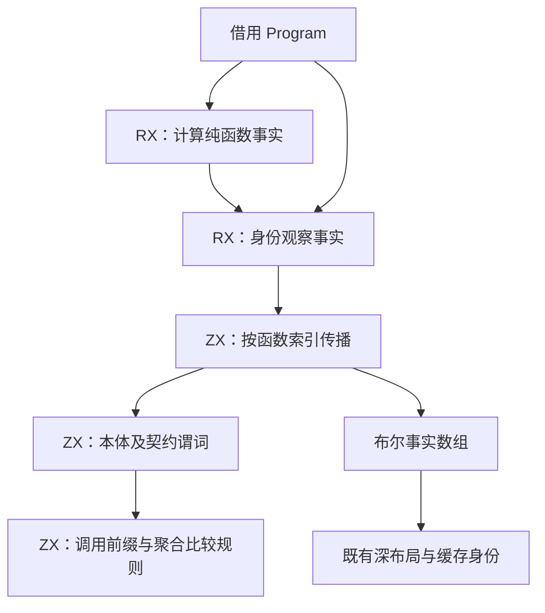

# 聚合身份观察分析自举

## Intent：最终目标

把函数级聚合身份观察分析的规则、调用传播与布尔状态迁入现有 RX/ZX 事实模块，保持深布局选择、缓存身份、普通 Zig 产物与性能。

## Data：可用证据

基线为 `909cafc2`。`iteration_layout/identity_free.zig` 对纯函数并行扫描表达式及契约，保存每个函数的调用列表，再按函数顺序传播安全事实。调用目标不小于当前函数索引时，旧算法直接判定不安全。因此每个有效依赖只指向已处理前缀，可以用同一布尔数组按索引一次计算，无需保存调用图。

对第 i 个函数，原结果为“本体不观察聚合身份”且“所有 callee 的结果为真”；有效 callee 都小于 i。按索引归纳，扫描中直接读取已发布的 callee 结果，与原先先保存调用列表再汇合等价。必须保留纯函数门禁、future/self call 拒绝、与 none 比较豁免，以及 optional 解包后仅 object/tuple 属于聚合表示的规则。

## Edges：边界与限制

- 复用现有 Program 列式视图、`types/layout_represented.zx` 及函数事实适配器，不新增编译器专用原生接口。
- RX 显式连接依赖于 pure 的身份观察事实；ZX 负责内聚的整表算法与表达式谓词，所有输入列借用。
- 旧并行扫描不因迁移自动变得更慢或更快；融合消除调用列表、复制和调度成本后，必须用正式 bootstrap 与 CLI 测量验收。
- 旧实现仅留在非 generated 分支。临时差分探针核对完整布尔数组，最终测量前移除；不新增测试用例。
- 本阶段不等于唯一性、错误传播、布局生成或整个编译器完成自举。

## Answer：交付格式与成功标准

实现 ZX 前缀传播与身份观察谓词，接入现有 RX 事实阶段，正式路径不再调用旧分析。通过既有检查及同输入旧新事实差分，固定源码与工具链比较完整产物、冷热生成、CPU 和峰值 RSS。记录实现、数据及自我批判后独立英文提交并推送。

## 实现与正确性证据

`facts/analyze.rx` 在 pure 结果之后显式调用 `identity/free` 并汇合 `identity_free`。ZX 按索引发布每个函数的最终布尔结果；`body` 检查正文及全部契约表，`expressions` 只处理旧规则涉及的 Call 与相等/不等比较，复用现有 `layout_represented`。它不扩大 task 等节点的拒绝规则，不依赖整个调用图已拓扑排序：前向与自调用仍由本项谓词判为 false。

旧算法的每函数 callee 列表、复制和 worker 工作区不再属于正式分析路径。输入 Program 继续由既有适配器借用，生成事实复制至调用方 allocator。旧并行实现留在非 generated 分支，不作为正式分支的回退。

临时探针在正式 generated 分支同时调用旧并行算法，以相同 pure 数组逐项比较完整 `identity_free` 布尔数组。正式 bootstrap 工具处理 55 入口、1,461 模块、1,316 函数文件的实际输入通过；前后生成文件集合中 1,429 项逐字节一致，只有 `.zxc-inputs` 工具 frame 摘要不同。报告为 `identity-probe-{bootstrap-build,generator}.json` 和 `identity-probe-output-raw.json`。

## 既有布局检查与基线核对

带差分探针执行既有 `test-aggregate-loop test-modular-loop -Doptimize=ReleaseSafe -j2`：135/135 个实际执行的测试通过，但整个命令失败，7 个生成步骤被文本形态门禁拦住，不能记为完整套件通过。aggregate 的 nested/call/bounds/stack/consumer/two_lanes 报 `InvalidValueBufferCount`，modular 的 simple 报 `MissingFrameValueBuffer`；这些门禁要求特定 `.ArrayList(state_type_` 字符串数量。

随后临时把本阶段修改的三个既有生产文件恢复为 `909cafc2` 内容，保留新 ZX 文件为不可达源码，执行完全相同的目标与参数。基线结果同为 116/153 构建步骤成功、7 个生成步骤失败、135/135 个实际执行测试通过；失败模式与错误类型逐项一致。三个生产文件在 finally 中恢复，并与保存字节核对一致，没有修改测试门禁或新增用例。

完整失败日志保存在 `identity-{probe,baseline}-layout-checks.json` 及对应日志目录，两份报告均明确为 `valid=false`。这证明上述失败已存在于本阶段基线，不证明失败门禁已经解决，也不把未生成的下游测试计为通过。探针随后移除，最终构建和性能另行验证。

## 性能复核与最终结果

第一版正式测量中，热生成 667.30 → 663.56ms，冷生成 1,375.18 → 1,406.41ms，后者约 +2.3%，不能直接放行。交换顺序各 9 轮后，冷生成 1,389.19 → 1,387.29ms，差异没有复现；热生成仍有约 1% 的增加。原始 `identity-formal-*`、`identity-repeat-formal-*` 报告全部保留，没有只选较快样本。

随后收窄新算法的输入及循环状态：整表阶段只引用类型列、函数的表达式与契约表、pure 及 safe；契约循环只携带表达式表列表；表达式热循环只引用 kinds/types/payloads/call_functions/binary_operators/binary_left/binary_right 七列。它们仍借用同一份原始数据，不复制数组。生成源中的描述符展开缩小，但不把静态字段数换算为时间收益，最终仍用实际工具计时。

最终无探针版本的 bootstrap 与 CLI 构建成功；完整 RX 推导 138/138 通过，cache/gates/resources 的 Debug 检查 9/9 通过，临时构建选择已原样恢复。新 ZX 的 lint 与格式检查通过。报告为 `identity-slim-{bootstrap-build,cli-build,rx-inference,generation-debug}.json`，构建有并行负载，不据其耗时计算提速。

最终比较固定相同的修改后源码、55 入口 manifest、Zig 0.17 与相同 ReleaseSafe 宿主/small 根模块。基线正式 bootstrap 仍运行旧并行算法，最终工具运行新 RX/ZX 算法。所有计时与构建、测试隔离；常驻服务关闭，每轮新输出目录；热生成按版本预热函数缓存，每轮仍分析全部模块并复用全部 1,406 个生成单元；冷生成逐轮新建函数缓存。

两种执行顺序各自保存独立报告，下表合并全部样本计算中位数；热生成每版共 14 轮，冷生成共 10 轮。CLI 每批对既有 YAML gap RX 连续编译 50 次，禁用源码缓存，分别预热可执行文件后按相反顺序各 7 轮。

| 场景                             | 墙钟中位数：基线 → 最终 | CPU 中位数：基线 → 最终 | 进程峰值 RSS 的中位数：基线 → 最终 |
| -------------------------------- | ----------------------- | ----------------------- | ---------------------------------- |
| 正式热函数缓存生成，两种顺序合计 | 659.54 → 664.15ms       | 3.305 → 3.310s          | 354,557,952 → 356,655,104 B        |
| 正式冷生成，两种顺序合计         | 1,390.92 → 1,386.25ms   | 8.895 → 8.850s          | 360,316,928 → 360,267,776 B        |
| CLI，先最终后基线                | 325.32 → 323.09ms       | 0.40 → 0.39s            | 57,180,160 → 57,196,544 B          |
| CLI，先基线后最终                | 321.82 → 325.31ms       | 0.40 → 0.39s            | 57,212,928 → 57,212,928 B          |

热生成两种顺序分别为 658.63 → 664.15ms、664.93 → 664.15ms，方向不一致；CPU 差异也随顺序反转，合计墙钟约 +0.70%、CPU 约 +0.15%。冷生成两组均略快。没有稳定退化证据，也不据此声称普遍提速。热生成 RSS 各轮最大值 377,421,824 → 368,050,176 B，冷生成最大值 361,824,256 → 365,821,952 B；后者单轮峰值增加必须保留，不能用中位数隐去。这里的 RSS 是被测进程峰值，不是整台机器或常驻服务的累计内存。

最终前后完整目录 1,430 项中，1,429 项逐字节一致；唯一变化为 `.zxc-inputs` 的工具 frame 摘要。先保留原始差异，再仅排除此精确路径复核。最终冷、热生成全部 1,430 项一致，不作排除；CLI 源码及 ABI 两项也一致。报告为 `identity-slim-{1,2}-{warm,cold}-{before,after}.json`、`identity-slim-cli-{1,2}-{before,after}.json`、`identity-slim-output*.json`、`identity-slim-cold-warm-output.json` 与 `identity-slim-cli-output.json`。

## 自我批判与剩余边界

原有并行扫描不能机械改成串行照搬。这里依据前缀不变量融合传播，省掉中间调用图及调度；是否保持性能仍由正式路径测量决定，不能只凭复杂度或文件后缀判定。

已有布局检查并未穷尽契约比较及所有前向调用形态。逐项差分、原规则归纳和实际生成目录对照共同支持本项迁移，不能代替整个编译器的传递依赖审计。错误传播、唯一性、宿主状态和其余布局语义仍待迁移；本阶段也不宣称原有 7 个生成门禁已修复。
