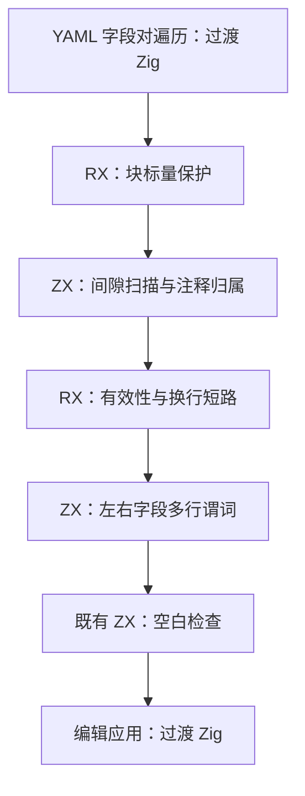

# 自举执行计划

## Intent：最终目标

继续将编译器自有规则与状态迁入 RX/ZX，保持普通 Zig 静态编译、零专用运行库与数据借用；每个阶段验证后独立提交并推送。

## Data：可用证据

当前基线为 `f570aa73`。六组 lint 基础规则已接入正式生成入口，但 YAML 字段间注释扫描与分隔规则仍由手写 Zig 执行。读取了自举完成标准、RX 开发约定及 compiler-performance 技能。历史“暂不测性能”的记录被本次明确性能要求取代。

## Edges：边界与限制

- 第一阶段只迁移 YAML 字段间规则；字段收集、字段对遍历及编辑应用仍保留过渡实现，不宣称 YAML formatter 或编译器完成自举。
- 不新增测试，使用既有配置格式化回归；不修改用户工作区中的无关文件，不新建分支。
- 输入源码及字段范围借用；不把字段数组重新编码，不构造每个间隙的注释列表。
- 使用技能脚本记录实际命令、墙钟、CPU 与 RSS；基线和修改后输入与优化模式一致。冷构建与热运行分别报告。

## Answer：交付格式与成功标准

1. 固定基线构建与格式化行为、性能证据。
2. RX 表达块标量短路、扫描有效性短路、多行判断及空白检查；ZX 实现单次有界扫描与多行谓词，复用既有空白检查。
3. 正式入口依赖生成规则，原生规则仅供 seed；执行既有配置格式化回归及同输入测量，复核生成代码借用与分配。
4. 记录验证、性能、自我批判与剩余职责，英文规范提交并推送。

第二阶段修复验证时发现的生成桥生命周期问题：核对 `generated.Output` 的实际类型，仅在输出全部为标量时在局部缓冲有效期内取值返回。范围是 RX 边界扫描及导入排序两个同源适配器，使用既有 RX 格式化与导入排序检查，并独立记录失败基线与修复结果。

第三阶段落实 [RX 显式输入输出契约](RX显式输入输出契约.md)：Input 位于 Module 开头，Output 位于末尾，声明通过批量解析接入既有类型图。

第四阶段收口完整回归暴露的 [分析并发与验证阻塞](分析并发与验证阻塞.md)：普通分配器入口安全顺序执行，正式生成器显式使用已证明线程安全的并行入口；以既有回归、同输入产物和性能为门禁。阶段完成不等于完整自举完成。

第五阶段迁移 [函数返回类型包含关系](函数返回类型包含关系自举.md)，把正式生成缓存使用的 `fresh_outputs` 整表事实接入现有 RX/ZX 分析模块。保留轮次标记与复用遍历缓冲区，使用正式 bootstrap 工具而非 seed 的性能数字验收。

第六阶段迁移 [聚合身份观察分析](聚合身份观察分析自举.md)，利用原有前向调用拒绝规则，融合本体检查与已完成函数前缀的传播。用旧并行实现作临时差分，按正式路径核对性能；保留并明确记录布局套件的既有生成形态门禁失败。

