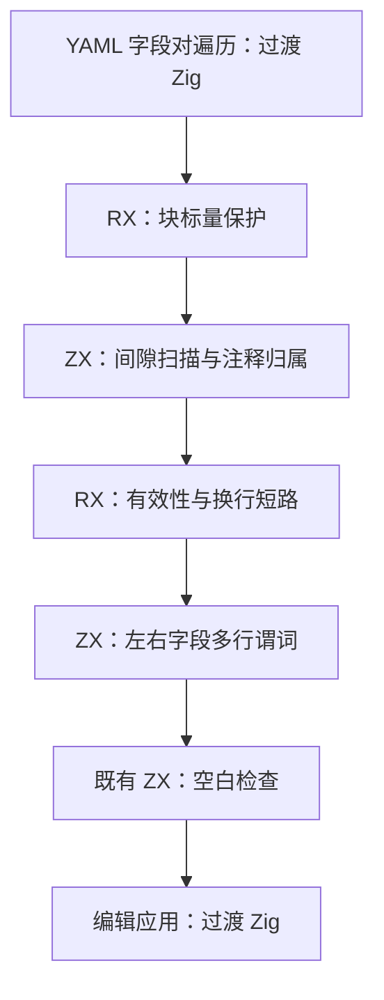

# 自举执行计划

## Intent：最终目标

继续将编译器自有规则与状态迁入 RX/ZX，保持普通 Zig 静态编译、零专用运行库与数据借用；每个阶段验证后独立提交并推送。

## Data：可用证据

当前基线为 `f570aa73`。六组 lint 基础规则已接入正式生成入口，但 YAML 字段间注释扫描与分隔规则仍由手写 Zig 执行。读取了自举完成标准、RX 开发约定及 compiler-performance 技能。历史“暂不测性能”的记录被本次明确性能要求取代。

## Edges：边界与限制

- 第一阶段只迁移 YAML 字段间规则；字段收集、字段对遍历及编辑应用仍保留过渡实现，不宣称 YAML formatter 或编译器完成自举。
- 不新增测试，使用既有配置格式化回归；不修改用户工作区中的无关文件，不新建分支。
- 输入源码及字段范围借用；不把字段数组重新编码，不构造每个间隙的注释列表。
- 使用技能脚本记录实际命令、墙钟、CPU 与 RSS；基线和修改后输入与优化模式一致。冷构建与热运行分别报告。
- 用户在 2026-10-31 13:46 更新目标：性能按先实现、再优化推进。若发现退化，保留功能并定位、优化到门禁达标，不再将撤回实现作为处理退化的结论；该明确要求优先于 compiler-performance 技能中撤回尝试的默认建议。第七阶段的撤回记录属于此前事实，继续保留，不改写历史。

## Answer：交付格式与成功标准

1. 固定基线构建与格式化行为、性能证据。
2. RX 表达块标量短路、扫描有效性短路、多行判断及空白检查；ZX 实现单次有界扫描与多行谓词，复用既有空白检查。
3. 正式入口依赖生成规则，原生规则仅供 seed；执行既有配置格式化回归及同输入测量，复核生成代码借用与分配。
4. 记录验证、性能、自我批判与剩余职责，英文规范提交并推送。

第二阶段修复验证时发现的生成桥生命周期问题：核对 `generated.Output` 的实际类型，仅在输出全部为标量时在局部缓冲有效期内取值返回。范围是 RX 边界扫描及导入排序两个同源适配器，使用既有 RX 格式化与导入排序检查，并独立记录失败基线与修复结果。

第三阶段落实 [RX 显式输入输出契约](RX显式输入输出契约.md)：Input 位于 Module 开头，Output 位于末尾，声明通过批量解析接入既有类型图。

第四阶段收口完整回归暴露的 [分析并发与验证阻塞](分析并发与验证阻塞.md)：普通分配器入口安全顺序执行，正式生成器显式使用已证明线程安全的并行入口；以既有回归、同输入产物和性能为门禁。阶段完成不等于完整自举完成。

第五阶段迁移 [函数返回类型包含关系](函数返回类型包含关系自举.md)，把正式生成缓存使用的 `fresh_outputs` 整表事实接入现有 RX/ZX 分析模块。保留轮次标记与复用遍历缓冲区，使用正式 bootstrap 工具而非 seed 的性能数字验收。

第六阶段迁移 [聚合身份观察分析](聚合身份观察分析自举.md)，利用原有前向调用拒绝规则，融合本体检查与已完成函数前缀的传播。用旧并行实现作临时差分，按正式路径核对性能；保留并明确记录布局套件的既有生成形态门禁失败。

第七阶段完成 [聚合循环值缓冲性能调查](聚合循环值缓冲性能调查.md)。追查前一阶段的既有失败，试作值缓冲并通过原型行为检查；完整计时发现零轮约 14.6% 退化，且正式自举输入没有可确认的生成代码收益，因此撤回全部生产与测试改动，仅保留调查和恢复证据。既有布局缺口继续登记，后续转回独立的 RX/ZX 职责迁移，不宣称该能力已经交付。

第八阶段迁移 [函数错误集传播](函数错误集传播自举.md)，以调用图分量及其状态为完整职责，保留既有本体扫描作为明确的过渡边界。用原生算法作临时差分，保持同输入产物、错误行为和正式路径性能。

第九阶段迁移 [唯一性列表槽布局](唯一性列表槽布局自举.md)，利用既有完整类型校验的前缀不变量，迁移槽计数、成员偏移及 optional 展开表构建；保留查询遍历和其他唯一性算法为明确过渡职责。

第十阶段修复 [空表达式错误校验零分配](空表达式错误校验零分配修复.md)：在原子集合校验内按空集合恒真短路，避免无用上下文构造，保留完整校验其他阶段及非空 Capture/Task 分析。

第十一阶段迁移 [公开形状图规划](公开形状图规划自举.md)：按公开接口图确定可达类型顺序和局部编号，将规划状态迁入 RX/ZX，修复全局 TypeId 与稳定缓存键不一致的问题；AST 构造保留为明确过渡边界。

第十二阶段实现用户确认的 [RX 类型引用与 Args](RX类型引用与Args实施.md)：Module 内使用多个 Type（as 必填、from 默认省略 .zx）和唯一 Args，以类型表达式复用 ZX 公开类型，替换第三阶段的 Input/Output 标签。本文第三阶段记录属于历史实现，不代表继续保留该语法作为并行契约。

12A 已完成 Module 接口、单函数简写及四源根全部 161 个普通 RX 的对齐，真实产物、磁盘/常驻编辑、公开边界验证与性能证据见对应文末验收。12B1 已接通 Store 类型属性/来源作用域并完成对应检查，记录见 Store类型表达式与限定枚举实施.md；12B2 已接通限定枚举值并验收，相关基线旧失败另行记录。第一项完成后，继续按用户顺序实现共享常量与其他语言要求。旧工具也触发的并行 OOM 诊断栈 panic 独立保留，不以裁剪诊断的通过替代原套件全部通过。

用户要求先逐项完成 [新增语言需求实施清单](新增语言需求实施清单.md)，再继续原有自举：Type/Args 与 Module.fn 对齐、const.zx 导出常量与裸值清理、lint/fmt 的非空对象强制垂直布局及默认 90 列、barrel 与 index 目录入口、If/Else、pipeline。每项独立核对正确性、缓存与性能并提交推送。

按更新后的性能原则，已重新定位第七阶段保存在 `/tmp/zxc-layout-gates/rejected-source/` 的值缓冲及最终初始谓词 guard，旁边的 `rejected-buffer.patch` 可用于差异迁回。guard 已避免零轮执行第三次指针→值整表转换，但没有最终性能验收；`measure_guarded.py` 仍指向不存在的工具快照，不能直接当作已有证据。后续须保留功能完成测量与优化。当前 function-updates 的 duplicate/mixed 使用 `i64[]`，不走 product 元素值缓冲，需分别追查边界别名复制与重复归一化，不能宣称恢复值缓冲即可修复。

第十三阶段实现共享导出常量。13A 先建立独立 AST 与原生/生成解析、格式化顺序和明确拒绝边界；13B 继续 typed constant 求值、导入、IR/编译库与缓存传播，再从共享 const.zx 直接导入清理裸值，不增加同值别名。实施与证据见 [共享常量与裸值清理实施](共享常量与裸值清理实施.md)。13A 不等于完整常量功能交付。

13B1 已完成闭合标量 typed IR 求值、独立值模型与实际现有夹具对照，记录见共享常量与裸值清理实施.md。当前 bootstrap 与基线二进制相同，CLI 交错对照无稳定退化；声明仍明确 unsupported。继续 13B2 的声明分析、直接命名导入、编译库、IR/cache 版本与导入值失效，不将算法阶段代替完整常量交付。

13B2a 已完成消费端 typed identifier 与初始 seed 同源求值快照，具体范围和实证见共享常量与裸值清理实施.md。源码 export const 与跨模块值通道仍保留明确拒绝，继续补齐 signature/import、IR/artifact、编译库与缓存后再清理裸值。

13B2b 已将真实常量 AST 接入签名 typed exports，原生与生成路径核对通过，阶段证据见共享常量与裸值清理实施.md。当前项目常量总 guard 保持；继续 project/binding/resolved、模块 Source、IR/link/mixed 及库/缓存传播，再解除 guard 和清理裸值。

13B2c 已接通项目签名的常量命名导入与 TypeId/值传播，真实双文件项目和共享解析缓存核对通过。编译 body guard 仍保留，继续 analyzer/Program/模块记录、link/mixed、IR/artifact/compiled/cache 通道后再开放完整常量功能。

13B2d 已打通 body/contracts 的只读常量 scope、Program.constant_exports、IR 校验、resolved admission 和 link/mixed 元数据；源码 provider 的 body guard 与 artifact/compiled/cache 门禁仍保留。首轮公共路径 CPU 退化已用 RX 空路径早退修正，最终五场景配对测量未检测到稳定退化，具体区间及 RSS 不确定性见共享常量与裸值清理实施.md。继续补 artifact、编译库与缓存的完整复制、校验和依赖值失效，再开放完整常量功能并清理裸值。

后续已完成 utils 与 loop 语法糖阶段（e9fe9156），再迁移
[唯一性调用图分层](../2026-11-01/唯一性调用图分层自举.md)：
深度、前向检查、分组和稳定顺序及其状态由 RX/ZX 持有，宿主保留线程执行与摘要 Walker。
模块生成四项历史失败已按 [门禁与缓冲验收修复](../2026-11-01/模块生成门禁与缓冲验收修复.md)
完成版本门禁及实际 ABI 对齐，23 项覆盖全部通过。随后完成
[追加缓冲惰性归一化](../2026-11-01/追加缓冲惰性归一化实施.md)：
foreign / dual / mixed 原 12 项借用失败全部解决，追加、缓存所有权、模块生成合计
427/427 项通过；两阶段 bootstrap 构建及全部 Zig 产物对照通过。正式生成路径五组交错
实测冷生成快 25.43%、磁盘热缓存快 14.68%。既有覆写别名、reverse 容量及初始所有权
形态门禁继续登记，不能以本阶段通过代替其验收。
全局语义裸值清理、lint、其余规则/状态与最终传递依赖闭包仍未完成。
