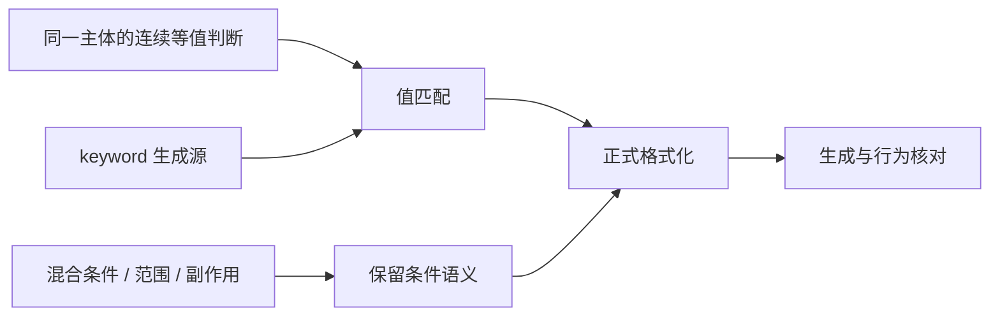
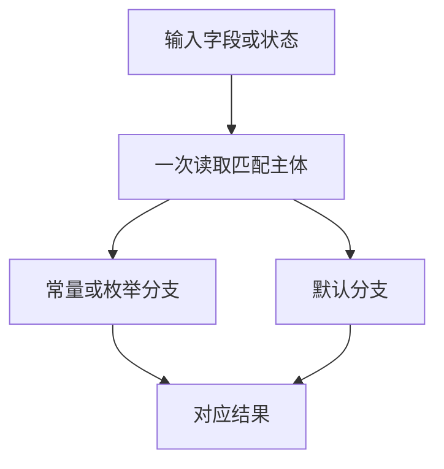

# 值匹配规范与源码对齐

Intent：同一纯值的等值分派使用 match value，消除各分支重复的 value == Pattern；保留真正的混合条件、范围和短路逻辑。

Data：截图对应 lexer/punctuation_symbol.zx。扫描生产源码确认 15 文件 20 处可直接改写；keyword DFA 还有 166 处由 generate_keywords.py 生成的同主体字节判断。目标式 match 已支持导入常量和枚举成员；当前不支持多值标签。

Edges：仅将无副作用的标识符或字段链提升为主体；保持分支顺序、默认路径和结果。混合条件不机械改写。两字符标点把 equals 的 next 判断收进该值的结果；lexer 模式分组复用相同诊断常量。单一组合条件加默认值改为条件表达式，不复制对象构造。原生声明 modifier 直接按 phase 分派，仍供状态更新使用的布尔值保留。历史测试夹具保留，生成源码从生成源改，生成器使用正式 formatter 防止再次输出旧布局。

Answer：20 处直接改写、4 处值分派重构及 1 处条件表达式简化；DFA 的 166 处由更新后的生成器统一再生。规则写入 AGENTS.md。复用实际生成链、现有回归与产物证据，以三组工具对照分离 match 与 printer 常量改动的性能，独立提交推送；不新增测试用例。

## 验收与边界

截图中的单字符分派及同文件双字符分派已使用 match in.byte；等号的次字符判断留在对应结果内，保持默认路径。源码生成器连续再生的文件摘要相同；不再从生成源输出重复的 in.byte ==。

现有 RX 文本、XML 表达式与所有权检查合计 190/190 通过。正式 bootstrap 16/16、CLI 28/28 构建成功。精化后的最终工具消费相同冻结源码，1515 个非身份文件与上一阶段基线逐字一致。源码副本编辑、恢复的缓存/冷生成对照均为 1516/1516 相同。

完整 compiler 回归为 365/372，失败与已记录基线相同：6 项旧回调捕获/参数断言，1 项已知分配失败枚举不确定性。最新缓存 codec、所有权与模块生成检查为 111/115：3 项已知 buffered eligibility 断言，1 项已有 ReleaseSafe 公共入口未拒绝非法 IR 的断言。不能宣称全套通过；没有借本次 match 对齐修改这些无关能力或放宽断言。原始日志位于 /tmp/zxc-value-match/{behavior-tests,optimized-tests,cached-cache-tests}.log。

自我复核：值匹配适用于同一纯主体等值分派，不能由标签更少推断所有条件式 match 都错误；混合主体、范围、短路或副作用仍须按实际语义保留。此次仅对齐实现写法及其生成源，不代表 barrel/index、If、pipeline、pick/omit 或完整自举已经交付。文档采用 IDEA 框架记录目标、证据、边界与交付标准。

## 独立性能收口

三组工具使用同一冻结输入：上一阶段基线、仅 printer 文本常量版、再叠加 match 对齐版。以下比较后两组，隔离此次 match 写法对齐；printer 文本借用分析的新增耗时仍单独处理中，不能将两项需求整体宣称性能通过。冷生成 16 组，热生成及 CLI 各 12 组，平衡前后顺序，记录 wall、CPU、RSS。

| 场景      | wall 中位数 前→后 ms | CPU 前→后 s | wall 差值 95% 区间 ms |
| --------- | -------------------- | ----------- | --------------------- |
| cold      | 1472.062→1480.049    | 9.450→9.450 | [-15.352, 19.456]     |
| warm      | 671.010→672.790      | 3.350→3.335 | [-4.349, 6.513]       |
| cli-rx    | 1217.335→1219.771    | 1.480→1.480 | [-6.172, 6.652]       |
| cli-zx    | 921.246→913.673      | 0.990→0.980 | [-15.828, 1.574]      |
| cli-store | 99.862→99.327        | 0.090→0.090 | [-1.435, 0.301]       |

所有 wall/CPU 区间含 0。初轮热生成 RSS 差值区间 [1.14, 13.19]MiB，因此追加相同工具双副本控制和 match 工具共 12 组对照，顺序均衡；没有复现稳定增长。保留初轮数据并与控制差值合并后，RSS 差值区间 [-1.44, 10.76]MiB，其他场景 RSS 区间也含 0。所测场景未检出 match 对齐造成的稳定退化，不外推为所有输入的绝对保证。摘要为 value-match-paired-summary.json、value-match-memory-control-summary.json，原始日志 /tmp/zxc-value-match/{performance,memory-control}.log。
