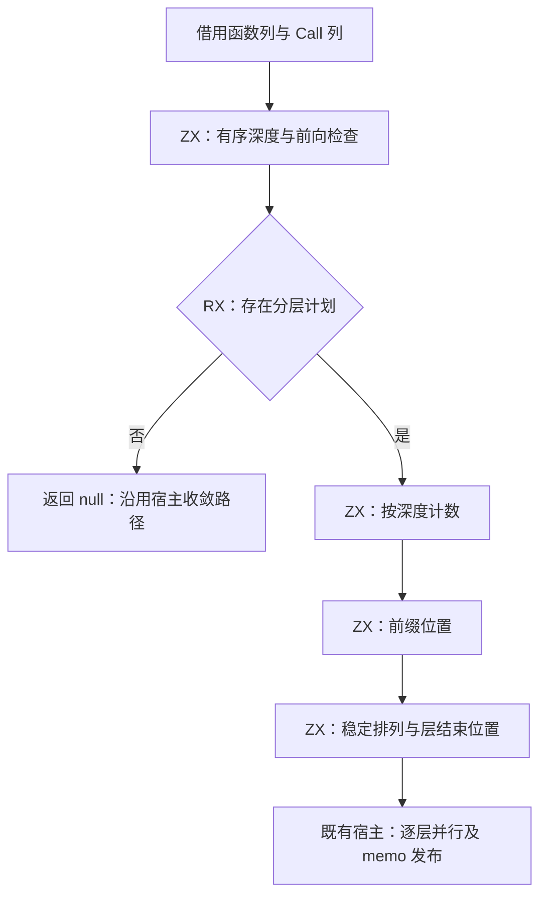
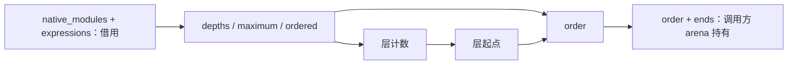

# 唯一性调用图分层自举

## Intent：最终目标

将唯一性分析中完整的调用图分层规划及其状态迁入 RX/ZX。保留既有前向依赖回退、
同层稳定顺序、并发分析和逐层缓存发布，不新增运行库或复制调用边。
本阶段完成后英文提交并推送；完整自举与全局裸值清理继续按既有清单推进。

## Data：可用证据

基线 e9fe9156。flow.zig 的 layers 在手写 Zig 中扫描全部表达式，计算函数深度、
分层计数、前缀位置与稳定顺序，随后 layered 使用结果驱动并发 Walker 和 memo 发布。

ExpressionTable.validate 保证 Call payload 完整且按行排列，因此合法表的 call_functions
正好覆盖原扫描命中的全部调用；Task 内部调用仍是同表独立 Call 行。
genz 的公开约定要求输入已完成 IR 校验，compiler 公开 emit/emitBundle 已执行该边界检查。
不为本次迁移新增整表校验，也不把 Task.body 的 ExprId 当 FunctionId。

## Edges：边界与限制

- 任一 callee >= 当前函数编号都返回无分层计划；不把前向但无环的图强行重新排序。
- external 深度为零；同层保持函数编号顺序；空表保留 order=[]、ends=[0]。
- RX 表达深度检查后的短路，以及计数、前缀位置、稳定排序之间的数据依赖。
  ZX 承担内聚的图遍历和集合算法，状态不隐藏在手写 Zig 中。
- 复用现有列 ABI 借用函数和表达式表，不重建或复制 callee 元素。
- seed 保留原生算法；正式路径只能调用生成模块。宿主适配器只负责类型表示与错误转换。
- Walker、摘要闭包及线程执行仍是明确的过渡职责，不宣称唯一性分析整体或编译器完成自举。
- 不新增仓库用例；用既有回归及临时差分核对边界、稳定顺序、缓存和真实生成。

## Answer：交付与成功标准

交付 RX 编排、ZX 类型和算法、正式生成接线及保留给 seed 的原算法。
核对真实生成闭包及借用，不以空包装或仅增加入口数作为完成证据。
相同冻结输入前后产物一致；实际成本变化使用 compiler-performance 的隔离对照，
如发现退化，保留功能并优化，直至门禁达标。

## 执行记录

已完成：正式生成入口注册 uniqueness_layers；flow.create 调用借用适配器，原算法移至 seed。

### 实现与职责复核

- depth.zx 计算一个函数的有序依赖深度；depths.zx 按函数顺序构造深度表，external 保持零。
- counts.zx 生成深度直方图，offsets.zx 转成起点，ordering.zx 按函数编号稳定填充并得到结束位置。
- plan.rx 明确连接上述阶段，前向检查失败时短路，不执行后续分组。
- 原生适配器仅借用列、调用 executeValue 并转换返回表示；输入列由 columns.slice 的
  编译期布局校验保证兼容，没有 callee 元素复制、字符串编码或动态调用层。
- ends 使用 u64，与 ZX 长度表示一致；宿主在取层范围处转换为 usize。输出与旧实现相同，
  没有把落在同一层的函数重新排序。

新增 ZX/RX 共 230 行，按上述算法职责组织；各文件不超过默认 120 行且已按 90 列格式化。
结构性的零值、起点与步长保留，没有添加语义裸值。
直接 check-rx 的独立项目入口因没有内部 core 包声明被拒绝，未将该命令算作通过；
正式 manifest 已声明这些源码包，并实际生成、编译了完整入口。

### 正确性与实际生成

正式 ReleaseSafe bootstrap-stage 和使用新 bootstrap 的 CLI 构建通过。
临时驱动直接链接同一生成入口，对照 e9fe9156 的原生 layers：
4096 组三节点有向图与 external 标记组合、空表，以及 1/17/257/4096 长链，
共 4101 组逐项核对 null、order 和 ends，全部相同。
驱动及日志在 /tmp/zxc-layers/proof、differential.log，没有新增仓库用例。

冻结四个源根与 66 个入口，前后 1574 个非身份生成文件全部逐字节一致。
完整比较唯一变化是 .zxc-inputs 的上下文摘要，显式排除后记录于 outputs.json；
同一最终工具冷/热输出 1575/1575 一致，不排除文件。

在临时源副本将 depth 的初始值从零改为一，确认实际生成模块发生变化。
编辑后的增量/冷生成、恢复后的增量/原始冷生成，各 1575/1575 一致，均不排除文件。
缓存格式与事实身份没有改变；此检查核对既有 memo 在新的分层执行下仍正确失效与恢复。
报告：/tmp/zxc-layers/cache-edit-equal.json、cache-restore-equal.json、cache-edit-changed.json。

### 既有回归与保留失败

运行 cached-ownership、zx-parallel-runtime 与 module-generation：
105/108 构建步骤成功，182/186 用例通过，失败恰为已登记的四项：

- buffer_eligibility 的 reverse dependency、restoring append、append payload 三项。
- gates 的 invalid IR cannot generate modules；该失败路径同时报告三项泄漏。

缓存所有权与真实 Task/Parallel 运行检查通过，没有改变其预期。
四项失败签名与 /tmp/zxc-value-match/cached-cache-tests.log 及 optimized-cache-tests.log 相同；
提交 726152a4 的共享常量实施记录已登记。三项 buffer 在更早 a2706901 基线有复现，
gates 的 ReleaseSafe/Debug 校验预期差异也已在分析并发记录中登记。
这些历史日志没有独立 revision 元数据，不冒称它们来自某个未证实的 pristine 快照。
完整日志：/tmp/zxc-layers/regressions.log；本阶段不把该目标说成全绿。

### 成本与性能

使用 compiler-performance skill。首先贯通实现，再做相同冻结输入的前后对照；
没有并发构建、resident 关闭、ABI 分别预热，冷生成每次使用独立生成缓存，
热生成紧随同一缓存执行。五组交替顺序，源码和工具摘要由测量脚本记录。
冷指语义/生成缓存，不代表 OS 文件缓存为空。

| 场景   | wall 中位数前→后（ms） | CPU 前→后（s） | 峰值 RSS 前→后（MiB） |
| ------ | ---------------------- | -------------- | --------------------- |
| 冷生成 | 1593.469→1584.282      | 10.22→10.15    | 395.53→396.09         |
| 热生成 | 802.120→796.844        | 4.24→4.24      | 402.73→407.23         |

墙钟中位数分别约 -0.58% / -0.66%；CPU 没有稳定增加。
RSS 配对差异方向不一致，前后都出现约 462MiB 的单次峰值，不能把中位数波动当内存改善或
稳定退化；有限输入与五组样本也不构成任意程序、OOM 和平台的性能证明。
所测冷/热场景未检出稳定退化，没有通过撤回功能或关闭安全规则规避成本。
原始报告、样本与来源摘要：/tmp/zxc-layers/performance；汇总 performance.log。

### 自我批判与后续边界

迁移的是分层规划及状态，线程池、Walker、摘要闭包、memo 编码和类型桥仍有手写 Zig。
生成文件一致能证明本阶段行为对齐，不能证明整个编译器已完成自举。
直接借用 Call 列依赖已核实的合法 IR 契约，不可扩展为绕过外部输入校验。
四项既有失败仍须独立修复；全局裸值清理与 lint 仍未完成，继续保留在需求清单中。
