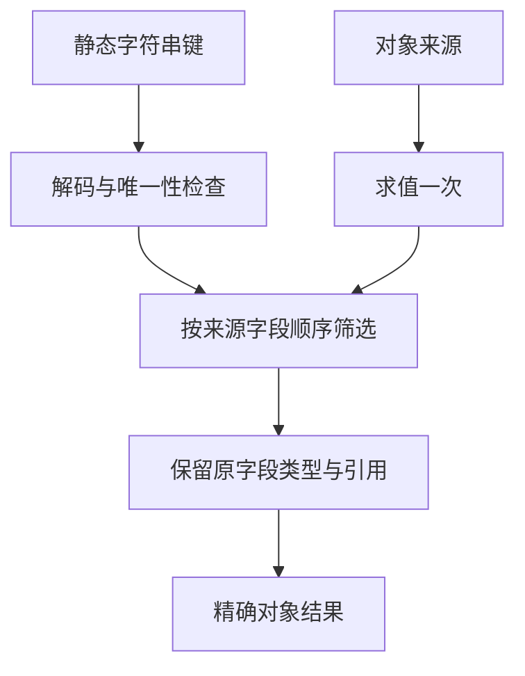

# 对象复用与静态字段选择实施

## Intent：最终目标

实现 `object.pick(["field"])` 与 `object.omit(["field"])`，并用展开、简写和静态选择简化正式 RX 数据组装。
复用原字段 TypeId、所有权和统一打印机制；完整阶段验收后提交推送。

## Data：可用证据

对象展开和同名属性简写已有解析与生成实现。ZX 的普通方法调用已有 receiver 分析阶段，
IR 已有 Scope、Object 和 Field。RX 图推导包含对象构造不动点，可挂接延迟字段选择事实。
Graph.field 会增加字段，不能用来证明选择键存在。

## Edges：边界与限制

只接受一个字符串字面量数组，解码后检查重复和未知字段；保留源字段顺序。
receiver 只求值一次，键不进入运行时 IR，不增加动态方法、反射或专用运行库。
保留已导入 namespace 调用的优先级，普通同名数据字段仍可读取。
RX 仅豁免这些静态对象操作，receiver 仍递归遵守值边界；不能放行普通函数或回调。
推导不提前 resolve 来源，也不靠补字段猜输入。等待完整来源字段集合；最终未确定时要求明确接口。
不新增仓库测试，用已有检查与真实源码的临时核查验收。

## Answer：交付与成功标准

交付原生与 RX/ZX 分析、RX 推导、值边界、实际源码采用、格式化兼容及应用指导。
验收类型身份、空选择、一次求值、覆盖与顺序、未知/重复键、推导收敛、所有权、缓存编辑恢复。
等价源码清理不做性能计时；新分析路径仅对实际成本风险进行对照。

## 实施与验收

## 实现结果

ZX 保留普通 Call AST，在已导入 namespace 解析之后、普通 collection 类型拒绝之前处理对象选择。
Native 与 RX/ZX 分析器检查一个字符串字面量数组，解码后检查重复及未知字段。
选择按来源类型字段顺序构造，字段 TypeId 原样复用，不重新创建枚举或原生引用类型。
全选直接返回来源；部分选择使用普通字段与对象构造。

RX 值边界只识别这两种静态形式，并递归校验 receiver。
普通调用、回调及隐藏在 receiver 中的调用仍拒绝。Store 初值沿用同一属性编译边界。
图推导注册选择事实，等待来源字段集合确定；选择结果封闭，消费者不能向它补字段。
构造和选择在已有不动点中交替传播，不提前 resolve 来源。

16 个正式 RX 文件采用 pick、omit 或更明确的展开复用，替换 20 处对象组装。
包括 analyzer/body 与 initialize 的整块 omit、source_signature 的部分字段展开、
原生/编译库接口的字段选择，以及 signature 中复用 types 后覆盖 delta/cache。
对全仓库生产 RX 再运行保守整块扫描，没有剩余的“三个以上同源同名字段”完整对象候选；
该扫描不代表所有复杂混合对象都可自动改写。
新 ZX 原子实现也复用共同 Input 类型、对象展开与局部简写，没有机械复制接口字段。

### 成本问题与修复

初版为每个 receiver 添加 Scope 绑定，使普通引用的选择结果妨碍参数展开，
CLI 示例在既有零容量分配器的 type_rules 校验中触发 OutOfMemory。
没有扩大分配器、关闭验证或撤除功能；纯 Reference / Field / TupleField / OptionalValue
直接投影，其他 receiver 继续绑定一次，避免重复调用或丢失错误。
正式 CLI 的默认构建包含 quote 示例，修复后整体通过，零分配约束保持。

中间编译器已经包含上述有成本的校验器，不能用它引导修复版。
临时 seed-input 使用正式源码副本，仅把 16 个 RX 的组装写法换回语义等价的显式对象，
从最后可用种子构建具备优化能力的过渡编译器；随后重新按完整正式源码构建和验收。
正式源码始终保留新能力与新写法，临时包装器和输入副本均不提交，不进入正式编译器依赖。
证据：/tmp/zxc-selection/seed-input/inputs.json。

空选择的 computed receiver 最初使用 null Scope 符号，既有 IR 规则只允许这种绑定承接
void 或 iteration，因而正确拒绝了非 void 对象。最终保留合法绑定，即使结果没有字段，
也保留 receiver 的求值和错误；未修改或放宽 IR 校验规则。

### 正确性证据

- 最终 ReleaseSafe bootstrap、CLI 默认构建通过，编译器回归 366/372。
  仅 6 项既有回调预期失败，见 /tmp/zxc-selection-final-tests.log。
- 65 个真实入口、1581 个模块完整生成通过，见 /tmp/zxc-selection-current.log。
  原生 seed bootstrap-parser 成功，12 个安装入口与最终生成路径逐字节一致，
  见 /tmp/zxc-selection/seed-equivalence.json。
- 复用真实 enums.zx 接口，RX omit 删除额外文本字段并保留 Mode 枚举；
  可空输入经过 If、对象构造、omit、pick 和字段读取，非空返回原枚举，空输入返回 null。
- computed receiver 从标准输入读取 abc，一次快照含 left/right 字段，选择后得到
  {left: abc, right: abc}。若按每个投影重读来源，将不能得到这个结果。
- 空 pick 正常返回空对象；读取上限不足时仍抛出 StreamTooLong，证明未跳过来源求值。
  证据：/tmp/zxc-selection/runtime/results.json 与 /tmp/zxc-selection/empty-proof.json。
- 最后一次合法绑定修复前后，三个已有运行应用的四个生成文件一致；复用运行证据，
  没有重复编译它们。空结果应用单独用最终 CLI 构建执行。
  证据：/tmp/zxc-selection/runtime-equivalence.json。
- 最终 CLI 拒绝未知键、重复键、动态键、非字符串键、普通调用、receiver 内调用和开放来源，
  见 /tmp/zxc-selection/rejections.json。
- 修改来源类型增加字段后，增量产物确实变化且等于冷生成；删除被选字段后，缓存路径拒绝；
  恢复后等于冷生成与基线，见 /tmp/zxc-selection/cache-proof.json。
- 24 个 RX/ZX 与 9 个 Zig 变更文件通过格式检查；现有 RX 格式化检查 52/52 通过，
  见 /tmp/zxc-selection/format-proof.json与 /tmp/zxc-selection-formatting-tests.log。
  没有新增仓库测试；例子与临时核查均保存在 /tmp。

### 性能与边界

只比较新增分析和已采用编译器职责对普通编译的影响，没有给等价源码清理单独计时。
固定旧输入 63 入口、1550 模块，ReleaseSafe 依赖与 small 根，resident 关闭，五对交替运行。
先各执行一次 standard ABI 命令预热可执行文件，源分析与生成缓存仍逐次使用新目录。
预热耗时另记为 8.16 / 64.51 ms，没有计入普通冷生成样本。

| 指标                 |       基线 |       最终 |
| -------------------- | ---------: | ---------: |
| 普通冷生成墙钟中位数 | 1376.76 ms | 1366.70 ms |
| CPU 中位数           |     8.87 s |     8.84 s |
| 峰值 RSS 中位数      | 375.75 MiB | 378.33 MiB |

成对墙钟差为 [-49.27, -14.44, -1.90, 5.30, -2.97] ms。
没有检出稳定耗时退化；RSS 中位数高约 2.58 MiB、样本波动较大，首个最终样本为 455.36 MiB，
全部原始点保留，不能据小样本宣称所有规模或内存场景绝无退化。
1515 个旧输入生成文件完全一致，只排除 .zxc-inputs。
报告为 /tmp/zxc-selection/performance/summary.json 与 equivalence.json。

### 自我复核与后续

批量改写最初只统计带点的字段引用，遗漏了混合对象中 source: $in 一类字段。
类型约束拦截了丢字段的结果。已还原这批改写并要求每行完整匹配；混合来源单独用展开保留原字段。
不会用扩大类型、补默认值或隐藏诊断让不等价改写通过。

首次诊断核查用了语言尚不支持的 Unicode 转义，被词法层拒绝；随后使用合法字符串核对重复键。
一次核查读取了另一个任务正在临时修改的同一文件，已改为串行执行并重新取得有效证据。
这些是核查工具修正，没有为核查预期改变语言契约。

本阶段交付静态选择与实际对象复用；原生 Graph 状态、语义适配器和剩余自举职责仍需迁移。
整体自举尚未完成，后续继续全局裸值规则与清理，以及最终传递依赖和阶段自编译验收。
