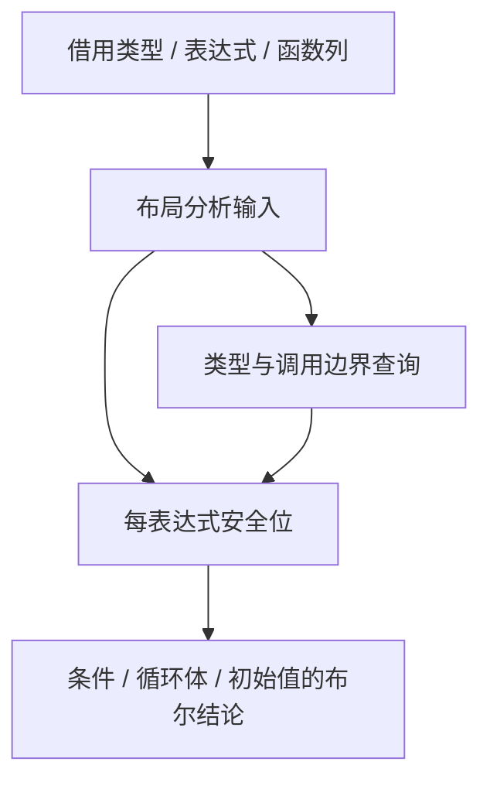

# 循环布局安全性分析自举

## Intent：最终目标

将循环浅层、深层值布局的表达式安全性分析迁入 RX/ZX。保持身份观察、调用、任务、
列表元素及错误边界，正式路径不执行旧 Zig 分析。完成同输入正确性与成本验收后提交推送。

## Data：可用证据

起点 b4aa1c72。`packages/genz/src/zx/iteration_layout.zig` 的 analyze 按表达式拓扑顺序
建立安全事实，结合 deepOperation、listEscape 和 borrowedProduct 决定循环条件、循环体
及初始值是否可用值布局。eligible、shallow、condition、deep、initialValue 均调用它。
已有类型、表达式、函数列模型及 list_supported、layout_represented 等逻辑可复用。

基线工具固定在 `/tmp/zxc-iteration-layout/before-bootstrap` 与 `before-cli`，不依赖会被覆盖
的工作区可执行文件。上一阶段的正式生成输入快照可继续使用，输入必须先核对摘要。

## Edges：边界与限制

- RX 显式连接类型/表达式安全事实与根集合归约；ZX 保留内聚的类型遍历和拓扑分析算法。
- 重用原始类型、表达式和函数列，不创建编译器专用运行库或源码片段节点。
- 原生适配器仅负责列借用、调用和拥有结果；旧算法仅保留 seed 分支。
- 不扩大布局适用范围，不通过放宽身份、任务、原生或别名保护修复既有旧失败。
- 不新增仓库用例，使用旧算法临时差分、现有行为检查与正式生成产物对照。
- 有成本变化则先完成实现，再按证据优化；不以撤回功能或遗漏规则获得通过。

## Answer：交付与成功标准

交付 RX/ZX 分析、正式构建接线和 seed 隔离。核对原算法与新算法的可达分支与结果，
比较同输入生成产物及既有相关检查，实测正式 generator 冷/热路径无稳定性能退化。
明确本阶段迁移范围，保留其他自有状态与生成器原生依赖的待迁移记录。

## 执行记录

已固定原工具；下一步完成规则迁移和正式生成接线，随后集中差分与成本验收。

### 首轮贯通与成本证据

首个正式工具构建 16/16 步通过。旧工具与新工具在相同 66 入口快照下，1573 个 Zig
文件与清单一致，仅 `.zxc-inputs` 的工具身份摘要不同；新工具冷、热全部 1575 个文件一致。
报告在 `/tmp/zxc-iteration-layout/performance-first/`。

五组交错实测：冷生成 1183.365→1250.636 ms，热缓存 675.087→742.853 ms，CPU 也增加，
RSS 中位数约 397→416 MiB，因此首轮不能交付。生成代码显示局部 `const table` 每个表达式
复制完整表达式描述符，初始化安全数组还使用额外一轮 map，深层类型查询为基本类型创建遍历栈。
保持功能，改用直接列引用、单遍构建安全事实及基本类型早退，等待复测。

既有 aggregate-loop、modular-loop、object-append 的首轮检查，389/389 个已执行行为检查通过；
另有七个生成形态前置门禁失败（六个 InvalidValueBufferCount、一个 MissingFrameValueBuffer），
故不能报告整套通过。已固定 b4aa1c72 的完整 genz 源码，在临时构建中仅替换 genz owner，
用于复现迁移前这些门禁；不使用过期缓存二进制推断基线，也不删除或放宽原检查。

### 实现边界复核

旧 list_supported 对列表元素还有额外 flat_product 要求，比本分析严格；native value boundary
检查 ABI 叶子，也不等同于列表逃逸。两者未作为错误替代。复用现有 descendant 与
layout_represented，保留 root 相等、列表/optional 遍历与 Task 不穿透规则。

正式入口按 RX 依次连接 shallow 边界准备、表达式安全事实、根集合归约；seed 算法隔离到
iteration_layout/seed.zig。适配器借用列和 ExprId 的已验证 u32 表示，不复制输入表。
当前通用 flat/leaf/aggregate/represented/supported 的原生查询仍被其他生成职责使用，
不把这些未迁移查询或整个迭代生成器算作本阶段已完成自举。

迁移前基线生成器已从 b4aa1c72 源码构建完成。17 组既有 aggregate/modular 夹具逐项对照：
退出码、诊断与已经写出的全部文件完全一致；七个前置门禁在原工具也同样失败，其中
modular simple 已写出的源码/ABI 也一致。结果见 `/tmp/zxc-iteration-layout/fixture-compare/summary.json`。
这证明它们是迁移前已有门禁，不能据此称完整两套回归通过，也没有绕过这些检查。

优化版第二次阶段工具构建 16/16 通过。安全数组改为一遍拓扑追加，读取只涉及先前事实；
表达式表直接借用列，不再建立整个表的局部值快照；简单类型和直接 fresh product 在分配
遍历栈之前返回。RX 单独传入边界所得 allowed，避免为覆盖一个字段重建整个输入记录。

第二轮优化没有消除主要退化：冷 1188.323→1253.867 ms，热 685.548→739.314 ms，
因此没有交付。构建了仅用于诊断的带符号工具（临时工程、正式相同的 fast compiler_rt，
不修改生产构建配置）。短命进程的首次采样因目标变为 defunct 而未通过身份连续性检查，
仅保留原始文件；随后对两次独立的冷常驻请求采样，目标服务器全程存活，两个 profiler
均退出 0、identity_unchanged=true，服务器均在采样后清理。

有效报告位于 `/tmp/zxc-iteration-layout/profile-resident/`。通过 nm 将采样 unknown 的
0x1c18/0x1c24/0x1c34 定位为 memcpyFast，不能将短窗口样本占比当成总收益。
近邻原 main 与新 main 中，全部 1573 个既有同名文件只有 types.zig、root.zig 改变，
其余逐字节相同；“新增入口导致所有旧生成函数变体变化”的猜测已被否定。

复核明确一个寿命缺口：旧 native analyze 的 safe 在返回前释放；新的生成调用返回 bool，
但增长旧块、safe 与类型遍历栈使用 Lower 的长期 arena。改为本次判定独立 scratch，返回时
释放；不存在指针或列表结果逃逸。同时以已校验的列布局直接借用 program.expressions，
不再创建整表中间副本，Program 参数也借用传入。第三个候选正在构建复测。

第三候选仍未消除固定耗时差异。分阶段报告明确：原工具 infer 249–251 ms，新工具
318–319 ms；emit 冷 810→795 ms、热 352→348 ms，生成本身没有对应退化。
此前继续优化布局内核没有切中主要开销，已停止这条猜测路径。memo 缓存 settled 数量
均为 6004、文件均为 3254613 字节；原/新编译工具的 memcpyFast 机器码也逐字节相同。

根据有效采样，额外处理推导所有权快照的明确复制热点：RestoreMemo 原循环携带类型表、
布局、引用位图、快照和整份 Memory，每恢复一个 u64 都构造完整上下文。将该内聚的数组
恢复算法提为 restore_memo，循环仅携带 memo/saved/first/index；其他动作保持原规则。
先读取相同 frame 偏移，空 memo 返回原 Memory；非空只替换 memo，其余字段一次保留。
此项为保留自举迁移后消除实测成本所需的推导优化，不放宽任何布局或所有权规则。

截至 guarded 候选，编译器原套件 18/18 步、372/372 项通过，见
`/tmp/zxc-iteration-layout/compiler-acceptance.log`。RestoreMemo 提取及空路径、引用槽同值
早退均未改变检查结果；引用槽早退限定 references=true，确保不绕过非引用 fact 的规范化。
五对成本仍未达标，因此阶段继续，不提交部分内部接线。

继续缩小快照复制：apply 只对 parent 为 root_parent 的根执行恢复，原循环却为每一个投影
字段重建大型状态。新增 next_root，以 parents/first/end 的小状态扫描到下一根；外层只迭代
根，不再为被跳过的字段重建上下文。扫描仍按原顺序、相同 end 范围读取同一父索引列，
不假定根连续、不改 Layout 形状、不新增根表。root_parent 在所属 places/const.zx 导出。
该优化正在构建，之后重测，尚不作为已达标证据。

临时语言能力探针也确认普通 loop 回调不允许捕获外部绑定，因此没有通过闭包绕过既有
显式参数约束，也没有添加单元素数组等仅为改变布局的伪装数据。

### 当前收口状态

roots 版本的完整编译器检查再次为 18/18 步、372/372 项通过，见
`/tmp/zxc-iteration-layout/compiler-roots-acceptance.log`。同输入新/旧全部生成 Zig 与清单
仍一致，仅工具身份摘要不同；新工具冷/热 1575/1575 文件完全一致。

但五对实测仍不达标：冷 1179.909→1226.862 ms，热 672.364→720.373 ms，
CPU 分别 7.25→7.58 s、3.56→3.86 s。不得以正确性通过或此前阶段收益覆盖本阶段退化。
阶段未提交、未推送；目标保持进行中。

平台复制原语仅作临时工程探查，未改生产构建：默认 Small compiler_rt 会生成逐字节
memcpy；关闭内嵌 compiler_rt 后缺少八个 f128 符号，见
`/tmp/zxc-iteration-layout/platform-no-rt-build.log`。未添加私有平台 ABI、额外数学库、
自制运行库或不可移植的链接兜底，也不把该失败探针当成性能证据。

### 下一缺口：不变字段的物理状态表示

现有 `projected_symbols` 只证明 symbol 经字段读取，不证明字段始终转发；state_value 的
selected/origin 也不是不变性证明。大 loop 虽只修改少量字段，生成的 SSA 中间 record
仍反复携带整份不可变上下文。下一步应直接证明并消除该复制，而不是继续更改布局安全规则。

约束与实施方向：

- 不添加闭包、标签或回调语法。RX/ZX 计算静态字段转发证明，生成普通 Zig 的局部状态。
- 沿 scope bindings、SSA 别名、条件和 match 所有结果检查；中间状态临时替换过字段也必须
  视为可变，不能只看最终 object。保守拒绝不能证明的表达式。
- 整 state 的 Call、Store/集合存储、身份比较、match subject、Task capture 等不能仅用字段
  投影代替；spread/evaluation 的结构别名及最终 ABI 重建不能一概误判为逃逸。
- initial 只求值一次。复用 iteration lowerMode 中参数重绑位置，以及 Lower.projectedField、
  aggregate 的局部构造/绑定和 scope 的局部缓存覆盖。必须同时缩小中间 record 构造，
  仅改字段读取不能消除整 record 复制。
- 物理投影必须局限本次 loop 的表达式和符号，不全局修改 TypeId 的布局；嵌套生成、
  helper 生成、context 与 cache 均保存恢复。最初可保守不启用 deep/forwarded 路径。
- 拟提取字段若被 loop renewal 路径穿过，须保留或基于归一化后的值建立绑定；不能用旧值
  配合已有唯一性 flags。更新后清除 origin，零轮沿既有路径返回原 initial 保留身份。
- emitter 的刻意形态变化进入生成缓存身份，并用现有行为、别名、错误、OOM、冷热与阶段
  自编译验收；不能继续用形态变化前的字节一致代替新的运行语义证据。

### 本轮自我批判

前几次优化没有先拆已有计时报告的 infer/emit/write，追随了“刚迁移的布局代码就是主要
开销”的猜测，导致数轮构建只消除局部成本。后续先复用已有阶段计时定位成本归属，再结合
实际生成代码和有效采样，只有证据能改变下一步时才改动；不继续重复优化已持平的 emit。
已明确根扫描/快照提取的收益有限，剩余门禁不得靠反复采样求偶然通过。

### 不变字段证明与局部借用

新增 `iteration/fields/plan.rx`，真实连接绑定索引、图边界、逐字段证明和结果组装。
`core/expression_table/child.zx` 复用统一表达式列，按既有 child 顺序读取一个子节点，
不创建子节点数组。未知来源、不可证明的前向绑定均保守保留可变字段。

证明同时检查所有中间 state，不能只看最终返回值；仅允许字段读取、Scope、条件与 match
结果、对象展开求值来源转发整个 state。拒绝整个 state 被调用、存储、比较、作为 match
subject，以及 Task/Capture/Parallel/嵌套循环。`origins` 仅是来源信息，不能单独授予不变性；
实际选择以 `!mutable` 和目标表示是否值得借用共同决定。

目标表示限定当前循环的 expression/symbol 集合。只将已证明不变的大字段改成指向 seed
字段的局部 const 指针，中间构造使用同一局部类型；条件和字段投影仍求值原 target。
被借用的构造字段也保留原求值，避免删掉其来源 Scope/条件中的错误或其他字段计算。
入口 renewal 先作用于完整 seed，再取字段地址；出口恢复完整私有布局，不让局部指针逃逸。
前测循环先在 seed 上检查第一次条件，零轮不进入物理状态构造；后测循环保持先 next 再判断。

独立只读审计核对了子节点顺序、来源证明、整值逃逸、缓存、renewal、scope、零轮和后测。
审计发现的字段求值遗漏已修复；没有以逻辑值相同替代错误行为相同。

首次第二阶段生成失败原报 OutOfMemory。逐入口缩小到 resource_scan，再验证 AST 得到
expression[51] 引用了 max_u32：局部类型 origin 字段直接读取了惰性 ABI 类型缓存，
未初始化项是占位编号。改用统一 `types.get` 后单入口成功，临时探针全部移除。
不是资源压力，未通过忽略错误或回退打印器掩盖。共享类型包边界也必须用统一查询接口。

未绑定出口重建值的版本已完成第二阶段自编译和原编译器检查：23/23 步、372/372 项通过。
生成代码中 330 个函数使用局部字段借用，含已采样命中的 snapshots/apply。
五对隔离测量冷生成 1181.998→616.699 ms，热缓存 676.109→453.399 ms，
CPU 7.22→3.46 s、3.55→2.38 s；热 RSS 392.06→409.47 MiB，仍需缩小代码与内存。
新工具冷/热 1575/1575 文件完全一致。报告 `/tmp/zxc-iteration-layout/performance-fields/`。

出口重建 record 原在 ABI 转换的多个字段投影中重复展开，使全部 Zig 源码从
19305542 增至 20421828 字节。现改为退出循环后绑定一次完整 record，再交原出口转换；
零轮分支保留直接 seed 路径。正在做第二/第三阶段核对、相关旧行为检查和最终成本验收。

### 扩展行为检查与基线债务

原有十组相关检查的汇总为 455/583 构建步骤、661/665 项执行通过；29 个步骤失败，
不能报告整套通过。日志 `/tmp/zxc-iteration-layout/fields-runtime-acceptance.log`。
失败分组为：23 个旧形态前置检查、4 个零轮身份检查、2 个 borrowed 编译错误。

- 六个 aggregate、一个 modular、八个 columns 和八个 initial ownership 的形态检查仍定位
  `execute`。旧/新正式接口的该函数都是对 `executeIn` 的包装，不承载循环；旧检查还假定
  ArrayList/dupe/@constCast 的具体生成形态。此前十七模式差分也已证明最初七项是基线失败。
  本次未删除或放宽这些检查。
- 固定 b4 工具与新工具对原 shared.zx 单入口、17 元素、零轮执行，均得到 original 与 values
  指针不同。旧产物也是先 zxRenew、再 while；需修复首次循环条件前的复制，以及反向传到
  initial/callee 的循环唯一性需求。探针 `/tmp/zxc-iteration-layout/zero-probe/`。
- borrowed 的旧/新 callee Zig 文件逐字节相同：签名 error{}，内部却 try zxReserve(false)。
  最终唯一性计划新增的分配效果没有加入源码错误闭包。后续应沿原有错误边界传播 OOM，
  并让 Lower 与 fingerprint 使用同一事实；不能全改 anyerror 或只补一个函数签名。

内存收口只证明目标表示确实可缩小的候选字段，不再逐个证明小标量；已知可变的字段提前
停止遍历。图边界拒绝后不再建立无用绑定表。构造字段的原求值放在该字段值自身的 block
中，保留对象字段原有顺序，不在其他字段求值之前提前执行。内存收口版第二阶段仍为
23/23 步、372/372 项通过；第三阶段与对象行为复核进行中。

### 中途交接记录：耗时通过，峰值内存尚未收口

当前源码对应 `/tmp/zxc-iteration-layout/fields-lean-stage3/bin/zxc-bootstrap`，正式 CLI
`zig-out/bin/zxc` 仍为 b4；本阶段没有安装覆盖、没有提交、没有推送，goal 保持 active。

- lean 第二阶段 23/23 步、372/372 项通过；第三阶段 16/16 步通过。
- 第二/三阶段生成目录分别为 compiler/.zig-cache/o/b6d93d357838e855fc4634eef1d715aa/main
  与 9d006be23e4efff3378c5b854677c91b/main，排除工具身份 `.zxc-inputs` 后 1601/1601 文件一致。
  报告 `/tmp/zxc-iteration-layout/lean-stage-comparison.json`。
- 现有对象追加与求值顺序检查为 147/147 步、290/290 项通过。
  `/tmp/zxc-iteration-layout/fields-refined-runtime.log`。之后仅在字段证明的循环上下文中
  omit 掉重复保留的 origins；该变化前后同冻结输入 1574/1574 产物一致（排除工具身份），
  见 `lean-artifact-comparison.json`，未重复相同行为检查。
- lean 冷/热缓存 1575/1575 全文件一致，见 `lean-cache-comparison.json`。
- 本次 26 个 RX/ZX 文件以 max-lines=0 检查，其他 lint 规则全通过。
  三个内聚文件超过默认行数信号：value.zx 128、child.zx 176、snapshots/apply.zx 121；
  未为行数机械拆分或压缩必要空行。

五对 lean 正式实测：冷 1176.059→630.024 ms、CPU 7.24→3.45 s；热
679.999→464.914 ms、CPU 3.57→2.39 s。但 RSS 中位数冷 392.84→399.19 MiB、
热 394.31→410.89 MiB，尚未按用户的无退化约束收口。报告 `performance-lean/`。
不能把耗时改善代替全部成本通过。

随后只对 function_sources 的临时源码缓冲做生命周期尝试：磁盘 stored 与 generated 输出
独立分配，在结果副本和缓存副本持有后逐项释放，并保留并行失败全清。只读审计未发现
所有权问题、相关 20 项缓存检查通过，但五对实测并未消除 RSS 差异。因此这项可选优化
已完整撤回，function_sources.zig 恢复 HEAD；循环布局安全自举、字段证明与局部借用仍保留。
`/tmp/zxc-iteration-layout/final/bin/zxc-bootstrap` 包含该已撤回尝试，不能作为当前源码工具。

RSS 时间线诊断 `/tmp/zxc-iteration-layout/memory-trace.json` 把采样峰值定位到推导结束附近，
生成段明显较低：before 约 303.81 ms / 394.03 MiB，after 约 300.45 ms / 385.80 MiB。
此诊断使用已撤回尝试的 after 工具，约 10 ms 的 ps 采样会漏掉短峰值，不能替代正式
max_rss 或据此宣称无退化；但足以否定“只根据同时三份源码就断定它是实际峰值”的猜测。

下一步只诊断推导收口处的分配与并行存活范围，必要时在临时工具中记录 backing allocator
的 live/peak 字节和分配调用栈。先取得能区分根因的证据，再改生产源码；不继续猜测并修改
已经定位为低于峰值的 emit/cache，也不通过改变基准并行度、放宽旧保护或撤回自举实现通过门禁。
校验对象和完整输入快照继续沿用已有固定工具/manifest/sources 摘要。

本轮自我批判：源码缓存确实存在可缩短的临时寿命，但没有先确定 RSS 所属阶段，就把它
当成峰值原因，增加了无效构建。该尝试已经撤回并留证，后续不能重复这条路径。
零轮身份、borrowed 错误闭包、23 个旧形态检查仍是后续待修的明确债务，不能用更改断言掩盖。

### 推导峰值诊断与有界预分析

临时 allocator 记录在 `/tmp/zxc-iteration-layout/allocation-profile/`。完整记录纳入
Ahead 的 worker/bindings arena 后，旧/新逻辑分配峰值约 536.05/527.83 MB，累计次数
均为 11872；这些数字不是 RSS。162 次 RX 快照累计约 23.95 MB，最大 224504 字节，
bindings 高水位约 2.2 MB，不支持把快照当作主要内存根因。

最大同深度段一次预分析 149 个模块，worker arena 在链接前保留整层中间结果，
约 338–342 MB 的保留容量还延续到末尾小层。单纯释放空闲 worker，或每层 free_all
均未稳定改善实际 RSS；后者反而明显恶化，生产代码已撤回，不保留这些尝试。
临时报告符号化会额外占用内存，其 RSS/耗时不能作为正式成本门禁。

改为同深度段有界预分析：成功 prepare 的结果达到现有线程数与原 minimum 门槛的
较大者后停止，按原依赖 order 完成本批链接，再分析余项。保留深度段末尾，避免每批
重扫整层形成平方复杂度；被 setter/compiled/reuse 等过滤的模块不占成功结果额度。
没有改动线程数、命令行配置、原串行回退或最终链接顺序。2/3 核仍允许四项批次并行，
不会因批长不足原门槛而全部串行。

只读审查覆盖前缀增长、Task 函数 delta、native/initializer 失效回退、历史检查点、
prepare 过滤、批次边界和 scratch 生命周期，未发现语义反例。第一候选与 lean 正式
生成结果排除工具身份后 1574/1574 一致，冷/热也一致；修正 prepare 计数后的最终候选
正在集中验收，不能把候选数字提前当作最终提交结果。

### 最终候选的集中成本与缓存验收

正式候选为 `/tmp/zxc-iteration-layout/bounded-prepared/bin/zxc-bootstrap`，
与固定 b4 工具交替五对测量；同冻结 manifest/sources、ReleaseSmall、resident=0，
每对新磁盘缓存后复用一次，分别输出到全新目录。测量前后核对源摘要。
报告 `/tmp/zxc-iteration-layout/performance-bounded-final/summary.json`：

| 指标中位数 | 冷生成旧→新         | 热缓存旧→新         |
| ---------- | ------------------- | ------------------- |
| 墙钟       | 1188.356→713.625 ms | 677.371→543.974 ms  |
| CPU        | 7.30→3.30 s         | 3.56→2.23 s         |
| max RSS    | 399.516→367.281 MiB | 400.859→329.078 MiB |

本场景各项均改善，没有用墙钟收益抵扣 RSS 退化。与 lean 功能候选排除工具身份后
1574/1574 全产物一致；最终候选冷/热缓存不排除任何文件，1575/1575 全部一致。
报告 `lean-artifacts.json`、`cold-warm.json`。

沿用既有缓存诊断脚本，使用正式候选检查磁盘复用、常驻初次/无修改复用、合法语义编辑
与干净生成、恢复与初次生成，五组全产物比较全部相同。编辑仅作用于 `/tmp` 冻结副本，
finally 恢复，之后再次核对原摘要；未修改生产源码或新增仓库用例。
报告 `/tmp/zxc-iteration-layout/bounded-cache-checks/summary.json`。

### 收口验证与职责边界

最终候选的既有 RX 顺序执行、Parallel、Task 检查全部通过：1093/1093 构建步骤、
1014/1014 Zig 检查；Task 的 CLI 检查 32/32。日志 `bounded-rx-acceptance.log`。
第二阶段自编译与编译器检查 23/23 步、372/372 项通过，第三阶段 16/16 步通过。
第二/三阶段全部 1601 份约定产物一致，仅排除工具身份文件 `.zxc-inputs`。
日志 `bounded-stage2.log`、`bounded-stage3.log`，报告 `bounded-stage-comparison.json`。

本阶段交付的是循环表达式布局安全性分析的 RX/ZX 实现、局部不变字段证明、静态局部
借用表示，以及支持其成本收口的快照根遍历和有界模块预分析。旧表达式算法仅作 seed；
正式路径通过借列适配器调用生成逻辑。flat/leaf/aggregate/represented/supported 的其他
原生查询、模块联结与 worker 状态、生成器自身仍有专用 Zig 依赖，不宣称完整自举完成。
下一职责先处理已经证实的零轮身份与最终分配错误闭包，再继续自有语义和状态迁移。

最终自我批判：本阶段曾多次追逐没有区分峰值阶段的局部分配，延长了验收；相关尝试
已撤回并保存失败证据。后续只在证据能改变实现决策时扩大诊断，不将局部优化拆成
重复小阶段。当前正式成本使用实际 ReleaseSmall 工具而非带探针/符号化的诊断构建，
相关行为检查与阶段不动点均通过；已知基线失败没有被隐藏或当成新实现已解决。

正式 CLI 已通过根目录 dist 安装，26/26 步成功，当前可运行文件为 `zig-out/bin/zxc`，
不再是早期 b4 工具。日志 `bounded-install.log`。本阶段提交推送现有 master；总体自举
goal 继续 active，不以本阶段完成替代最终传递依赖与全部自有状态迁移。
