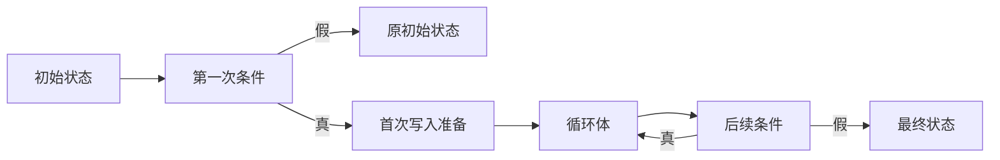
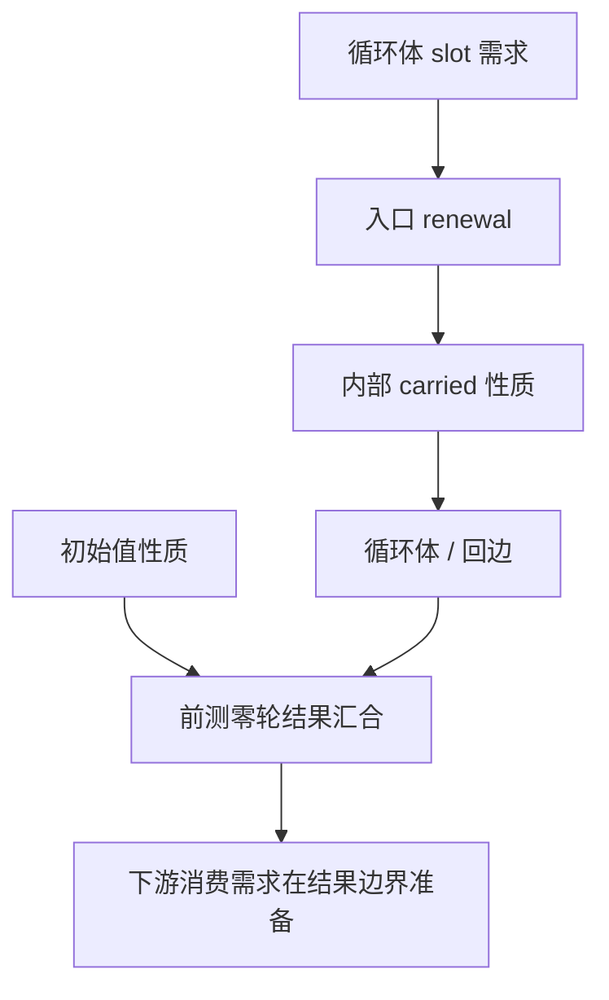

# 循环首次写入准备与零轮身份

## Intent：最终目标

零轮循环保留初始列表身份，不为未发生的循环体写入分配或修改初始值；正轮与后测循环
继续保持唯一性、别名保护、错误顺序和线性增长。以完整职责验收后提交推送 master。

## Data：可用证据

起点 30ad291c。现有 test-loop-call-origins 的 shared/mixed 零轮四项失败，borrowed
两路生成签名遗漏 OutOfMemory。旧 b4 与当前工具对 shared 的零轮都先 zxRenew，再判断
条件；uniqueness/function.carry 同时 trace(initial)，会把循环体需求反向传到初值和工厂函数。
已有检查包含零轮、两次写入、别名、错误注入和后测顺序，不新增仓库用例。

基线固定在 /tmp/zxc-loop-entry/before-bootstrap、before-cli；正式性能继续采用已核对摘要的
冻结输入。上一阶段的通过证据只用于未改职责，不替代本次循环行为与成本验收。

## Edges：边界与限制

- 区分循环内部的 carried Level 与循环结果的零轮分支；不能将入口复制后的性质错误地
  宣称为所有返回路径的性质。后测循环总执行一次，归约也有空输入路径。
- 只在状态满足条件只观察该 slot 的前提下延迟其 unique renewal。保留第一次条件、
  body、后续条件的顺序；条件自身的写入和独立错误不能被跳过。
- 原地写要求、多个活跃别名、Task/Capture/Parallel 边界均保留。所有 Zig 通过结构化 AST
  构造与统一 printer 输出，不添加运行库。
- 原生唯一性分析与迭代生成仍是过渡依赖；本阶段修复其行为，不宣称这些职责完成自举。
- 分配错误闭包还涉及有限 Capture 与 Task 错误类型。消除错误的反向需求不能替代完整
  闭包修复，若仍有独立缺口必须保留证据，不能全改 anyerror 或扩大捕获值类型掩盖。

## Answer：交付与成功标准

交付正确的循环入口准备与零轮结果事实，统一普通布局和局部字段借用两条生成路径。
运行现有 call-origins、iterate、相关所有权检查，核对阶段自编译、缓存编辑恢复与冻结
性能；无性能退化后英文规范提交并推送。记录实际失败与残留边界，不机械修改形态断言。

## 实现记录

已删除 carry 对 initial 的反向 trace；内部 carried 仍使用实际 renewal 后的性质，
前测结果和归约结果与 initial 汇合。外部消费者要求在结果边界 provide，不再错误地
把内部准备承诺为所有结果路径的性质。普通循环和局部字段借用两条路径均把 renewal
放到首次条件为真之后；旧 reduce IR 在确认 source 非空后才准备 accumulator。
唯一性 program identity 升为 v11，生成 fingerprint 升为 v51，隔离旧缓存事实。

只读审查发现且已补齐一个首轮条件漏洞：observed 不代表 callee 不追加临时列表。
只追加并返回 bool 的 probe 不被 Flow 标记为输入写入，但若条件符号仍使用 renewal 后
headered 性质，probe 的首轮参数会被错误地视为带 header。前测 condition reference
也必须与 initial 汇合，后测仍用 carried。这个修正与结果零轮事实不同，不能漏掉。

首轮候选只完成 native 语法与构建检查，未用作验收工具；补齐 condition facts 后统一
运行既有 call-origins 与 iterate 行为检查，避免把内部接线拆成小交付。

## 首轮行为结果

现有 test-loop-call-origins 与 test-iterate 共 165/165 步、132/132 检查通过，CLI
检查 5/5。日志 /tmp/zxc-loop-entry/runtime-first.log。shared/mixed 的四个零轮失败、
borrowed 两路的编译失败均消除，未修改用例或断言。工厂函数不再因下游循环写需求
生成本不需要的 normalize，因此该工厂仍可保留原 error{} 签名；这不能单独证明所有
其他编译期分配的错误效果闭包已解决。

当前候选的编译器检查 23/23 步、372/372 项通过。日志 current.log。继续第二阶段
生成、相关集合行为与冻结成本验收；不能把第一轮通过替代完整职责收口。

## 冻结成本与后续错误边界

固定 30ad 工具对新 stage2 工具五对交替测量，同 manifest/sources 摘要、ReleaseSmall、
resident=0，每对新缓存后复用一次。报告 /tmp/zxc-loop-entry/performance-final/summary.json：

| 中位数  | 冷生成旧→新         | 热缓存旧→新         |
| ------- | ------------------- | ------------------- |
| 墙钟    | 710.706→699.230 ms  | 537.247→536.202 ms  |
| CPU     | 3.29→3.28 s         | 2.23→2.23 s         |
| max RSS | 367.234→363.797 MiB | 329.000→326.594 MiB |

热耗时差值很小，按持平报告；本场景未见退化，不把噪声当作显著提速。

只读核对表明，直接禁止所有 outputs.unique 传播并不能完整修复错误边界：必须保留
嵌套 slot 的 callsite provide，而且 identity(current.items) 后写入的循环可能由一次准备
退化为每轮复制，成为 O(T×N)。本阶段没有采用这个未经成本收口的改动；仍保留跨调用
需求传递。后续若收束优化新增的可失败准备，需要同时保留输入到返回 slot 的来源事实，
并检查 Capture 的捕获位置及 Task 的启动/等待边界，不能粗暴扩大有限错误值类型。

磁盘冷/热、常驻初次/无修改、合法语义编辑与干净生成、源码恢复五组缓存全产物对照
全部一致。报告 /tmp/zxc-loop-entry/cache-checks/summary.json。修改只作用于 /tmp 副本，
finally 恢复，再次核对原摘要；没有改动生产源码、测试用例或断言。

## 收口结果

对象追加、归约和对象求值顺序现有检查全部通过：232/232 构建步骤、502/502 项检查，
日志 ownership-runtime.log。第三阶段自编译 16/16 步成功，日志 stage3.log。
第二/三阶段 1601/1601 约定产物一致，仅排除工具身份 `.zxc-inputs`；
报告 /tmp/zxc-loop-entry/stage-comparison.json。

本轮自我批判：最初只区分循环结果与内部状态，会遗漏首条件 callee 的 header 前提。
通过静态反例补齐了 condition reference 与 initial 的汇合，并在集中行为验收前修正。
既有 6 项失败消除并不等于所有错误闭包问题已解决；保留跨调用需求的成本收益，
不能用简单删除该优化或改变有限 Capture/Task 错误类型来宣称全部完成。

根目录 dist 26/26 步成功，正式 CLI 已更新到 `zig-out/bin/zxc`，日志 install.log。
本阶段在现有 master 提交推送；整体自举 goal 继续 active。后续仍需迁移原生类型查询、
唯一性/生成规则与状态，并修复其他错误边界及历史形态检查，不宣称整个仓库回归已全绿。
