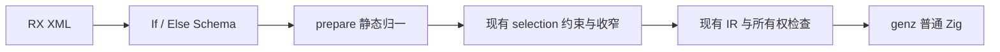
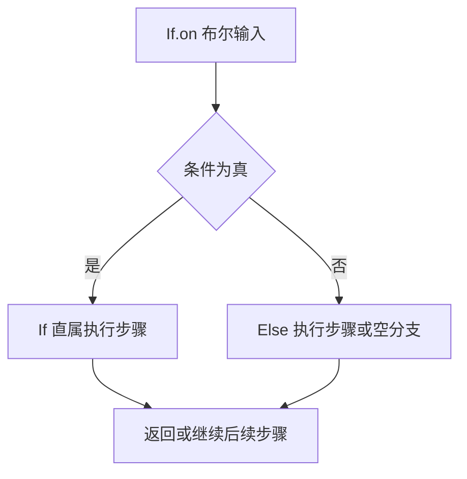

# 条件标签实施

## Intent：最终目标

实现 If.on 布尔条件与可选末尾 Else，简化正式源码中的二分 Switch 编排。
保留静态 Zig、作用域、返回、所有权、短路和无环约束；完整阶段验收后提交并推送。

## Data：可用证据

现有 Schema 使用 steps.children 递归识别执行步骤。prepare 将 Switch 变为
flow.selection；约束、空值收窄、返回完整性与 IR lowering 已统一处理 selection。
依赖扫描遍历所有 XML 子节点，不按运行时条件跳过分支。

## Edges：边界与限制

If.on 必须是花括号布尔表达式。If 内直接编排，不增加 Then。
Else 最多一次、位于末尾，并保留非空真分支。Else 不能独立出现。
复用 selection 的 true 与默认分支；省略 Else 时仅保留 true 分支，假路径继续执行，不承诺必定返回。
不增加运行库、动态分派、复制层或新的 IR 分支类型。
仅对实际开销变化验证受影响路径；等价语法迁移、格式和文档不跑性能比较。
不新增仓库测试，用既有回归和真实模块的公开入口验收。

## Answer：交付与成功标准

交付 Schema、原生及 RX/ZX 属性规则、静态分支适配、实际源码采用与应用指导。
核对嵌套、短路、返回路径、空值收窄、局部绑定、无环与非法标签/属性诊断。
已知基线失败单独记录，不把局部通过视为整体自举完成。

## 实施与验收记录

If / Else Schema 与 steps 递归解码已贯通，Else 不在普通步骤枚举中，不能独立使用。
原生种子与正式 RX/ZX 属性规则都将 If.on 归为 Expression；类型分析通过布尔标签约束条件。
prepare 归一为现有 selection，未新增 IR 操作或运行时代码路径。
有 Else 时生成默认分支，无 Else 时只生成 true 标签，沿用已有返回完整性判定。

正式源码共 100 个 RX 文件采用 If；false 标签对应取反条件，多值 Switch 保留。
应用指导、标签表、CLI 提示和嵌套条件的 lint 建议已更新。
格式化和 lint 的遍历本来支持任意嵌套标签，不添加额外标签白名单或重复检查逻辑。

### 取得的证据

- ReleaseSafe bootstrap 和正式 CLI 构建成功，最新 CLI 已原子安装到 zig-out/bin/zxc。
- 93 个文件的 true/default 或 true/false 等价迁移使用同一生成器、65 个入口比较，
  1530 个生成文件逐字节一致，仅排除源码指纹 .zxc-inputs。
  证据：/tmp/zxc-if/output-equivalence.json。后续 9 个 false 标签文件中有 2 个与前批重叠；
  这批使用取反条件，生成形式允许改变，未混入上述逐字节一致结论。
- 正式 lint/length/check.rx 编译并执行，maximum 为 null、0、2、1 时，
  两行文本分别返回 2、null、null、2；覆盖嵌套 If、Else、短路与非空收窄。
  证据：/tmp/zxc-if/runtime.json；没有新增仓库测试。
- 真实源码临时副本的引号条件、非布尔条件、前置/重复 Else、Then、缺失返回路径、
  Else 内自循环均被拒绝。循环诊断使用 acyclic 一词；临时核查脚本末尾对 cycle
  子串的断言过窄，已核对实际诊断，不把脚本断言失败报告成生产代码失败。
- 101 个变更的 RX/ZX 文件通过正式 fmt --check。
- 现有 RX 格式化 CLI 检查 52/52 通过，见 /tmp/zxc-if-formatting-tests.log。
- 编译器现有检查 365/372：6 项既有回调预期失败，加上此前已记录的间歇性
  style.format_test 分配失败检查。没有新增失败种类，不能称为全部通过。
  证据：/tmp/zxc-if-compiler-tests.log。

### 性能与自我复核

本阶段是静态语法归一和既有源码写法对齐，未改算法、缓存、装载或所有权处理。
按用户最新要求不做性能对比；生成形态等价证据直接复用，不重复计时或完整构建。
对 false 标签的取反保持一次求值与逻辑短路，不为取得字节一致而增加反向改写优化。

首轮命令行核查曾把工作区外临时源当作当前项目入口，被项目根校验拦截；
已改在真实临时目录执行，并核对具体诊断，而非只依赖退出码。
独立应用按 JSON 命令行参数调用，纠正了最初误用标准输入的核查命令。
这些核查工具修正不需要重建生产代码。

If Schema 和归一适配仍是原生边界，整体原生状态与规则迁移尚未完成。
本阶段只交付 If / Else，pipeline、静态 pick/omit、全局裸值清理及最终阶段自编译仍待继续。
