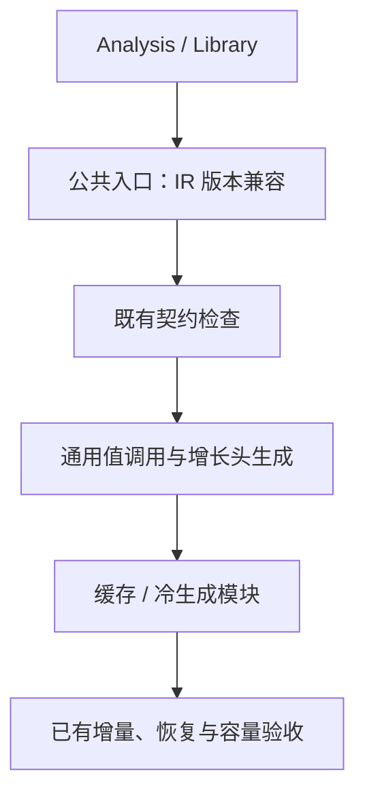
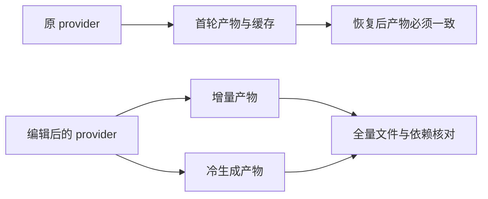

# 模块生成门禁与缓冲验收修复

## Intent：最终目标

解决已登记的四项模块生成失败，恢复可用的自举生成验收门禁。保留当前通用值调用及
容量传递设计；核对真实生成与资源行为，不以未提交原型的专用 ABI 作为成功标准。
阶段完成后英文规范提交并推送，继续剩余自举职责及资源检查发现的独立缺口。

## Data：可用证据

1919a7d9 阶段的 test-module-generation 重现三项 buffer_eligibility 与一项 invalid IR 门禁失败。
trusted 在 ReleaseSafe 跳过全部 IR 再校验，也漏掉便宜的版本兼容门禁。

缓冲用例仍断言 callBuffered 出现/消失；当前可达根 f570aa73 已没有该生产接口，
历史中也没有其删除提交。2026-10-05 的跨函数追加记录说明当时生产实现来自未提交工作区。
当前实际机制为通用值调用、唯一性证明与增长头，是否满足资源边界必须通过实际运行核对。

## Edges：边界与限制

- 版本兼容为公共模块/库生成入口的恒定成本前置检查，不恢复 ReleaseSafe 的整表重复校验。
- 仍复用已证明 Analysis/Library 的内部 IR 信任边界；不能据版本检查宣称校验任意字段篡改。
- 保留原 push→reverse、reverse→push、push→changed 三种转换及缓存/冷生成比较、重复复用和恢复。
- 新验收对应实际调用 ABI 与依赖源码；资源保证使用已有对象追加的线性容量、禁止 resize、旧值和 OOM 检查。
- 不新增仓库用例，不重引入专用调用 ABI，不为某个文件名或例子添加生产特例。
- 只改门禁与已失真的验收契约；若发现真实容量缺口，再修复其通用源头。

## Answer：交付与成功标准

交付版本门禁与按实际机制核对的既有验收。模块生成套件四项失败解决，
既有容量、错误、分配失败检查按实际覆盖范围记录，源码/缓存/fresh 产物一致。
独立的未实现优化继续登记，不通过修改那些资源预期把它们算作通过。
使用 compiler-performance 的证据原则；明显不改变有效产物或执行成本的门禁与断言修正不单独跑基准。

## 执行记录

已完成版本前置门禁与三项陈旧 ABI 验收的对齐。新增断言核对模块名称和依赖身份，
原有 provider 源码变化、增量/冷生成一致、重复命中及恢复检查全部保留。

### 实际生成依据

临时驱动直接调用生产 project.analyze 和 emitModulesCached，提取原三种 provider。
push、reverse、changed 的入口均为 17814 字节且逐字一致，真实循环调用使用通用 callValue。
push→reverse 改变 leaf 与 step 两个模块，push→changed 仅改变 leaf；模块名和依赖不变。
证据：/tmp/zxc-module-gates/inspection-results.json 与 results 下的实际源码。

因此，旧断言要求逆序操作切换必须改变入口、以及 callBuffered 出现/消失，
并非当前生成契约。新的断言要求入口与依赖身份保持稳定，真正的 provider 仍必须变化，
同时保留跨模块传播和缓存失效的完整比对；没有在生产代码按 Mode 或文件名添加分支。

### 模块生成门禁验收

ReleaseSafe 原始复验 21/23 通过，两项分配失败检查没有诊断输出；该首次结果保留在
module-generation.log，不能写成首轮全绿。
同一二进制、同一种子直接运行两组共 5 项检查均通过。
在其它构建结束后用 -j2 限制构建进程并发，完整目标 43/43 步骤成功：
18 项复用此前相同输入的成功结果，5 项重新执行通过，覆盖全部 23 项。
没有修改 OOM 检查、吞错误或放松内存释放断言，也没有根据后续通过断言已定位首次波动根因。

四项原始失败已经解决：3 项依赖过时专用 ABI 的断言与 1 项有效的版本门禁缺口。
版本不匹配在任何构建模式下直接返回 InvalidIr，不创建生成 Bundle；
已验证合法 IR 的整表重复校验策略保持原有边界。
日志：/tmp/zxc-module-gates/module-generation-final.log、resources-direct.log、
buffer-resources-direct.log。

### 扩大资源检查与真实剩余缺口

现有 test-object-append 的 13 种模式、source/library 两条路径：
114/121 构建步骤成功，242/254 项通过，12 项失败。
其中 call_push、call_concat、call_chain 的既有语义、线性分配、禁止 resize 与 OOM 检查通过。
失败集中于 foreign、dual、mixed：零轮或者某一路实际未写入时，结果仍要求保留原借用切片。
当前唯一性需求传播将潜在增长列表在进入循环时提前 renew，因此会做这次不必要复制。
这与废弃 ABI 的断言是两类问题，不能通过更换指针预期把它们一并消除。

为核对变更范围，用旧、新 bootstrap 对 13 种实际追加模块分别生成；
62/62 文件完全相同，不排除身份文件。这些生成规则没有被本次版本门禁修改。
报告：/tmp/zxc-module-gates/append-outputs-full.json。资源失败原始记录在 object-append.log。

后续独立职责为惰性归一化：在首个真实写入时取得增长缓冲，
保持零轮、未写入通道、旧值观察、输入借用、错误和分配失败语义，再做实际性能验收。
现有 12 项检查全部保留，不能将这项优化提前标为实现。
另已发现 function_analysis 构建仍引用不存在的 buffer_call/analysis/flow.zig，
对应原型摘要验收也需在后续完整回归中按当前通用机制对齐，不能用空兼容模块掩盖。

### 成本、自我批判与交付边界

本次生产改动只有统一入口的版本比较；合法程序的目标产物没有变化。
按照用户要求，不为该恒定门禁或测试契约修正单独运行性能计时。
bootstrap-stage 与使用该工具的 CLI 构建通过，没有新增仓库用例或专用运行库。

最初把三项旧断言统一称为生产优化缺口不准确；先核对当前调用协议和原始提交证据，
才能判断是实现缺口还是失真的验收。反过来，扩大检查出现真实提前复制后，
也不能因为部分单路容量检查通过，就宣称所有通道都满足零复制。

本阶段交付可用的模块生成门禁及对应验收。整体自举、全局裸值 lint 与惰性归一化仍未完成。
