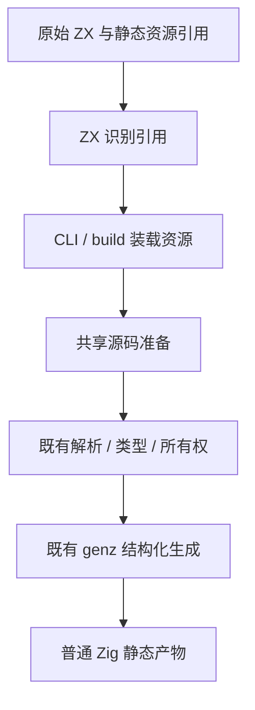
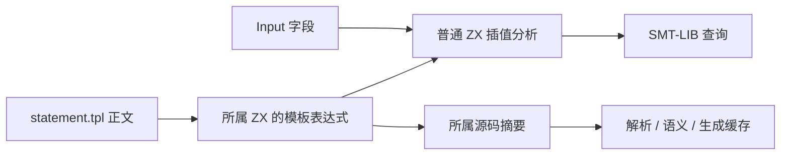

# 求解器模板资源实施

## Intent：最终目标

把 SMT-LIB 正文维护在 verification/query/statement.tpl。statement.zx 保留已有 Input/Output 与默认函数，使用 templateFile("./statement.tpl") 静态资源引用；模板插值继续走普通 ZX 解析、类型、所有权与生成路径。

## Data：可用证据

原 statement.zx 只有一条模板表达式，生成 Z3 查询而非 Zig。已有 lexer 保留字符串与模板边界，parse cache 和 semantic cache 按实际源码摘要失效，常驻生成器保留文件原文与摘要。尚无通用外部模板资源入口。

## Edges：边界与限制

- 只读取明确引用的 .tpl；路径为静态字符串，遵守项目/包身份与边界。
- 编译器库不读取文件，调用者提供资源正文；CLI/build 负责装载、watch 与依赖跟踪。
- .tpl 使用现有模板正文语法，保留换行和已有插值规则；不是 Zig 代码生成模板。
- 展开只发生在源码准备阶段，fmt 继续排版原始 ZX 引用，不能把正文写回源码。
- 每个宿主模块只因自身引用资源变化而改变语义缓存摘要。产物不需要运行时模板文件或解释器。
- 静态引用识别用 ZX 实现；源文件元数据封装、路径和 writer 适配器仍属于自举待迁移边界，不宣称完整自举。
- 不新增仓库测试；复用已有求解器检查、真实查询与编辑/恢复的冷暖产物对照。

## Answer：交付格式与成功标准

正文只有 .tpl 一份，原查询字节一致，普通 ZX/RX/API/build 均可消费静态资源，修改/恢复可靠失效，运行产物不读取 .tpl。验收与同输入性能检查通过后，英文规范提交并推送。文件单独存在或局部编译通过均不算交付。

## 执行与自检

statement.zx 已切换为 templateFile("./statement.tpl")，静态引用识别由 resources/scan.zx 承担。CLI 通过统一 Source.templates 提供真实资源，build 收集与跟踪 .tpl，prepareSources 在语义缓存查找前投影为既有模板表达式。资源正文不成为独立 ZX/RX 模块，也不修改原始文件。

原生求解器 seed 的手写模板已替换为从同一 RX/ZX 与 .tpl 生成的 bootstrap/query 快照；seed 只保留 executeValue 接口别名。快照通过正式模板入口重生成，和内联版本的查询 Zig、ABI 都逐字节一致，查询 Zig SHA-256 为 b3bf725dcd0ad20e1f638766e80b151fad38cce22388eee4ba2abf92b639feca。

初始 seed 构建带资源能力的 bootstrap 34/34，通过它生成正式 CLI 28/28。现有 Z3 CLI 20 场景、公开入口 8/8、枚举验证 74/74、RX/ZX 格式化 52/22、RX 格式化和验证资源释放 5/5 通过；生成的 query seed 回退路径另以同一既有验证资源检查 3/3 通过。

实际查询应用构建后删除 .tpl，程序仍可执行且输出字节等于模板展开。未知字段准确定位 statement.tpl:6:14；缺失文件与动态路径指向 statement.zx 的静态引用，fmt 在文件不存在时仍保持原始引用。

生成器修改模板 timeout 数值、暖生成与冷生成一致；恢复模板后的暖/冷及初始产物也完全一致。只有一个查询模块的 Zig 随正文变化。CLI 磁盘语义缓存独立核对命中、编辑失效、恢复和改用另一资源文件，各自产物与 --no-cache 一致。报告位于本目录被忽略的 template-cache-*.json，详细日志在 /tmp/zxc-tpl/。

同输入性能以冻结的 63 入口源码对比旧、新工具；因旧工具不认识 templateFile，公共性能输入对两者均使用相同的内联查询正文。外部模板的真实编译成本另与等价内联源码对照，不把这两类输入冒称字节相同。

剩余自举边界：路径标准化、资源集合封装、源码编辑和来源映射仍为手写宿主适配器。功能资源已静态编译，不代表这些适配职责已经自举，更不代表整个编译器完成自举。

资源装载收口时消除了两项重复工作：无静态引用的模块直接返回；有引用时复用已发现的引用，在模块首次解析前完成准备，不再对引用源码额外解析一次。token 描述符也改为连续数组，避免逐项分配。诊断报告读取原始源码位置，TPL 内错误继续使用资源位置。后续既有格式化/验证资源释放检查 8/8 通过，资源编辑/恢复及生成字节重新核对通过。

同输入的 RX、ZX、Store CLI 最终各 16 对测量均未检出稳定墙钟、CPU 或 RSS 退化；报告为 template-layout-optimized-summary.json。其余不受装载优化影响的冷/热生成与 fmt 证据复用前一轮。外部模板和内联正文是不同物理输入：优化后 200 次独立编译的平均额外墙钟约 7.6ms（每次约 0.038ms），仍有一个资源读取及静态识别成本；没有将该成本隐藏为“零编译成本”，也没有把不同输入混入相同输入的回归判定。最终查询程序及 ABI 字节保持，运行时不产生额外模板机制。
