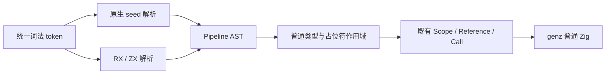
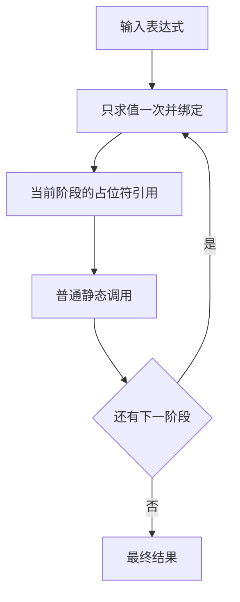

# 管道表达式实施

## Intent：最终目标

实现 `value -> function(_) -> other(argument, _)`，让原子计算组合更易读。
每级输入只求值一次，沿用普通函数类型、错误、副作用及所有权约束；完成阶段后提交推送。

## Data：可用证据

现有表达式解析分为原生 seed 与 RX/ZX 索引树，正式分析同样有两条路径。
IR 已有顺序 ScopeBinding、引用和静态 Call；普通导入已能为原生 tuple 参数逐项检查并构造 tuple。
formatter 使用统一 token 布局，不需要另建源码 printer。

## Edges：边界与限制

管道左结合，优先级低于普通二元运算、高于条件表达式。
阶段必须是调用；`_` 仅绑定当前阶段的输入，不进入回调、迭代、异步体或嵌套管道。
输入先按普通表达式求值，阶段结果类型沿用普通调用。占位符可复用，但不能绕过移动与借用规则。
多个实参仅在目标 Input 为 tuple 时静态组装，保持函数实际单 Input ABI。
不新增运行库、动态分派或 IR opcode，不把语法降低为仅限 loop 的 state_block。
不新增仓库测试；复用既有检查、真实源码与临时公开入口核查。

## Answer：交付与成功标准

贯通 token、双解析器、AST 适配、双分析器、静态 Scope/Call、格式化与既有源码采用。
核对一次求值、参数位置、作用域隔离、tuple 参数、错误及所有权；缓存恢复与冷生成一致。
仅在实际编译成本改变处验证受影响路径，等价写法迁移不重复计时。

## 实施与验收

## 实现结果

词法与原生 seed 均识别独立的 -> token，与 => 区分。原生 AST 和索引 ExprKind
保留 Pipeline；读取适配器与语法借用视图同步支持。管道低于普通二元运算、高于条件表达式，
各阶段左结合；分隔处重置 ?? / 逻辑运算的混用检查，括号边界仍生效。

原生与 RX/ZX 分析器各自用独立阶段上下文解析 `_`，不把它注册为可捕获的普通名称。
内层管道输入、回调、迭代与异步体不继承外层占位符。阶段必须是使用占位符的调用，
方法接收者也可使用占位符。普通 Input tuple 的多实参复用既有逐项检查与构造；
单实参保留完整 Input 契约，原生调用原有的参数数量诊断保持。

每级降低为既有 ScopeBinding、Reference 和 Call。借用判断复用既有局部绑定规则，
不新增 IR opcode、持久化编码或运行库。Scope 已由缓存与各后端支持。
RX 属性的计算边界同步拒绝 pipeline，不以新语法绕开 Call 或 Store 授权。

formatter 强制每个 -> 开始新的阶段行，并递归处理两侧 AST，继续使用统一 token 布局。
header/parse.zx 和 types/parse.zx 已实际采用；循环和 reduce 的内部算法职责保持。

### 正确性与运行证据

- ReleaseSafe bootstrap、正式 CLI 及初始原生 seed bootstrap-parser 构建成功。
  seed 与生成解析路径的 12 个安装入口文件一致，见 /tmp/zxc-pipeline/seed-equivalence.json。
  此项取得于后述 Context 成本调整前；成本调整没有改变原生语法与语义规则。
- 65 个真实入口、1574 个模块的生成通过。管道已用于编译器自身的解析算法，
  不是仅解析用户示例或新增入口包装。
- 复用实际 add.zx，输入 7 经两级调用得到 13；实际 tuple 接口接收多个实参，
  输入 3.5 得到 [true, 3.5]，保留单 Input ABI。
- process.readStdinText 读取 abc 后，在一个阶段引用两个 `_`，输出 abcabc；
  输入流若被重复读取将不满足此结果。上限不足时保留 StreamTooLong 错误。
- void 阶段写入 stderr，输出仅一次 pipeline；列表 concat 结果经占位符 pop，
  得到 [[1, 2], 3]。证据在 /tmp/zxc-pipeline/runtime/results.json 与 extra-results.json。
- 缺失占位符、非调用阶段、管道输入中的外层占位符、内层管道继承占位符、
  回调捕获占位符均拒绝；回调内部建立自己的管道可正常编译。
  最终 CLI 证据：/tmp/zxc-pipeline/context-rejections.json。
- 修改链条增加阶段后，增量结果与冷生成一致且确实改变；恢复后同时等于冷生成和原结果。
  最终 CLI 证据：/tmp/zxc-pipeline/context-cache-proof.json。
- 29 个变更 RX/ZX 文件通过格式检查；管道手动运行输入的格式化幂等。
  原有 RX 格式化检查 52/52 通过，没有新增仓库测试。
- 最终 compiler 回归 366/372：仅 6 项既有回调预期失败，分配失败检查本轮通过。
  见 /tmp/zxc-pipeline-context-tests.log；不能报告全部回归通过。

### 实现后优化与性能边界

初版把管道栈加入高频重建的 Frames。普通编译首轮五对样本墙钟中位数基本持平，
RSS 中位数较基线高约 7 MiB，但样本波动较大，不能直接认定原因。
源码层面的成本点是新增字段随普通 continuation 结构反复构造。

最终把栈移入原有遍历入口状态，命名为 Context；普通 Frames 保持原宽度。
入口恢复标记仍由同一上下文保存，遍历循环显式传递更新后的 Context；
仅管道进入、引用和退出改变阶段栈。不是把管道编码进不相关的 frame 字段。
调整后的同输入测量未检出稳定退化，不把两轮不同 RSS 基线直接相减当作优化收益。

最终对照固定旧输入 63 入口、1550 模块；两侧均为 ReleaseSafe 依赖与 small 根，
resident 关闭，五对交替执行。全部样本保留：

| 指标                 |       基线 |       最终 |
| -------------------- | ---------: | ---------: |
| 普通冷生成墙钟中位数 | 1374.87 ms | 1382.02 ms |
| CPU 中位数           |     8.90 s |     8.88 s |
| 峰值 RSS 中位数      | 387.94 MiB | 386.16 MiB |

成对墙钟差为 [3128.12, 12.16, -21.77, -4.07, 8.46] ms。
首个新可执行文件启动样本为 4541.80 ms，未删点；其额外时间主要在生成器报告阶段之外。
未进一步归因到具体系统服务，也不据此保证所有首次启动或规模场景均无退化。
初版首个新二进制也有高值，两个报告均保留在 /tmp/zxc-pipeline/performance 与 context-performance。
首轮测量开始时曾同时运行少量 CLI 诊断核查；最终轮没有并行构建或核查干扰。

最终 1515 个旧输入生成文件逐字节一致，仅排除 .zxc-inputs。
Context 调整前后，连续调用、tuple、标准输入复用、void 与列表这 5 个应用的
7 个实际生成文件完全一致，因此复用已经完成的运行证据，不重复后端编译应用。
最终 CLI 另行重验了占位符诊断与缓存恢复。
证据：/tmp/zxc-pipeline/context-performance/equivalence.json、context-runtime-equivalence.json。

### 自我复核与自举边界

最初的语法构造在一个条件表达式内部再放条件表达式，触发现有 lint；已把节点种类和
family 决策独立计算，未关闭检查。AST 新种类也补齐 RX 推导与 Store getter 的显式处理。

手动列表核查最初选择 clone，被既有禁止深复制规则拒绝，随后改用正式已有 concat/pop 组合。
对未使用 pop 结果的核查，不能预设原值再次读取必须失败：直接调用与管道都接受，
这与输入不可变和列表更新返回新结果的既有契约一致，未为符合错误预期改写所有权规则。

本阶段完善管道并在真实原子算法中采用。原生 parser、语义适配与项目状态仍有迁移债务；
上述产物一致不代表已消除手写核心依赖，也不代替完整 seed→stage1→stage2→stage3 验收。
后续继续静态 pick/omit、对象复用、裸值规则与剩余自举职责。
