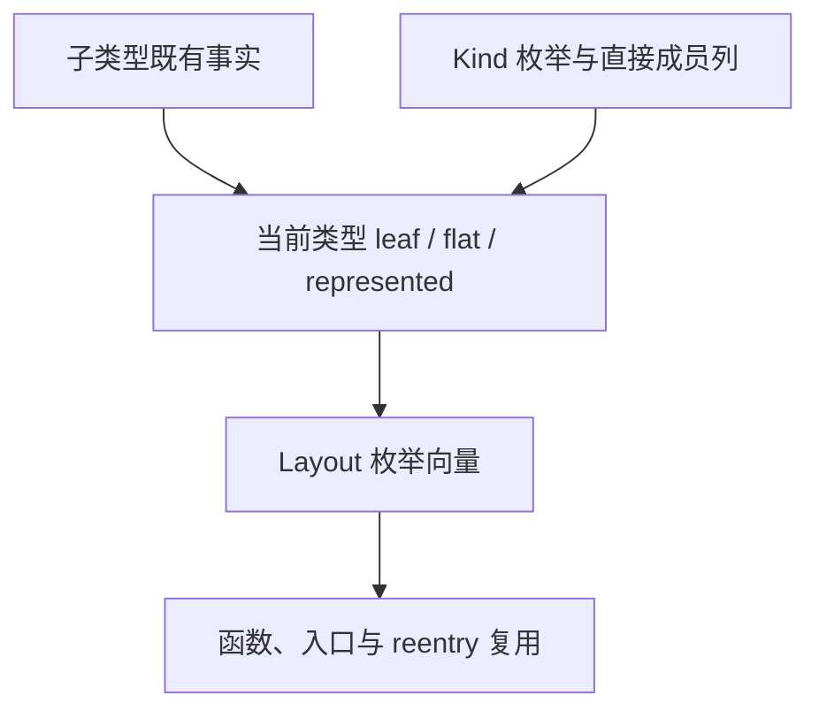

# 类型布局查询自举

## Intent：最终目标

将生成器正式发射路径中的 flat、aggregate、represented 类型规则迁入现有 RX/ZX
分析职责，leaf 作为 flat 的内部依赖一同迁移；supported 的正式 ZX 实现已经存在。
旧原生类型规则只留 seed 使用，保持所有输入的布局选择与生成产物不变。

## Data：可用证据

起点 694a981c。正式 native 查询消费者位于 iteration、scope、iteration_value；
inline_call/selection、identity_free、iteration_layout/seed 的旧查询均处于 seed 分支。
已核对 flat_product 不等价于 flat，list_supported 也不等价于旧 supported，不能误替换。
类型校验 row.zx、children.zx 与 seed_type_rules 均要求子 TypeId 小于父 TypeId，
因此合法 IR 可按 TypeId 顺序一次求出全部事实，不需每次查询递归或临时 arena。
低层 genz API 不执行完整 IR 校验，仍以既有合法 IR 前提工作；不新增宽松回退。

## Edges：边界与限制

- RX 在现有 facts 中真实连接类型事实计算，ZX 保留内聚的一次表遍历。
- 以一个 Layout 枚举向量表示 Other、Leaf、Product、FlatProduct、WrappedProduct
  五种合法组合。正式查询只匹配命名枚举，不新增位协议和常量桥；supported 的正式
  ZX 实现维持既有语义。类型标记使用 Kind 枚举。
- flat 允许列表叶子，拒绝对象叶子；represented 只穿过 optional；空产品 flat 为真，
  Task 各项为假，必须与旧规则逐项一致。
- Lower、函数变体、共享分析与 reentry 借用同一事实；拥有的分析只复制最终结果，
  不复制类型表。seed、错误闭包、其他代码生成和状态模型不计作本阶段已完成自举。
- 不新增用例；复用现有编译器/循环行为检查、全产物差分与固定输入性能门禁。

## Answer：交付与成功标准

交付 ZX 类型事实、RX 编排接线、只读查询与明确隔离的 seed 实现。固定输入新旧全产物
相同，阶段自编译一致，相关检查通过；性能无退化后英文规范提交并推送当前 master。

## 实现与首轮验证

新增 types/layout.zx，按合法 TypeId 顺序计算 leaf 工作列与 flat/aggregate/represented
结果三列；空产品、列表叶子、optional 和 Task 分支均保留旧语义。现有 facts RX
连接该原子算法并汇合输出；native 只借用类型列和复制结果，Lower 不再执行分类规则。
原生五项查询移动到 types_seed.zig，inline seed selection、seed expression safety 和
seed identity_free 显式指向它；正式 supported 继续使用既有 iteration/supported.zx。

只读审查确认 Owned 复制、scratch 释放前结果拥有、函数变体共享及 reentry 类型表
保持不变，未发现额外 query 分配、漏接正式调用或新的生命周期问题。首轮构建捕获
批量换签名时误改另一个同名 state_plan 查询，已局部修正，不改变该接口。

第一阶段与编译器检查为 23/23 步、372/372 项通过，日志
/tmp/zxc-type-layout/stage1.log。继续自编译与全产物/成本验收，不将局部通过作为交付。

## 事实表示收敛

首轮三列 bool 与旧工具排除工具身份后 1574/1574 全产物一致，冷/热不排除文件
1575/1575 一致；报告 artifact-comparison.json、cache-comparison.json。五组成本
耗时和 CPU 基本持平，RSS 的微小中位数差值落在原始单次分布内，未判定为稳定退化。

复核发现 flat 必然也是 aggregate 和 represented，因此三列只有五种合法组合。
现改用命名 Layout 枚举，leaf 也从同一向量读取，四个工作向量缩为一个。桥接器
直接使用生成接口暴露的枚举类型，不复制裸值或引入位协议；seed 仍走原生规则。
这一收敛减少实际向量分配和复制，并排除非法组合，不通过重测取幸运数字。

## 查询边界与公开 ZX 根贯通

枚举判定也属于编译器规则，因此新增单一 query.zx 原子谓词处理三个命名 Property，
由生成的纯函数执行；native 查询只读表并传递命名操作，不保留枚举语义分支。
该函数没有分配、运行库或动态装载，仍静态编译为普通 Zig。

将它注册为独立公开 ZX 入口后，真实引导复现了 shared project 遗漏公开 ZX 根的问题：
derive 只使用注册 RX 模块作为 additional_roots，独立公开的 ZX 没有被编译，最后以
通用 public module was not compiled 报错。修复为根集合并入 options.exports 的路径，
不按源码种类过滤，不使用额外 RX 包装规避；空 exports 与既有 RX 根保持原行为。

旧 stage0 本身包含这个漏洞，无法引导新的独立入口；使用带相同 native 修复的原始
seed 完成第一阶段。final-seed-stage1.log 为 41/41 步、372/372 项检查通过，证明
独立 ZX 公开入口已贯通。继续用该阶段构建后续阶段，不把原始 seed 算作最终实现。

## 静态查询表收口

最终动态查询候选与旧工具全产物仍一致，但五组热路径中位数为 532.660→538.743 ms，
CPU 2.22→2.23 s，不能提前宣称成本收口。报告 performance-final/summary.json。
其查询组合有限且谓词纯粹，改由 Zig comptime 反射两个生成枚举，执行生成的 ZX
谓词得到常量表。宿主不手写任何分类答案，运行发射只索引这份表，无动态谓词调用。

使用当前 Zig 0.17 的 field_names 与 backingInt 反射接口；编译期表版本已通过
23/23 步、372/372 检查，日志 comptime-stage2.log。继续正式成本与阶段验收，
不通过调整并行度、编译优化模式或排除产物消除差异。

进一步核对了阶段明细：动态查询候选首对热路径 infer 均为 360 ms，emit 为 98/99 ms，
write 为 30/37 ms；因此不能把总耗时差异直接归因为查询热点。编译期表是保证静态查询
零成本的结构收口，不作为已证实热点优化来宣传，也不围绕文件写出噪声反复改代码。

编译期表版本的五对报告 performance-comptime/summary.json：冷/热墙钟中位数
709.159→713.335 ms、540.743→540.067 ms；CPU 3.28→3.28 s、2.24→2.25 s；
RSS 364.234→364.047 MiB、326.484→325.344 MiB。infer 中位数冷均 367 ms，热
367→366 ms，emit 冷 202→204 ms、热 99→100 ms；整体处于样本波动和 CPU 计时粒度内，
没有观察到稳定退化。保留全部原始样本，不重复测量相同源码取更好数字。

## 最终验收与边界

- 最终表版本：372/372 编译器检查通过（comptime-stage2.log）。
- 现有对象归约、循环 call-origins、Task 输出检查：234/234 构建步骤、354/354 检查，
  Task CLI 32/32；runtime-acceptance.log。没有新增仓库用例或修改断言。
- 最终新旧生成产物排除工具身份后 1574/1574 一致，冷/热不排除任何文件，
  1575/1575 一致；comptime-artifact-comparison.json、comptime-cache-comparison.json。
- 原五组缓存检查全通过；额外使用真实 layout/query 源模块快照作为独立公开 ZX 根，
  常驻增根与干净生成一致，移除后与初次产物一致。仅在 /tmp 创建快照和新 manifest，
  原输入摘要已恢复核对。七组报告 cache-checks/summary.json。
- 第三阶段 16/16 步成功；第二/三阶段 1605/1605 约定产物一致，仅排除工具身份。
  stage3.log、stage-comparison.json。

自我批判：先用三列事实虽然直观，但相关状态可被一个语义枚举准确表达。合并后若
在 native 重新解释枚举，又会保留查询规则；已由 ZX 谓词与 Zig comptime 表消除这一
架构缺口。阶段计时也说明不能把写出波动误判为查询热点。本次不继续为微小测量噪声
扩大修改，只保留已证明的零成本查询与完整的正确性证据。

分类和查询语义已在 RX/ZX；native 仍有列借用、拥有结果、编译期调用和只读索引桥。
shared project 根装配仍是过渡实现，其他生成规则、状态模型与通用错误闭包也尚未
完成迁移/修复。本阶段完成不代表整体自举完成，goal 继续 active。

根目录 dist 26/26 步成功，正式 CLI 已更新为 `zig-out/bin/zxc`，日志 install.log。
本阶段按英文规范提交并推送既有 master，不创建分支。
