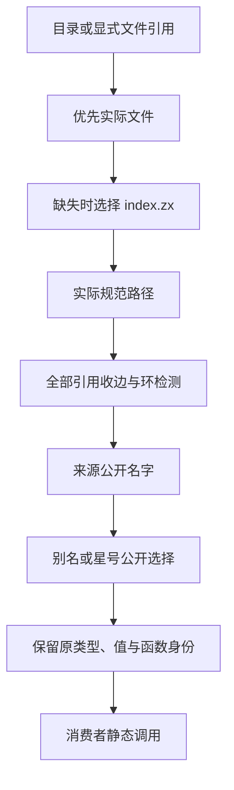
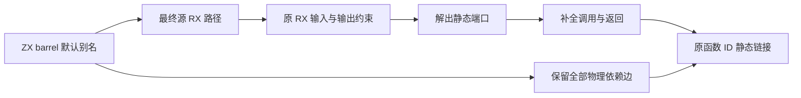

# 聚合导出与目录入口实施

## Intent：最终目标

支持以 index.zx 聚合公开类型、常量和函数；目录引用与显式 index 引用具有同一身份，所有引用和重导出均参与无环校验。聚合层只改变编译期名字与公开接口，不增加运行时转发、复制或动态模块。

## Data：可用证据

基线为已推送的 726152a4。当前 ZX import 只支持默认函数与无别名的命名类型/常量；ModuleRecord 和编译库保存默认函数、类型、常量，尚无命名函数公开表。原生与 RX/ZX 解析器共用 header 视图。ZX resolvePath 与 RX resolveFunction 均直接追加 .zx；CLI 物理读取与内存 source-set 分析分别调用，必须得到相同候选选择。普通 body loader 与混合 SourceGraph 已遍历全部 imports，包括未使用导入；signature 阶段跳过默认函数边，不能独立证明无环。

## Edges：边界与限制

- 复用现有模块公开接口与原类型/函数身份；支持显式重导出、别名和星号聚合。导入不自动公开，星号不隐式重导出默认函数；默认函数可通过显式命名重导出公开。
- 引用采用文件优先、目录 index.zx 其次的静态选择。物理 loader 与已注册 source-set 分析使用相同顺序；目录/index 变体在收边前归一。保留 ZX/RX 已有的引用语法、包边界和项目边界，不把模板资源改为目录模块。
- 所有重导出均为依赖边，不因未消费、类型引用或别名绕过环检测。公开名字冲突必须诊断，合法菱形依赖保持原身份。
- 贯通解析、格式化、绑定、公开签名、源码编译、编译库、缓存、CLI 装载及 watch；不以解析成功或局部接线代替整项功能。
- 不新增仓库测试、不调用浏览器。使用已有检查、实际源码产物、临时输入的公开 API/运行与缓存对照；基线二进制保存在 /tmp/zxc-barrel。保持先实现再优化，所有阶段完成后英文规范提交并推送，不新建分支。
- 新规则与集合算法优先在 RX/ZX 表达，既有 host 只完成必要的原生数据与文件系统边界适配；新增或保留的原生语义必须明确作为自举债务，不能宣称最终自举完成。

## Answer：交付格式与成功标准

重导出使用 TypeScript 风格的 export { Name as Alias } from、export type { Name } from 和 export * from；默认函数可写 export { default as calculate_total } from。命名 import 同时消费公开函数并支持别名。逐项验证类型、常量值及函数 ID 经多层聚合保持，冲突/直接环/间接环/目录别名环拒绝；增量修改与恢复等于冷生成；旧输入产物保持；仅针对解析、装载、签名或缓存的实际开销变化进行必要的同输入性能核对，不机械重复无关 CLI 或语法风格场景。

## 实现状态与证据

原生与 RX/ZX 解析器保留重导出、星号及原名字/别名，支持与普通声明交错。
绑定由 RX 组织初始约束、名字展开和选择，ZX 返回类型、常量、函数的来源索引；
签名不伪造函数 ID，实际编译使用原函数 ID。公开名字检查复用现有唯一性算法。

本地导入与重导出分别保存。ModuleRecord 的原声明供语义缓存保存，重导出接口从当前依赖重建；
依赖比较包含重导出标志及原名字。语义 artifact 协议升至 v5。编译库保留命名函数成员，
加载时同步映射函数 ID 与输入输出类型；旧编译库缺省为空成员表。

文件优先/index 其次的选择接入物理 loader、注册源码集合、RX Type/Call、混合图和 check-rx。
注册索引由结果 arena 持有，Options 只借用；该索引是派生查找结构，不参与配置 JSON。
显式目录路径支持点目录、父目录和末尾斜杠。缺失的优先候选仍进入 watch 输入。

公开 Zig 入口经 genz Builder/AST/printer 生成函数别名，相关函数保留普通调用 ABI 并进入公开根集合；
facade 缓存键包含公开名字及原函数模块路径。无命名成员的旧路径不构建额外的公开成员索引。
原生函数的默认重导出通过正常 IR Call/Return 入口表达，不能复制 external 的空函数体。

格式化按源码次序合并引用、类型与常量声明；排序不会跨声明移动引用，也不会覆盖声明间空行。
同组导入沿用原有排版，支持命名函数的 camelCase。应用指导同步到编码约定，未写入内部构建细节。

### 已取得的验证

- 实际采用：parser/imports/index.zx 汇总 advance、resume、State；外部解析阶段使用目录引用。
  采用后 bootstrap-stage 已成功，产物位于 /tmp/zxc-barrel/adopted-bootstrap。
- 正式 CLI 已编译实际目录消费者，并发布包含两个命名函数的库；重发布该编译库后仍保留成员及正确函数/类型映射。
- 实际公开接口的别名修改与恢复：缓存与冷生成的 13 个文件分别一致，证据为 /tmp/zxc-barrel/public-cache-check.json。
- 对真实源码副本使用星号：保留 6 个公开类型和 2 个字符串常量；加入经目录回引的依赖后拒绝循环，
  证据为 /tmp/zxc-barrel/wildcard-cycle-check.json。没有新增仓库测试。
- 既有 compiler 回归 365/372；6 个原有回调预期和 1 个已记录的分配失败检查仍失败。
  原先禁止从函数文件引入类型的旧预期已按用户要求更新为接口复用，复用原用例而非新增用例。

### 性能核对与最终验收

对照使用冻结的 63 入口、同一工具链、ReleaseSafe 依赖与 small bootstrap 根，关闭 resident generator。
基线及最终版本各 5 次冷生成；正常未修改缓存入口各 3 次。不同优化模式的早期数字不作前后结论。

最初的新增绑定把临时 arena 挂在长期结果 arena 上，又在释放前向长期结果复制，导致临时块按导入驻留。
最终由 SourceProject 复用绑定 scratch，每条绑定开始保留容量重置；mixed 复用已有 scratch 且不提前重置。
临时名字和签名视图不逃逸，返回名称、namespace、常量和诊断仍由结果持有；不为优化改变接口语义。

| 指标                  |       基线 |       最终 | 解释                             |
| --------------------- | ---------: | ---------: | -------------------------------- |
| 冷生成中位数          | 1380.74 ms | 1385.34 ms | +0.33%，小样本未显示稳定墙钟退化 |
| 冷生成 CPU 中位数     |     8.88 s |     8.92 s | +0.45%，不将其解释为普遍收益     |
| 未修改缓存中位数      |   29.21 ms |   29.44 ms | +0.23 ms，正常无修改入口         |
| 冷生成峰值 RSS 中位数 | 389.80 MiB | 369.31 MiB | 临时区复用后低于基线             |

全部原始样本保留，包括最终首次调用 2026.92ms 的高值；未删点或把首次调用成本解释成特性收益。
样本范围有限，不能由此声称所有规模与场景均无退化。计时和 RSS 分别保存在
/tmp/zxc-barrel/performance-summary.json 与 /tmp/zxc-barrel/scratch-performance-summary.json。
1515 个生成文件完全一致，仅排除编译器身份输入戳 .zxc-inputs，见 /tmp/zxc-barrel/scratch-output-equivalence.json。
语法写法、格式化及文档没有独立性能比较。

最终 ReleaseSafe bootstrap 与 CLI 均构建成功。目录入口发布、编译库重发布、别名修改/恢复与冷生成一致均通过。
公开函数 ABI 的 union 更新保存原 ID 后再切换标签，已实际复核该运行路径。
49 个本次变更的 RX/ZX 文件通过正式格式检查；编译器现有回归仍为 365/372，已知失败未扩大。
编译库现有检查另有一项空公开表在非 Debug 模式下未被拒绝，源于原有内部校验开关，
实际结果见 /tmp/zxc-barrel/library-checks.log，不能写成全绿。

本轮实现已提交并推送 41a99745（feat(compiler): support barrel exports and directory entrypoints）。
源 RX 默认重导出的未知端口已在下述后续贯通中闭合；没有填入占位 TypeId，也没有要求用户重复类型声明。
整体自举仍未完成，后续语言需求与原生职责迁移继续按清单推进。

### 自我复核与自举边界

验证期间发现并修复了 check-rx 目录函数识别漏检，以及 external 默认重导出可能丢失函数体的问题。
格式化的初版未完全保留同组多行导入的原规则，已修正，不靠批量重排无关源码掩盖差异。
目前仍有原生 Project 状态、ID/表适配和路径边界代码；这些是自举债务，
本阶段的聚合语义与静态产物不代表整体自举完成。Store 的授权边界沿用现有规则。

## 源 RX 默认重导出的后续贯通

本轮发现原来的后缀分流同时影响库发布和普通构建：ZX 聚合入口引用 RX 时，物理 loader 会提前拒绝，
并且混合分析的入口收口只接受 RX。已按统一模块边界联动修正并验收：

- 未解成员保存最终 RX 的规范路径，透传多层别名，不填入占位 TypeId。
- 调用端复用已有 RX 模块输入、输出约束；Module.fn 在端口解出后补全输入与返回步骤。
- 真实依赖图仍包含每个 barrel，实际链接仍从该节点取得函数，避免跳过环检测或丢失公开接口。
- 混合分析支持 ZX 入口；公开接口保留原函数 ID 和命名成员，公开路径不再冒充实现路径。
- CLI 的物理装载与图扫描共用 RX 引用遍历，队列按规范路径去重；原有纯 ZX 分析路径保留。
- 已用实际 modules/path/load.rx 经 index.zx 发布并构建 Module.fn 包装，运行得到相同的目录路径结果。

本轮新增的 Native 签名元数据和端口适配仍属于迁移债务，不代表该职责已经完成 RX/ZX 自举。

### 补充验证与边界修正

真实 parser/imports/advance 的复杂 State 与 Token[] 输入已通过生产函数 initial 产生；
原 ZX、ZX→RX 默认聚合入口及 Module.fn 包装的结果一致。默认与命名接口在编译库中共用函数 ID 6，
见 /tmp/zxc-rx-barrel/parser/proof.json，没有给聚合层增加实现函数。

现有 Store 发布输入经纯命名聚合后，仍有 advance/read/settings 三个成员以及 counter/settings 两项初值，
见 /tmp/zxc-rx-barrel/store/proof.json。筛选初始化对象时检查实际公开函数的 Store slots，不初始化无关对象。

公开路径与实现路径分离后，库的 Program 视图和验证诊断使用函数的实际源码路径；
公开路径仍必须是合法非空文本。原先要求两条路径相等的负例已更新为空路径拒绝，未增加仓库用例。

check-rx 的原 RX-only 图无法发现 RX→ZX barrel→RX 环；已补充完整混合图的结构校验。
签名检查只接受已注册的 RX 委托目标，原 RX 引用的 ZX 函数体仍被校验，不以签名成功替代函数体检查。

### 源 RX 后续阶段的收口结果

- ReleaseSafe bootstrap 与 CLI 均构建成功；当前代码的 compiler 回归为 366/372，仍有原先 6 个回调预期失败。
- 编译库 codec 现有检查通过。库链接现有检查仍有原先非 Debug 空公开表检查失败，不扩大为本阶段全绿结论。
- 生产 initial 产生的复杂 State/Token[] 经 direct、barrel 和 Module.fn 的输出一致；复用现有 nothing.rx 的 void 输入输出三条路径也一致。
- 将公开路径改为真实 barrel 路径、保留 RX 实现路径后，仅用 library.zxcir 的消费端运行成功且结果相同。
  证据：/tmp/zxc-rx-barrel/consumer/proof.json；生产者源码未复制到消费包。
- 合法 RX 实现从 advance 改为 resume，再恢复：缓存结果与对应冷生成一致，恢复后的 13 文件也与最初一致。
  证据：/tmp/zxc-rx-barrel/parser/cache-proof.json。
- check-rx 同时检查混合图与实际 RX 调用的 ZX 体；拒绝循环及错误底层返回类型。
  证据：/tmp/zxc-rx-barrel/parser/rejections.json。
- 新共享收集器替代旧 RX-only 引用遍历；规范路径队列去重，后续阶段复用已读取源码，避免重复读盘。

仅对实际改变的模块解析与装载路径测量：固定相同 63 入口、ReleaseSafe 配置、工具链，关闭 resident generator，
冷生成交替顺序各 5 次，正常 ZX/RX CLI 各 5 次。基线取上一阶段工具：

| 指标              |   上一阶段 |     本阶段 |
| ----------------- | ---------: | ---------: |
| 冷生成墙钟中位数  | 1379.01 ms | 1398.38 ms |
| 冷生成 CPU 中位数 |     8.89 s |     8.90 s |
| 峰值 RSS 中位数   | 386.45 MiB | 385.44 MiB |
| RX CLI 中位数     |   3.900 ms |   3.873 ms |
| ZX CLI 中位数     |   3.627 ms |   3.639 ms |

五个配对墙钟差为 -42.48、+27.24、-20.26、-3.25、+19.87ms，均差 -3.78ms；
不能仅由两个中位数相减判断稳定退化或收益。本轮未检出稳定退化，样本限制继续保留。
1515 个生成文件完全一致（仅排除编译器身份输入戳），见 /tmp/zxc-rx-barrel/output-equivalence.json；
原始计时见 /tmp/zxc-rx-barrel/performance.json。文档、排版与删除失效遍历代码没有额外性能比较。

本轮依旧使用原生签名/约束适配器，属于已明示的自举债务；本项功能交付不代表整个编译器已经自举完成。
