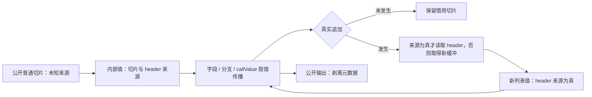
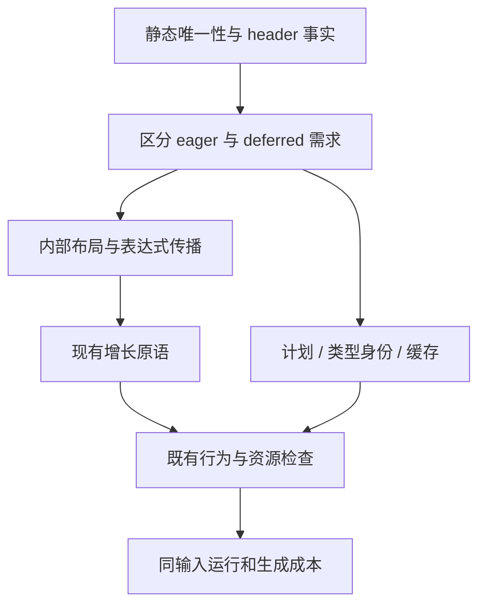

# 追加缓冲惰性归一化实施

## Intent：最终目标

解决 foreign、dual、mixed 的 12 项保留借用检查：零轮、空追加和未写入通道不复制输入，
在第一次真实追加时取得增长缓冲。保留旧值、输入、错误、分配失败和线性增长语义。
本阶段贯通后英文提交并推送，继续原有自举目标。

## Data：可用证据

cbd4ee82 基线：对象追加 242/254 项通过。uniqueness 的 headered/unique 是跨所有路径的
静态事实；carry 将潜在增长需求提升为循环入口 renew，导致尚未写入也复制。
state_value.origin 保存整个原 ABI 对象地址；只修改一条通道重建对象就会清空该地址，
不能用它代表每条列表的缓冲来源。

## Edges：边界与限制

- 每个内部列表值携带实际缓冲头来源；元数据按值传递，记录重建与分支逐字段继承。
- 不新增 callBuffered，不按用例、路径或固定函数名选择行为。公开/native/Store 边界仍为普通切片。
- 缓冲头来源只说明能否读取 header；元素覆写、retract 继续需要静态唯一性证明。
- Header-only 需求可以延迟；需要独立元素所有权的既有隔离仍按现有证明处理。
- 真正追加成功后才生成新状态；空 concat 保留原来源位，仍按顺序求值参数与错误。
- 复用现有结构化 genz AST 与普通 Zig/标准库；不使用源码模板或专用运行库。
- 布局、计划和来源事实进入类型身份、memo 和生成缓存，不恢复旧 eager 事实。
- 不新增仓库用例。现有 12 项检查保留，使用现有语义、容量、错误及 OOM 验收。

## Answer：交付与成功标准

交付通用内部来源表示、完整传播、增长生成与缓存联动；现有 254 项追加检查通过。
核对跨函数、重复别名、旧值及异步边界；实际成本按 compiler-performance 做同输入隔离对照。
按用户要求先贯通实现，出现退化后优化，不能撤回能力或放松保护来通过门禁。

## 执行记录

已完成来源表示、抽象域、正式生成、公开边界和缓存联动。最终验收及阶段构建见文末；
完整自举仍继续，不以本阶段完成代替传递依赖闭包。

### 已取得的实现证据

首次完整追加检查为 121/121 步、254/254 项通过，见
`/tmp/zxc-lazy-growth/object-append.log`。相对基线增加的 12 项借用检查全部通过；
没有修改既有用例或降低容量、错误、OOM 与输入保留标准。随后补齐公开 scalar 入口、
nested list 元素及 SIMD/consumer 边界，正在运行更广的相关目标，尚未作为最终验证。

内部列表按值携带 `items` 与 `headered`，每个新值独立传递来源事实；首次追加对未知来源
分配增长缓冲，已有缓冲才读取 header。`Level.deferred` 不授予唯一性，覆写仍使用原有证明。
公开 `executeValue` 保留原先聚合按值、列表切片的视图，内部 `callValue` 传递来源元数据；
普通公开 `Input` / `Output` ABI 保持切片与指针记录。未知原生、Store 与数组元素边界降为未知来源。

正式 RX/ZX 的 state/value 分析与 seed 实现同步，类型身份前缀、uniqueness memo 与生成缓存
版本均更新；仍需完成磁盘/常驻缓存的同输入冷、热及编辑恢复核对。

### 相关旧失败的复现

扩大检查发现的元素覆写循环问题由修改前的 `/tmp/zxc-lazy-growth/before-cli` 复现：
flat、branch、switch、direct、nested、tuple、two_fields 失败，四组 stale 通过。
完整原检查输出在 `/tmp/zxc-lazy-growth/baseline-iterate/`。这不是本阶段追加借用失败的替代验收，
后续仍须解决按需覆写及固定容量需求。

初始值所有权的 8 个形态门禁也由旧工具生成产物复现：5 个 MissingOwnedInitialTransfer、
3 个 MissingSharedInitialCopy，见 `/tmp/zxc-lazy-growth/baseline-shape/summary.json`。
它们扫描公开 execute 中的 constCast/dupe；尚未把生成形态断言等同于实际所有权结论。

原有 reverse capacity 检查由旧工具复现同一数值：2048 个 i64 的 payload 为 16384 字节，
累计分配 79096 字节、arena capacity 79024 字节，见
`/tmp/zxc-lazy-growth/baseline-reverse/check.log`。utils.map 降为通用追加循环后的预分配优化
仍需单独处理，不得通过放宽 `< payload * 2` 的检查掩盖。

### 扩大检查暴露的问题与修正

第一批扩大检查中，数组对象元素被循环消费器直接投影为原 ABI 切片，而 `callValue` 需要内部
列表表示；普通 Lower 已有转换，优化消费路径遗漏。多项 safety 变体重复出现同一类型错误后，
停止了该批构建，保留 `/tmp/zxc-lazy-growth/regressions-before-consumer-fix.log`。
修复 `.index` 的 ABI 元素转换，以及非 represented 父对象的 `.field/.tuple_field` 转换；
不能只在 return 包一层，否则中间长度和索引读取仍不一致。相关四目标正在重新验收。

自我复核也发现，给物理 Renewal 加 `lazy` 再在生成时跳过，会增加计划复制时遗漏字段的风险。
改为在最终 renewal 列表只输出确实需要唯一副本的记录；内部 header demand、deferred 事实仍保留，
追加 Flags 继续使用它们。没有为内部接线单独提交，也没有新增转发 ABI。

函数覆写的 mixed、duplicate 容量检查由旧工具原夹具复现，见
`/tmp/zxc-lazy-growth/baseline-updates/`。mixed 为静默的 TestUnexpectedResult，duplicate
先触发原有指针保留断言；不能将“failed without output”直接解释为进程崩溃或环境资源不足。
缓存资源检查中的同类输出仍需原二进制隔离运行后判断。

### 性能收口与状态规范化

首轮五组交错实测发现冷生成退化，未交付：1595.873→1671.488 ms（+4.74%），
CPU 10.19→10.92 s；热缓存 799.831→741.244 ms。随后减少 scalar 的无效转换、
直接投影编译器创建的列表包装，以及给同形的公开视图建立类型别名。生成 Zig 总量
21,753,498→19,301,909 字节，但冷生成仍约 +5%，因此没有以源码变小代替性能验收。

采样首次遇到 ReleaseSmall 符号不足，临时仅为 bootstrap root 保留符号，采样后已逐字恢复
`packages/compiler/build.zig`。有效符号采样集中在唯一性不动点（root.zig settle/demand）；
此前 settled memo 记录从 8765 增至 10322。已知 header 时还传播 deferred 是冗余状态。
规范化为 H=true 时 D=false，合并 header 与未知路径时为动态来源 D=true；H/U 仍只做 AND，
不借 D 授予 header 或唯一性。分析程序身份升为 v10，隔离旧分析语义。

最终候选五组交错对照，同一份 66 入口、1653 个源文件快照，正式 generator 路径、
ReleaseSafe 宿主及 ReleaseSmall root、关闭常驻服务，测量期间没有编译任务：

| 场景                 |      原工具 |        候选 |    变化 |
| -------------------- | ----------: | ----------: | ------: |
| 冷生成墙钟中位数     | 1588.102 ms | 1182.674 ms | -25.53% |
| 冷生成 CPU           |     10.17 s |      7.26 s | -28.61% |
| 磁盘热缓存墙钟中位数 |  793.110 ms |  674.194 ms | -14.99% |
| 磁盘热缓存 CPU       |      4.21 s |      3.55 s | -15.68% |

配对峰值 RSS 中位数约 400 MiB，差异约 0.42%；复用三批有效原工具数据（输入、工具链、
二进制不变），原工具冷场景范围约 390–521 MiB、候选 400–472 MiB，热场景范围也重叠。
不把单次 RSS 离群点当成确定的内存收益或退化。候选 settled 记录降为 6004，memo 文件
6,217,448→3,254,613 字节。计时报告在 `/tmp/zxc-lazy-growth/performance-settled/`；
符号采样在 `/tmp/zxc-lazy-growth/profile-symbols-2/`。后续并发许可修复后还须复核最终工具。

### 完整产物与模块边界

磁盘热缓存、常驻首次与无修改、常驻语义编辑对同输入冷生成、恢复原文对首次生成，
五组比较均为 1575/1575 文件完全一致，未排除任何文件。语义编辑为 frozen 快照中所属职责
const.zx 的身份字符串 v2→v3→v2，真实仓库源码未改动；独立启动的常驻进程已结束。
报告在 `/tmp/zxc-lazy-growth/cache-checks/`。

正式分文件生成复用 foreign、dual、mixed 原检查，为 3+3+4=10 项通过，含借用、线性分配、
OOM 和同 arena 恢复。再通过既有 effects_nested_add 的 40 项原生调用顺序、嵌套对象、错误与
分配失败检查。临时驱动最初使用了越界相对路径并漏接 generated 的 probe import；已仅修正
临时组装并复跑未验证部分，未修改产品代码迁就驱动。

### 串行路径的分配次数漂移

候选三目标为 425/427，通过的追加检查仍为 254/254。资源检查原二进制同种子单独 2/2 通过；
50 项 cached ownership 单独运行时，失败从 duplicate_path 移到 none，明确为
`NondeterministicMemoryUsage`，不能忽略或仅反复复跑以求绿。

已定位：公开串行 analyzeFrom 未将 concurrent=false 传给底层唯一性 Pool。Ahead 可把当前 body
排入后台；queued 时取消并在主线程使用传入 workspace，running/ready 时采用后台 smp scratch。
仅 entry 的 tuples 也会随调度少一次或多一次 round arena 首块分配，破坏失败注入的确定性。
修复沿现有显式并发许可贯通：串行 Pool 单 worker、零后台线程；Concurrent 保留原预取。
未识别失败分配器、未改 allocator、未改测试或放宽检查。修复后的完整验收为
175/175 步、427/427 项通过，见 `/tmp/zxc-lazy-growth/serial-final-acceptance.log`。

### 最终版本验收

- `test-object-append`、`test-cached-ownership`、`test-module-generation` 合计 427/427 项通过；
  原来 foreign / dual / mixed 的 12 项失败全部解决。源码与编译库追加合计 254 项。
- 最终 bootstrap 与使用它生成的下一阶段 bootstrap，均为 16/16 构建步骤通过。
- 再由最终下一阶段工具构建 CLI，28/28 步通过（含 Quote 零分配检查）；日志为
  `/tmp/zxc-lazy-growth/final-cli.log`，可执行文件已原子安装到 `zig-out/bin/zxc`。
- 两阶段全部 1575 个文件先作无排除比较，唯一差异为 `.zxc-inputs`。已核对它由
  generator digest 和相同输入共同计算；精确排除此身份摘要后，1574/1574 文件一致，
  包含全部 1573 个 Zig 文件与文件清单。未忽略任何 Zig 或清单差异。
- 最终工具与先前完成模块边界、常驻编辑检查的 settled 工具产物也仅身份摘要不同，
  其余 1574 个文件一致，因此复用上述 10+40 项运行及五场景缓存证据。
- 最终工具磁盘冷、热生成不排除文件，1575/1575 完全一致。

阶段对照报告在 `/tmp/zxc-lazy-growth/final-stage-checks/`。正式生成产物一致仅证明本阶段
确定性，不证明全部自有分析规则、状态和传递原生依赖已经自举完成。

并发许可修复后的最终工具重新五组交错测量，输入快照与工具链均相同，无并行构建干扰：

| 场景                 |      原工具 |    最终工具 |    变化 |
| -------------------- | ----------: | ----------: | ------: |
| 冷生成墙钟中位数     | 1603.599 ms | 1195.851 ms | -25.43% |
| 冷生成 CPU           |     10.20 s |      7.29 s | -28.53% |
| 磁盘热缓存墙钟中位数 |  792.256 ms |  675.918 ms | -14.68% |
| 磁盘热缓存 CPU       |      4.21 s |      3.57 s | -15.20% |

最终配对峰值 RSS：冷场景 396.42→400.30 MiB（+0.98%），热场景
396.88→403.30 MiB（+1.62%）。冷样本范围 391.17–407.81 与 393.84–406.81 MiB，
热样本范围 391.95–459.84 与 388.86–407.23 MiB 均重叠；未观察到超出当前测量波动的
稳定内存变化，不宣称内存改善。完整报告在 `/tmp/zxc-lazy-growth/performance-final/`。

### 自我复核与后续边界

本次引入的是编译器静态生成的普通字段与分支，来源元数据不授予唯一性，公开 ABI 不携带它，
没有专用运行库、动态调度或未经证明的 header 读取。真实追加才分配，空 concat 仍求值参数。
首轮冷生成退化后保留功能并优化状态规范化，未撤回实现或放宽检查。

本阶段解决追加借用与串行分析的分配确定性，不宣称已解决既有元素覆写别名、reverse 容量、
初始所有权形态门禁。后续须继续这些完整职责及 RX/ZX 规则迁移，并完成最终传递依赖审计。
