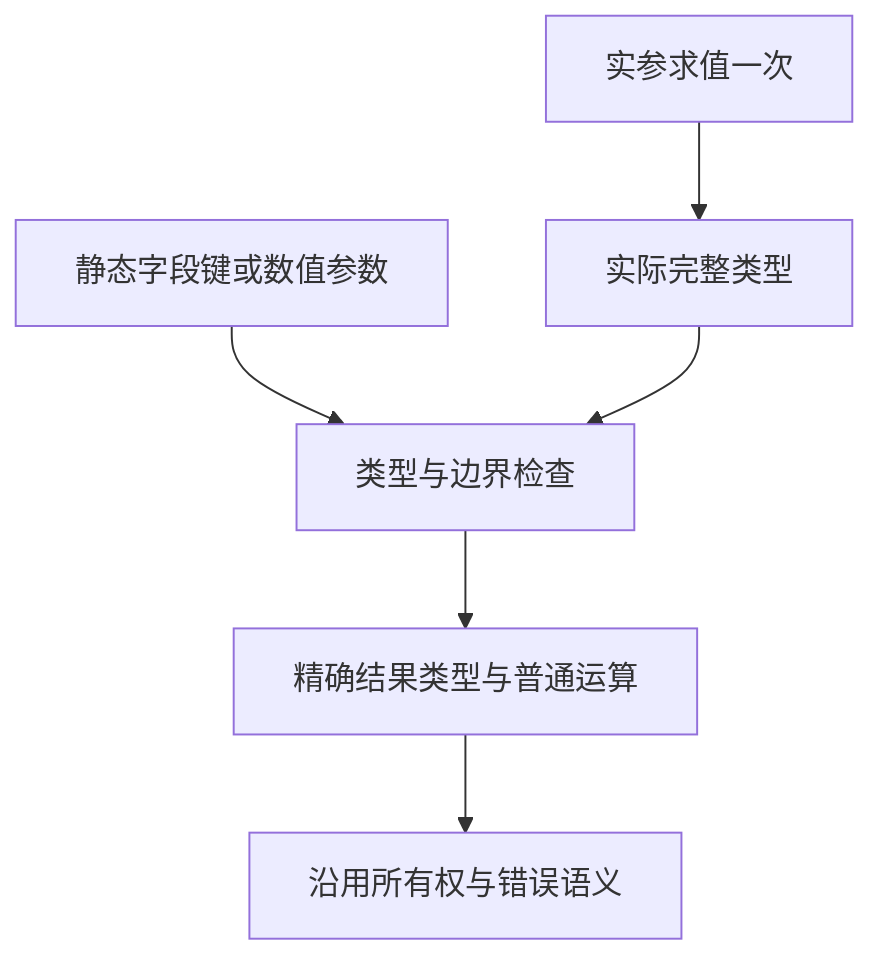

# 通用工具包实施

## Intent：最终目标

新增普通源码包 `utils`，从 `index.zx` 聚合导出常用工具。`pick/omit` 对任意完整对象类型可用，
保留字段类型与一次求值，不要求重复声明每种对象的接口。

## Data：可用证据

现有对象方法已经静态降低为 Object / Field / Scope。普通导入、别名和 barrel 已可复用，
但函数绑定只保存具体 FunctionId、Input 和 Output，无法表示按实参类型确定结果的静态操作。
ZX 当前也没有普通泛型函数或可传递的 callable 类型。

## Edges：边界与限制

用显式的编译期操作身份贯通导入、重导出、缓存和库；不得按局部名称、文件路径或空对象签名猜测。
普通函数与编译期操作的元数据严格互斥；静态操作的键与调度不进入运行时。
复用既有 IR、所有权和结构化 printer，不添加 utils 专用运行库。
保留现有 RX 静态对象组装语法，RX 普通属性仍不能执行任意函数。

本轮常用集合为 pick、omit、identity、isNil、isNotNil、head、last、take、takeRight、drop、
dropRight、sum、min、max、clamp、inRange、map、reduce。对象键保持静态，数组元素类型原样保留，
数值工具按调用处的实际数值类型检查，不将所有整数转成浮点数。
暂不承诺 JavaScript 对象原型、动态键、truthy 转换、动态函数调度或 es-toolkit 全量兼容。
不新增仓库测试。等价语法调整不做性能计时；新增分析路径只针对实际成本变化验收。

## Answer：交付与成功标准

交付 utils 包、真实导入绑定、静态降低、缓存与库元数据、公开使用说明。
以已有回归、临时真实应用的运行与拒绝行为，以及旧源码产物一致性核查验收。
阶段完整后英文 conventional commit 并推送；后续仍继续全局常量约束与自举。

## 实施记录

静态身份、源码与编译库消费已贯通；按用户后续明确修正，统一 loop 原语与 utils 语法糖。

### 最新语言边界

用户明确：map/reduce 已从语言中移除，统一使用 loop；utils 可以导出 map/reduce，作为 loop 的语法糖。
语言层拒绝对象 `.map/.reduce` 方法，导入的 `map(array, inline_callback)` 与
`reduce(array, inline_callback[, initial])` 按真实导入身份静态降低为既有 iteration。
支持别名与重导出，lambda 不成为普通运行时值；读取外层数据沿用 loop 的只读上下文规则。

生产四根 53 个文件的 85 处方法调用已迁移。夹具采用同样的 AST/token 编辑，
保留接收者括号和注释，按嵌套顺序插入调用，随后重新解析和格式化。
18 个已有 ZX 生成入口同时更新，避免只修改产物。arrow 的 LF/CR/CRLF 专项保留原始换行，
不以格式化抹去其测试对象。TypeScript 自身的数组方法保持原有语义。

### 先前验收判断的纠正

曾仅根据现有实现与历史集合用例，将六项失败归为过时预期，并得到一次 372/372。
用户随后重申已移除语言方法，这次全绿不能作为新语言标准的最终证据。
已撤回那批直接放行旧方法的修改，按显式 utils 导入和 loop 重新迁移、验收。
保留对真正超限参数、非法函数值、作用域隔离与所有权的检查。

另一个分配失败检查报告 NondeterministicMemoryUsage；沿用仓库现有回归的 noResize / noRemap
allocator 配置，穷举确定的分配失败路径，没有跳过释放检查。该变化不影响生产实现，不做性能计时。

### 迁移工具复核

TypeScript AST 的位置采用 UTF-16 code unit；最初用 Python 字符位置应用编辑，
在三个含非 BMP 字符的生成器中导致偏移。生成器语法检查立即拦截，已从原始副本恢复，
改用 JavaScript 原生位置应用编辑，并重新生成对应产物。编译器没有为工具问题加入特殊处理。

### 已有证据与待收口

前 16 项工具在源码包与编译库消费路径各通过六组真实输入，包括空数组、大计数和反向区间。
一次求值与错误保留的七项运行检查通过，三参数副作用顺序为 ABC。
十项导入、字段与参数诊断检查通过；临时应用和报告位于 /tmp/zxc-utils。
新增 map/reduce 的运行已验证索引、来源、只读上下文，以及带初值与不带初值的归约。
这些证据不替代关闭旧方法后的最终回归；当前正在补齐该轮验收。

### 最终接口复核

模块产物原先只保存私有导入，没有公开函数重导出。现增加独立 members，
从真实 record.reexports.functions 提取，拥有名称并映射具体函数的 ID/类型；
静态工具保留操作身份。两条提取路径及缓存 codec 同步处理。
链接按提供者公开名、消费处别名与真实操作身份核对，私有导入不会冒充公开接口。

临时真实项目覆盖 named、export *、默认重导出，经模块提取、缓存编解码和重新链接均通过；
将公开 Map 身份篡改为 Reduce 时返回 ConflictingInterface。
证据：/tmp/zxc-utils/artifact-proof/results.json。

关闭旧方法后的编译器既有检查 372/372 通过，正式 bootstrap-stage 与 CLI 构建通过。
前端目录 6693/6693 通过。迁移了内嵌在 list_range JSONL 中的 26 个源码用例，
没有更改原有诊断预期。模块产物、链接边界和初值归约检查通过；
显式上下文检查保持来源→上下文→回调的求值顺序，忽略的非 void 结果仍用绑定接住。
18 个生成入口检查通过，另修复 reduce_trace 模板片段遗漏并重新生成、核对。
TypeScript typecheck 通过。没有新增仓库用例。

源码包与编译库均实际运行 map/reduce，得到映射 [11,12,13]、带初值归约 16、
无初值归约 6，索引和来源数组引用正确。旧 .map/.reduce 两项真实调用均被明确拒绝。

### 自我复核与剩余边界

六项旧失败不能仅以“现有实现支持”判为过时，应优先核对用户原话及后续修正。
本轮已按语言 loop 与 utils 语法糖的明确边界收口，不以绿色旧用例代替需求验收。

utils 只有当前列出的 18 个工具，不承诺 es-toolkit 全量兼容。
此次不把自举目标标为完成：编译器的过渡适配、状态模型与原生传递依赖仍按
自举完成标准继续迁移，全局语义裸值清理与 lint 仍由既有清单跟踪。

### 成本与产物核对

使用 compiler-performance skill。新增静态绑定路径的第一轮固定输入对照，
1515 个生成文件全部一致；三组墙钟中位数变化约 +0.46%，未检出稳定退化。
这轮证据只代表前 16 项工具的绑定与降低路径，不冒充最终版本。

最终公开成员元数据改动另用冻结的四个源根、65 个入口验证。先分别预热，
随后关闭 resident、隔离其它构建，交替执行三组相同输入的生成：
修改前 1628.9 / 1589.4 / 1594.0ms，修改后 1595.4 / 1599.6 / 1574.5ms；
中位数 1594.0→1595.4ms，约 +0.09%，单组方向不一致，未检出稳定墙钟退化。
1566 个生成文件逐字节一致，仅排除记录生成上下文的 .zxc-inputs。
峰值 RSS（MiB）修改前为 400.98 / 403.02 / 391.62，修改后为
397.11 / 466.50 / 404.86；中位数约 +0.97%，包含一次较大波动，
这些样本不足以把单次 RSS 峰值认定为稳定内存退化或内存改善。
原始报告与产物比较：/tmp/zxc-utils/final-cost/isolated。

此前与检查构建重叠的探测没有隔离条件，不用于性能结论。
map/reduce 调用语法迁移、格式化和测试源码修正没有单独做性能计时。

归约 trace 的 source / library 路径现有运行检查通过，包括带初值 126 项与
无初值 78 项，以及求值顺序、错误和回调次数。
