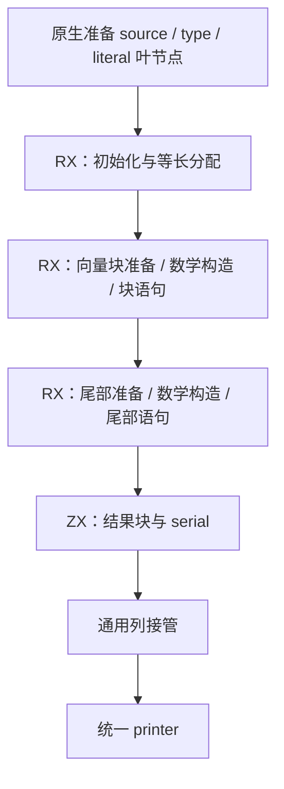
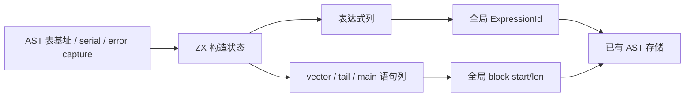

# SIMD 循环结构构造自举

## Intent：最终目标

将完整 SIMD 分块、标量尾部、局部绑定、块结果与名称推进规则迁入 RX/ZX，继续复用
既有 AST 列协议和通用导入器。原生只准备外部叶节点和接管结果。完整功能贯通并
集中验收后英文提交推送 master，不把构造原语内部接线拆成独立交付。

## Data：可用证据

起点 884ee215。资格、计划及数学表达式构造已自举；root.emit 仍原生创建循环。
aggregate.bind 使用 operand 名称，fresh 先递增 serial；finish 生成 block 标签。
fallible call 在 capture 存在时生成 catch_value，不能一概替换为 try。

## Edges：边界与限制

- source 只执行一次，等长分配，平台 suggestVectorLength 的缺省宽度为 1。
- 维持数学树、向量/尾部语义、unused element 的下划线捕获、错误捕获及 serial 次序。
- 所有外部 AST 准备完成后才读取 base，之后不得插入原生节点。两遍 literal 准备
  保持原有 cache read 次数；literal 不推进 fresh serial。
- 语句按 vector/tail/main 分块导入，ZX 设置全局 block range；不复制整个旧 AST，
  不通过重排语句表改变打印的执行顺序。
- 构造只用 AST 节点与统一 printer，禁止源码模板、RawCode 和专用运行库。
- 不新增测试，复用阶段自编译、既有 SIMD/捕获行为、冻结输入和缓存对照；先实现
  再依据真实成本优化，不能用撤回迁移或放宽安全边界解决退化。

## Answer：交付与成功标准

交付 RX 的初始化、分块、尾部与结果流程，ZX 节点/语句构造及命名逻辑，通用导入
两类列的真实消费者。前后完整产物、现有行为与缓存一致；报告实际 CPU/RSS/耗时。
仍保留的通用叶节点和宿主内存适配明确列出，不能宣称全 compiler 自举完成。

## 实现与职责核对

emit/build.rx 显示 source 绑定、分配、宽度、块数、vector、tail 和结果阶段；vector.rx
和 tail.rx 显示准备→复用数学构造→块语句。ZX 处理各阶段的原子节点构造与数据
组装，不存在承载全部流程的单一 ZX 总控。AST 表达式投影扩展到本职责所需列，
新增语句投影与 binding/assignment/for/break 构造，均复用 printer 的枚举和列名。

fresh 用既有 printer/text/integer 的数字算法生成字节名。给定准备后的 serial=s，
source/result/width/chunks 是 operand_(s+1..4)，随后 chunk_(s+5)、offset 的
operand_(s+6)、tail 的 operand_(s+7)、index_(s+8)、element_(s+9)、block_(s+10)。
broadcast 仍推进 element 名；语义字符串和最小向量宽度集中在本职责 const.zx。

语句片段按 vector、tail、main 顺序输出，body start/len 从实际列长度计算。当前
语义为 2/1/8 条，但没有将这些数量写进构造逻辑。finish 追加 BreakValue，再用
同一 label 构造 Block。source 先绑定一次，再分配等长结果；保留 comptime 宽度、
目标建议宽度 orelse 1、双层 slice+deref、向量 cast 及标量尾部。

fallible.zx 保留 TryValue/CatchValue 的分支，capture 的 name/label/failure 均传递，
最终输出 uses_allocator 供宿主合并。原生 emission 只准备通用 source/list 表示、
type 和两遍 literal，随后捕获 base/serial 并调用生成入口，使用通用 importer 接管
表达式及三段语句，不再创建循环节点。旧独立 simd_expression 桥与注册已移除，
数学构造直接作为 ZX 调用复用；seed 的原始循环发射保留用于最初引导。

## 阶段、行为与完整产物

首次源码 seed 构建即通过：build-stage1.log 为 41/41 步、372/372 既有检查；
stage2/stage3 各 16/16 步成功。stage-fixed-point.json 中 1701/1701 约定
阶段产物一致，仅排除工具身份 .zxc-inputs。根目录 dist 26/26 步成功，CLI 已更新。

现有 SIMD safe 驱动 378/378 外层调用通过：Node f32/f64 的特殊值与尾部，WASM
baseline/simd128 的结果与汇编，以及整数/filter/reduce/嵌套回退；记录
simd-semantics-safe.log。没有新增或修改测试、断言和目标配置。

f32、f64、fallback 三份真实 CLI Zig 输出与 884ee215 有效基线逐字相同，各为
45676、45676、57682 字节，包含 fresh 名、完整循环及尾部。前版本的源码/工具链
未变，复用基线；新侧禁用缓存生成。保留 fixtures-before/after 与完整比较报告。

## 成本与缓存证据

全部构建终止后，使用冻结源码、相同工具链/target/ReleaseSmall/resident=0，做
五对交替冷/热测量，前后核对输入 digest，不重测同版本挑中位数。

编译器大输入冷墙钟中位数 704.840→690.664 ms，热 539.693→538.490 ms；CPU
冷 3.29→3.26 s、热 2.24→2.22 s；峰值 RSS 冷 364.219→364.719 MiB，热
326.203→326.547 MiB。infer 冷 363→363 ms、热 363→361 ms；emit 冷
204→204 ms、热 101→100 ms；write 冷 38→37 ms、热 38→40 ms。

实际 SIMD 三夹具冷墙钟 9.656→9.966 ms（+3.21%），热 8.680→8.691 ms；
冷 RSS 15.594→15.609 MiB、热 13.047→13.094 MiB。CPU 低于采样分辨率，
infer/emit/write 整数毫秒中位数两侧均为冷 3/1/0、热 3/0/0。新侧一份冷样本
14.108 ms 保留在原始数据，没有删除。小输入增加约 0.31 ms 的观测不能隐去，也
不能用大输入更快来证明它没有额外计算开销；后续继续定位可重复的构造/命名/复制
成本，不能把当前数据解释为所有场景严格零退化。

十对大输入产物各 1574/1574 相同，十对 SIMD 产物各 12/12 相同，仅排除工具身份。
七项缓存检查全部通过：磁盘热缓存、常驻初次/重复、合法语义编辑对照冷生成与恢复、
新增公开 ZX 根对照冷生成、移除根恢复，保留 1575 文件无排除。

原始报告、日志、冻结夹具与 all-output-comparisons.json 均在 /tmp/zxc-simd-loop。
43 个 AST/loop ZX/RX 文件通过 formatter --check；本次 diff 通过空白检查。

## 自我批判与剩余边界

这次完整迁移循环 AST 结构，未以转发入口或专用原生 Runtime 充数。新的字节名、
参数和捕获数据由通用 importer 接管，未复制已有 AST，也未保留整块 scratch。

源码核对覆盖捕获、allocator 标记、名称推进、双基址、两遍 literal、块范围、
transform wrap 与 iteration 裸返回。现有夹具没有单列错误 Capture 包住 SIMD map，
故该组合的证据来自源码接线和通用列/字节拥有权规则，不能称为专门运行验证。

仍有通用 source/type/literal 原生叶节点准备、列/allocator 适配、其他发射器与 compiler
状态待迁移；小输入冷成本也仍保留为性能跟进项。全局目标继续，不宣称全 compiler
自举完成或全场景零成本已证实。
