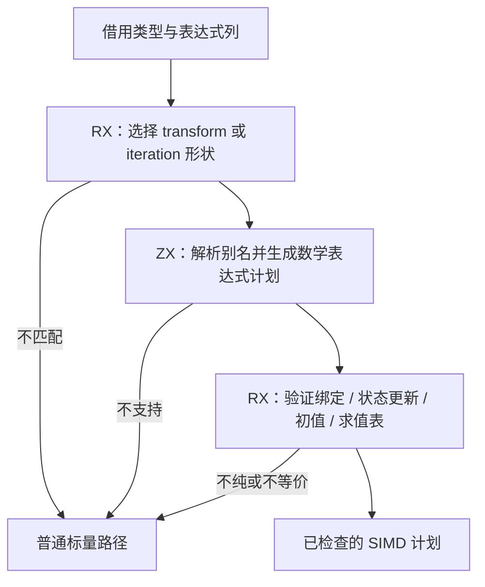

# SIMD 资格与表达式计划自举

## Intent：最终目标

将正式 SIMD 路径的 transform/iteration 形状识别、别名解析、数学表达式资格、
循环绑定与状态更新纯度检查迁入 RX/ZX。输出后序表达式计划，原生只按计划构造
结构化 Zig AST，保留向量分块、尾部与标量 fallback。阶段完成后提交推送 master。

## Data：可用证据

起点 276ea85b。simd/root.zig、iteration.zig、iteration_proof.zig 与 expression.zig
包含正式原生规则；iteration_consumer 在缓存检查后尝试 SIMD，未选择时继续通用
循环路径。已有 test-simd-semantics 覆盖浮点运算、尾部、fallback 和 WASM。
上一阶段 capability 原生实现的内部调用已全部在 seed，不能靠整理它们制造迁移进展。

## Edges：边界与限制

- 保留 f32/f64 同型映射、无 initial 的 map，及 precondition loop 的完整状态模式。
- 条件、源/索引/输出字段互异、零起点、u64 索引、空输出、push 参数数量、单位步长、
  其他状态不变、绑定纯度与求值表一一对应都必须保留；不可为扩大 SIMD 命中率放宽。
- 别名查找按绑定前缀逆序，匹配后继续只看更早的前缀，不把后续绑定引入作用域。
- 上游仍是合法 IR，保持该信任边界；不把编译器自身状态藏进标准库或新增专用原生桥。
- 原生输入只借用列。临时计划由 scratch 管理，发射期间存活，不能把指针泄漏到输出。
- 不新增测试，复用现有 SIMD/目标检查与冻结输入；先实现再按成本证据优化。

## Answer：交付与成功标准

交付 RX 选择与验证阶段、ZX 规则及后序计划、仅负责 AST 构造的原生适配和隔离 seed。
三阶段自编译、完整冻结产物、已有 SIMD 行为通过；无稳定 CPU/内存/生成成本退化。
保留原始证据、观测限制和自我复核，不以单个入口变成 RX 宣称整个 SIMD 发射自举。

## 已实现的职责边界

select.rx 根据 consumer 选择 transform 或 iteration 形状；analyze.rx 明确组织形状
检查、表达式计划、循环安全验证及短路。iteration/verify.rx 顺序组织绑定纯度、状态
更新、初值与求值表检查。ZX 内保留各项模式识别与集合遍历，没有把流程藏入一个
总控函数。iteration/select.zx 为 248 行，是单一循环形状识别职责；将行数作为评审
信号，保留该内聚模式，不机械切成转发文件。

expression/resolve.zx 保留 binding 前缀倒序规则；classify.zx 统一判断相同 TypeId、
元素、数值字面量和四种算术。plan.zx 按左/右/父顺序构造 Node 后序数组，保留原始
literal ExprId、操作数顺序与 uses_element；supported 和 passive 分别用于全部绑定
的验证，不能只验证最终 callback。没有重结合、折叠或扩大支持的运算集合。

原生 analysis 桥只借用输入列。计划及验证状态位于独立 scratch arena，在向量块和
尾部 AST 构造期间存活；AST 只保留节点及原始 literal 生成结果，不保存计划引用。
expression.zig 不再解析别名或判断元素，而是按计划节点构造 AST。原始向量宽度、
分块、尾部循环与一次 source 求值保持不变。Transform 仍 wrap(..., false)，iteration
仍返回原有裸结果。旧规则及旧 emitter 一并归入 seed，只在 generated_analysis=false
使用；正式 native 路径中已无 Context.resolve、supported、usesElement 或原生 proof。

## 阶段与行为验收

修正了一处 Zig error-union 到 optional payload 的返回转换，显式 try 后再返回。
没有放宽错误集合、类型检查或资格条件。build-stage1-result.log：41/41 构建步骤，
372/372 既有检查通过。stage2、stage3 各 16/16 步成功；stage-fixed-point.json
中 1658/1658 约定产物字节相同，仅排除工具身份 .zxc-inputs。

实际 CLI 生成既有 f32、f64、fallback 三个夹具，迁移前后 .zig 逐字相同，各为
45676、45676、57682 字节，原始证据 fixtures-before/fixtures-after 与
simd-source-comparison.json。输入路径相同、禁用生成缓存，避免缓存替代新规则。

现有 SIMD 目标驱动在 safe 模式完整通过 378 个外层调用案例：Node f32/f64 特殊
浮点与尾部各 84 项，WASM baseline 与 simd128 各类型各 42 项，42 项整数/filter/
reduce/嵌套回退；覆盖输入不变、负零、NaN/Infinity、分组舍入及汇编向量要求。
记录 simd-semantics-safe.log；未新增、修改测试或断言。

首次以 small 模式运行该既有驱动时，84 个 Node 案例通过后在 WASM 的 program.zig
调试位置断言失败。旧 CLI 在同一模式精确复现；small 产物只有无编号的 .file root，
但包含正常标量和 f32x4.mul 指令。safe 产物保留带编号的 .file/.loc，所以按既有
调试位置检查所需的模式执行完整验收。行为验收模式与性能 ReleaseSmall 不混为一谈，
没有改编译参数制造性能收益，也没有删除源码归属或汇编断言。

根目录 dist 26/26 步成功，正式 zig-out/bin/zxc 已更新，记录 install.log。
原始证据目录统一为 /tmp/zxc-simd-plan。

## 固定输入成本与缓存

性能测试前后核对冻结源码 digest；使用相同工具链、target、ReleaseSmall、resident=0，
五对交替冷/热样本。所有构建及目标检查终止后才运行测量，没有同时运行另一组生成。
performance/summary.json、原始 JSON 与分层日志保留全部样本，未重测同版本挑结果。

编译器冻结输入：冷墙钟中位数 697.882→704.970 ms（+1.02%），热
537.469→536.123 ms；CPU 冷 3.28→3.28 s、热 2.23→2.23 s。峰值 RSS 冷
360.188→363.781 MiB、热 326.453→326.313 MiB；冷 RSS 两组范围分别
353.391–365.469 与 354.344–364.688 MiB，不能仅凭中位数声称内存改善。
infer 冷 362→363 ms、热 361→362 ms；emit 冷 203→204 ms、热 100→100 ms；
write 冷 38→41 ms、热 39→38 ms。十对 1574/1574 约定文件逐字一致，仅排除
工具身份 .zxc-inputs；all-output-comparisons.json 包含所有对照。

另冻结已有 f32/f64/fallback 三个真实夹具，覆盖实际 SIMD 命中路径，不人为复制
入口扩大负载。五对冷墙钟中位数 9.648→9.625 ms，热 8.651→8.804 ms；冷 RSS
15.719→15.703 MiB、热 12.969→13.031 MiB。此规模 CPU 时间低于采样分辨率，
不把报告中的 0 秒解释为没有计算。十对产物各 12/12 相同，仅排除工具身份；
原始证据 positive/performance，未借用 compiler 大输入的结论代替 SIMD 命中检查。

七项缓存检查全部通过：磁盘热缓存、常驻初次/重复、合法语义编辑对照干净生成、
恢复、增加公开 ZX 根对照干净生成、移除根恢复；全部保留 1575 文件，不作排除。
cache-checks/summary.json 保留对照。format --check 的 21 个新 RX/ZX 全部通过。

## 自我批判与后续边界

迁移新增显式后序计划和编译期临时数组，不能以零运行时笼统声称编译器零成本。
真实 SIMD 夹具的冷生成、CPU/RSS 和完整产物没有显示稳定退化；大输入冷墙钟增加
1.02%、emit 增加 1 ms 的观测保留，主要可见差异还包括未修改的文件写出波动。
不把产物相同替代成本判断，不改变并行度、优化模式或输出边界换取漂亮数字。
后续如果计划构造成为可复现热点，应在当前 RX/ZX 实现内消除重复状态或分配。

源码逐项复核涵盖别名前缀、直接模式、全部 binding、状态和 evaluation、安全回退、
操作数与 literal 顺序、wrap 区别及 scratch 生命周期。现有目标夹具未专门枚举绑定
前缀或 evaluation 重排，所以不能只凭 378 项通过宣称一般形式证明；规则等价审查
和真实生成产物对照一起构成本阶段证据。没有按文件名、数值或测试输入加分支。

本阶段完整迁移 SIMD 的资格与计划规则，原生仍构造向量/尾部 AST 并负责模块与
内存适配，其他发射器及 compiler 状态模型也仍待迁移。全局自举目标保持 active，
不能因这项完整职责完成宣称整个 SIMD 发射或整个编译器自举完成。
