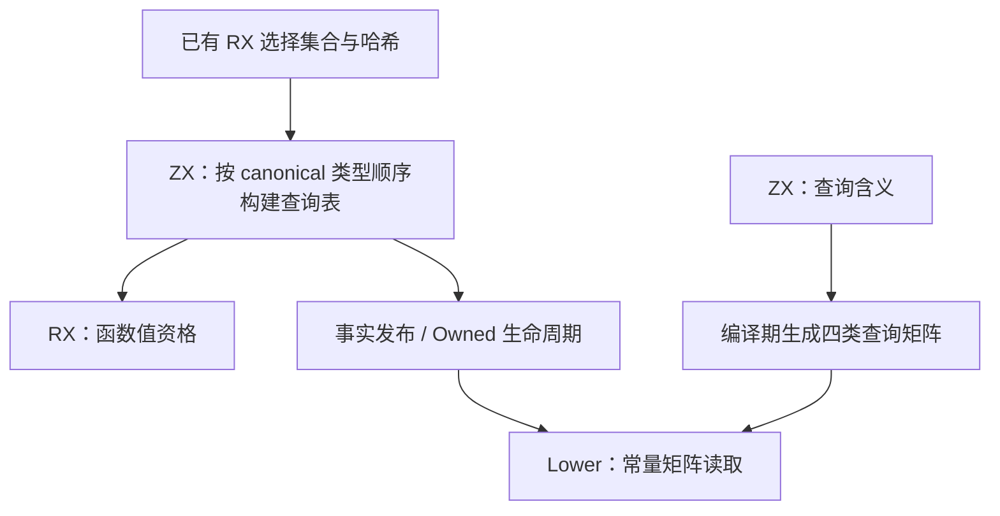
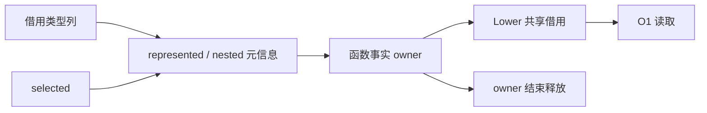

# 值布局查询自举

## Intent：最终目标

迁移正式发射路径中 represented 与 nested 两项值布局查询。复用已有 state/select.rx 的
选中集合与哈希；RX 显式接入查询表构建，ZX 一次计算每种类型的两项事实，发射只查表。
保持可空层级、只读/装箱记录、列表、原生边界和函数资格的既有语义。

## Data：可用证据

基线 6f531731，工具 /tmp/zxc-entry-sharing/stage3/bin/zxc-bootstrap。
沿 function_analysis.remaining 核对后，选择集合、重复/冻结传播和哈希已走 RX/ZX；
正式函数事实不调用 state_value/analysis.create；该旧构造器仍供 seed 与直接分析接口使用。
真正仍在正式路径的手写规则是 represented 的
optional 递归，以及 nested 对 optional、object、tuple 的子项扫描。
现有 types/layout 已采用 canonical 类型顺序预计算，layout/query 通过 ZX 生成编译期
查询矩阵，可直接复用此模式；不重复已有选择算法。

## Edges：边界与限制

- 输入沿用已有 canonical 类型顺序；不新增验证放宽或业务用例硬编码。
- selected 与 keys 不变；新增每类型查询元信息，查询不分配、不扫描、不复制类型表。
- 查询表与其他函数事实拥有同一生命周期，Owned 复制与错误清理须联动。
- 原生适配只发布枚举表与编译期查询矩阵；旧递归仅在初始 seed 配置中执行。
- 不新增测试，用现有布局、value/native 边界、缓存、OOM 和阶段自编译验收。
- 仅测受影响的生成路径。已有 RSS 波动证据复用，不追逐单轮或小样本中位差。
- 底层 IR 状态、选择结果发布容器及结构化 lowering 仍为过渡依赖，不宣称完整自举。

## Answer：交付与成功标准

交付 ZX 查询表/规则、RX 阶段接线、正式读取与所有权清理；固定最终输入的新旧生成
产物应相同，相关既有检查通过，三轮自编译稳定；受影响路径无稳定性能退化。
完成后英文规范提交并推送 master。

## 实现与所有权核对

新增 state/queries/build.zx 一次推导每个类型的 Represented / Nested 元信息；read.zx
定义四类元信息的解释规则。facts/analyze.rx 在选择之后、函数值资格之前显式接入；
value/summary 也复用该表，不再重复解开 optional。类型次序与已有 types/layout 相同，
semantic/types/validation/children 明确要求 object/tuple 子类型编号早于其 owner。

原生读接口只通过 ZX 在编译期构造的 4×2 常量矩阵查询。正式路径不调用旧递归与
字段扫描；初始 seed 保留它们。函数事实发布与 Owned 复制同时带上查询表；不拷贝
类型或表达式列。直接 Native Summary 接口仍被既有检查调用，其构造器通过同一 ZX
构建规则补齐查询表并拥有返回数组，错误清理和释放点同步更新。

第一轮原先因嵌套 loop 捕获外部 product 被拒绝，已将该值放入 loop 显式状态；不改动
语言的闭包边界。最终第一轮 bootstrap 16/16 通过，等待后续阶段与受影响检查。

## 最终验收证据

证据目录 /tmp/zxc-state-queries；基线工具来自 6f531731。

- Small 的 native-value-boundary、field-facts、module-generation 为 87/87 步，
  构建器内 85/85 项通过；16 组外部 Zig 检查合计 104 项通过，总计 189 项。
  包含可空/object/tuple、装箱、原生输入、source/library、缓存恢复和分配失败。
- stage1/2/3 均为 16/16，三个二进制一致：
  190997e74f6b1de8184fbd2b8d8b710a4365d4e44637ba9407d0ad06882a8f91。
- 同一最终输入下，新旧工具共 1826 个文件，仅 .zxc-inputs 的工具身份不同；
  所有 1825 个生成文件一致。stage2/3 连身份 marker 在内全部 1826 个文件一致。
- 已取得的有效行为证据不为格式调整或同一二进制重复执行。

7 对交替顺序成本测量无其他构建并发，固定同一最终 manifest、源码、SDK 与工具链；
每次冷生成使用独立空缓存，暖态复用对应缓存/输出，输入摘要前后不变。

| 指标                  |      6f531731 |          本次 |
| --------------------- | ------------: | ------------: |
| 冷生成墙钟中位数      |    849.311 ms |    843.442 ms |
| 冷生成 CPU 中位数     |        3.87 s |        3.87 s |
| 冷生成峰值 RSS 中位数 | 418,578,432 B | 418,463,744 B |
| 暖态墙钟中位数        |    558.248 ms |    557.804 ms |
| 暖态峰值 RSS          |   2,375,680 B |   2,392,064 B |

冷生成时间和 CPU 基本持平，RSS 差值落在已确认的基线波动内；不把微小中位差说成
确定的内存收益。暖态固定多一页 16 KiB，仍为未消除的性能限制；不宣称所有指标均无
退化。自举输入的生成源码不变，因此复用已有运行证据，不重复计时同一产物。

## 自我复核与后续边界

本次移除的是正式路径的两项手写查询规则，选中集合/哈希本就由 RX/ZX 完成；没有
重复实现已有算法，也没有把 seed 构造器误当成正式迁移成果。数组查询状态来自 ZX，
语义矩阵也由 ZX 在编译期生成；原生只做输入借用、所有权发布与索引。

直接 Native Summary API 及初始 seed 仍含旧选择逻辑，底层 IR、事实 owner 和降低器
仍有原生依赖，完整自举未完成。既有 Safe Zig 编译崩溃并未在本次重新调查；Small
成功不能作为 Safe 已恢复的证据。固定 RSS 增量与后续真正的规则/状态迁移继续跟进。

最终数据流复核发现直接构造器原先在填充 selected 前调用查询构建，已调整到完整初始化
之后；keys 因而跨越新增的可失败调用，补充 errdefer 释放。此前通过的主路径事实来自
RX，不受此顺序影响；直接接口的资源检查需按修正后的源码补跑，不能拿先前的通过
结果覆盖这个问题。

修正后直接接口补跑 native-value-boundary：36/36 步、35/35 项通过，包含完整分配失败
检查。最终源码重建 bootstrap-stage 为 16/16，二进制 SHA 与上述三轮完全一致；正式
二进制不包含该直接接口构造路径，因而复用同字节工具的阶段、产物及成本证据，不再
机械重跑。整体 189 项作为行为覆盖数，不将这次重复的 35 项累加为新增覆盖。

最终 CLI Small dist 26/26。另以同一单入口 manifest，用真实基线工具与最终工具各自
生成既有 stack fixture：共 7 个文件，除工具身份 marker 外全部逐字节一致
（stack-equivalence.json）；不以手工替换或推算的源码冒充基线产物，不重复计时同一产物。
