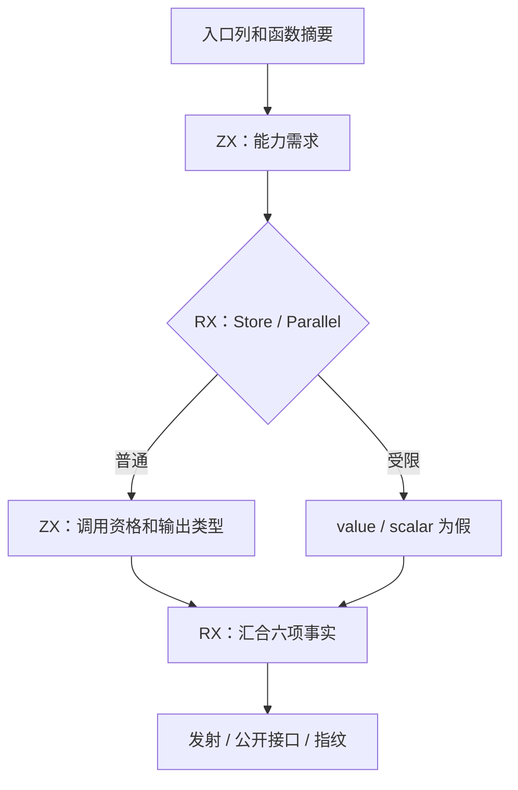
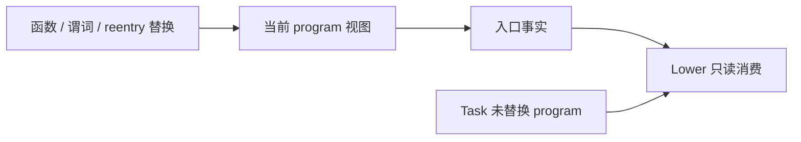

# 入口资格与执行能力判定自举

## Intent：最终目标

将生成器入口的 value、scalar-locals、task allocator、IO、process 和 body-only process
六项判定迁入 RX/ZX。发射与缓存指纹共享同一事实，替换上下文时刷新，保持原 ABI、
契约、Task/Store 边界与生成产物；成本无退化后提交推送 master。

## Data：可用证据

起点 2e37520f。旧规则分散在 value_call/analysis、tasks/allocator、io、capabilities。
正式消费者包括 Analysis/public library 元信息、Lower、函数变体、static_list、Task 和
fingerprint。已有 calls/body、calls/expressions、capability/uses、control/parallel 可复用。
原生判定扫描整份 expression table，不按可达性缩小。scalar 仅解开 optional 后接受
scalar/enum/error_set，不能误用允许 NativeReference 的 primitive 判断。

只读审查确认三处 Lower 替换上下文必须刷新：functions/emit、modules/functionPrepared、
contracts/preconditions。Task worker 没有修改 program，应保留父上下文判定。Analysis
reentry 的提前返回也必须覆盖刷新。任务分配器只看 body，IO/process 看 contracts 调用，
body-only process 专门保持 Task.start 的原参数边界。

## Edges：边界与限制

- RX 显示 Store/并行短路和结果汇合；ZX 保留谓词与内聚扫描，不新增专用运行库。
- 输入列借用，最终只返回六个 bool。分析生命周期与发射上下文分开，避免每个表达式
  重算整个入口，也不为缓存无关上下文改变增加共享可变状态。
- 旧规则仅留 seed；原生适配和存储容器是过渡依赖，不宣称整个生成器完成自举。
- 不新增仓库用例。复用现有行为、缓存编辑恢复、全产物差分与阶段自编译证据。
- 基线工具在 /tmp/zxc-entry-flags；性能输入继续用已核对摘要的固定快照。

## Answer：交付与成功标准

交付完整 RX/ZX 入口事实、上下文刷新与统一消费者；固定输入新旧产物完全相同，
阶段产物一致，相关现有检查通过，无稳定成本退化。英文规范提交并推送既有 master。

## 接线与所有权

新 entry/analyze.rx 保留 Store 与 Parallel 的真实短路，调用 effects、eligibility、scalar
三个原子职责。输入使用现有 core 列模型，复用 calls/body、calls/expressions、
capability/uses 与 control/parallel；不复制类型或表达式表，也不引入运行库。
原生桥借用列，独立 scratch 内执行生成函数，最终只复制六个 bool。

Analysis 在函数摘要就绪后计算入口事实，Owned 按值保留；reentry 在任何提前返回前
刷新。Lower 初始化继承事实，函数体和契约谓词替换后刷新；Task worker 不改变
program，继续继承父视图。发射、公开 value/allocator 接口和 v52 缓存指纹消费同值。

只读审查还发现 Store 与 Gateway 的正式宿主路径重算 IO/process。现在普通 Bundle
和 PublicModule 持有生成时已取得的两项 requirements，宿主直接消费；不保留 Analysis
借用，也不新增全分析。可选字段的 null 明确表示未提供事实，消费时返回既有错误，
不把未知默认成 false。没有 IR 入口的 Gateway host bundle 保持未提供状态。

本阶段范围是入口六项规则及其正式消费者。names 创建函数身份时仍可调用原生函数
摘要，inline seed 也保留旧纯度摘要；这些是既有过渡依赖，不能描述为全部 seed-only。
后续仍需迁移宿主状态与身份装配，完整自举目标尚未达成。

## 阶段构建

第一阶段 bootstrap-stage 与既有编译器回归成功，build-stage1.log；第二阶段
16/16 步成功，build-stage2.log。第三阶段也已覆盖宿主 requirements 复用后的
编译器回归并通过。所有临时报告均位于 /tmp/zxc-entry-flags，不提交日志或快照。

## 固定输入与缓存证据

最终第三阶段 23/23 步、372/372 编译器检查通过，build-stage3.log。
第二／三阶段排除工具身份 .zxc-inputs 后 1611/1611 产物一致，stage-comparison.json。
五对固定输入的全部产物逐一比较，新旧各 1574/1574 一致，仅排除工具身份；同工具
冷／热每对 1575/1575 一致，不排除文件，all-output-comparisons.json。

七组缓存检查通过：磁盘热缓存、常驻初次／复用、语义编辑与干净生成对照、恢复、
新增真实 ZX 公开根与干净生成对照、移除根并恢复。cache-checks/summary.json 保留
逐项报告；冻结源码摘要在测量前后及恢复后核对。

五组交替测量 performance/summary.json，resident=0、同输入、同工具链和优化模式，
计时期间没有其他构建。冷／热墙钟中位数 707.642→704.773 ms、543.912→541.504 ms；
CPU 3.27→3.28 s、2.23→2.23 s；峰值 RSS 362.891→363.500 MiB、
326.375→326.422 MiB。冷 CPU 差值为计时粒度，RSS 差值落在原始样本波动内。

infer 中位数冷 367→368 ms、热 368→368 ms；emit 冷 204→204 ms、热 101→99 ms；
write 冷 37→38 ms、热 40→38 ms。没有稳定退化，也不将这组毫秒差值宣称为提速。
没有为取得更好的数字重复测量、修改并行度或扩大排除范围。

## 既有测试的失效边界

现有 test-function-analysis 仍引用 HEAD 已不存在的
function_analysis/lanes.zig 和 buffer_call/analysis/flow.zig，六个编译目标无法加载。
同一套 fixture 还期待已删除的 buffers/transfers/allocated 字段及旧 analyze 签名。
这些文件不在本次 diff 中；不能恢复旧架构或删除断言来制造通过。

现有 test-aggregate-loop 的六个生成目标仍要求 execute 包装器直接持有
.ArrayList(state_type_) 及旧 ensureTotalCapacity 填充形态，因
InvalidValueBufferCount 停在形态门禁，未执行其依赖运行目标。这对应此前已记录的
旧形态门禁问题，不能计作行为通过。另用仍有效的对象归约及 loop call-origins
现有检查覆盖本次 scalar/value 路径，不新增用例、不放宽门禁。

## 最终行为验收与自我批判

- test-rx-parallel（源码、库、导入）、test-rx-task-output 和 test-gateway 成功；
  合并命令的实际 Zig 检查 1035/1035 通过，Task CLI 32/32，Gateway CLI 86/86。
- 合并构建整体为 1266/1336 步，13 个目标失败，不能报告为全绿。其中 6 个为旧
  function-analysis 引用缺失，6 个为旧 aggregate-loop 形态门禁；其余为 Process
  service.rx 输入无法推导，发生在发射之前。Process 前 36 项成功后停止，后续
  service/state 项没有执行。
- 使用修改前 before-cli 与最终 CLI 对同一真实 service.rx 单独重放，两者均以
  相同 type_mismatch 失败；process-service-comparison.json 保留完整结果。
  该既有推导问题仍待后续处理，不能把未执行的用例算作通过。
- 仍有效的 test-loop-call-origins 与 test-object-reduce 为 191/191 步、318/318
  Zig 检查通过，对象归约 CLI 两组也通过；loop-acceptance.log。没有新增用例。
- 所有新增 RX/ZX 通过 fmt --check，均在 90 列内且未超过 120 行。
- 根目录 dist 26/26 步成功，正式 zig-out/bin/zxc 已更新，install.log。

自我批判：仅替换 Lower 内查询会遗漏宿主的相同规则，已通过持有两项能力事实消除
这条正式重复路径。生成与缓存完全一致不能证明所有外部行为，因此补充了现有并行、
Task、Gateway 和循环行为验证。扩大验证又暴露历史失效门禁和前端推导失败，已区分
静态门禁、实际行为通过与未执行部分；没有通过恢复旧架构或放宽断言掩盖问题。

本次完成入口六项语义及其正式消费路径的 RX/ZX 实现；native 仍承担列桥接、
生命周期及事实容器，名字和状态模型也有既有过渡依赖。整体自举仍继续，未宣称完成。
本阶段提交推送既有 master，提交信息使用英文，不创建分支。
