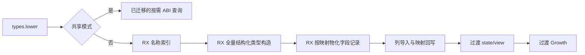
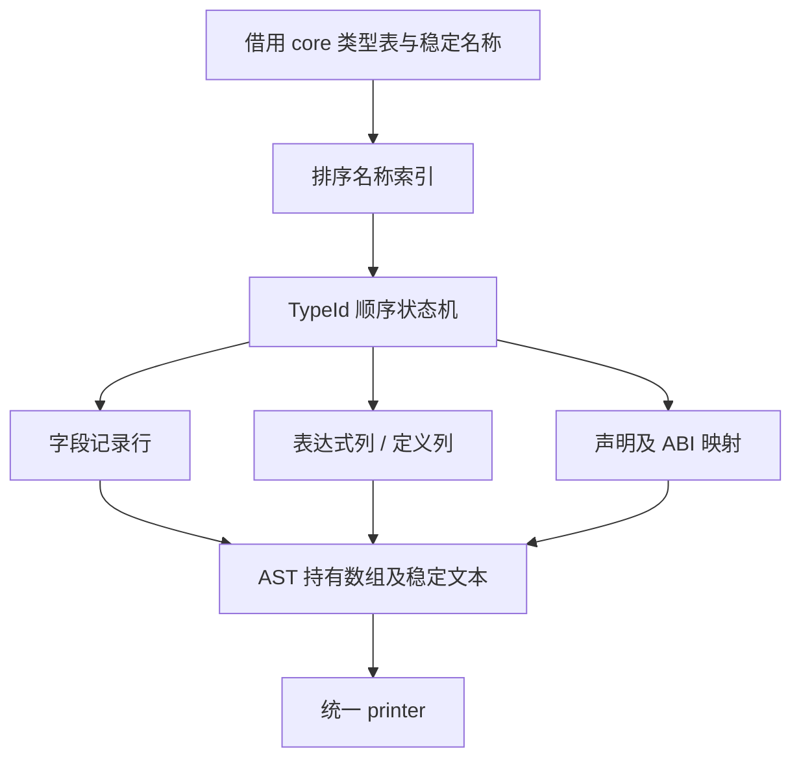

# 全量 ABI 类型构造自举

## Intent：最终目标

将 types.lower 中普通 ABI 类型定义、聚合成员、同名声明去重与类型/布局映射迁入
RX/ZX。维持共享 ABI 按需查询的独立模型和缓存，不把本阶段称为完整类型自举。

## Data：可用证据

既有语义验证要求类型依赖先于使用者。全量 lower 依次构造每个类型，同名类型只
去重声明，所有类型仍有自己的 AST 与映射。native reference 为 opaque，enum
保持值 ABI，其余命名聚合使用 const pointer。字段存储使用独立 AST 基址。

## Edges：边界与限制

- RX 连接名称索引、顺序类型构造及字段物化；ZX 保留各阶段的内聚算法。
- state/view、Growth、Lower 与 AST 持有状态仍为过渡原生实现。
- 初始 seed 保留旧规则；正式入口以编译期开关选择 RX/ZX 构造。
- 使用结构化 AST 列，不输出 Zig 源码片段，不增加运行库。
- 普通 ABI 返回全量映射，宿主回写既有数组；不得替换其身份。
- 命名去重使用排序和二分查找，避免每个类型扫描全部声明。无显式名称时，
  zx_type_<TypeId> 天然唯一，不创建无用名称索引。
- 类型阶段累计字段范围，字段阶段按对象顺序产出记录行；成员引用已完成的
  ABI 映射。tuple 成员为独立短数组，不复制名字字节。
- 不新增测试，复用现有原生 ABI、库发布、任务和分配失败检查。

## Answer：交付格式与成功标准

交付完整普通 ABI 构造及过渡表示适配，集中验证阶段自编译、相关行为和受影响
路径性能；每阶段英文提交并推送。只有产物一致不能证明整个编译器完成自举。

## 实现与所有权

全量模型复用共享构造的表达式类型，只增加定义列；通用 join 只合并列描述符，
不复制 AST 数据，也不扩大按需查询模型。名称查找移动至 names 职责下，通过
既有 bytes.lessThan 执行字节序比较。构造循环中独立列更新合并为一次状态更新。

所有名字内容仍由 ZX 决定；宿主不进行类别判断或声明去重。正常稳定名字借用
原 IR；无显式名字时，表达式和声明分别持有默认名字的副本。tuple 数组、enum
及 error 名字数组的外层结构由 AST 持有，不能借用短命 scratch。

字段阶段按每个 object 的原顺序生成 Field 记录，范围仍由类型阶段按同一顺序
累计；不会把类型表的全局字段起点误当成 AST 起点。多个 NativeReference 使用
独立 opaque 计数，void scalar 继续使用 Primitive。宿主先完成导入并回写原映射，
再执行原 state/view 和 Growth。

construct.zx 超过 120 行，是单一结构化类型构造算法的评审信号。没有为消除
lint 信号拆成重复转发、压缩格式，或把跨阶段调度藏回 ZX。

## 性能诊断

最初五对冷墙钟 720.035→710.346 ms、热 554.406→552.176 ms，但冷 CPU
3.31→3.33 s、退休指令约增 0.63%，因此没有按墙钟下降宣称已通过。字节比较
复用和字段循环分离之后，冷 CPU 增量仍存在；仅靠这些解释不足以定位主要成本。

改为记录行前，临时阶段计时确定冻结输入只执行一次全量普通 ABI：2827 个类型、7520 个字段。
新构造 2.742 ms、导入 0.085 ms、收尾 0.082 ms，旧 seed 同职责约 1.087 ms。
它不足以解释整轮 20～50 ms 的 CPU 增量。临时对照保留相同生成入口和模型，
只切换全量构造入口；所有探针和临时开关已移除。

生成源码对比发现更直接的证据：原来的 22 个 printer helper 发生布局变化，
Source 从只读 ABI 指针扩大为值对象，State、initialize 与 walk 随之变重。新增
字段列对象复用了 printer.Fields 的同构类型，触发了当前全局值布局选择的传递
扩张。共同的类型定义自身未变，不能据此排除新 value/view 布局的额外开销。

生成阶段改为输出字段记录行，宿主导入列；printer.Fields 继续作为只读列视图。
这对应生产记录与打印视图的实际职责，不加辅助标记来规避类型选择。全局值布局
对结构同构的成本耦合仍是编译器后续需要处理的限制，不能称本阶段已通用解决。

## 验收记录

最终 compiler 检查 23/23 步、372/372 项；原生 ABI/运行、库链接/打包及 Task
208/208 步、302/302 项，并通过八个既有 Node 库消费驱动。没有新增测试用例。
最终 stage 2/3 各 16/16 步，1742 个生成文件逐字节一致（仅排除 .zxc-inputs）；
两份二进制 SHA-256 也一致。该证据不代替自举边界审计。

最终 CLI dist 26/26 步。首次因下载官方 Zig 时 TLS 初始化失败而停止；改用已有
zig-archive 参数传入缓存官方压缩包，SHA-256 与 releases 清单完全一致，未修改
下载校验或生产实现。复用缓存后构建完成。

记录行方案还恢复了 22 个旧 printer helper 的逐字节一致性，8275 个共同类型
定义均相同；未见其余旧 helper 变重。

## 最终受影响路径性能

沿用冻结的 1653 个源文件、66 个入口，ReleaseSmall、resident=0。五对交替运行，
各有独立冷缓存后再测热轮；可执行文件、缓存与输出路径两侧等长。全部构建结束
后计时，执行前后核对输入摘要。不为选取更好数字重复运行同一源码。

| 五对中位数       |  修改前 |  修改后 |
| ---------------- | ------: | ------: |
| 冷墙钟 / ms      | 714.936 | 714.352 |
| 热墙钟 / ms      | 544.547 | 550.287 |
| 冷 CPU / s       |    3.30 |    3.30 |
| 热 CPU / s       |    2.24 |    2.23 |
| 冷峰值 RSS / MiB | 356.109 | 362.797 |
| 热峰值 RSS / MiB | 326.328 | 326.188 |

冷退休指令 45225453329→45309166311（约 +0.185%），热
31695166220→31700998861（约 +0.018%）；周期冷
13316670514→13322401790，热 9058081379→9050915901。

CPU 未见此前稳定的 20～50 ms 增量；冷墙钟持平，热墙钟约增 5.7 ms，但热
CPU 下降，不能把该墙钟差异直接归因于新增类型构造（既有 trace 已证实该冻结
场景热轮不执行新的 ABI 查询或构造）。本批冷 RSS 中位数增约 6.7 MiB，必须保留。
同一基线二进制在本轮四个有效批次、20 次既有冷样本中为 353.047～365.734 MiB、
中位数 363.750 MiB；最终新版本五次为 354.078～366.344 MiB、中位数 362.797 MiB。
这些分布没有显示超出既有波动的明显内存增长，但不能按本批结果宣称内存下降，
也不能把所有指标概括为提速或数学意义的严格零差异。

五对各 1574 个输出逐字节相同，仅跨版本排除 .zxc-inputs；各版本冷/热输出
包含输入指纹也全部一致。类型生成形态与既有行为保持。

证据在 `/tmp/zxc-full-abi/`：final-performance/{summary,counters,outputs}.json、
final-fixedpoint.json、old-helpers.json、rows.log、final-checks.log、
final-stage2.log、final-stage3.log、final-dist-local.log。中间批次及临时计时
日志同时保留，不提交缓存、日志或临时开关。

## 自我复核与后续边界

本阶段迁移普通 ABI 规则及成员数据，RX 真实连接三个有依赖的阶段。宿主保留
表示导入、内存持有及 Lower 映射适配；state/view、Growth 与 AST/Lower 状态尚未
完成自举。全局值布局的跨模块成本耦合仍需后续通用治理，本阶段没有以源码后缀、
阶段一致或局部成功冒充整个类型系统或编译器完成。
